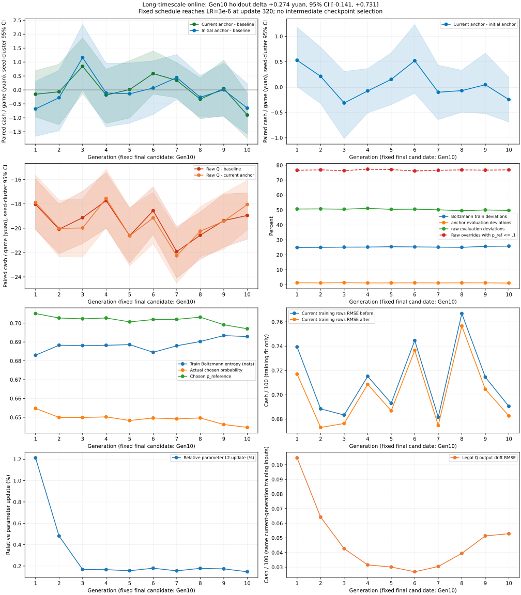
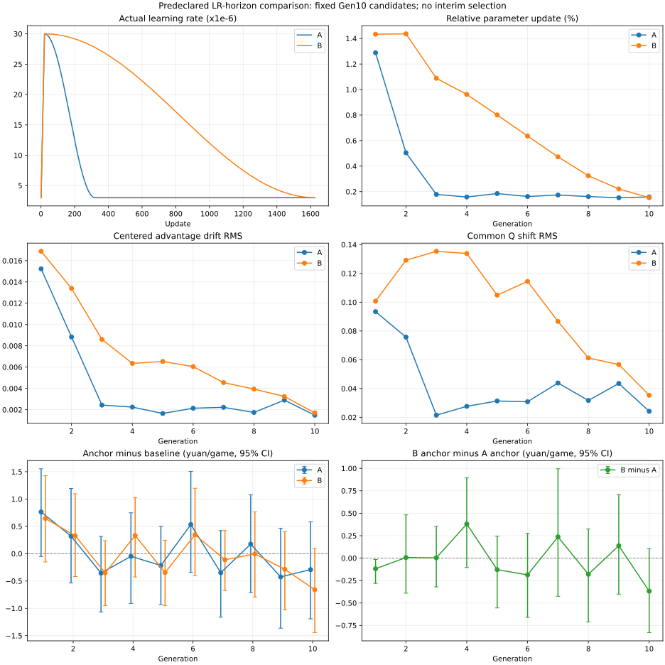
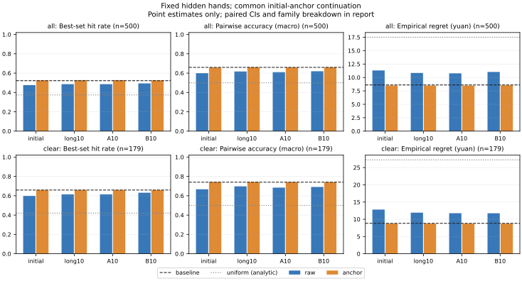

# Mortal-faithful-v1与历史现金Q实验

当前主线为 **Mortal-faithful-v1**：55×20可见Observation、1D ResNet +
Channel Attention、1024 latent、structured legal-action Dueling Q，默认
terminal现金MC + offline CQL；3-step SARSA仅为对照。support只作离线安全
评估/部署护栏，主算法结果必须同时报告raw Q。

原10k四组对照及后续离线诊断已完成。首轮MC-only online已停止并回退；最新第二轮
固定T=.5的anchored Boltzmann A/B也完成各3代：真实替代动作访问显著增加，
但三代B−A现金区间均包含0，未证明探索优于greedy；baseline未替换，不自动扩量。
pairwise/counterfactual训练停止扩展，trajectory／RouteQ／PPO和所有旧证据保留。
最新协议与结果见文末“第二轮online：anchored Boltzmann A/B”，旧阶段授权不自动延续。

## 官方实现调研与对应

参考2026-10-14读取的官方源码：
[model.py](https://github.com/Equim-chan/Mortal/blob/main/mortal/model.py)、
[train.py](https://github.com/Equim-chan/Mortal/blob/main/mortal/train.py)、
[dataloader.py](https://github.com/Equim-chan/Mortal/blob/main/mortal/dataloader.py)、
[player.py](https://github.com/Equim-chan/Mortal/blob/main/mortal/player.py)、
[engine.py](https://github.com/Equim-chan/Mortal/blob/main/mortal/engine.py)。
本项目独立实现训练思想，未复制或导入官方实现代码。

| 官方Mortal | ZiMortal第一版 |
| --- | --- |
| Brain：1D ResNet，通道注意力、BatchNorm、Mish，34牌位置、1024 latent | 既有ResidualBlock思路：GroupNorm／SiLU，20位置、55通道，small宽32、3块、256 latent；保留表示以隔离算法改变 |
| 固定动作DQN：V＋A−合法A均值 | encode_action结构化候选（包括完整chi／bi），状态＋动作MLP产生A，mask内均值；padding Q为负无穷 |
| gamma^steps_to_done × kyoku_reward；训练用0.5 MSE | gamma^剩余本家非强制决策数 × payments[seat]/100；用用户指定Huber，不裁剪回报 |
| 离线CQL：合法Q的logsumexp−chosen Q；正系数相加，在线关闭此项 | MC-only alpha=0与MC+CQL alpha=0.1对照；合法候选内计算，不加入PPO |
| 日麻牌谱loader、按玩家筛选、GRP计算跨局排名相关奖励 | 无高质量真人牌谱，以冻结强v0产生bootstrap完整局；单局真实现金，不复用日麻奖励或GRP |
| 冻结baseline，训练／测试OneVsThree | 一探索learner＋两冻结v0，三个座位与庄家独立交叉轮换 |
| Boltzmann epsilon在greedy／温度Q采样间切换，支持top-p | v0 policy logits温度采样T=1.5；top-p=1，无epsilon。可选epsilon明确为uniform混合，与官方语义不同 |
| 测试avg_rank／avg_pt优于旧best时保存；并无本项目所要求的bootstrap认证 | 后续晋级用独立现金、种子聚合区间与历史对手退步检查；不能宣称严格复制官方晋级公式 |

来源奖励、损失、探索和晋级均有明确适配差异，不能把Dueling结构相同说成
完全复刻Mortal训练效果。不能直接复用固定动作空间、日麻规则、四人竞技、
GRP、排名收益、oracle输入或日麻和牌保护规则。

## 模型与数据

`model.mortal_q.MortalQNet`不覆盖PolicyValueNet，独立随机初始化，
small默认width32／latent256／3块；可配置width64／latent512做后续base对照。
只接受55×20 Observation编码及结构化合法候选。没有路线／未来赢家组／
人工偏好输入，没有wait、huxi等辅助head；既有55通道中的公开胡息表示保持不变。
模型可经runtime.save_model/load_model原子保存／恢复结构与权重。

behavior固定为`data/generated/league-v2/stage-02/best-dev.pt`，称ZiMortal-v0。
只保存探索learner非强制决策；其他两人greedy，非法动作概率始终为0。
每个有效完整局保留seed、dealer、learner seat、完整历史与终局审计状态。
决策字段包括features、actions、chosen、terminal_cash、steps_to_terminal、
seed／seat／game_id、behavior_logprob、完整行为概率、parent_greedy、history_step、
动作族；policy version和checkpoint／源码哈希存manifest元数据。
折扣步数是之后本家自由决策数，不是摸牌／过牌等引擎总步数。

256完整局一shard（尾块232），features保持float32；动作通过offsets存ragged，
mask在batch时重建，只有实际候选为True。NPZ每成员一次读取后共享切片，避免
逐行重复解压。manifest带数据／重放SHA256，完整状态仅用于审计和标签。
训练／开发／检验按完整游戏seed%10切分为80%／10%／10%，没有同局状态跨集。
生成时逐step验证守恒，终局标准引擎完整重放；落盘后再次逐决策比较可见features、
legal actions、chosen、行为概率与现金标签。未知规则整局排除，保存错误和前缀，
独立新seed补足有效局，不伪造0回报；真实流局才为0。

## 有限实验与性能记录

```bash
ZIMORTAL_TRAINING_MODULE=zimortal.training.mortal_offline \
  bash scripts/train-online-rl-wsl.sh \
  --directory data/generated/mortal-v1 --games 1000 --device cuda \
  --temperature 1.5 --alpha-cql 0.1 --gamma 1 --epochs 8
```

两变体使用相同初始权重、数据、batch shuffle种子，AdamW lr3e-4、Huber、
梯度范数1；开发RMSE选型，锁定后才看留出回归／reranking。
恢复文件保存匹配optimizer、权重哈希与随机状态；本版入口只允许新目录，
不自动覆盖或续写已有数据。逐epoch结果只留本地。

采样32slots批量网络推理；CPU执行Python规则和独立重放，CUDA做网络与更新。
默认WSL上限8GiB、Swap1GiB、300%CPU、2线程；保存前保留2GiB磁盘空间。
profile分别计编码、网络、legal_actions、step、胡求解、吃枚举、重放时间；
计时为inclusive，有重叠，不能直接相加当流水线占比。
CPU为进程累计CPU秒／wall，100%对应一核；nvidia-smi每0.5秒采GPU／显存利用率，
若WSL未提供数值如实报告不可测。无CUDA不悄悄回退CPU。

本轮不进行实战晋级，回归或reranking变化不证明牌力提升。
结果完成后在本节追加实测参数量、有效决策、速度、探索、Q数值和loss。

## 后续门槛

先汇报1000局A/B/C后停止。确认无明显问题再做D：10k局回归与reranking；
E：50k局MC／CQL对照；F：开发集选择后独立3000种子×三座位实战，
按seed聚合现金差与近似区间，检查改变轨迹比例和各动作族。
有可靠现金改善才实施online：同代C/B/B，baseline固定，300开发、1000中期、
5000或更多正式晋级种子并检查历史对手；未通过不换baseline。
没有证据证明此主线一定强于PPO；也不能因本轮转向就宣称旧路线实验错误。

## A/B/C实际结果：1000局，已停止

实际服务`zimortal-online-rl-20261014-010052.service`退出成功、MainPID=0。
PyTorch2.7.1+cu128，RTX5080；249,922参数，small32／256／3块。
1000有效完整局，8381个探索learner决策，规则排除0。
训练800局6722决策、开发100局871决策、独立检验100局788决策。
四个shard为256／256／256／232局；哈希、守恒、完整重放及所有可见输入逐行核对通过。
权重与配对optimizer保存在本地`mortal-v1/mc`及`mortal-v1/mc-cql`，未更换baseline。
本批共享behavior版本由manifest中的固定v0 checkpoint路径与SHA256标识；
落盘字段后续已增加显式policy_version，未修改本批训练输入或现金标签。

T=1.5、epsilon0、top-p1：平均动作entropy0.406 nat，1209/8381（14.43%）
不同于v0 greedy。探索覆盖：

| 决策族 | 数量 | 非greedy数量／比例 |
| --- | ---: | --- |
| 弃牌 | 4047 | 741／18.31% |
| 吃／过 | 2087 | 409／19.60% |
| 碰／过 | 1973 | 59／2.99% |
| 胡／过 | 274 | 0／0% |

碰、胡决策仍很集中，温度1.5没有产生胡／过探索；这是后续需要诊断的覆盖限制，
不能把“有温度采样”当成所有关键决策已充分探索。

两组各8轮，MC训练2.36秒，MC+CQL训练1.96秒；训练MC loss分别从0.1796
降至0.0586／0.0623，没有NaN、非法Q或非有限梯度。两组开发RMSE均在第1轮最优，
后续训练loss继续下降但开发误差上升，提示小数据过拟合。以下是开发选定模型，
不是第8轮最后权重；Q、回报单位均为现金/100：

| 检验指标 | MC | MC+CQL（0.1） |
| --- | ---: | ---: |
| chosen-Q MAE | 0.4207 | 0.4208 |
| chosen-Q RMSE | 0.8579 | 0.8581 |
| correlation | 0.1144 | 0.1128 |
| 全合法Q范围 | −0.2397～0.2600 | −0.2505～0.2606 |
| 全合法Q均值／std | −0.0257／0.0865 | −0.0281／0.0870 |
| chosen target均值／std | −0.1525／0.8527 | −0.1525／0.8527 |
| 相对父greedy改变动作率 | 58.76% | 59.14% |

MC的检验reranking：弃牌326/398、吃过134/198、碰过3/163、胡过0/29；
CQL分别328/398、135/198、3/163、0/29。变化大不表示策略强；没做现金实战。
这些是同局多个相关决策的描述性回归指标，不将788决策视为788独立局。
辅助wait/huxi loss均0，辅助head未启用。CQL loss从约1.4203降至1.3643，
但留出回归没有证明CQL优于MC；训练稀疏现金的variance仍很大。

## 性能与局限

生成和写shard总21.35秒，46.83局/秒；纯模拟20.80秒，402.99探索决策/秒。
进程CPU平均约100.0%（一核），未持续耗满300%限制。计时：

| 项目 | 秒 |
| --- | ---: |
| Observation编码 | 7.47 |
| 网络batch推理及传输 | 3.32 |
| legal_actions（含内部调用） | 4.28 |
| step | 0.72 |
| 胡求解（与上层计时重叠） | 2.36 |
| 吃枚举（与上层计时重叠） | 0.97 |
| 生成期间完整终局重放 | 2.21 |
| 落盘后二次逐行审计，另计 | 9.95 |

本轮最大的采样单项是编码；独立审计也占明显时间。不能将inclusive计时相加。
GPU百分比在原实验中不可用：systemd PATH找不到nvidia-smi，错误原样保留。
随后修正为检测路径并回退`/usr/lib/wsl/lib/nvidia-smi`；仅使用已保存Q推理验证
采集可用（3%、3%、30%三次样本），没有生成新局或继续训练。
这三个数不代表原始1000局或训练阶段GPU利用率，不据此夸大硬件瓶颈判断。

完整测试333通过、1跳过，Ruff与diff检查通过。标准顺序曾触发磁盘保留线；
清理本次测试临时目录、无损重压旧归档并调整测试顺序后，全套通过。
2GiB保护线没有降低，旧实验没有删除；磁盘空间仍紧，扩大50k前需增加空间。

结论：独立Dueling Q流水线、真实终局标签和小CUDA训练可正常运行，
暂未证明强于PPO或baseline。主要差距是小数据过拟合、胡过／碰过探索不足、
chosen-Q与未尝试动作之间缺少可靠收益排序证据。按用户要求此处停止。
建议下一阶段先审查探索覆盖、按完整局衡量回报方差与编码profile，再经确认
做10k对照；50k与独立3000种子现金实战在后，online不提前实施。


## 10k探索与数据扩展实验（2026-10-14）

最新授权覆盖上文1000局后的停止边界。本轮仅做1500局探索pilot、独立10k
及离线MC／CQL诊断；不做实战、baseline替换、50k或online。
主网络保持width32／3块／256 latent、249,922参数，55×20输入没有变化。

探索只按合法动作族分类：弃牌与吃温度1.5，碰温度2.5；HU和PASS同时合法时
HU总概率98%、PASS总概率2%，如同类多个候选均分。此分支覆盖温度分布，
记录覆盖后的真实完整probability和logprob；不加入名堂潜力或路线人工规则。
所有候选来自合法列表，padding不会进入采样。配置存manifest和config。

pilot种子1010000000起，正式10k种子1020000000起；不复用v1或pilot训练输入。
learner独立轮换座位／庄家，两对手始终冻结v0 greedy。
基线SHA256：`9332fd07a09099dcdd38e180577a38887876c6aa2ee5ac1b8c896193c6ac1784`。

### Pilot检查

1500完整有效局、12526决策，整局规则排除0；全量深度审计通过。

| 动作族 | 决策数 | 非greedy数／比例 | chosen probability均值 | entropy nat | 父top1概率 | 第二名／长尾比例 |
| --- | ---: | --- | ---: | ---: | ---: | --- |
| 弃牌 | 5983 | 1105／18.47% | .7394 | .5308 | .8145 | 11.40%／7.07% |
| 吃／过 | 3302 | 665／20.14% | .7119 | .4898 | .7895 | 17.60%／2.54% |
| 碰／过 | 2858 | 230／8.05% | .8668 | .2350 | .9205 | 8.05%／0% |
| 胡／过 | 383 | 12／3.13% | .9499 | .0980 | .9800 | 3.13%／0% |

整体非greedy16.06%；rank按父logit稳定降序，长尾指rank>=3。
12个PASS的终局现金/100：mean−.1792、std.7233、中位0、p5−1.29、p95.345；
5个零回报，1个<=−1的大额负收益，没有>=1的大额正收益。
这是动作后实际现金分布，不是HU与PASS的因果优势；同局多个PASS也可能相关。
覆盖检查通过：碰偏离率5%～25%、弃牌／吃<=30%，胡过样本>0且<=5%。
该检查仅防止探索过量与无覆盖，不证明策略棋力或每一个吃碰的合理性。

### 审计、编码与训练口径

遵循Agent.md保留全量生成step.validate、四张守恒、合法动作和标准终局重放；
落盘后仍全量检查hash及所有游戏／决策的可见特征、合法候选、概率、现金和折扣步数。
没有缩小审计范围。生成成本和一次性落盘深度审计成本单列。

pilot使用cProfile，开销明显；其65.44秒生成时间不能与未开profile的v1或10k直接比较。
编码profile的累计时间：encode_observation9.286秒，_huxi_features6.179秒，
_meld_features1.551秒，_history_features1.391秒，encode_action1.659秒。
这些是profile下inclusive计时，存在重叠；完整报告留encoding-profile.txt。
已有有界缓存仍在使用，胡息特征需要多次计算不同弃牌后的formed_huxi。
本轮保留编码实现，以免把递归胡息语义修改混入数据量／探索实验；无旧新编码差异。
进一步优化需独立冷／热缓存profile和大量固定Observation逐元素回归。

MC与MC+CQL(.1)使用同一个随机初始化、seed1414、相同数据shuffle和batch顺序，
AdamW lr3e-4、batch256、Huber、gamma1、梯度裁剪1。最多20epoch，
dev chosen-Q RMSE选最佳，连续4轮未改善停止；共享训练轮次的batch顺序一致。
逐epoch记录MC／CQL loss、dev MAE／RMSE／correlation、Q与target分布及裁剪前梯度范数。
权重与配对optimizer／随机状态留本地。没有新增辅助head。

回归只比较chosen action与其真实终局回报。全合法Q范围、排序和margin仅为诊断，
不把未选动作赋同一个现金标签当“动作准确率”。校准按chosen预测稳定排序分五等份。
门控使用Q_best−Q_parent>threshold；仅在开发集检查0／.02／.05／.1／.2，
预设改动作预算<=10%，选最小满足阈值；若所有阈值超预算，保留.2并如实说明。
这不是校准置信度或现金选型；检验只计算开发选定的一个门控阈值。

可复现启动（新目录，不覆盖已有结果）：

```bash
ZIMORTAL_TRAINING_MODULE=zimortal.training.mortal_v2 \
  bash scripts/train-online-rl-wsl.sh --directory data/generated/mortal-v2 \
  --pilot-games 1500 --temperature-peng 2.5
```

正式结果与1000局对比将在下文记录。原始数据、逐epoch日志、权重和指标仅留本地。


### 10k实际结果与停止状态

服务`zimortal-online-rl-20261014-012950.service`成功退出，MainPID=0；
PyTorch2.7.1+cu128／RTX5080，未启动后续任务。基线SHA256再次核对未变。
10000有效完整局、83012个learner决策、规则排除0，40个shard；全量深度审计通过。
按完整游戏划分8000训练／1000开发／1000检验局；决策数66424／8214／8374。
其中21局在该learner出现自由决策前已结束，保留其完整重放和真实结算，但没有
可训练的动作行；有决策游戏数7982／999／998。不能为这些局补造动作行。
实验完成后纠正了汇总的全局数／有决策局数口径，未改数据、标签、权重或选型。
当前代码还补全了动作族温度CLI、审计阶段进度及无决策游戏的收益统计；
实际producer的源码哈希仍按原config／manifest保存，不覆写成事后源码哈希。

正式探索覆盖如下（chosen probability、entropy及rank均为行为分布统计）：

| 动作族 | 决策数 | 非greedy数／比例 | chosen概率 | entropy | 父top1概率 | 第二名／长尾比例 |
| --- | ---: | --- | ---: | ---: | ---: | --- |
| discard | 39681 | 7492／18.88% | 0.7360 | 0.5352 | 0.8129 | 11.70%／7.18% |
| chi/pass | 21440 | 4443／20.72% | 0.7113 | 0.4805 | 0.7937 | 18.08%／2.64% |
| peng/pass | 19468 | 1544／7.93% | 0.8698 | 0.2342 | 0.9203 | 7.93%／0.00% |
| hu/pass | 2423 | 49／2.02% | 0.9610 | 0.0980 | 0.9796 | 2.02%／0.00% |

整体非greedy16.30%。HU/PASS中48个PASS（1.98%），与49次非greedy不同：
有一次父greedy原本为PASS，探索选择HU。48次过胡后的现金/100均值.3594、
std1.2977、中位0、p5−.3、p95 3.5，19个零回报、7个>=1、1个<=−1。
少数大额回报会拉高均值，不能以此认定随机过胡赚钱或学会名堂规划。
pilot的12个PASS还逐例重放了当场HU的确定结算：按决策9次最终现金低于直接HU、
2次相同、1次高于；其中一局含两次PASS，共11个不同游戏。
详细种子／步号／直接HU现金留`pilot-hu-pass-audit.json`，不混入训练标签。

全10000局每局一次真实现金/100：mean−.046735、std.703068、中位−.1，
p5−.9、p95.8；流局零回报18.67%，>=1正收益3.92%，<=−1负收益4.89%。
这是固定父行为加探索的局分布，不能冒称新Q策略对战表现。
检验决策行会按局长重复现金：mean−.014109、std.687663、中位−.1，
p5−.9、p95 1.2；零回报21.11%，>=1正收益5.62%，<=−1负收益4.47%。
决策样本不是8374个独立牌局，长局权重和稀有大额回报均影响回归。

| 开发选定模型 | MC | MC+CQL .1 |
| --- | ---: | ---: |
| 最佳epoch | 2 | 2 |
| 实际epoch数 | 6 | 6 |
| dev mae | 0.3823 | 0.3862 |
| dev rmse | 0.7317 | 0.7323 |
| dev correlation | 0.2191 | 0.2207 |
| dev q_std | 0.1533 | 0.1640 |
| dev chosen_q_std | 0.1766 | 0.1856 |
| test mae | 0.3890 | 0.3921 |
| test rmse | 0.6816 | 0.6836 |
| test correlation | 0.1619 | 0.1630 |
| test q_std | 0.1477 | 0.1608 |
| test chosen_q_std | 0.1688 | 0.1785 |
| test全合法Q范围 | -0.7886～1.6572 | -1.0970～1.5454 |

两组都在第2轮最佳，连续4轮未改善，于第6轮停止；MC训练21.81秒、CQL21.73秒。
最佳权重与optimizer checkpoint SHA及epoch2匹配确认，两组初始回归完全一致。
MC loss从.16336降到.08378，CQL的MC loss从.16432降到.08566；
CQL penalty从1.39657降到1.37451。训练loss继续改善而开发RMSE上升，过拟合仍在。
裁剪前梯度范数均非NaN：MC各轮均值.186～.995，最高2.075；CQL均值.194～1.045，
最高1.991。完整逐epoch日志保存在各变体epochs.json。

检验Q校准：分桶从低到高，各1675决策、最后1674。

| 桶 | MC预测均值 | MC真实target均值 | CQL预测均值 | CQL真实target均值 |
| --- | ---: | ---: | ---: | ---: |
| 0～20% | -0.2340 | -0.0885 | -0.2731 | -0.0647 |
| 20～40% | -0.1283 | -0.0845 | -0.1551 | -0.1178 |
| 40～60% | -0.0630 | -0.0745 | -0.0831 | -0.0524 |
| 60～80% | 0.0093 | 0.0075 | -0.0079 | -0.0241 |
| 80～100% | 0.2089 | 0.1696 | 0.1943 | 0.1885 |

MC五桶真实均值单调，但最低桶预测明显过负；CQL第一、二桶反转。
两组开发桶都单调，检验上的校准和泛化弱于开发，不能只看开发结果。

检验分动作族回归，只评估chosen动作：

| 动作族 | 数量 | MC MAE／RMSE／corr | CQL MAE／RMSE／corr |
| --- | ---: | --- | --- |
| chi/pass | 2186 | 0.3128／0.5467／0.1096 | 0.3152／0.5491／0.1105 |
| discard | 3976 | 0.4074／0.6983／0.0907 | 0.4081／0.7030／0.0711 |
| hu/pass | 229 | 0.4545／0.8412／0.1358 | 0.4600／0.8321／0.1253 |
| peng/pass | 1983 | 0.4286／0.7568／0.0634 | 0.4369／0.7552／0.0828 |

碰／过相关性仅.063／.083，吃约.110，弃牌.091／.071；关键动作族仍未学稳。
全部HU/PASS检验229行也混有不同现金档位与少数PASS，不把该族相关性当动作优劣判断。

检验best−second margin（cash/100）：

| 模型 | 全部p25／中位／p75 | 改变状态p25／中位／p75 | 未改变状态p25／中位／p75 |
| --- | --- | --- | --- |
| mc | 0.00458／0.01303／0.03111 | 0.00170／0.00997／0.01467 | 0.01448／0.03276／0.04359 |
| mc-cql | 0.01181／0.04407／0.22228 | 0.00705／0.01853／0.04627 | 0.03669／0.17854／0.29226 |

CQL的margin更大、改动作更少，但这是正则化推动的数值／行为差异，尚不是
更可靠的反事实收益或更强棋力。MC改动作状态中位margin约1元，CQL约1.85元。

门控诊断：以下所有候选阈值仅看开发，不读取test现金挑阈值。

| threshold | MC dev改动作率 | CQL dev改动作率 |
| --- | ---: | ---: |
| 0 | 59.53% | 48.90% |
| 0.02 | 35.35% | 37.24% |
| 0.05 | 8.05% | 20.19% |
| 0.1 | 0.39% | 5.15% |
| 0.2 | 0.01% | 0.78% |

开发选定MC阈值.05（5元），检验仅报告该阈值：改动作7.33%，原始greedy59.59%。
CQL选定.1（10元），检验改动作5.05%，原始greedy47.97%。不部署门控或Q策略。
这些变化次数不代表收益优势；parent agreement和margin均没有未选动作现金真值。

### 1000局与10k比较及判断

| 指标 | 1000 MC／CQL | 10k MC／CQL |
| --- | --- | --- |
| learner决策 | 8381 | 83012 |
| 最佳epoch | 1／1 | 2／2 |
| test MAE | .4207／.4208 | .3890／.3921 |
| test RMSE | .8579／.8581 | .6816／.6836 |
| test correlation | .1144／.1128 | .1619／.1630 |
| test target std | .8527 | .6877 |
| test全合法Q std | .0865／.0870 | .1477／.1608 |
| test greedy改动作率 | 58.76%／59.14% | 59.59%／47.97% |
| peng行为偏离greedy | 2.99% | 7.93% |
| HU/PASS行为覆盖 | 0个PASS | 48个PASS |

数据量、探索分布和牌局种子同时变化，本实验不能因果分离三者。
RMSE下降部分来自检验现金std下降，不能将全部下降归功于模型。
RMSE/target std：1000约1.006／1.006，10k约.991／.994，标准化改善仍小。
Q是条件均值的估计，合理的Q std本就应小于带随机结局噪声的target std，
不能强行把Q方差拉到target方差当学习成功。Huber在大额尾部也会弱化平方损失的
均值拟合语义，本轮按要求保持Huber，尚不能宣称学到精确最终净收益EV。

有积极信号：校准MC五桶单调、dev corr>.2、best从1到2、关键探索增加；
但test仍仅约.162、各关键族低相关、第3轮起仍过拟合、未选动作无反事实真值。
因此结论是“小数据及覆盖不足解释了部分不稳定，扩大10倍没有解决Q可靠排序”。
**目前不建议直接50k。** 未做实战，baseline与网页策略保持原样。

下一步优先对现有10k做按完整游戏的回报噪声、局长权重和早／晚局分层分析，
检查48个PASS及碰过的有效覆盖，再设计独立MC versus n-step/TD目标对照；
另外可单独比较Huber与真实均值目标的尾部偏差。先形成明确实验方案再经用户授权执行。
本轮停止，不自动进行这些实验，不自动F阶段现金对战或online。

### 10k性能和验证

生成及落盘231.94秒，43.12局/秒；纯模拟225.96秒，367.38决策/秒。
落盘后全量深度审计111.63秒单列。CPU均值100.10%（一核），并非CPUQuota300%耗满。
inclusive计时：编码82.75秒、网络33.47秒、legal46.62秒、step7.32秒、
胡求解25.30秒、吃枚举12.32秒、生成期间完整重放25.73秒；存在重叠。
每1000局编码约8.27秒（v1为7.47），没有编码优化速度提升；更多唯一状态、
探索路径和测量波动会影响缓存，不能仅凭此对比归因。
GPU实际样本：pilot147次平均3.22%峰8%，data614次平均3.06%峰10%，
training103次平均13%峰25%。data阶段包括独立CPU审计；低利用率来自小网络和CPU模拟，
不能通过增大显存或换服务器直接解决统计目标和覆盖问题。
2GiB磁盘保护线保留；Git对象无损压缩释放约10MiB，未清除历史或reflog。
旧实验全部保留，当前空间仍紧；进一步扩容前须增加磁盘空间。

验证：全套336通过、1跳过；动作族采样、低概率HU/PASS、合法mask、固定随机种子、
早停、margin、严格大于阈值门控、完整游戏隔离、合法CQL范围均覆盖。
Ruff与diff检查通过，真实CUDA双变体训练成功，全部10k重放审计通过。

最终复测曾因测试临时文件累积越过2GiB线而出现7个保护性写入失败（不是规则或训练数值失败）。
仅清理测试临时目录不足以消除风险；将已暂停branch-teacher-v1的77,600,934字节记录
无损归档为2,669,020字节，逐原文件SHA256全部核对，索引和恢复命令留
`data/generated/archived-active/branch-teacher-v1.manifest.json`。旧结果没有丢弃。
随后在完整套件中优先执行证据保护测试，末尾清理本次临时目录；不修改或mock生产保留线。
此资源限制需与测试正确性一起记录，不能把保护性失败隐去。

## Credit assignment：MC／3-step／5-step SARSA（2026-10-14）

本轮复用mortal-v2原10000完整局、83012个决策，不生成新训练数据；
保持55×20／width32／3块／256 latent／249,922参数和相同v0 baseline。
不扩50k、不继续路线或trajectory、不加belief／Transformer、不进入online、不替换baseline。

### 严格target定义

对同局同玩家按history_step排序，记本玩家自由决策为
`(O_0,a_0),...,(O_{L-1},a_{L-1})`，真实结算`Z=payments[seat]/100`。
自由决策沿用原mortal-v2记录口径：本玩家合法候选数>1的选择。
唯一合法动作（即便枚举forced=False）也不计步；同一张牌的胡／过、碰／过、吃／过
可能分别构成决策。n不是摸牌或进张次数，不新增或修改原训练输入行。
序列不包含其他玩家决策；两个自由决策间的引擎历史步数可以不同。
输入仍只有该步Observation和合法动作编码，未来Observation仅供训练target计算。
完整游戏及seat作为链接键，不跨游戏、座位或train/dev/test。

本轮gamma=1，因此：

- MC：每个chosen动作的target为Z。
- n-step SARSA（n=3或5）：若`t+n<L`，
  `y_t=Q_target(O_{t+n},a_{t+n})`；否则`y_t=Z`。
- 到达`t+n`的状态时尚未执行该行为动作。若它是最后一条自由决策，仍bootstrap其Q；
  如果在到达它之前已终局，就直接用Z。终局可能发生在别人的决策或强制动作中，
  没有足够后续本玩家决策时同样直接结算，不能用下一局补齐窗口。
- 中途奖励为0，终局奖励为真实现金，没有启发式奖励或截断伪造0。
  若未来使用gamma<1，接口沿用MC的`gamma^steps_to_terminal Z`尾部约定，
  未终局bootstrap为`gamma^n Q_target`；本轮三组均gamma1，不改变折扣口径。

bootstrap gather数据中实际行为动作的Q，既不取max也不重新采样。
输入未来完整合法候选及mask，padding永远不参与Dueling均值、gather或损失。
这些标签评估原探索behavior的后续收益，不是最优Q；实际轨迹SARSA也不能自动
消除策略最终argmax时未选择动作的离线OOD风险。

### Target network、公平性与选型

每个SARSA变体从同一online初始参数deepcopy独立target，`eval()`、关闭梯度，
`no_grad()`下预测并detach标签，不共享参数storage，不参与optimizer。
默认每250次online optimizer update后hard copy全部state_dict，频率可通过
`--target-sync-updates`配置；初始同步编号0，记录全部同步update编号。
不使用Polyak、max-Q、Double-DQN或其他目标混合。
最佳模型的配对optimizer同时保存当时target state、总update数、同步频率／历史、
模型SHA及随机状态，不能用最后target状态替代最佳轮次配对状态。

三个变体从seed1414复现v2的baseline构造→MortalQNet初始化顺序；
保存初始参数SHA并强制三组相同。shuffle seed1414，batch256、AdamW lr3e-4、
Huber、梯度裁剪1、无CQL（alpha0）、最多20轮、dev终局现金RMSE选型、patience4。
每轮记录batch索引序列SHA，所有共同训练轮次必须相同；只改变target。
MC在同批上重新训练，不直接拿上轮MC权重充当不同初始化对照。
开发和检验回归、校准及分动作族全部对真实Z评价，绝不用bootstrap target作收益真值。
日志`training_huber_loss`为对各自训练target的损失；历史键`mc_loss`在SARSA中
仅为兼容字段，并不表示terminal MC回归损失。同期记录训练target mean/std、
bootstrap／终局行数、梯度范数、同步历史与开发完整诊断。

门控仍只在开发检查0／.02／.05／.1／.2，用<=10%改动作预算选最小满足阈值；
检验仅计算开发选定的一个阈值，不正式部署门控策略。

### 条件现金screening

预先定义“明显改善”触发条件，避免看完检验结果再放宽：
SARSA须在dev及test分别同时达到：整体correlation比MC至少+.03、
RMSE不超过MC的1.005倍、chi/pass与peng/pass相关性平均至少+.02，
且两族任一不下降超过.01。这是描述性筛选门槛，不是统计显著性证书。

至少一个SARSA通过才运行500新独立seed（1030000000～1030000499）×3座位，
分别检查baseline、MC、3-step、5-step，各1500局；每个策略对两冻结baseline。
使用原始合法Q-greedy，门控仅作离线诊断，不额外改变这次筛选策略。
完整守恒、合法step与标准引擎终局重放，原始完整轨迹保存gzip JSONL；
未知规则排除整局并留证据，配对不完整则筛选无效，不能用0补齐。
按seed聚合三座位现金，与baseline和MC分别配对bootstrap近似区间；
500 seed才是独立单位，不把1500座位对局当独立样本。不正式晋级。
未达到触发条件时报告未运行及原因，不冒充零收益筛选结果。

本机有限实验命令：

```bash
ZIMORTAL_TRAINING_MODULE=zimortal.training.mortal_credit \
  bash scripts/train-online-rl-wsl.sh \
  --directory data/generated/mortal-credit-v1 --target-sync-updates 250
```

数据、原始指标、target配对检查点和筛选重放仅留本机，Git只提交实现与重要总结。
使用CUDA、MemoryMax8GiB／SwapMax1GiB／CPUQuota300%；原10k再次全量审计，
训练前后核对全部shard及重放SHA、baseline、模型／引擎编码和源码冻结。
结果完成后记录如下，随后停止。


### Credit assignment实际结果：完成并停止

离线服务`zimortal-online-rl-20261014-144820.service`成功退出，MainPID=0。
三组真实CUDA更新使用RTX5080／PyTorch2.7.1+cu128。原10k的全量深度审计
再次通过（10000局／83012决策、95.94秒），训练／开发／检验仍为
66424／8214／8374决策。该检验集已经用于v2，不冒称本轮新留出；现金筛选使用新种子。

三组初始参数SHA完全相同：
`dcc8c69e84d829a9875bf48ebe7bb0900f6eed7c9659290715235d82d13a414e`。
共同前5轮的全部batch顺序SHA一致；MC选定checkpoint的旧v2检验RMSE.681575，
本轮.681577，correlation旧.161853、本轮.161849，数值复现接近。
跨运行有微小浮点差异，权重不是位级相同，不把这些差异当作学习改善。
最佳epoch和配对optimizer哈希、target状态及同步历史核对通过。

| 指标 | MC | 3-step SARSA | 5-step SARSA |
| --- | ---: | ---: | ---: |
| 最佳epoch | 2 | 3 | 1 |
| 实际epoch数 | 6 | 7 | 5 |
| dev mae | 0.38231 | 0.37270 | 0.37000 |
| dev rmse | 0.73174 | 0.73055 | 0.73263 |
| dev correlation | 0.21908 | 0.22760 | 0.21481 |
| dev q_mean | -0.05175 | -0.05887 | -0.06753 |
| dev q_std | 0.15335 | 0.11883 | 0.09431 |
| dev chosen_q_std | 0.17667 | 0.14971 | 0.14748 |
| test mae | 0.38899 | 0.37166 | 0.36938 |
| test rmse | 0.68158 | 0.67158 | 0.67341 |
| test correlation | 0.16185 | 0.22050 | 0.20932 |
| test q_mean | -0.05306 | -0.06121 | -0.06867 |
| test q_std | 0.14776 | 0.11367 | 0.09103 |
| test chosen_q_std | 0.16880 | 0.14354 | 0.14206 |
| test全合法Q范围 | -0.7887～1.6579 | -0.9210～1.8049 | -0.6342～1.4387 |

三组test真实target std都为.687663；没有换回报分布，因此本轮误差差异比
上轮1000与10k跨数据对比更可解释。3-step test RMSE下降1.47%，相关性+.05865；
5-step RMSE下降1.20%，相关性+.04747。dev 3-step只+.00852，chi略下降；
5-step dev整体及peng下降。结果不能称为跨数据集或多次初始化的稳健证明。

训练bootstrap／终局行数每轮固定：3-step 42639／23785，5-step 27659／38765；
MC全部66424行终局标签。3-step初轮训练target std.42580，第7轮.55730；
5-step初轮.54584，第5轮.61476；MC固定.73758。
TD损失受目标变化影响，不能直接把它比MC损失更低当成预测收益更好。
MC训练Huber由.16336降到.08379；3-step由.05484到.05355（中间非单调），
5-step由.09096到.07848。三组均无非有限Q、损失或梯度。
MC各轮平均梯度范数.186～.995、最大2.074；3-step均值.099～.623、最大1.824；
5-step均值.135～.700、最大1.920，统一clip1。

3-step最佳第3轮，optimizer update780，配对target最近同步750；
5-step最佳第1轮，update260，最近同步250。目标保持独立冻结，未把online当target。
每轮260个batch，最终3-step update1820／同步至1750，5-step update1300／同步至1250；
最佳checkpoint没有错配这些最后状态。训练时间MC19.89秒、3-step27.38秒、5-step21.21秒。

分动作族chosen-Q回归（MAE／RMSE／correlation，均对真实现金）：

| split／动作族 | 数量 | MC | 3-step | 5-step |
| --- | ---: | --- | --- | --- |
| dev discard | 3921 | 0.40201／0.74685／0.16407 | 0.39332／0.74796／0.14773 | 0.38814／0.74983／0.12857 |
| dev chi/pass | 2185 | 0.31707／0.60331／0.14665 | 0.30900／0.60224／0.13935 | 0.30465／0.60197／0.14090 |
| dev peng/pass | 1878 | 0.41476／0.81095／0.15455 | 0.40317／0.80982／0.16840 | 0.40140／0.81487／0.12638 |
| dev hu/pass | 230 | 0.40132／0.88641／0.33345 | 0.37758／0.84998／0.45063 | 0.42531／0.84827／0.34669 |
| test discard | 3976 | 0.40737／0.69835／0.09065 | 0.39013／0.68935／0.13595 | 0.38408／0.69016／0.12493 |
| test chi/pass | 2186 | 0.31279／0.54666／0.10959 | 0.29768／0.53750／0.17163 | 0.29554／0.54048／0.13741 |
| test peng/pass | 1983 | 0.42858／0.75679／0.06337 | 0.40960／0.74640／0.12645 | 0.40839／0.75031／0.08242 |
| test hu/pass | 229 | 0.45450／0.84119／0.13577 | 0.42855／0.81230／0.17828 | 0.48129／0.80565／0.09655 |

重点弱项：test chi从.10959→.17163，peng从.06337→.12645，3-step有明确的单次检验改善；
但dev chi .14665→.13935，peng .15455→.16840，改善不均匀，不能只选test叙述。
5-step test chi .13741／peng .08242，弱于3-step；dev peng反而从.15455降至.12638。

Q calibration按chosen-Q预测稳定升序分五等份，每桶1643/1642（dev）或1675/1674（test）。
表内为预测均值／真实现金均值，数值单位cash/100：

| split／分位桶 | MC | 3-step | 5-step |
| --- | --- | --- | --- |
| dev 0～20% | -0.23718／-0.16975 | -0.18366／-0.15301 | -0.16219／-0.16351 |
| dev 20～40% | -0.12930／-0.14035 | -0.11681／-0.08999 | -0.10562／-0.11665 |
| dev 40～60% | -0.06363／-0.05797 | -0.07509／-0.09413 | -0.07559／-0.07438 |
| dev 60～80% | 0.01371／-0.00584 | -0.01968／-0.02593 | -0.04119／-0.00596 |
| dev 80～100% | 0.22574／0.22092 | 0.17865／0.21005 | 0.14648／0.20749 |
| test 0～20% | -0.23399／-0.08854 | -0.18176／-0.17770 | -0.16182／-0.14131 |
| test 20～40% | -0.12832／-0.08475 | -0.11872／-0.10690 | -0.10619／-0.08642 |
| test 40～60% | -0.06297／-0.07388 | -0.07619／-0.03782 | -0.07531／-0.05681 |
| test 60～80% | 0.00934／0.00710 | -0.02044／0.04585 | -0.04201／0.03660 |
| test 80～100% | 0.20894／0.16962 | 0.16374／0.20615 | 0.13361／0.17751 |

test三组五桶真实均值都单调，3-step低收益桶校准更贴近；dev 3-step第二、三桶轻微反转。
预测std比MC更小也有一定收缩偏差，不能仅凭方差缩小称作credit assignment成功。

best−second margin（p25／中位／p75，cash/100）：

| 模型 | 全部状态 | 改动作状态 | 未改动作状态 |
| --- | --- | --- | --- |
| mc | 0.00458／0.01304／0.03112 | 0.00170／0.00997／0.01467 | 0.01448／0.03277／0.04360 |
| sarsa-3 | 0.00546／0.01274／0.02696 | 0.00350／0.00898／0.01413 | 0.01594／0.02724／0.03191 |
| sarsa-5 | 0.00616／0.01318／0.02166 | 0.00369／0.00896／0.01512 | 0.01392／0.01954／0.02948 |

三个模型改动作状态的margin中位数仍仅约.009～.010（不足或约1元），
没有未选动作的反事实真值，不能把margin或parent agreement当作动作收益准确率。

门控开发诊断（threshold仅在开发比较，检验只报告选定一个）：

| threshold | MC dev改动作率 | 3-step dev | 5-step dev |
| --- | ---: | ---: | ---: |
| 0 | 59.53% | 60.73% | 61.02% |
| 0.02 | 35.35% | 39.06% | 40.58% |
| 0.05 | 8.05% | 12.55% | 10.18% |
| 0.1 | 0.39% | 0.24% | 0.19% |
| 0.2 | 0.01% | 0.01% | 0.01% |

| 检验门控结果 | MC | 3-step | 5-step |
| --- | ---: | ---: | ---: |
| 原始Q greedy改动作率 | 59.59% | 59.79% | 60.40% |
| 开发选定threshold | 0.05 | 0.1 | 0.1 |
| 门控后改动作率 | 7.34% | 0.25% | 0.19% |

预设<=10%变化预算在离散阈值网格上会导致SARSA很少换动作（3-step21/8374、5-step16/8374），
不意味着如此保守的代理已经具备更强棋力。本轮实战使用raw Q-greedy，未筛选门控现金效果。

### 500新种子现金筛选：探索性结果

预设联合dev/test门槛两组均未通过，原始失败标记保留。3-step和5-step的test达到条件，
dev不达标，因此原自动任务先停止。看到3-step test吃／碰及整体改善后，按用户授权
追加探索性现金screening，明确记录为**事后追加**，没有重写预设门槛或宣称通过它。
这是为了检查回归信号能否转化为真钱收益，不能当预先指定的统计显著性验证。
所有模型仍是原开发选定checkpoint；现金结果没有反过来选epoch或修改target。

筛选服务`zimortal-online-rl-20261014-145441.service`完成并停止。
500新种子×3座位×4策略=6000有效完整局、规则排除0，配对齐全。
生成时检查终局守恒及普通引擎重放；落盘后额外核对340030个step的四张守恒、
合法动作、完整终局序列和真实cash，6000局全部通过（22.80秒）。
原始重放、产出源码／模型SHA和事后审计源码SHA各自留本地，不伪造为同一个producer版本。
复用`online_rl.play`的是静态评估函数（training=False），未执行PPO或在线更新；
新增回调只保存重放，不改变动作选择。通用资源封套的文件名不代表online training。

| 策略 | 平均每局现金（元） | 相对baseline的近似95%配对区间 | 相对MC均值差（元） | 相对MC近似95%配对区间 | 胡牌率 | 流局率 |
| --- | ---: | --- | ---: | --- | ---: | ---: |
| baseline | 0.00 | [0.00, 0.00] | 22.07 | [19.05, 24.99] | 27.00% | 19.00% |
| mc | -22.07 | [-24.99, -19.05] | 0.00 | [0.00, 0.00] | 3.53% | 28.33% |
| sarsa-3 | -24.19 | [-27.08, -21.42] | -2.12 | [-5.56, 1.00] | 3.87% | 25.87% |
| sarsa-5 | -23.09 | [-25.87, -20.56] | -1.02 | [-4.28, 2.08] | 4.07% | 25.47% |

baseline对自己三座位的平均现金为0是对称零和口径，不代表每局都流局。
区间按500个seed聚合三座位后配对bootstrap，非1500个独立样本；多个模型比较和
事后追加筛选未做全局多重检验控制，区间仅为探索性诊断，不能作为正式晋级认证。
三组Q都明显弱于baseline，3-step／5-step相对MC的区间包含0，没有收益改善证据。
3-step胡牌次数略多仍更亏钱，再次说明胜率或回归correlation不能替代实际现金。

### 判断、差距与下一步

**按开发／检验RMSE及检验correlation，3-step最好；MAE则5-step略低。**
这次没有证据证明任何新target让Q代理更强。
3-step的吃／碰与整体检验回归改善是credit assignment的局部积极信号，
但开发表现不稳定、action margin仍小、现金仍明显弱于baseline。
MC的现金点估计在三实验模型中最高，但相对SARSA区间包含0，也不宣布MC统计上更强。
因此**不建议直接进入50k**，不晋级、不替换baseline、不进入online，按本轮要求停止。

主要瓶颈已经从“只有terminal MC能否训练”转为“已选动作的收益回归与合法候选排序脱节”。
SARSA避免了max-Q bootstrap的额外高估，却不能约束部署时argmax选择低支持动作。
下一步优先按行为概率／动作族审查那些大幅偏离父策略的候选，设计保持结构不变的
3-step+CQL或支持约束／门控现金对照；开发选择后用新筛选种子验证，先不堆50k。
这只是后续建议，本轮没有自动执行。

完整测试343通过、1跳过；Ruff、diff检查通过。测试覆盖同局同座位链接、历史步数
不等于自由决策数、末端bootstrap／终局边界、实际动作gather而非max、无目标梯度、
hard-sync时点及storage隔离、同init／batch序列、配对target快照、重放及现金篡改拒绝。
本轮没有改编码、模型主结构、基线或原10k数据；指标、权重和全部机器JSON留本地。

## 2026-10-14：3-step SARSA 的 CQL 与 behavior support 对照

本轮只研究离线 Q 对低支持动作的排序问题。沿用 mortal-v2 的 10,000 局、
83,012 条本玩家非强制多选决策，55×20 → ResNet → 256 latent → Dueling Q，
不改规则、编码、网络或 baseline，不生成新的训练轨迹，不启动 online。
三组网络从相同初始化开始，AdamW lr=3e-4、batch=256、seed=1414、
最多20 epoch、patience=4；early stopping 仍按 dev 的真实终局现金 RMSE。
训练使用相同 batch 顺序、3-step 实际行为 SARSA 和每250次 optimizer update
hard sync 的独立 target network。CQL 系数为0、0.05、0.1：

```text
Huber(Q(s,a_behavior), y_3step)
  + alpha × mean(logsumexp(Q(s,a_legal)) - Q(s,a_behavior))
```

CQL 包含全部合法候选，不包含 padding。bootstrap 仍取轨迹中第3次本玩家
后续多选决策的实际行为动作，不用 max-Q，不做 support 截断。

部署 support 是 `mu(a|s) > threshold`，阈值候选0.01、0.03、0.05、0.1；
父策略 greedy 无条件保留。先计算全合法列表上的 Q，再限制 argmax 候选，
不能先改变 Dueling Q 的均值中心化 mask。概率使用原数据行为策略：
冻结父策略 logits 的分族 temperature（弃牌/吃1.5、碰2.5），HU/PASS 强制
98%/2% 混合；不是父策略未加温 softmax，也不是 Q 的 softmax。
用已保存的全83,012条概率和父 greedy 核对重算实现，部署只输入 Observation。

### 预先固定的开发选择与检验隔离

support 不改变网络的 chosen-action 回归，因此用该 RMSE 无法选择阈值。
开发现金选择使用现有 dev split 中最小的200个 seed，每个交叉3座位、
固定原始 dealer，两家对手始终为冻结 baseline。先比较两个 CQL alpha 的
raw Q 平均现金，选较高者，完全相同则选较小 alpha。再对 raw SARSA 和选定
CQL 各自测试4个 support 阈值，选择两网络平均现金最高的**共用阈值**；
完全相同则选较高阈值。共用阈值保持最终2×2对照解释性。
开发选择是探索性筛选，有多重比较风险，不是晋级证据。

训练 `evaluate_test=False`，完成 dev 选择后落盘 `selection-lock.json`，
包含 alpha、阈值和权重 SHA256，之后才读取 test 指标。
最终新现金种子1040000000～1040000499，500×3座位×5策略，共7,500局；
与前轮1030000000段不重叠，不用于本轮训练或选参数。比较 baseline、raw3、
CQL、support、CQL+support，不使用 confidence gate 选择动作。

每个多选决策记录合法动作、原始 Q、原始行为概率、父 greedy、选择、过滤数、
margin 和真实终局现金；整局正常结束后才提交记录。保存所有完整复盘，并独立
逐步重放验证合法性、四张守恒、实际结算和配对完整性。
chosen-action calibration 只能使用轨迹实际动作的终局标签；不能把原动作的
现金当成新 argmax 的反事实标签。support 和未过滤版本的 chosen-action MAE、
RMSE、correlation/calibration 本来应相同，差别是部署选择和新实战现金。
改动作状态的终局现金分桶是描述性统计，同局多个状态相关，不作独立样本证明。

复现命令（新目录，不覆盖证据）：

```bash
ZIMORTAL_TRAINING_MODULE=zimortal.training.mortal_support_experiment \
  bash scripts/train-online-rl-wsl.sh \
  --directory data/generated/mortal-support-v1
```

本地证据和权重保留在 `data/generated/mortal-support-v1/`；Git仅保存实现、测试和总结。

概率一致性审计补充：第一次尝试在训练前中止，保留其本地审计证据。
GPU 256批次与原来小批次的数值计算路径有差异，不能要求百万分之二内完全一致。
完整 CPU FP32 重算的最大概率误差为0.000004053、greedy错配0；
GPU 32批次最大误差0.000001848、greedy错配0，83,012条全部核对。
正式运行用 CPU FP32 独立审计，容差0.00001；部署和训练的 GPU 设置未改变。

### 完整结果：参数只由 dev 选择，完成后停止

数据仍为10,000局；train/dev/test决策数66,424／8,214／8,374。三网络249,922参数。初始化SHA256均为 `dcc8c69e84d829a9875bf48ebe7bb0900f6eed7c9659290715235d82d13a414e`，与上一轮3-step一致；共同epoch的batch顺序SHA也逐一相同。终局现金单位为元，网络回归单位为cash/100。

| 网络 | alpha | best epoch / ran | dev MAE | dev RMSE | dev corr | 开发现金/局 |
| --- | --- | --- | --- | --- | --- | --- |
| raw | 0.0 | 3 / 7 | 0.3727 | 0.7305 | 0.2276 | -24.93 |
| cql005 | 0.05 | 4 / 8 | 0.3743 | 0.7299 | 0.2320 | -19.86 |
| cql01 | 0.1 | 4 / 8 | 0.3819 | 0.7302 | 0.2314 | -17.71 |

没有非有限loss、Q或梯度；三组均按相同patience=4停止。alpha=0.05的回归略好，但预先固定的选择目标为开发现金，故选择**alpha=0.1**。未选择alpha=0.05的test指标始终未计算。

| support阈值 | raw开发现金 | CQL开发现金 | 两者平均 |
| --- | --- | --- | --- |
| 0.01 | -13.69 | -11.70 | -12.70 |
| 0.03 | -8.87 | -7.14 | -8.00 |
| 0.05 | -7.64 | -4.44 | -6.04 |
| 0.1 | -5.88 | -4.55 | -5.21 |

锁定**共用threshold=0.1**。raw随阈值提高单调改善；CQL总体改善，0.05到0.1略有回落，不能声称每种网络都严格单调。共用阈值按两网络平均现金选择，不在test分别挑阈值。

### 锁定后的 test：chosen-action 回归与候选排序

| 方案 | MAE | RMSE | corr | discard corr | chi/pass corr | peng/pass corr | hu/pass corr |
| --- | --- | --- | --- | --- | --- | --- | --- |
| raw | 0.3717 | 0.6716 | 0.2205 | 0.1360 | 0.1716 | 0.1265 | 0.1784 |
| cql | 0.3776 | 0.6745 | 0.2133 | 0.1173 | 0.1041 | 0.1618 | 0.2084 |
| support | 0.3717 | 0.6716 | 0.2205 | 0.1360 | 0.1716 | 0.1265 | 0.1784 |
| cql-support | 0.3776 | 0.6745 | 0.2133 | 0.1173 | 0.1041 | 0.1618 | 0.2084 |

| 方案 | 全合法raw-Q改动作率 | 实际部署改动作率 | 过滤候选比例 | 保留候选平均μ | 所选动作平均μ | 全合法margin p50 | 保留候选margin p50 |
| --- | --- | --- | --- | --- | --- | --- | --- |
| raw | 59.79% | 59.79% | 0.00% | 0.3044 | 0.3907 | 0.0127 | 0.0127 |
| cql | 47.31% | 47.31% | 0.00% | 0.3044 | 0.5015 | 0.0378 | 0.0378 |
| support | 59.79% | 20.61% | 72.43% | 0.7451 | 0.7549 | 0.0127 | 0.0182 |
| cql-support | 47.31% | 17.89% | 72.43% | 0.7451 | 0.7712 | 0.0378 | 0.0570 |

过滤比例按候选数加权；保留候选平均μ是先在每个状态取原始概率均值，再对状态平均，概率不重归一化。所选动作平均μ另列。support两组均有4,931/8,374状态只剩一个候选；这些状态没有best-second margin，未伪造0或无穷大。margin为cash/100，不能当作校准置信区间。

chosen-action calibration按预测Q的五等分排列，表内金额转回元；support与对应原网络完全相同，全部8,374条真实行为动作保留，未删低支持标签。

| 分位组/样本数 | raw预测均值 | raw实际均值 | CQL预测均值 | CQL实际均值 |
| --- | --- | --- | --- | --- |
| 1 / 1675 | -18.18 | -17.77 | -25.25 | -14.56 |
| 2 / 1675 | -11.87 | -10.69 | -14.01 | -9.72 |
| 3 / 1675 | -7.62 | -3.76 | -8.80 | -6.11 |
| 4 / 1675 | -2.04 | 4.55 | -3.07 | 2.29 |
| 5 / 1674 | 16.38 | 20.63 | 17.22 | 21.06 |

CQL的chosen-action整体corr和chi corr下降，peng corr上升。它不能称作所有动作EV预测都改善；support的现金改善也不能伪装成chosen-action预测改善。

### 新500种子×3座位现金 screening

每方案1,500局，共7,500局，全部有效。两家对手为冻结父策略；baseline交叉三座位的现金平均为0。区间按seed聚合三座位、10,000次bootstrap，属近似95%区间；多方案筛选不作正式晋级检验。

| 方案 | 平均现金/局 | 相对baseline约95%区间 | 胡牌率 | 相对raw现金改善 |
| --- | --- | --- | --- | --- |
| baseline | 0.00 | [0.00, 0.00] | 28.80% | +21.06 |
| raw | -21.06 | [-23.50, -18.68] | 4.47% | +0.00 |
| cql | -18.28 | [-21.06, -15.48] | 5.07% | +2.79 |
| support | -5.31 | [-7.89, -2.69] | 25.67% | +15.75 |
| cql-support | -1.03 | [-4.43, 2.74] | 24.87% | +20.04 |

| 配对差值 | 平均改善 | 约95%区间 |
| --- | --- | --- |
| cql-vs-raw | +2.79 | [-0.23, 5.85] |
| support-vs-raw | +15.75 | [12.39, 19.30] |
| cql-support-vs-raw | +20.04 | [15.57, 24.97] |
| cql-support-vs-support | +4.29 | [0.47, 8.41] |
| cql-support-vs-cql | +17.25 | [12.48, 22.52] |

CQL+support是四种新Q部署方案中现金最高者，但点估计仍低于baseline，区间跨0；没有证明超过父策略，也没有证明非劣，因此不替换baseline。其胡牌率低于单独support，而现金较好，说明不能用胡牌率替代净收益评价。

### 所有推翻父动作状态的支持分布

以下统计覆盖每个新策略的全部多选决策，改动作包括弃牌；不是只抽取吃碰样本。不同策略会访问不同状态，分布对照不是相同根状态的动作反事实实验。

| 方案 | 全部决策/推翻数 | 改动作率 | 新动作μ均值 / p50 | 新动作μ p5 / p95 | 父动作μ均值 / p50 | μ≤0.03比例 |
| --- | --- | --- | --- | --- | --- | --- |
| raw | 11854 / 7631 | 64.37% | 0.047557 / 0.001011 | 0.000001 / 0.313051 | 0.8501 / 0.9378 | 75.89% |
| cql | 12348 / 5839 | 47.29% | 0.075472 / 0.004996 | 0.000002 / 0.387209 | 0.8177 / 0.8922 | 64.24% |
| support | 12602 / 2769 | 21.97% | 0.236644 / 0.212322 | 0.108142 / 0.441712 | 0.6445 / 0.6599 | 0.00% |
| cql-support | 12721 / 2283 | 17.95% | 0.251271 / 0.232919 | 0.109437 / 0.452705 | 0.6283 / 0.6329 | 0.00% |

| 动作族 | raw推翻/决策 | raw新动作μ p50 | raw推翻中μ≤0.03 | CQL推翻/决策 | support推翻/决策 | CQL+support推翻/决策 |
| --- | --- | --- | --- | --- | --- | --- |
| discard | 5964/6434 | 0.000286 | 88.85% | 4321/5880 | 1619/6402 | 1333/6043 |
| chi/pass | 1607/2931 | 0.094993 | 30.62% | 1475/3614 | 1075/2932 | 878/3282 |
| peng/pass | 60/2422 | 0.308788 | 0.00% | 43/2778 | 75/2883 | 72/3023 |
| hu/pass | 0/67 | — | 0.00% | 0/76 | 0/385 | 0/373 |

raw推翻父动作的75.89%落在μ≤0.03；弃牌改动作率92.70%，其中88.85%是μ≤0.03。父弃牌μ中位数0.9644，新弃牌仅0.000286。**主要风险集中在低支持弃牌排序**，不是本轮碰/过或胡/过的频繁翻转。所有新策略在访问到的HU/PASS状态均与父动作一致；raw只到达67次HU/PASS、组合373次，不能把raw少胡归因于主动过胡。

改动作状态的真实终局现金分桶如下，均为“决策数 / 元”；同局多个状态相关，不能解释为单次改动作的因果贡献。

| 新动作μ区间 | raw | CQL | support | CQL+support |
| --- | --- | --- | --- | --- |
| 0:0.01 | 5191 / -20.69 | 3244 / -17.43 | 0 / — | 0 / — |
| 0.01:0.03 | 600 / -19.09 | 507 / -19.99 | 0 / — | 0 / — |
| 0.03:0.05 | 278 / -19.84 | 265 / -20.42 | 0 / — | 0 / — |
| 0.05:0.1 | 381 / -19.84 | 399 / -14.96 | 0 / — | 0 / — |
| 0.1:1.01 | 1181 / -19.53 | 1424 / -18.37 | 2769 / -5.58 | 2283 / -2.17 |

单个策略内部的μ分桶现金**没有单调关系**；raw的高支持改动作也沿着退化策略继续走，不能用这张表证明每个低μ动作都更差。较强证据来自开发阈值干预趋势以及锁定后新种子的现金改善。

补充实际执行动作的on-policy calibration，使用该新策略自己随后走出的真实回报，表内预测/实际均值转回元。不同策略状态与收益方差不同，不能用这里的MAE/RMSE直接排棋力；它们也不用于选参数。

| 方案 | on-policy MAE | RMSE | corr | 最高Q五分位预测均值 | 该组实际均值 |
| --- | --- | --- | --- | --- | --- |
| raw | 0.2529 | 0.4798 | 0.1321 | 12.91 | -13.95 |
| cql | 0.2643 | 0.5860 | 0.1569 | 10.97 | -5.09 |
| support | 0.3684 | 0.6849 | 0.1915 | 16.60 | 15.57 |
| cql-support | 0.4270 | 0.9077 | 0.1692 | 17.77 | 23.91 |

raw最高Q分位预测盈利，实际仍亏损；组合的高Q分位实际转为盈利，但低分位仍有低估。这说明修复了部署外推风险，并未获得可靠的完整EV模型。完整五分位和分族分布保存在本地 `screening/additional-diagnostics.json`。

### 本轮五个问题的结论与目标差距

1. **raw Q差是否主要来自低支持argmax？** 结果支持它是主要原因之一，尤其是弃牌。support单独消除了约74.8%的raw现金劣势，组合约95.1%；仍不能归因到每一个动作，也不能排除高支持动作排序问题。
2. **CQL有效吗？** 单独CQL改善+2.79元，近似95%区间跨0，证据偏弱，且chi回归下降；在相同support下额外改善+4.29元，区间[+0.47,+8.41]，本轮筛选支持二者配合有效，不能据此宣称普遍有效。
3. **support有效吗？** 是，本轮新种子相对raw改善+15.75元，区间[+12.39,+19.30]；低支持推翻全部消除。它保护了父策略可靠动作，但未证明学会了所有高支持动作间的优劣。
4. **什么组合最好？** 新Q方案中CQL0.1+support0.1最好，-1.03元/局；全部方案点估计仍是父策略0元最好。组合与父策略差的区间[-4.43,+2.74]，不能晋级。
5. **值得进入50k或真正online RL吗？** 暂不建议直接扩大同分布数据或启动正式online。先定位剩余高支持弃牌和chi/pass排序错误，验证这些改动作的现金收益，再决定是否做受限的online探索。本轮到此停止，架构、10k数据及baseline保留，不自动续训。

### 证据完整性与运行收尾

现有10k全部重放，83,012条可见编码/合法动作/行为概率/现金标签审计通过。开发alpha阶段2,400局、138,049步，support阶段5,400局、296,985步，最终screening 7,500局、423,507步均独立逐步重放，四张守恒和真实结算通过。全部原始NPZ、复盘分片及manifest校验值保持不变。

额外逐一核对最终全部62,205条本玩家多选决策：没有遗漏或重复；候选动作与普通引擎当时的合法列表完全一致；记录选择与实际历史动作相同；严格support argmax、父greedy保留、过滤数和真实现金一致。结果保存于本地 `screening/decision-record-audit.json`，不是新训练数据。

运行使用RTX 5080 CUDA，systemd上限MemoryMax=8G、SwapMax=1G、CPUQuota=300%、两线程。完成服务 `zimortal-online-rl-20261014-160948.service` 的MainPID=0、Result=success，训练和现金评估进程均已退出。早期概率容差失败服务也无残留进程。新增重复启动保护，已有目录会直接拒绝，避免覆盖完成的progress/evidence。

最终权重SHA256（均保留本地，不纳入Git）：

| 网络 | SHA256 |
| --- | --- |
| raw | `d24f582865fe825f6222b98b5fe29900d6e1e75b3237153327ab46f0cd813542` |
| cql005 | `91311a3888d1e73ca4f34d6ec6e9575ae4c2406c77646a26072cf58bcfb40a13` |
| cql01 | `71f663de33d197a92b32e783024c9606e61d7133f2e932e1679fddc6eaea1746` |

baseline trace 的 `q` 字段只是父策略logit，不能解释为金额Q；本文所有Q回归、margin和calibration对照仅比较四个SARSA部署方案。生产代码快照见本地config的source hashes；完成后新增的已有目录拒绝与manifest最终复核只加强证据保护，不改变本轮已完成的训练或部署结果。

最终验证：`.venv/bin/python -m pytest -q` 为 **349 passed、1 skipped**；
`.venv/bin/ruff check zimortal tests` 和 `git diff --check` 均通过。

## 2026-10-14：高支持动作排序与小样本 counterfactual 诊断

本轮纯诊断，复用上一轮 **3-step SARSA+CQL alpha=0.1、support threshold=0.1** 的cql01权重。55×20／32宽3块ResNet／256 latent／Dueling Q不变；10k、baseline、已保存初始化／optimizer／batch／early stopping实验记录不变，**没有重新训练**。冻结Q SHA256 `71f663de33d197a92b32e783024c9606e61d7133f2e932e1679fddc6eaea1746`。没有调整support或alpha，没有online、50k或baseline替换。

### 全部高支持改动作状态与训练覆盖

从前轮独立500种子、CQL+support的完整轨迹提取全部推翻父动作的状态。只比较父动作与所选动作均满足原行为概率 **μ≥0.1** 的状态；合法候选的高支持统计也用≥0.1。部署规则仍为严格>0.1＋父greedy保留，未改边界。本池全部2,283个改动作均满足双动作高支持；没有HU/PASS改动作，因此该类不生成虚构样本或准确率。

| 族 | 全池状态 | 父μ均值 / p50 | 所选μ均值 / p50 | Q父均值（元） | Q所选均值 | 两动作Q差均值 | 保留best-second margin均值 |
| --- | --- | --- | --- | --- | --- | --- | --- |
| discard | 1333 | 0.592 / 0.586 | 0.231 / 0.206 | -10.74 | -5.97 | 4.77 | 3.99 |
| chi/pass | 878 | 0.679 / 0.685 | 0.278 / 0.266 | -17.98 | -10.22 | 7.76 | 7.49 |
| peng/pass | 72 | 0.690 / 0.670 | 0.310 / 0.330 | -22.21 | -5.96 | 16.25 | 16.25 |

动作方向：吃→过574、过→吃248、吃方案→另一吃方案56；碰族72个全部为过→碰。弃牌族1,333个是不同弃牌比较。每个状态的μ、Q、合法候选和训练频率保存在 `population.json`，完整p5/p25/p50/p75/p95分布见 `population-diagnostics.json`。

训练频率**只统计train的66,424条真实行为决策**，不计dev/test。动作按网络可见的结构化action编码对齐，涵盖tile、吃、全部下比、来源与相对座位标志；这是跨状态聚合频率，不是同手牌下的采样量。eligible表示合法列表包含该编码的训练行数；chosen表示实际执行该编码的行数，同一行不重复计eligible。

| 族 | 父实际执行次数p50 / 合法出现p50 | 所选实际执行次数p50 / 合法出现p50 | 父/所选完整输入见过次数 |
| --- | --- | --- | --- |
| discard | 1321 / 15184 | 1613 / 14138 | 0 / 0（全池均为0） |
| chi/pass | 59 / 133 | 143 / 373 | 0 / 0（全池均为0） |
| peng/pass | 685 / 1529 | 558 / 838 | 0 / 0（全池均为0） |

同一PASS编码可在吃／过和碰／过阶段出现，因此另按**同一动作族**统计，避免混淆。这是完成后的train只读补充，不改变抽样、Q或分支；逐状态计数保存于 `family-frequency-diagnostics.json`。

| 族 | 父同族执行p50 / 合法出现p50 | 所选同族执行p50 / 合法出现p50 |
| --- | --- | --- |
| discard | 1321 / 15184 | 1613 / 14138 |
| chi/pass | 59 / 132 | 139 / 244 |
| peng/pass | 280 / 838 | 558 / 838 |

所选弃牌、吃/过编码并不比父动作在全局更稀少；不能把剩余问题简单归为“这种牌从未训练”。但全部2,283个完整状态+合法列表在train没有完全相同输入，也就没有该具体输入的双动作经验标签。高维新状态零精确重复本身很正常，不能单凭这个判定数据无效；问题是条件排序泛化，需要下面的配对验证。未抽样状态保持 `not_measured`，没有把全部推翻父策略的动作一律判错。

### 抽样、CRN与rollout定义

抽样seed=1416。弃牌和吃族各抽100，按**Q_selected−Q_parent的四分位**分层，各层无放回均匀抽25；碰族全部72。共272个不同状态、200个原始牌局seed，不按原终局输钱／赢钱挑根。现金平均和准确率使用层大小/抽样数量权重，合并时还原1,333:878:72的总体占比。相关性按抽样根不加权，主要解读各动作族结果，不能把合并相关性当成精确总体相关性。

每根两动作各32次，17,408条完整终局分支。固定该根**真实三家暗手、坎、公开牌组、过张、pending与历史**；仅均匀置换尚未摸出的原牌堆多重集。根ID+诊断seed确定独立粒子种子，每一粒子先生成一次牌堆置换，再复制给父动作与Q动作；不是两分支各自消费随机数重新抽世界。第一动作强制不同，其后**三家全部由同一个冻结baseline greedy**，仅Observation进入网络，单一合法强制动作由规则引擎执行。

精确定义为 `Q(a, frozen-baseline continuation | fixed root hidden hands, uniform remaining-deck permutation)`。这是条件反事实均值，**不是最优Q**，不是对全部未知对手暗手积分后的Observation EV，也与原探索behavior SARSA的后续策略不同。当前原始暗手只用来定义诊断环境，不输入Q、父策略或后续网络；不能据个别真实暗手下的负根，声称该Observation下Bayes EV必然为负。

每一步检查四张守恒与合法执行；每条终局分支用普通RuleEngine从其置换后的同一个根独立重放，检查完整终局与实际payments一致。不能从原始seed重新生成未置换的牌堆来审核新后缀。逐根保存原根、共同种子、牌堆、两终局和结算。全部272根有效，零失败；未知规则原本按整根排除且不填零／不重采样补数。

配对差为每粒子 `cash_selected−cash_parent`；SE=`sd(paired differences)/sqrt(32)`，不是把两动作当独立样本。每根4,096次配对bootstrap近似95%区间；分族/合并区间按原始game seed聚类bootstrap，交叉座位和同局不同步不当独立样本。均值为0称sample_zero；CI跨0称unresolved，不认证平手。所有区间为有限样本近似，未经多根误差预算校正，不冒称严格排序证书。

### 排序质量和真实现金差

| 族 | 抽样/原seed数 | 父现金均值 | 所选均值 | 配对差 | seed聚类约95%区间 | 非零样本排序准确率 | 准确率约95%区间 |
| --- | --- | --- | --- | --- | --- | --- | --- |
| discard | 100/90 | 5.31 | 2.93 | -2.38 | [-8.08, 3.16] | 52.2% | [41.1%, 62.6%] |
| chi/pass | 100/90 | -9.51 | -7.54 | 1.97 | [-1.83, 6.11] | 52.7% | [42.9%, 62.6%] |
| peng/pass | 72/71 | -6.45 | -1.42 | 5.03 | [-0.05, 10.64] | 59.2% | [47.9%, 70.8%] |
| 总体 | 272/200 | -0.76 | -1.23 | -0.47 | [-3.94, 2.85] | 52.6% | [45.4%, 59.7%] |

Q选择的动作在此池始终有更高预测Q，故“非零样本排序准确率”是rollout均值差>0的加权根数／均值差≠0的加权根数。样本零差没有算作成功；以下另列全部根的正负与不确定情况。准确率区间只表达观察到的Monte Carlo均值符号，不能消除每根32粒子的测量噪声。

| 族 | 正均值比例 | 负均值比例 | 样本均值0 | bootstrap正 / 负 / 未区分根 | 配对SE p50 | 前后16次符号一致率 |
| --- | --- | --- | --- | --- | --- | --- |
| discard | 48.0% | 44.0% | 8.0% | 14 / 19 / 67 | 5.19 | 68.0% |
| chi/pass | 49.0% | 44.0% | 7.0% | 16 / 14 / 70 | 4.35 | 71.0% |
| peng/pass | 58.3% | 40.3% | 1.4% | 14 / 5 / 53 | 6.40 | 52.8% |
| 总体 | 48.7% | 43.9% | 7.4% | 44 / 38 / 190 | 5.27 | 65.1% |

整体不显著优于五五开；32粒子多数根尚未分清正负。弃牌点估计-2.38元，是当前最值得优先修的风险；吃+1.97、碰+5.03元的区间也均跨零。**尚不能统计确认整局剩余-1.03元主要由某类动作造成**，且不能把这些一步后全baseline的根delta相加，解释实际持续Q策略的整局亏损。

| 动作方向 | 抽样数 | 非零排序准确率 | 配对差 | 约95%区间 |
| --- | --- | --- | --- | --- |
| chi->chi | 7 | 33.3% | -5.58 | [-17.97, 6.18] |
| chi->pass | 64 | 55.7% | 0.96 | [-2.74, 4.66] |
| discard->discard | 100 | 52.2% | -2.38 | [-8.08, 3.16] |
| pass->chi | 29 | 50.0% | 6.02 | [-3.18, 17.71] |
| pass->peng | 72 | 59.2% | 5.03 | [-0.05, 10.64] |

吃方案互换只有7个样本，不能据33.3%准确率或负点估计制定硬性吃牌禁令。过→吃的正均值与约50%符号准确率可以同时成立，因为现金收益大小不同。

### Q margin与behavior probability分桶

| 族 | 两动作Q差Pearson / Spearman | 保留best-second margin Pearson / Spearman |
| --- | --- | --- |
| discard | 0.130 / 0.056 | 0.171 / 0.032 |
| chi/pass | -0.013 / 0.023 | -0.002 / 0.037 |
| peng/pass | 0.055 / 0.179 | 0.055 / 0.179 |
| 合并样本 | 0.114 / 0.133 | 0.128 / 0.136 |

两动作Q差（元）：

| 区间 | 根数 | 非零排序准确率 | 真实配对差 | 约95%区间 |
| --- | --- | --- | --- | --- |
| 0～2 | 46 | 51.8% | -1.58 | [-7.98, 3.98] |
| 2～5 | 67 | 43.3% | -4.43 | [-11.39, 1.47] |
| 5～10 | 54 | 69.1% | 3.98 | [-3.99, 11.69] |
| ≥10 | 105 | 53.5% | 2.55 | [-4.25, 11.60] |

保留best-second margin（元）：

| 区间 | 根数 | 非零排序准确率 | 真实配对差 | 约95%区间 |
| --- | --- | --- | --- | --- |
| 0～2 | 52 | 55.7% | -0.70 | [-6.21, 4.20] |
| 2～5 | 65 | 40.4% | -5.21 | [-12.41, 0.96] |
| 5～10 | 52 | 65.5% | 2.67 | [-5.65, 10.94] |
| ≥10 | 103 | 56.2% | 4.41 | [-2.51, 13.35] |

所选behavior probability：

| 区间 | 根数 | 非零排序准确率 | 真实配对差 | 约95%区间 |
| --- | --- | --- | --- | --- |
| 0.1～0.2 | 88 | 47.9% | 1.28 | [-4.56, 7.99] |
| 0.2～0.3 | 71 | 66.3% | 1.99 | [-4.61, 7.61] |
| 0.3～0.4 | 74 | 53.3% | -5.10 | [-13.63, 0.70] |
| ≥0.4 | 39 | 41.3% | -2.07 | [-10.81, 6.19] |

margin相关性弱，尤其chi近0；收益差不随margin或μ单调增加。大margin桶虽有正均值，区间仍跨0，准确率也不足以证明“高support＋高margin大多确实更好”。不据此放宽support或启动online。

### 独立共同粒子复核：信号能否重复

首批完成后，追加一次**预先固定的一次性复核**：取首批区间排除零的全部82根（44正、38负），不只挑负根；用独立 `confirmation-v1` 种子命名空间，每动作再32次，共5,248分支。没有反复追加到得到想要的符号。复核只看第二批自己的均值与CI，不先把两批合并扩大显著性。82根是选择后的富集样本，复核一致率不是全部272根的排序准确率。

| 族 | 复核根 | 同均值方向 | 两批CI同向排除0 | 第二批CI反向 | 第二批仍未区分 |
| --- | --- | --- | --- | --- | --- |
| discard | 33 | 32 | 23 | 1 | 9 |
| chi/pass | 30 | 29 | 21 | 0 | 9 |
| peng/pass | 19 | 16 | 9 | 0 | 10 |
| hu/pass | 0 | 0 | 0 | 0 | 0 |
| 总体 | 82 | 77 | 53 | 1 | 28 |

77/82（93.9%）收益方向重复，53/82（64.6%）第二批CI也确认同向。首批38个负根中29个再次确认负CI、8个未区分、1个反向；正根44个中24个再次确认正CI。确认负根按族为弃牌16、吃10、碰3。这提供了**选择性、可重复的条件纠错信号**，而非支持把所有32粒子的符号都做成硬训练标签。

### 具体可复验的错误形态

以下案例按原始动作历史编号，seat从0起（seat2即玩家3）；它们是反例展示，不替代全样本统计。具体对手暗手只用于诊断；自己的手牌和公开牌组属于该玩家可见信息。

| seed / seat / step | 父动作 → Q动作 | 父μ / 新μ | 预测Q差 | 首批真实差 | 独立复核真实差及CI |
| --- | --- | --- | --- | --- | --- |
| 1040000339 / 2 / 45 | 打八 → 打玖 | 0.357 / 0.340 | +4.45 | -134.38 | -193.28 [-222.81,-159.90] |
| 1040000207 / 1 / 46 | 吃二七十＋下比七八九 → 过 | 0.559 / 0.377 | +12.38 | -60.00 | -60.00 [-60.00,-60.00] |
| 1040000031 / 0 / 26 | 吃陆柒捌 → 吃伍陆柒 | 0.506 / 0.253 | +3.94 | -26.88 | -30.00 [-36.09,-23.91] |
| 1040000435 / 2 / 32 | 过二 → 碰二 | 0.607 / 0.393 | +19.77 | -93.12 | -91.25 [-114.38,-70.31] |

第一题自己公开胡息已16且已有跑/提。手中六、八、肆伍陆柒捌玖，打八可保留两个完整大顺加单六钓将，打玖拆掉完整组；纯formed_huxi仍同为16，说明仅看胡息总量不能区分结构损失。在这份**实际暗手**中打玖还触发对手玖坎的跑；暗坎牌型不是网络可见信息，因此不能将这部分损失描述为它本应知道的确定风险。

第三题自己有伍伍、陆、捌，父用陆捌吃柒保留伍伍；Q用伍陆吃柒拆掉大伍对子。两者formed_huxi仍同为15，却有稳定现金差。第四题碰小二拆一二三，formed_huxi从15降到13（小碰1胡替代潜在123的3胡）；Q仍给近20元优势。这些案例定位到**完整组／对子保护、替代进张和15胡门槛的条件动作后果**，不能仅用全局动作出现频率或一个胡息标量解释。

### 本轮结论与下一步

1. **剩余错误来自哪类？** 弃牌最值得优先排查；真实均值点估计负、两次负CI确认16根。吃方案/过吃也确认10个条件负根。总体区间宽，尚不能证明整局剩余亏损主要来自弃牌，碰/过与胡/过也不能靠不存在的改动作数据下结论。

2. **高支持排序准吗？** 非零均值准确率52.6%，约95%区间45.4%～59.7%，未显著优于五五开；有稳定负反例，也有稳定正例。高μ不等于具体上下文的动作排序有可靠标签。

3. **Q margin是否对应真实优势？** 相关性弱：合并两动作差Pearson0.114、Spearman0.133；chi几乎0，大margin桶无可靠单调收益。因此不当作扩大探索的依据。

4. **rollout值得作下一阶段训练信号吗？** 值得选择性使用：独立复核29个负根、24个正根能再次分出方向，32粒子约0.59秒/根，成本可控；但190/272首批未分清，需要不确定性权重与独立验证。当前标签固定真实暗手、目标是baseline continuation；下一阶段必须明确后续策略及隐藏世界口径，不能把这些conditional CI当作完整Observation EV的置信区间。

5. **走pairwise ranking还是online exploration？** 先做小规模、置信度加权的counterfactual pairwise/ranking对照，优先弃牌完整组与对子、吃方案和15胡门槛；使用新的训练/开发根，处理暗手方差与SARSA/continuation目标差异，再用新的独立现金种子验证。当前272根、复核82根及原500种子是诊断数据，**全部not_for_training，本轮不训练**。不放宽support、不启动online、不扩50k、不替换baseline，完成后停止。

距离高强度AI仍缺可靠的状态条件动作收益排序与独立现金优势；本轮证明了部分可重复的纠错信号，尚未证明新策略更强。

### 复现与证据

本地首轮 `data/generated/mortal-counterfactual-v1/`，独立复核 `data/generated/mortal-counterfactual-confirm-v1/`。每根gzip含完整根、共同粒子和两终局；有文件SHA和生产源码/两冻结checkpoint SHA。原始JSON、详细日志、轨迹与权重只留本地。首轮272根约160.38秒（不含准备），17,408分支；复核82个原根、5,248分支，合计22,656分支，仍只有272个不同诊断状态。

```bash
ZIMORTAL_TRAINING_MODULE=zimortal.training.mortal_counterfactual \
  bash scripts/train-online-rl-wsl.sh \
  --directory data/generated/mortal-counterfactual-v1 \
  --per-family 100 --rollouts 32
ZIMORTAL_TRAINING_MODULE=zimortal.training.mortal_counterfactual_confirm \
  bash scripts/train-online-rl-wsl.sh \
  --source data/generated/mortal-counterfactual-v1 \
  --directory data/generated/mortal-counterfactual-confirm-v1
```

已有目录会拒绝，不覆盖证据。运行于RTX5080，保持MemoryMax8G、SwapMax1G、CPUQuota300%、两线程；两个有限systemd服务均MainPID=0、Result=success，已无诊断进程。

最终验证：`.venv/bin/python -m pytest -q` **357 passed、1 skipped**；
`.venv/bin/ruff check zimortal tests`、`git diff --check`均通过。
同族频率字段是完成后的只读统计补充，原始共同粒子、首轮/复核结果与生产哈希保留；没有因此重新运行或修改模型。

## 小规模 pairwise ranking 对照（2026-10-14）

本轮保持55×20输入、原ResNet/256 latent/Dueling Q、10k主数据、3-step真实
行为SARSA、CQL=0.1和部署support=0.1。baseline不变，不进入online、50k或
路线规划。A只用原损失，B增加固定系数0.05的pairwise辅助；没有新增网络参数。
主批次使用原seed1414，辅助批次用独立seed1415，避免改变主数据顺序。
AdamW lr=3e-4、256主批次、hard sync=250、最多20epoch、dev终局现金RMSE
早停patience=4均保持。开发根用于报告排序，不用于调辅助系数。

预先固定的新根种子：训练1050000000起600种子；开发1050100000起200；
独立检验1050200000起200；现金1050300000起500。每个种子轮换三个学习者
座位，庄家seed%3；其他两家固定baseline。根来自原CQL+support推翻父动作
且两动作behavior probability≥0.1的状态。按动作族和原Q差四分位分层抽样，
训练每族最多300根，开发/检验每族最多100；稀有碰牌保留全部。
上一轮272根及其82复核根均不参与训练，旧反例只作锁定后的诊断。

标签定义严格为Q(action, frozen-baseline continuation | fixed hidden root)：
固定真实暗手/历史，均匀置换剩余牌堆，同一粒子只改变第一个动作，此后所有
玩家使用冻结baseline greedy。该标签不是Q*，也不是观察信息集上积分后的EV。
每动作32共同粒子，配对delta的4096次bootstrap给95%区间，SE按配对样本估计。
首批区间跨零的训练对丢弃；首批高置信训练对再独立32粒子复核，只保留方向
一致、复核区间也排除零且|delta|≥1元的对。没有逐次加粒子直到得到期望标签。
区间只描述当前固定隐藏根的未来牌堆随机性，不覆盖暗手不确定性。

令d为复核现金差（selected-parent），SE为复核配对标准误：
`w=min(|d|/20,1)*max(0,1-1.96*SE/|d|)`；辅助随机批次64对。
Q单位为现金/100，`L_pair=mean(w*softplus(-sign(d)*(Q_selected-Q_parent)/0.1))`。
总损失为`L_SARSA3 + 0.1*L_CQL + 0.05*L_pair`。低置信对权重零，
不强行赋硬标签；w不在批内归一化，弱信号确实贡献更小。
SARSA行为延续与baseline反事实延续存在目标差异，辅助线是否有效由独立
排序检验及现金筛选判定，而非宣称两种目标完全相同。

A/B训练完成后先锁定权重SHA，再采集独立检验反事实标签。实战筛选为
新500种子×3座位，对比baseline/A/B，使用种子簇bootstrap，属于筛选而非晋级。
完整根、粒子重放、JSON日志及权重保存在本地`data/generated/mortal-pairwise-v1`，
不加入Git；代码和汇总文档提交。

### 本轮完整结果与停止决定

实际训练抽样690根：discard300、chi/pass300、peng/pass90。228根首批通过
置信度筛选并接受独立复核，最终158个正权重训练对：73/66/19。正收益68对、
负收益90对，平均权重0.3966。开发225根（100/100/25），独立检验234根
（100/100/34），检验211对均值非零、76对正置信权重。合计88,128个完整
反事实后续对局，两动作同粒子严格配对，每次转移检查四张守恒和合法性，
终局从置换后的根重放核对收益。根采集对局6,000局，仅用于采样/审计，
原10k训练数据没有追加。全部本地证据约72MB。

A/B初始参数SHA均为`dcc8c69e84d829a9875bf48ebe7bb0900f6eed7c9659290715235d82d13a414e`，
249,922参数；8个epoch主批次SHA逐一相同。两组均best epoch4，epoch8早停。
A dev现金RMSE73.023元，B72.964元。B辅助损失从epoch1的0.2292降至epoch8
的0.0068，但这不是泛化指标。独立终局test上A/B的MAE为37.759/38.290元，
RMSE为67.454/67.800元，correlation为0.2132/0.1859。

以下准确率是新检验分层样本上、配对rollout均值非零时的无权重准确率，
不是全体高支持根总体估计。95%提升区间按根的原始seed聚类bootstrap；
标签本身还有32粒子估计误差，因此另外报告高置信子集。没有用test改参数。

| 动作族 | 根/非零对 | A准确率 | B准确率 | B−A（百分点）及95%区间 |
| --- | ---: | ---: | ---: | --- |
| 全体 | 234/211 | 49.76% | 45.97% | −3.79 [−11.84, 4.46] |
| discard | 100/87 | 40.23% | 43.68% | +3.45 [−9.89, 16.85] |
| chi/pass | 100/91 | 50.55% | 46.15% | −4.40 [−16.84, 7.78] |
| peng/pass | 34/33 | 72.73% | 51.52% | −21.21 [−39.39, −3.03] |

检验高置信子集准确率A44.74%、B43.42%；分族A→B为discard32.14→35.71%、
chi51.22→51.22%、peng57.14→28.57%。peng高置信只有7对，不能据此单独
推广结论；分族多重比较未校正。弃牌点估计改善最多，但区间很宽，尚未证明。
训练158对准确率A43.04%、B98.73%；开发非零对47.45→53.06%，
独立检验却下降。辅助线明显拟合训练标签，未表现出可靠泛化。

预测的有符号pair Q gap与真实rollout delta，全体Pearson A0.0012、B−0.0728，
Spearman A0.0559、B−0.0697。各族Pearson A→B：discard0.0411→−0.0253，
chi0.0076→−0.1092，peng−0.3665→−0.1755；没有可靠正相关。
按绝对pair gap分桶（0～5、5～15、≥15元），预测较优动作的真实平均优势
A为−3.54、+2.33、−3.42元，B为−3.92、−9.10、+0.23元。
这与部署best-second margin不同；不能把大Q差当成可靠优势。

### 旧反例：仅评估，未训练

| 根ID | 问题 | A原坏动作相对父动作Q差 | B Q差 | 原动作对是否纠正 |
| --- | --- | ---: | ---: | --- |
| 1040000339-2-45 | 弃玖破坏完整大字组/钓将潜力 | +4.45 | +13.32 | 否 |
| 1040000031-0-26 | 吃伍陆柒拆伍伍，替代陆柒捌保对子 | +3.94 | +3.82 | 否 |
| 1040000207-1-46 | 过吃，损失二七十及全部下比方案 | +12.38 | +5.53 | 否 |
| 1040000435-2-32 | 碰二破坏123，15胡降至13胡 | +19.76 | +0.81 | 否 |

前两题B部署选择了第三个候选，不能仅因避开原坏动作就声称修复；本轮没有
该第三动作的独立反事实标签。后两题仍选择原坏动作。15胡反例Q差虽大幅
缩小，仍未跨越正确排序边界。第一题隐藏对家玖坎不属于模型可见信息。

### 新500种子×3座位现金筛选

每方案1,500局，学习者对两家冻结baseline；support固定0.1。完整审计共
4,500局、247,819次动作，逐步守恒、合法完整重放和终局现金标签均通过。
以下按500个seed簇、每簇三座位平均现金差做10,000次bootstrap。

| 方案 | 相对baseline 元/局 | 95%区间 |
| --- | ---: | --- |
| baseline | 0.00 | [0.00, 0.00] |
| A原3-step+CQL+support | −1.07 | [−3.94, 1.95] |
| B加pairwise | −1.20 | [−4.50, 2.17] |
| B−A配对差 | −0.14 | [−2.90, 2.63] |

没有现金改善证据，也不能把跨零区间解释成已经证明不退化。没有晋级、
换baseline、扩50k或进入online。完整结果：本地`result.json`、`ranking.json`、
`review.json`、`selection-lock.json`及逐根gzip；数据不进Git。

本轮停止。下一步优先诊断标签泛化：固定真实暗手条件的收益可能依赖观察
不可见的对手信息；只有158对、置信筛选偏向极端收益，同时baseline延续与
SARSA行为延续不一致。它们是待验证原因，不能仅凭本实验断言哪项主导。
应先在已有证据上分辨可见组牌特征、隐藏触发因素及延续目标冲突，再设计
信息集一致的反事实标签或更谨慎的辅助训练；当前不值得直接扩大同类pairwise
根，也没有进入online的证据。

可复制执行命令（目录必须不存在，避免覆写实验）：

```bash
ZIMORTAL_TRAINING_MODULE=zimortal.training.mortal_pairwise bash scripts/train-online-rl-wsl.sh
# 上一任务结束后，只做锁定后诊断：
ZIMORTAL_TRAINING_MODULE=zimortal.training.mortal_pairwise_review bash scripts/train-online-rl-wsl.sh
```

## Mortal-faithful-v1：当前主线（2026-10-14）

按本轮指令停止扩展pairwise/counterfactual训练。旧代码、诊断证据和权重保留，
本轮不加载其标签、不新增任何pairwise、RouteQ、trajectory或其他辅助loss。
默认主目标恢复terminal MC+CQL；3-step SARSA仅为对照。support用于离线
安全筛选/部署，不进入损失、采样或Dueling合法均值，不宣称为最终算法核心。
旧小网络检查点保持可加载，冻结baseline不替换。

参考官方[model.py](https://github.com/Equim-chan/Mortal/blob/main/mortal/model.py)
和[train.py](https://github.com/Equim-chan/Mortal/blob/main/mortal/train.py)。本轮
自行实现其架构与目标形式，未导入上游源码或权重，不宣称完整复现Mortal。

| 部分 | 本轮对齐/适配 |
| --- | --- |
| 主干 | 1D卷积、pre-activation残差、BatchNorm(momentum=.01, eps=.001)、Mish |
| 通道注意力 | 每个残差支路使用平均/最大池化，共享两层MLP，sigmoid通道门控 |
| 表征 | 卷积投影至32通道，flatten后映射1024维latent |
| Dueling | V+A−合法动作A均值；padding不参与均值或CQL |
| MC回归 | terminal return，½MSE；离线加logsumexp(Q_legal)−Q_behavior的CQL |
| Observation | 跑胡子55×20可见编码，替代日麻牌种和频道；暗手/牌堆顺序不进网络 |
| 动作头 | 保留structured legal action编码、共享动作条件advantage；吃及下比方案可变，不能照搬固定日麻动作表 |
| 奖励 | 实际三人终局净现金/100，流局0；没有日麻排名GRP或next-rank辅助任务 |

Mortal-like使用128通道、12个残差块、1024 latent，value和advantage隐藏层256；
小模型仍为32通道、3块、256 latent。这个容量是本机小规模对照选择，并非
声称与官方某个训练检查点的宽度、深度完全相同。Mortal-faithful-v1是主线名，
不是Mortal代码版本号。未复制其完整数据管线、排名奖励、优化调度/AMP、
网络对战和online系统；这些不属于本轮严格对齐范围。

### 固定2×2实验协议（结果查看前锁定）

四组：small-MC、small-3step、faithful-MC、faithful-3step。全部使用原mortal-v2
10k、同一train/dev/test游戏划分、CQL=.1、gamma=1、½MSE、AdamW lr3e-4
weight_decay=.01、batch256、梯度clip1、最多20epoch、dev终局现金RMSE早停
patience4。与历史Huber实验区分：四组内部统一MSE，旧Huber+CQL+support
仅作现金锚点，不能据其差异单独归因容量。没有辅助损失或新训练数据。

同一架构的MC/3step从相同参数和BN状态深拷贝开始，记录initial SHA；不同
架构维度不同，不能宣称参数相同。主批次shuffle seed1414，所有组共同epoch
逐一核对batch SHA。3step仍沿本玩家三次非强制决策bootstrap实际行为动作，
中途终局用现金，独立target network每250更新hard sync；MC不使用target net。
BN统计也随hard sync复制，target始终eval、不更新统计。

最佳权重按同一dev指标选择并先锁定SHA，再一次读取test。四组均报告终局
MAE/RMSE/correlation、分动作族、calibration、Q差和raw/guarded改动作率。
没有根据test选择alpha、support、宽度、深度或epoch。

现金筛选使用新1060000000～1060000499，共500独立seed×3学习者座位，
庄家seed%3，另两家冻结baseline。四组均报告raw legal argmax及support=.1护栏，
另比较冻结baseline和当前旧CQL+support锚点，合计10方案×1500局。主算法
报告raw结果，护栏结果不能替代raw结论。按seed聚合三座位，bootstrap10000次。
全部完整对局审计逐步四张守恒、合法重放及终局真实金额。

受控online设计前的保守证据门槛预先设为：faithful-MC护栏相对当前锚点的
配对现金差95%区间下界≥0；raw表现必须另报。若仅点估计相近或区间跨零，
不能认定已经证明“至少达到”。无论门槛是否通过，本轮都停止，不自动启动
online、不换baseline。若通过，仅写下一轮小规模受控自博弈设计。

本地入口：`ZIMORTAL_TRAINING_MODULE=zimortal.training.mortal_faithful bash scripts/train-online-rl-wsl.sh`。
GPU训练沿用8G进程内存/1G swap/3核CPU限制；检查点、优化器、target、RNG、
源文件和数据SHA留在`data/generated/mortal-faithful-v1`，机器日志不入Git。

### Mortal-faithful-v1完整结果

原10k全审计通过：10,000局、83,012决策，重放、可见输入和现金标签核对。
train/dev/test决策仍为66,424/8,214/8,374。新模型2,451,074参数，小模型249,922。
小模型两target初始SHA为`dcc8c69e84d829a9875bf48ebe7bb0900f6eed7c9659290715235d82d13a414e`；
新模型均为`28c8ffaed03ad9a0e61bc64bb22633f4ca4a92cc404029cdb128f185be2bfd53`。
所有六组两两比较的共同epoch批次SHA均一致（本地fairness-audit.json），
训练实际为PyTorch2.7.1+cu128、RTX5080。无pairwise/counterfactual标签进入本轮。

| 模型/目标 | best/总epoch | dev RMSE元 | test MAE元 | test RMSE元 | test correlation |
| --- | ---: | ---: | ---: | ---: | ---: |
| small MC | 1/5 | 73.49 | 39.52 | 68.00 | .1931 |
| small 3step | 4/8 | 73.34 | 39.74 | 67.88 | .1959 |
| faithful MC | 1/5 | 73.98 | 37.21 | 67.89 | .1666 |
| faithful 3step | 5/9 | 73.49 | 40.21 | 67.85 | .2031 |

新模型MC在epoch1达到本协议最佳dev后早停；不能据此宣称更大网络收敛充分。
四组没有非有限loss/gradient，优化器/随机状态及3step target同步状态均保存。
以下chosen-action correlation对实际终局标签计算，不是未选动作Q真值。

| 模型/目标 | discard | chi/pass | peng/pass | hu/pass |
| --- | ---: | ---: | ---: | ---: |
| small MC | .1105 | .1247 | .1168 | .1198 |
| small 3step | .1106 | .1213 | .1578 | .0933 |
| faithful MC | .0784 | .0865 | .0771 | −.1549 |
| faithful 3step | .1409 | .1567 | .1417 | .2398 |

胡/过test只有229行，新MC的负相关尤其需要注意，不能只看overall RMSE。
faithful 3step分族相关性较好，但这没有转化为已证明的现金优势。

| 模型/目标 | test raw改父动作率 | 护栏改动作率 | raw平均margin元 | 护栏平均margin元 |
| --- | ---: | ---: | ---: | ---: |
| small MC | 48.83% | 18.40% | 12.88 | 7.78 |
| small 3step | 48.20% | 18.43% | 12.16 | 7.47 |
| faithful MC | 49.38% | 18.63% | 9.66 | 6.04 |
| faithful 3step | 49.00% | 18.77% | 13.01 | 8.03 |

raw margin基于全部合法候选，护栏margin只对至少两个保留候选的3,443行计。
其余4,931行为护栏单候选；不把其margin记零冲淡均值。完整过滤比例、
behavior probability分布、Q范围/标准差和分族误差在offline-test.json。

Chosen Q五等频calibration，每格为“预测均值/实际终局均值”，单位元：

| 模型/目标 | 最低五分位 | 第二 | 第三 | 第四 | 最高五分位 |
| --- | --- | --- | --- | --- | --- |
| small MC | −23.65/−13.66 | −13.08/−6.83 | −5.55/−5.00 | 3.25/−1.39 | 29.95/19.83 |
| small 3step | −18.89/−16.08 | −6.43/−8.49 | −.31/−1.97 | 6.11/.46 | 30.34/19.04 |
| faithful MC | −12.76/−10.84 | −8.04/−6.59 | −5.46/−.06 | −1.35/−.67 | 9.30/11.10 |
| faithful 3step | −24.89/−13.25 | −7.48/−8.28 | −.51/−4.10 | 7.25/−.98 | 30.24/19.57 |

各模型按自身Q分桶，不能把同列当同一批状态。新MC输出较收缩，最高分位
收益排序仍弱；上述calibration不认证argmax候选的counterfactual EV。

### 同批独立现金筛选与2×2对比

10个方案各1500局，共15,000局、855,598次动作。四张守恒、合法完整重放、
真实现金结算均通过；模型、baseline、数据及源码SHA在实验前后未改变。
进程正常退出，MainPID=0，结果状态complete_offline_stop。

| 方案 | 相对冻结baseline 元/局 | seed-cluster bootstrap95% |
| --- | ---: | --- |
| 冻结baseline | 0.00 | [0,0] |
| 当前旧3step+CQL+support锚点 | −2.53 | [−5.07,−.06] |
| small MC raw | −18.97 | [−21.61,−16.41] |
| small 3step raw | −18.67 | [−21.84,−15.56] |
| faithful MC raw | −17.87 | [−20.97,−14.62] |
| faithful 3step raw | −17.37 | [−20.11,−14.72] |
| small MC护栏 | −.84 | [−3.86,2.25] |
| small 3step护栏 | −.83 | [−3.55,1.89] |
| faithful MC护栏 | −.46 | [−2.97,2.19] |
| faithful 3step护栏 | −1.88 | [−4.46,.74] |

旧锚点在本批为−2.53，而上一批约−1；必须用同批配对差，不能跨批只比较均值。
以下直接现金差bootstrap，正数表示表内前者更好；未作多重比较校正。

| 配对对照 | raw差元/局及95% | 护栏差元/局及95% |
| --- | --- | --- |
| faithful−small，MC | +1.10 [−1.74,4.12] | +.38 [−2.62,3.42] |
| faithful−small，3step | +1.30 [−1.24,3.87] | −1.04 [−3.49,1.42] |
| MC−3step，small | −.31 [−3.68,2.95] | −.003 [−2.58,2.63] |
| MC−3step，faithful | −.50 [−3.76,2.77] | +1.42 [−.92,3.76] |

faithful-MC护栏相对**当前锚点**的配对差为 **+2.07元/局，95%[−.65,5.07]**。
点估计更好，但区间跨零，未通过预设的“至少达到”的证据门槛。所有容量/
target对照区间也跨零，不能宣称MC必然更优或增大模型已提升棋力。

本轮停止。按用户方向，将MC+CQL保留为新主线目标，3step保留对照，这个
主线选择不是宣称统计上已经战胜3step。更接近官方结构并未解决offline
未覆盖动作的收益排序；raw仍明显弱于baseline，护栏收益也不证明算法已经
能脱离行为支持。没有替换baseline、扩50k、继续pairwise或进入online。

尚未满足受控online设计的前提，本轮不启动也不把待办包装成已完成的online
方案。下一步应先检查MC组早停/欠拟合、胡/过负相关和chosen标签的收益覆盖，
保持MC主目标且不用test重调本轮配置，明确新的开发协议后再做有限对照。
若未来同协议独立筛选达到门槛，再设计有限局数、冻结对手/快照、合法探索、
真实现金、独立晋级与回退机制的受控self-play；support仍只作安全护栏。

完整机器结果、calibration、参数/优化器/BN状态、配对对照及replay SHA均在
本地mortal-faithful-v1，未上传逐JSON或权重。代码验证：pytest363通过、1跳过；
ruff和git diff --check通过。

## Mortal-faithful-v1离线诊断（2026-10-15）

本轮只诊断，不改网络、loss、MC目标、CQL=.1或support=.1，不生成新对局，
不进入online或扩50k。faithful-MC做LR={3e-4,1e-4,3e-5}×patience={4,8}六组，
其他保持原协议：128×12、1024 latent、同一原10k、AdamW/weight decay/clip、
初始化SHA、batch256及shuffle种子不变，最多20轮。六组共同epoch的批次SHA
一致；同LR的两个patience不仅best epoch相同，选定模型参数SHA也完全一致。
原3e-4/p4的best dev RMSE精确复现上轮，没有因额外诊断改变训练行为。

每轮保存train/dev/test chosen-Q MAE、RMSE、correlation、chosen-Q std、
全部合法Q std、target std和五等频calibration，并保存诊断用epoch权重。
日志在本地`mortal-faithful-diagnostics-v1/*/epochs.json`；138行split×epoch
指标导出至`epoch-curves.csv`，金额/标准差/calibration均转换为元，train½MSE
仍为归一化现金/100单位。初始指标、最佳paired optimizer/RNG也保留。
本轮明确逐轮观察test，因此这些test只能作诊断，不能再称后续实验的盲测。
checkpoint仅按dev RMSE选，测试中验证了test误差下降不会改变选定epoch。
没有根据test改LR、patience或其他参数，也没有新模型现金screening。

### 1. best epoch=1的原因

| LR | p4 best/总轮 | p8 best/总轮 | 最佳dev RMSE元 | 最佳test RMSE元（仅诊断） |
| --- | ---: | ---: | ---: | ---: |
| 3e-4 | 1/5 | 1/9 | 73.98 | 67.89 |
| 1e-4 | 2/6 | 2/10 | 74.07 | 68.21 |
| 3e-5 | 2/6 | 2/10 | 74.17 | 68.48 |

patience从4加到8没有恢复更好的dev模型；降低LR只是把拐点从第1轮移到
第2轮，没有改善dev点估计。不能以这些微小dev差异宣称LR间显著优劣。
原3e-4/p8的完整拐点统计如下（训练loss是逐批½MSE，不含CQL）：

| epoch | train½MSE | train RMSE元 | dev RMSE元 | test RMSE元 |
| --- | ---: | ---: | ---: | ---: |
| 1 | .24602 | 72.50 | 73.98 | 67.89 |
| 2 | .18492 | 56.88 | 76.41 | 68.36 |
| 3 | .12298 | 43.82 | 74.79 | 69.69 |
| 4 | .08355 | 38.03 | 78.45 | 72.66 |
| 5 | .05845 | 29.80 | 76.48 | 69.59 |
| 6 | .04051 | 28.89 | 74.66 | 69.11 |
| 7 | .03171 | 22.90 | 75.76 | 70.95 |
| 8 | .02382 | 21.20 | 76.49 | 71.38 |
| 9 | .02028 | 19.59 | 76.79 | 71.00 |

1e-4/p8从best轮2到轮10，train RMSE56.55→15.03元，dev74.07→77.73；
3e-5/p8为65.66→18.60、dev74.17→80.12。三组在best后8轮全部dev更差，
逐批train½MSE连续下降8次。**主要证据是快速过拟合，而非patience=4过早停止**。
本轮不能证明任意更长训练都不会改善，但延长patience和这三个LR均无修复证据。

最佳3e-4轮1的train chosen-Q std9.02元，target std73.76元。这个差异单独
不能证明欠拟合：条件期望EV本来就应比带未来随机性的真实终局现金波动小。
选定模型的HU收益校准确实较弱，但不能因此把全局train/dev分离称为单纯
“训练不够”。更合理解释是早期预测较收缩，继续训练很快拟合有限样本的
终局噪声/偶然相关；究竟多少属于不可约隐藏信息噪声，当前标签不能精确分解。

### 2. 收益覆盖与动作类别失衡

下表为决策级统计，同局终局现金会出现在多个决策上，不能当独立赢牌次数。
本地coverage.json另外保存每组distinct game count、全部现金档位次数、分位数、
std和chosen behavior probability分布。金额单位为元，p是原采样策略的概率。

| split | 动作族 | 决策数 | cash均值/std | chosen p均值/中位数 |
| --- | --- | ---: | --- | --- |
| train | discard | 31784 | −1.82/76.00 | .7356/.8881 |
| train | chi/pass | 17069 | −7.29/56.27 | .7119/.8072 |
| train | peng/pass | 15607 | −1.70/79.61 | .8695/.9510 |
| train | hu/pass | 1964 | 66.45/87.99 | .9595/.9800 |
| dev | discard | 3921 | −4.50/75.60 | .7349/.8920 |
| dev | chi/pass | 2185 | −9.03/60.78 | .7061/.7971 |
| dev | peng/pass | 1878 | −1.69/81.97 | .8735/.9514 |
| dev | hu/pass | 230 | 66.89/90.07 | .9633/.9800 |
| test | discard | 3976 | −2.58/69.47 | .7407/.8956 |
| test | chi/pass | 2186 | −6.73/54.55 | .7117/.8059 |
| test | peng/pass | 1983 | −1.80/75.08 | .8687/.9486 |
| test | hu/pass | 229 | 73.01/77.95 | .9716/.9800 |

各现金档位覆盖（按标签统计）：

| split/族 | <0 | =0 | (0,50] | (50,100] | (100,200] | >200 |
| --- | ---: | ---: | ---: | ---: | ---: | ---: |
| train/discard | 16903 | 6827 | 5279 | 1528 | 698 | 549 |
| train/chi | 9236 | 4392 | 2541 | 580 | 201 | 119 |
| train/peng | 8618 | 3110 | 2455 | 741 | 371 | 312 |
| train/hu | 14 | 17 | 1311 | 352 | 155 | 115 |
| dev/discard | 2078 | 911 | 584 | 177 | 130 | 41 |
| dev/chi | 1163 | 617 | 288 | 64 | 41 | 12 |
| dev/peng | 1014 | 411 | 266 | 92 | 69 | 26 |
| dev/hu | 2 | 2 | 149 | 43 | 25 | 9 |
| test/discard | 2211 | 817 | 584 | 159 | 137 | 68 |
| test/chi | 1229 | 558 | 273 | 63 | 43 | 20 |
| test/peng | 1124 | 393 | 267 | 79 | 73 | 47 |
| test/hu | 0 | 0 | 149 | 34 | 31 | 15 |

上述hu行表示整个hu/pass动作族；单独HU和PASS如下。每格“数量；平均终局现金”。

| 类别 | train | dev | test |
| --- | --- | --- | --- |
| HU | 1922；+67.32 | 226；+68.23 | 227；+70.88 |
| hu/PASS | 42；+26.90 | 4；−8.75 | 2；+315.00 |
| CHI | 7722；−6.99 | 1009；−8.56 | 959；−6.85 |
| chi/PASS | 9347；−7.54 | 1176；−9.44 | 1227；−6.65 |
| PENG | 14237；−1.21 | 1719；−1.67 | 1798；−.82 |
| peng/PASS | 1370；−6.74 | 159；−1.89 | 185；−11.27 |

CHI/PASS数量较平衡；PENG约91%对9%；HU/PASS严重失衡，与原HU98%/PASS2%
采样一致。train hu/PASS的42条中14负、17零、11正（其中4条>200）；dev4条
为2负2零；test2条全部高正收益。不能把PASS的三个split均值当稳定EV。

**负相关来源得到具体解释**：原faithful-MC在test整族correlation−.1549，
但只看227条HU为+.2023；按game簇bootstrap95%为[.0684,.3271]。混合族区间
[−.3798,.2600]跨零。两条PASS是seed1020001300/seat1/history_step55、
seed1020006920/seat2/history_step45，真实终局+180/+450元，Q为−43.29/−42.33元。
混合极少数“低预测、高实现收益”的PASS，改变了总体协方差符号。移除PASS仅
用于诊断，没有移除训练样本。两点PASS相关性+1完全没有可靠统计意义。

因此主要问题是**稀少PASS样本、尾部收益与split偏斜**，不能据整族负相关
断言网络把HU收益方向学反。HU自身仍偏弱：预测std4.09元，真实std73.81元，
MAE43.25元；HU立即终局的收益幅度校准未充分学到。PASS的终局收益带未来
随机性，两个高收益实现不证明其状态上的真实期望也应是180/450元。

### 3. 原500种子raw崩溃的来源

只读取原faithful-MC raw的12204条非强制决策，不重新生成对局。对每条记录
用其同一Q、同一behavior p、同一合法候选重新计算support=.1后的动作；
不是把两套策略不同轨迹的同一步强行配对。

| 动作族 | 决策数 | 推翻父动作 | 推翻中p≤.1 | 同状态护栏改变raw动作 |
| --- | ---: | ---: | ---: | ---: |
| discard | 6066 | 4547 | 4073（89.58%） | 4073 |
| chi/pass | 3486 | 1603 | 582（36.31%） | 582 |
| peng/pass | 2581 | 52 | 1（1.92%） | 1 |
| hu/pass | 71 | 0 | — | 0 |
| 总体 | 12204 | 6202 | 4656（75.07%） | 4656 |

同状态替换中CHI变化为pass→chi269、chi→pass235、chi→chi78；PENG一次peng→pass。
每族selected/parent p分布、全体和低/高支持margin分布在raw-screen-diagnostics.json。
原独立现金比较中护栏相对raw为 **+17.41元/局，95%[12.99,21.93]**，
raw−17.87、护栏−.46。两种策略仅护栏不同，证据支持低支持argmax仍是主要
policy风险，尤其弃牌；不能由此给每个弃牌步骤分配精确因果现金损失。
本批Hu/pass没有推翻父动作，不能将raw崩溃主要归因于胡/过负相关。

**margin检查推翻了“大margin主要集中未覆盖动作”的猜测**：低支持推翻平均
margin1.20元，高支持2.63元；≥5元的195次推翻仅39次低支持；≥15元的52次
仅1次低支持；没有≥30元。低支持弃牌平均margin1.09元，风险更多来自大量
近似平分候选中的错误排序，而非极大的Q差。

只用train统计同族structured action模板的实际chosen/eligible次数：6202次
推翻中仅31个CHI模板全局chosen为0；低支持4656次里4625次模板曾被选过。
4073个低支持弃牌模板全都见过，平均同族模板chosen次数约1855。
模板是动作编码，不包含完整Observation；它见过很多次不等于当前状态动作
有收益支持。也不把新seed的精确状态未见过当作异常。应区分**全局模板覆盖**
和**给定状态下的行为支持**，不能把75%的低支持全部称为全局没训练过。

### 是否扩大50k与下一步最小方案

**当前不建议直接将相同采样复制到50k。值得先做20k过渡验证**：明确的
train/dev分离支持独立数据量可能有价值，但低支持排序、稀少PASS和MC噪声
不是简单增加同分布日志就一定解决的。本轮没有采集新增数据或启动下一轮。

若下一轮授权，最小实验为：保留原8k训练游戏，新增10k独立轨迹（8k新train、
1k全新dev、1k全新test），用原8k与合并16k训练游戏比较。总采集达到20k，
旧dev/test作为已观察历史留存，不混入正式盲测。两模型同初始化、网络、
MC、CQL=.1、support=.1、LR3e-4；不新增loss，不同时换行为采样或对手池。
匹配optimizer更新预算和dev评估频率（例如最多5200更新、每260更新评估、
patience按4次评估计），避免把更多更新误认成更多独立数据的效果。

先看新dev的train/dev差距、Hu/PASS分层校准、行为支持覆盖；锁定权重后，
用全新500种子×3座位比较两模型raw/护栏与冻结baseline/当前锚点。
只有新数据显著改善raw现金，且护栏不退步，再考虑50k；若raw仍同样崩，
下一步应研究采样支持的覆盖，而不是继续复制同一批分布。上述只是下一步
建议，尚未执行，不能宣称20k/50k或online已开始。

复现：先运行`ZIMORTAL_TRAINING_MODULE=zimortal.training.mortal_faithful_diagnostics bash scripts/train-online-rl-wsl.sh`，
完成后运行`.venv/bin/python -m zimortal.training.mortal_faithful_diagnostic_review`。
诊断JSON/138行CSV/46个epoch权重等约636MB留本地，不入Git。最初统计JSON
有NumPy整数序列化错误，训练未启动，失败目录归档；修复并测试后六组正常
完成，原始数据/旧模型均未覆写。最终进程MainPID=0、Result=success，停止。

验证：pytest367通过、1跳过；ruff和git diff --check通过。只提交诊断代码与
总结，权重、完整JSON/CSV和失败日志留本地。未替换baseline，未继续训练。

### 两条test过胡的原始网页复盘

按用户要求导出完整保存轨迹，不用当前策略重新生成：

- `http://127.0.0.1:8765/?review=split-901`：seed1020001300，玩家二，第56步之前；
  当时胡净收益180元，探索过胡后原轨迹终局同为180元。
- `http://127.0.0.1:8765/?review=split-902`：seed1020006920，玩家三，第46步之前；
  当时胡净收益240元，原轨迹终局450元。

history_step字段零基，所以诊断中的55/45对应网页下一动作56/46。
这两条是原10k行为策略2%概率采样的PASS，不是faithful-MC greedy选择。
网页显示原行为概率、faithful-MC逐动作Q、即时胡现金及真实完整后续；
自动停在选择前，可继续播放到终局。单次450元实现不认证过胡的期望优于240元。
导出入口`.venv/bin/python -m zimortal.web.test_reviews`，生成的JSON仅留本地。
HTTP接口、完整重放/终局收益、JS语法和现有367项测试验证通过（另1项跳过）；
本轮只增加复盘能力，没有继续训练。高强度策略仍需解决条件动作支持与泛化。

## 20k过渡数据量实验（2026-10-15）

本轮只检验独立数据量，固定faithful128×12/1024、MC现金/100、½MSE、CQL=.1、
support=.1、AdamW lr3e-4/betas(.9,.999)/eps1e-8/weight_decay=.01、clip1、
batch256和冻结baseline。探索分布沿用原mortal-v2：discard/chi温度1.5、peng2.5、
hu1.0，HU/PASS=.98/.02，epsilon0、top_p1，不换对手或新增loss。

新增1080000000～1080009999的独立10k轨迹，按game_id%10分8k train、1k全新
 dev、1k全新test。原8k train保留为A，合并新8k为B；旧dev/test不参与选型。
数据完整重放、可见输入、终局现金审计通过，10000局零排除/替换。新现金筛选
保留1090000000～1090000499，500seed×3学习者座位，另两家固定baseline。

严格匹配优化步数：A/B从同一初始化开始，**各跑满5200更新**，各见1,331,200
决策样本，每260更新评估新dev（共20次）。训练数据长度不同，shuffle采用相同
seed的各自循环全排列，不能宣称具体batch内容/顺序相同。跨周期拼接保持每批256。
没有各自早停；不能把更多epoch、更新或重复样本当新增独立数据。

**现金评估权重也取相同update**：新dev上A/B RMSE均值最小的共同update，
平分时取较早点，两组都取这个点，锁定SHA后才评估新test。各自最佳dev权重仅
作诊断，不用于主要现金比较。初版只匹配总预算、未匹配选中权重更新数，在
新test未评估且B未训练前停止；v1保留已生成数据及A部分训练记录，v2检查
数据生成器/模型/探索分布一致后重用同一10k，在新目录重训，不混用初版权重。

数据在mortal-volume20k-v1/data；有效训练/评估在mortal-volume20k-v2。
模型及sampler/optimizer/RNG按共同候选点原子保存，源文件与数据SHA锁定。
训练没有读取新test的模型指标；完整数据审计不用于选模型。

最终报告同更新时点的train-dev gap、共同test raw低支持推翻率、按动作族
及HU/PASS实际覆盖，并做A/B raw和护栏相对baseline与彼此的现金比较。
按500seed簇bootstrap95%：保守扩50k证据要求raw B−A区间下界>0、护栏
B−A下界≥0。若仅点估计未退但区间跨零，报告证据不足，不将“无显著差异”
当“已证明不退”。本轮无论结果如何停止，不自动50k或online。

复现：`ZIMORTAL_TRAINING_MODULE=zimortal.training.mortal_data_volume bash scripts/train-online-rl-wsl.sh --data-source data/generated/mortal-volume20k-v1/data`。
全新采集可不指定data-source；已有目录不覆写。详细日志、原始数据与权重只留本地。

### 完整结果与停止结论

有效新增数据为10,000局、83,068条非强制决策：新train66,267、新dev8,356、
新test8,445。A保留66,424条，B合并为132,691条。两组初始化SHA相同
`28c8ffaed03ad9a0e61bc64bb22633f4ca4a92cc404029cdb128f185be2bfd53`。
20次共同dev检查后，共同最佳update为520，恰好也是两组各自最佳点。
完整训练各5200更新，现金模型实际各520更新；配套optimizer内部step计数已核验。
选型锁文件先于test评估落盘，A/B权重SHA分别为
`ad3273967aeb13f52e76ae37fdf229ba94545f840e9135617eb44f277f4b2b93`、
`5250b0c24765ce9d66911c0519f41297e2e99b667aaa80e63b76ad3e98619b2b`。

下面误差和gap均换算为元，correlation无单位：

|共同520更新指标|A：原8k|B：合并16k|
|---|---:|---:|
|train RMSE|56.98|68.67|
|新dev RMSE|80.35|79.77|
|dev−train RMSE gap|23.37|11.10|
|新test MAE|43.67|41.20|
|新test RMSE|84.87|83.39|
|新test correlation|0.210|0.312|
|raw推翻父动作率（同一新test）|47.93%|48.25%|
|推翻中新动作behavior probability≤.1比例|77.12%|77.37%|

完整5200更新时，A/B train RMSE为18.36/25.62，新dev为86.23/84.59，
gap为67.87/58.97。更多独立数据减小gap，改善chosen-action收益预测；
但各组train集合不同，不能把gap改善等同于反事实动作排序改善。
低支持推翻比例没有下降。

|新test动作族|条数|A correlation|B correlation|
|---|---:|---:|---:|
|discard|4014|0.168|0.293|
|chi/pass|2228|0.114|0.140|
|peng/pass|1958|0.133|0.252|
|hu/pass|245|0.360|0.476|

|train动作族|A条数及实际动作|B条数及实际动作|
|---|---|---|
|discard|31784|63568|
|chi/pass|17069：CHI7722、PASS9347|34001：CHI15321、PASS18680|
|peng/pass|15607：PENG14237、PASS1370|31217：PENG28481、PASS2736|
|hu/pass|1964：HU1922、PASS42|3905：HU3830、PASS75|

覆盖数量接近翻倍，类别失衡仍在：peng主要是碰，hu主要是胡。
新dev HU238/PASS2，新test HU242/PASS3；不能凭hu相关性改善断言过胡排序可靠。
完整现金档位、行为概率、分族校准保存在本地coverage/offline JSON中。
全局模板出现次数增加，也不保证同一Observation的替代动作充分采样。

### 独立现金筛选

1090000000～1090000499，每seed三个学习者座位，另外两家固定同一baseline。
四个模型方案及baseline共7500局，429034步均完整重放，逐步80张守恒、
合法动作及终局现金审计通过。按seed簇进行配对bootstrap，避免把三个座位当独立样本。
表中现金为相对冻结baseline元/局，区间为95%bootstrap：

|方案|平均现金差|95%区间|
|---|---:|---|
|冻结baseline|0|[0,0]|
|A raw|−18.63|[−21.29,−15.98]|
|B raw|−19.62|[−22.63,−16.64]|
|A support=.1|−5.43|[−8.57,−2.32]|
|B support=.1|−3.83|[−6.91,−0.78]|
|B−A raw（直接配对）|−0.99|[−4.11,1.98]|
|B−A support（直接配对）|+1.60|[−0.76,3.94]|

raw没有明显改善；护栏点估计改善，但区间仍包含退步，未证明不退。
两组护栏在这批新种子上仍弱于baseline，不晋级。不能把旧筛选的−0.46元
与本轮直接比较：种子、dev和共同选型点均不同。

现金轨迹上的推翻动作中，A/B低支持比例分别75.80%/76.30%。弃牌推翻
4270/4239次，其中89.34%/89.81%低支持；吃牌1561/1469次，其中
41.13%/39.69%低支持；碰牌50/47次，其中2.00%/2.13%；均无胡牌推翻。
不同模型会访问不同状态，这些是部署描述统计，主要同状态证据仍是上表新test。

**本轮不支持“主要瓶颈只是同分布独立数据不足”**：预测泛化有所改善，
raw动作支持风险及现金没有改善。有限500seed筛选不能证明任何更大数据都无效，
但不足以授权继续堆同分布数据到50k。停止扩量，不启动online，不换baseline。

下一步应先设计小规模behavior coverage/受控探索实验：固定网络、MC+CQL和
训练预算，只改变数据采样支持；优先弃牌、吃/过的高概率候选，记录候选行为
概率和真实现金，保留冻结baseline安全锚点与独立dev/test、撤退阈值。
HU/PASS稀少且代价大，应单独审查覆盖需求，不盲目放大过胡。
该方向只作建议，尚未采集、训练或进入online；先验证增加条件动作覆盖是否
改善排序与现金，再决定扩大规模。

复核命令：`.venv/bin/python -m zimortal.training.mortal_data_volume_review`。
本地result.json、review.json、selection-lock.json、逐检查点统计与现金完整轨迹
可复核，不纳入Git；runtime-source.tar.gz保留实际运行源码。训练服务正常退出
（Result=success、ExecMainStatus=0），没有残留训练进程。本轮完成后停止。

最终验证：`.venv/bin/python -m pytest -q`为370通过、1跳过；
`.venv/bin/ruff check .`及`git diff --check`通过。新增测试覆盖循环batch不丢尾部、
固定更新预算约束和共同dev更新点选型；只提交控制器、复核代码、测试及摘要。

## Behavior coverage小规模对照（2026-10-15）

预先固定协议：只改变behavior exploration，模型/MC/CQL=.1/support=.1/AdamW
lr3e-4/clip1/batch256/初始化1414/每组5200更新/每260检查新dev均与上一轮一致。
不混入旧数据、不训练pairwise、不修改loss，不进入online或替换冻结baseline。

A/B各采4,000局训练，配对同一全新seed1100000000～1100003999、同庄家和座位，
各自独立演进；与历史训练/测试种子分离。同seed不表示两策略后续状态或收益相同。
另按原探索采1110000000～1110001999共2,000局，奇数seed为共享新dev1000局，
偶数为共享新test1000局。两组只用这批各4k训练，数据量相同，不掺上一轮8k/16k。

A原探索：discard/chi温度1.5、peng2.5、HU/PASS=.98/.02。
B仅改变discard和chi/pass：原概率p中排除父greedy，保留p≥.03的最多前三项
替代动作，令u在这些动作中均匀，p_B=.5p+.5u；没有合格替代则p_B=p。
这是受父策略约束的备选采样，尾部仍保留原概率的一半，不做全合法动作均匀随机。
peng、HU/PASS逐状态与A完全一致，不增加过胡探索。不用完整暗手或搜索筛动作。
记录全部合法候选实际p_B/原p、chosen、动作族、父greedy、公开输入及真实终局现金；
NPZ与完整轨迹按局原子保存，完整规则重放、80张守恒、现金及采样变换审计。

训练各5200更新、20次dev检查，以两组新dev RMSE均值最小的**共同更新点**
锁定权重和配套optimizer，同一更新点公平比较，再一次看新test。
同初始化和shuffle种子，数据不同不能称具体batch内容一致。完整记录所有检查。

主support诊断和部署护栏对A/B均用**原探索p_A**、阈值>.1并保留父greedy。
这避免改变概率定义机械产生“低支持下降”；B实际采样概率另存，不作为主诊断口径。
同一新test比较raw推翻与低支持比例；执行覆盖统计非greedy次数/比例、候选质量
门槛、实际动作模板和重复Observation上的实际不同选择，不把全局模板当条件覆盖。

锁定后使用1120000000～1120000499全新500seed×3学习者座位，与两家冻结baseline
比较baseline、A raw/support、B raw/support，共7500局，按seed簇配对bootstrap95%。
同时报告护栏−raw差，判断依赖是否减弱。chosen-action regression在共享原探索
heldout比较；B训练MC返回对应B后续行为，改变continuation本身是探索干预的一部分，
结果不能严格单独归因于同一隐藏状态的单动作覆盖，也不冒称Q*。

成功方向预先要求B−A raw现金区间下界>0，且同一test原口径低支持比例下降；
同时检查护栏、回归不退。单次探索方案失败不证明所有coverage方法无效。
若仅回归改善而raw不改善，停止增加探索并建议检查policy extraction；
不自动调探索参数、扩数据、启动online。无论结果如何，本轮结束停止。

入口：`ZIMORTAL_TRAINING_MODULE=zimortal.training.mortal_coverage_experiment bash scripts/train-online-rl-wsl.sh`。
数据/权重/逐决策概率留本地`data/generated/mortal-coverage-v1`，不纳入Git。

### 完整执行结果

10,000局新采集全部完整、零规则排除/替换：A4,000局33,464决策、B4,000局
33,540决策、共享dev1,000局8,271决策、test1,000局8,238决策。数量差异是行为
改变访问状态的结果，没有按收益挑样本。原概率及实际概率按全部合法多选候选保存。
两组初始化SHA均为`28c8ffaed03ad9a0e61bc64bb22633f4ca4a92cc404029cdb128f185be2bfd53`，
各5200更新、1,331,200条重复训练样本、20次dev检查。共同锁定update260；
独立dev最佳A260、B1300只作诊断，不给B额外选型/现金比较机会。
A/B所选权重SHA分别为
`ad8c9eed3f889ddcd98305c7e6f4eb7db9031d412da2cc9c8c04545c44e54375`、
`4e2bbee3204630d949753ad92dcaa94a0ef6a2b6e19dc8c862b6dd13d4737a8f`。
配套optimizer内部step与权重SHA已核验均为260，锁定后才评估test。

采样末尾覆盖统计的NumPy整数最初无法JSON序列化，发生在任何训练/test模型评估
之前；修复为原生int并补回归测试。`--reuse-data`校验生成器/引擎/网络/采样配置
与完整分片SHA，复用已经审计的同一批数据，不重新抽样或排除失败局。
原采样源码和实际训练源码分别保存在本地runtime-generation-source.tar.gz与
runtime-training-source.tar.gz，collection-config与training-config来源可追溯。

|训练动作族|A决策数|A替代动作执行数/比例|B决策数|B替代动作执行数/比例|
|---|---:|---:|---:|---:|
|discard|15949|2893 / 18.14%|16392|6296 / 38.41%|
|chi/pass|8723|1791 / 20.53%|8643|4541 / 52.54%|
|peng/pass|7829|659 / 8.42%|7666|575 / 7.50%|
|hu/pass|963|18 / 1.87%|839|19 / 2.26%|

后两族的配置没有改变，执行比例差来自访问状态/有限采样；HU/PASS每个决策仍为
.98/.02。弃牌、吃/过确实执行了更多替代动作，并非只是提高纸面概率。
同seed首个学习者多选决策中，3995个可比较根的编码输入/合法候选完全相同，
零未匹配：弃牌1591根替代执行324→628，chi1251根312→691，peng1152根
134→134，hu1根0→0。其余5局没有学习者多选决策。这是配对采样检查，
不代表给每个访问状态都反复采了所有动作，也没有生成反事实训练标签。

### 同一新test：支持与回归

误差以元计，相关性无单位；原探索概率≤.1为低支持，两组采用相同口径。

|指标|A原探索|B增强探索|
|---|---:|---:|
|chosen-action MAE|36.27|37.45|
|chosen-action RMSE|67.45|68.01|
|chosen-action correlation|0.170|0.124|
|raw推翻父动作率|47.10%|51.35%|
|推翻中低支持比例|76.37%|75.86%|
|低支持推翻占全部决策|35.97%|38.95%|

主要回归指标点估计均未改善，没有达到“回归至少不退”的支持证据；未为微小
误差差异宣称统计显著退化。共同点train/dev RMSE分别为A73.45/75.16、
B74.08/75.49；跑满5200后为A18.14/94.71、B19.54/96.78，仍有明显过拟合。

后锁定CPU FP32诊断与主CUDA的推翻比例一致，按test种子簇bootstrap：
总体低支持比例B−A为−0.50个百分点，95%[−1.51,+0.52]，没有稳定下降证据。
弃牌推翻3058→3074次，低支持88.88%→88.35%，差值区间
[−1.07,+0.03]个百分点；**chi/pass推翻774→1108次，低支持31.65%→44.49%**，
差值区间[+9.28,+16.25]个百分点。peng两组各48次推翻、均无低支持，hu无推翻。
整体微降掩盖了动作族构成变化，不能当作吃牌风险改善。

若改用各自实际训练行为概率，B低支持比例为63.59%，A76.37%。这部分下降
包含概率定义本身改变，因此只列附加诊断，不代替原概率口径或作为现金护栏的
新候选规则；本轮部署护栏始终原p>.1，未给B额外改变policy extraction。

### 独立500seed×3座位现金

五方案共7500局，421556步全部通过逐步80张守恒、完整合法重放及现金审计。
按500seed簇聚合三个座位，以下均为相对冻结baseline元/局，95%配对bootstrap。

|方案|现金差|95%区间|
|---|---:|---|
|baseline|0|[0,0]|
|A raw|−20.55|[−23.38,−17.89]|
|B raw|−19.92|[−22.70,−17.15]|
|A support|−1.23|[−4.23,1.81]|
|B support|−2.34|[−5.03,0.32]|
|B−A raw|+0.63|[−2.18,3.53]|
|B−A support|−1.11|[−3.91,1.62]|

护栏相对raw增益仍巨大：A+19.33元[15.66,23.19]，B+17.59元[13.56,21.51]。
护栏增益B−A=−1.74元，区间[−5.02,1.43]，没有证明护栏依赖减弱。
B raw没有显著改善；B护栏也未证明不退。护栏对baseline的区间跨零不能称为
已达到baseline或正式晋级，继续冻结baseline。

### 判断与下一步（本轮停止）

五项结论：替代动作实际执行覆盖提高；原口径低支持推翻没有稳定下降、
chi/pass反而明显增加；raw现金无显著改善；护栏依赖未消除；回归点估计略差。
**这套bounded coverage增强方案没有验证“补替代动作即可修复raw”的方向。**
不能据此证明所有coverage探索都无用，也不能断言已排除coverage是潜在主因：
本轮仅增加原p≥.03的前三备选，极低支持尾部并未扩采；状态访问及MC继续策略
也随探索改变。全局模板/执行次数增加不等于完整条件动作收益可识别。

停止继续加探索，不追加探索网格、数据或训练；不扩50k、不进入online、不换baseline。
下一步建议只设计**固定权重的policy extraction诊断**：区分弃牌/吃牌推翻，
检查合法argmax的选择偏差、行为锚定及动作族限制的真实现金影响；先建立可验证
的提取规则，再决定是否值得受控online。未做动作族现金因果消融，不能将整局
亏损精确归因于某一类动作。上述下一步尚未执行。

复核入口：`OMP_NUM_THREADS=2 OPENBLAS_NUM_THREADS=2 .venv/bin/python -m zimortal.training.mortal_coverage_review`。
result/review/逐检查点指标、概率、完整对局及权重保留本地；训练筛选服务正常
退出（MainPID=0、Result=success、ExecMainStatus=0），原采样统计失败进程亦已退出。
实际CUDA为RTX5080，WSL进程内存峰值约2.6GB，没有残留训练任务。

验证：`.venv/bin/python -m pytest -q`为374通过、1跳过；
`.venv/bin/ruff check zimortal tests`与`git diff --check`通过。
新增测试覆盖受限候选概率、peng/HU分布不变、概率分片往返/整局重放与NumPy统计JSON导出。

## Fixed-Q policy extraction诊断（2026-10-15）

本轮禁止训练：固定上一轮B-coverage的`fit/selected-common.pt`（update260，SHA
`4e2bbee3204630d949753ad92dcaa94a0ef6a2b6e19dc8c862b6dd13d4737a8f`），
冻结baseline、规则引擎、55×20编码与所有网络。没有optimizer、backward、
新训练数据或Q校准；逐方案验证完整state_dict（含BN buffers）与源码/权重文件SHA。
只保存诊断对局/决策日志，不生成训练NPZ或loss。行为概率沿用当前护栏的原
父策略分族温度/.98胡率，与上一轮原口径一致，不切换到增强探索概率。

先固定全新dev1130000000～1130000199（200seed×3座位）、test1140000000～
1140000499（500seed×3座位）；每方案同种子、庄家、学习者座位、另两家baseline。
开始dev前保存两套种子清单，旧test不选型。dev只按实际平均现金各选一个C/D/E，
同值按策略名称字典序；选型与参数SHA落锁后，test只评估锁定方案和预声明消融。
不根据test换checkpoint、规则或参数，完成后停止，不启动online或晋级。

预声明策略：

- A：全部合法动作raw argmax(Q)。
- B：当前原p>.1硬护栏，始终保留父greedy，再argmax Q。
- C：仅discard和/或chi/pass使用同一p>.1硬限制；比较仅discard、仅chi、两者。
  peng/pass始终raw；HU/PASS使用父greedy，不修改胡牌合法性或强制动作。
- D：所有合法动作score=Q+λlog(p+1e-8)，λ∈{.01,.03,.1,.3}，无硬support筛选。
  包含HU/PASS，分族报告实际选择，不能假称与C的HU规则完全相同。
  Q单位为现金/100，λ亦为此单位，不改Q数值本身。
- E：discard/chi各取概率最高top-k，四个(k_discard,k_chi)∈{2,3}²，再argmax Q；
  同概率稳定排序，保留父动作，候选不足k则全保留；peng raw、HU/PASS父greedy。
- 为让family消融可归因，另有F-control：仅HU/PASS父greedy，其余全部raw。
  与F比较仅约束discard、仅约束chi、两者，以及两者之间配对差。
  C按dev在三种约束中选择，不把F加入C选型。

每次先在完整legal mask上计算同一个Dueling Q，再做提取；不改变合法均值项。
报告分族：推翻父动作率、推翻中p≤.1比例、低支持推翻/全部决策、父动作
候选保留率与实际选择率（两者不同）、Q margin与父动作Q差。
Q margin同时记录保留候选top1−top2、selected Q−最佳其他候选（anchor可为负）、
以及实际score top1−top2。单候选margin为null，不用零伪造高置信。
现金95%区间为种子簇bootstrap（同seed三座位聚合）。多方案为诊断筛选，
不冒称经过多重比较校正的正式晋级；接近baseline的区间跨零也不等于证明等价。
不同策略访问状态不同，另需结合消融现金，而非只看分族描述性比例。

入口：`ZIMORTAL_TRAINING_MODULE=zimortal.training.mortal_extraction_experiment bash scripts/train-online-rl-wsl.sh`。
本地目录`data/generated/mortal-extraction-v1`；15种dev方案9000局、锁定后三个
family消融与F控制均保留，共9种test方案13500局，合计22500局仅作评估。
没有扩充训练集；权重和原数据文件保持只读。

### 完整结果：先dev锁定，test未再调参

dev锁定C-both、D λ=.3、E(k_discard=3,k_chi=2)。dev现金元/局如下，
所有数字仅用于一次预声明网格选型，不把dev胜出当作正式棋力证据：

|候选|dev现金差|
|---|---:|
|raw / HU父策略控制|−19.65 / −19.65|
|当前support|−4.67|
|C仅弃牌 / 仅吃牌 / 两者|−8.48 / −18.91 / −4.67|
|D λ=.01 / .03 / .1 / .3|−12.38 / −3.47 / −0.85 / −0.53|
|E k=(2,2) / (2,3) / (3,2) / (3,3)|−14.33 / −14.29 / −11.58 / −13.07|

锁文件同时保存所选参数、checkpoint SHA和开始dev前创建的种子清单SHA。
未评估其他λ/k的test，不用test改参数或换模型。
以下test现金全部为相对冻结baseline的元/局，区间按500seed簇配对bootstrap95%。

|策略|现金差|95%CI|相对raw改善|改善的95%CI|
|---|---:|---|---:|---|
|A raw|−19.29|[−22.31,−16.17]|0|[0,0]|
|B support>.1|+0.12|[−3.43,3.89]|+19.41|[15.04,23.79]|
|C 同时约束弃牌/吃牌|+0.12|[−3.43,3.89]|+19.41|[15.04,23.79]|
|D λ=.3平滑anchor|+0.45|[−1.13,1.94]|+19.74|[16.56,22.91]|
|E 弃牌top3/吃牌top2|−12.95|[−16.51,−9.39]|+6.34|[3.14,9.53]|

B/C在这1500局中实际轨迹完全一致，不是两次独立复验；这批状态中peng/HU的
额外过滤差异没有改变实际行为，不表示其他状态下可无条件忽略它们。
D−B=+0.33元，95%[−3.23,3.68]：平滑anchor确实修复raw，但尚未证明优于
硬护栏或满足预先定义的不劣界（本轮未定义等价/不劣容差）。B/C/D均未证明
现金超过baseline；点估计接近0、区间跨零不能当作已证明等价。

### Family ablation

HU父策略控制组与raw在本批test的轨迹完全相同。下面比较均保持peng raw、
HU父策略，分别只改变discard/chi筛选；两约束的收益不必线性相加。

|对照|现金差元/局|95%CI|
|---|---:|---|
|仅弃牌−控制|+14.76|[10.89,18.70]|
|仅吃牌−控制|+0.46|[−1.43,2.23]|
|两者−控制|+19.41|[15.04,23.79]|
|已有吃牌约束，再约束弃牌|+18.95|[14.90,23.25]|
|已有弃牌约束，再约束吃牌|+4.64|[2.16,7.62]|

弃牌是最需要行为锚定的动作族；吃牌在弃牌已受约束后仍有清晰增益，
不能因“仅吃牌”区间跨零而认为吃牌排序无问题。这是对冻结策略干预的现金消融，
不同干预会改变后续状态访问，不把改善金额解释为各族独立、可相加的亏损归因。
本轮未单独优化peng/HU规则，也未证明其全部Q排序正确。

### Test分族动作统计

低支持定义原behavior p≤.1，仅在推翻父动作中计算；没有推翻显示“—”。
父候选保留率五类策略、四动作族均为100%；下面列**父动作实际选择率**。
Q margin为保留候选Q top1−top2均值，换算元；单候选不填零。
D的该margin并非被选动作优势，另记录signed selected−best-other和score margin。

|策略|动作族|改动作率|推翻中低支持|父实际选择率|Q margin均值（元）|
|---|---|---:|---:|---:|---:|
|A raw|discard|74.96%|90.21%|25.04%|1.374|
|A raw|chi/pass|48.48%|38.85%|51.52%|1.855|
|A raw|peng/pass|2.19%|1.82%|97.81%|28.004|
|A raw|hu/pass|0.00%|—|100.00%|64.790|
|B support|discard|22.45%|0.00%|77.55%|4.181|
|B support|chi/pass|30.89%|0.00%|69.11%|1.957|
|B support|peng/pass|2.56%|0.00%|97.44%|27.421|
|B support|hu/pass|0.00%|—|100.00%|—|
|C family|discard|22.45%|0.00%|77.55%|4.181|
|C family|chi/pass|30.89%|0.00%|69.11%|1.957|
|C family|peng/pass|2.56%|0.00%|97.44%|28.005|
|C family|hu/pass|0.00%|—|100.00%|—|
|D anchor|discard|2.04%|0.00%|97.96%|1.938|
|D anchor|chi/pass|1.22%|0.00%|98.78%|1.947|
|D anchor|peng/pass|1.72%|0.00%|98.28%|28.019|
|D anchor|hu/pass|0.00%|—|100.00%|64.504|
|E top|discard|58.08%|74.03%|41.92%|3.082|
|E top|chi/pass|45.22%|32.19%|54.78%|2.164|
|E top|peng/pass|2.13%|1.69%|97.87%|28.027|
|E top|hu/pass|0.00%|—|100.00%|—|

总体父选择率A47.46%、B/C80.72%、D98.30%、E58.33%；总体改动作率分别
52.54%、19.28%、1.70%、41.67%。D共210次推翻，涉及198/1500局轨迹变化；
它在全部合法动作上打分但实际推翻没有低支持动作。其弃牌signed Q margin
均值−3.72元，说明允许牺牲原Q排序来服从行为锚；这不是修改Q或证明Q校准正确。
E虽然限制排名，仍有大量绝对概率低的备选：top-k不能替代绝对支持或概率惩罚。
每个方案/消融的完整分族计数、概率、margin分布、候选保留率和实际选择率均在
本地test/diagnostics.json与逐决策日志中，未只记录所选方案。

### 四个问题的结论与停止边界

1. **raw现金损失主要可以通过提取策略修复**：固定同一Q，B/C/D相对raw的
   配对改善均约19元且区间完全为正，不需要本轮重新训练。
2. **弃牌最需要行为锚定，吃牌是有交互的第二重点**；peng改动作少、HU本批
   没有推翻父动作，不据此断言这两族已学好。
3. **平滑behavior anchor是可行候选**：λ=.3修复raw，仍保留全部合法候选；
   但D与硬护栏差异区间跨零，不能宣布优于或已认证可无风险替换。
4. **相对raw显著改善、点估计接近baseline，但未证明超过baseline**：D+0.45[−1.13,1.94]。
   更准确的说法是“相对raw显著改善，点估计接近baseline”，没有做正式等价检验。

D恢复父动作达98.30%，所以改善很大程度来自避免错误偏离父策略，不能据此
宣称固定Q已创造超出父策略的价值或高支持排序全部可靠。当前证据更支持先设计
**受控、行为锚定actor**，而非马上重训网络/改MC loss；后续设计需单独审查少量
推翻父动作的收益、允许偏离范围、固定对手与退出条件，再决定是否进入online。
本轮不启动该actor、不晋级、不改baseline、不扩训练数据、不改loss，完成后停止。

执行证明：dev9000局501294步、test13500局759295步，总22500局1260589步，
全部完整合法重放、逐步80张守恒、真实现金核验，零排除/替换。
Q完整state_dict SHA在dev/test均为
`c4f5c5245be6a3d2cf507a5f609d523f9cc172703fd7230e69fc24a3d63850ec`；
父网络均为`ccd7181ab097c7571c9c85bfa33b866f2dd807952df7a553412c5b719de3cfd6`。
每个方案后均核验参数/BN buffers、规则/模型源码和文件SHA；实际优化更新0，
无新训练样本/检查点。服务MainPID=0、Result=success、ExecMainStatus=0。
详细JSON、逐动作Q/概率/现金、完整轨迹与实际源码快照仅留本地，不提交Git。
复核入口：`OMP_NUM_THREADS=2 OPENBLAS_NUM_THREADS=2 .venv/bin/python -m zimortal.training.mortal_extraction_review`。

B/C虽轨迹相同，peng margin均值仍可不同：保留候选集合不同，单候选样本不参与
margin均值；这不是重新计算或修改Q。跨策略还会访问不同状态，margin不能直接
当作收益优势。验证：`.venv/bin/python -m pytest -q`为380通过、1跳过；
`.venv/bin/ruff check .`和`git diff --check`通过。新增六项测试覆盖分族独立约束、
原Q不变、精确log-anchor、ragged top-k/父动作保留、dev-only选型及完整无更新对局。

## Anchored actor实际偏离价值验证（2026-10-15）

预声明固定3000个全新seed1150000000～1150002999，各轮换三个学习者座位，
同seed庄家不变，另两家冻结baseline；每方案9000局。四种固定策略baseline、
anchor-all、anchor-first（最多1次）、anchor-max2（最多2次），共36000局。
不搜索预算，不用本轮结果换规则、λ、模型或baseline。主策略anchor-all，
first/max2为预声明次要对照；全部独立于之前dev/test。

固定上一轮checkpoint SHA `4e2bbee3204630d949753ad92dcaa94a0ef6a2b6e19dc8c862b6dd13d4737a8f`、
原behavior概率和score=Q+.3log(p+1e-8)。网络/BN buffers/规则引擎/支持口径/loss
不变，实验优化更新0，没有新训练数据。all保留全部合法动作，budget仅在额度
耗尽后回到父greedy，不加入新的support过滤。

偏离定义为当前相同Observation下actor动作≠冻结父策略greedy，而不是与已分叉
的baseline整局轨迹按步号硬对照。仅实际执行的非强制决策消耗额度，强制偎/跑/提等
不消耗。新增play可选context callback仅传入seed/seat标识供独立计数，不传暗手
或牌堆，旧调用方默认行为不变；规则引擎源文件保持冻结。计数按(seed,seat)，
与并行slot无关，forward提议本身不消耗额度。

逐动作保存完整Q、行为概率、父动作、原始Q差、原anchor分数margin、实际最终
现金、预算前后计数及被预算阻止的提议。完整轨迹逐步审计，核对实际action与
日志chosen、counter前缀、额度限制、Q差/anchor提议和终局现金。另验证零偏离
轨迹与同seed baseline相同；all偏离数未超过cap的局，与对应cap策略轨迹相同。

运行前固定分桶（均左闭右开，p最后一档包含1）：

- 动作族discard/chi-pass/peng-pass/hu-pass。
- p_behavior：0、.1、.2、.3、.5、1（实现末端1.0000001）。
- anchor top1−top2 score margin：0、.001、.003、.01、.03、.1、+∞。
- Q_selected−Q_parent：−∞、0、.01、.03、.1、.3、+∞。

margin与Q差使用原Q单位现金/100，未缩放Q。所有实际偏离进入分族及三套独立
分桶，不根据结果重切。每桶同时报告决策次数、不同局/seed数、行为概率/Q差/
anchor margin分布、决策加权终局现金，以及按不同局去重的现金和同局baseline
差。一个多偏离局可能进入多个桶，不能累加桶现金作为独立动作贡献。

每局保存偏离次数，并按0次/1次/多次报告同seed同座位配对现金。条件子集
bootstrap重采seed簇内全部入选局，用sum(delta)/sum(selected games)保留局权重，
不将入选座位少的seed当作同权均值。这些分组是post-treatment描述，不能作为
单动作反事实EV，或仅凭“多次组更差”断言多偏离造成亏损；因果策略对照以
固定first/max2/all在全部相同seed上的差为依据。

主要现金比较使用10000次seed-cluster bootstrap95%CI，同时附三项比较的
Bonferroni98.33%区间作预声明多重比较诊断；按用户要求报告每个名义95%区间，
不在事后选择最好的budget或当成正式晋级。全部区间跨零时不能宣称Q有稳定
改进信号；若至少一种95%下界>0，记录可利用信号及多重比较局限，最多建议
下一步受控online设计。本轮无论结果都停止，不启动online。

入口：`ZIMORTAL_TRAINING_MODULE=zimortal.training.mortal_deviation_experiment bash scripts/train-online-rl-wsl.sh`。
数据仅为诊断日志，保留本地`data/generated/mortal-deviation-v1`，不入训练集/Git。

### 完整结果：没有确认正policy-improvement信号

四方案各9000局全部完成，无排除/替换；以下都是相对同seed同座位baseline的
净现金差。主要95%CI与预声明三比较98.33%诊断区间均跨零，无方案下界>0。
没有根据本轮结果选择新的budget、λ、动作规则或替换baseline。
|固定策略|相对baseline元/局|95%CI|98.33%诊断区间|
|---|---:|---|---|
|baseline|+0.000|[0.00,0.00]|[0.00,0.00]|
|anchor-all|+0.113|[-0.45,0.71]|[-0.57,0.85]|
|anchor-first|+0.103|[-0.46,0.70]|[-0.58,0.83]|
|anchor-max2|+0.105|[-0.46,0.70]|[-0.58,0.83]|

|策略|偏离次数/决策占比|有偏离局|一次局|多次局|
|---|---:|---:|---:|---:|
|baseline|0 / 0.00%|0|0|0|
|anchor-all|1174 / 1.57%|1106|1042|64|
|anchor-first|1106 / 1.48%|1106|1106|0|
|anchor-max2|1170 / 1.56%|1106|1042|64|

|策略|偏离次数组|局数|平均现金|同局baseline现金|配对差|95%CI（条件描述）|
|---|---|---:|---:|---:|---:|---|
|anchor-all|zero|7894|0.06|0.06|+0.00|[0.00,0.00]|
|anchor-all|once|1042|-0.06|-1.03|+0.96|[-3.89,5.99]|
|anchor-all|multiple|64|9.30|9.14|+0.16|[-15.86,15.00]|
|anchor-first|zero|7894|0.06|0.06|+0.00|[0.00,0.00]|
|anchor-first|once|1106|0.40|-0.44|+0.84|[-3.73,5.70]|
|anchor-max2|zero|7894|0.06|0.06|+0.00|[0.00,0.00]|
|anchor-max2|once|1042|-0.06|-1.03|+0.96|[-3.89,5.99]|
|anchor-max2|multiple|64|8.20|9.14|-0.94|[-16.48,13.36]|

|anchor-all动作族|偏离数|不同局|平均p|平均Q差（原单位）|平均anchor margin|局去重配对差|95%CI（条件描述）|
|---|---:|---:|---:|---:|---:|---:|---|
|discard|711|681|0.365|0.0777|0.0388|+0.50|[-6.32,7.52]|
|chi/pass|207|205|0.439|0.0415|0.0212|-1.90|[-9.00,5.15]|
|peng/pass|255|254|0.398|0.2704|0.1433|+3.60|[-5.34,12.59]|
|hu/pass|1|1|0.980|0.5980|1.7656|+0.00|—|

anchor-all预声明p_behavior桶（条件描述，不是动作EV）：

|区间|偏离数|不同局|局去重平均现金|同局配对差|95%CI|
|---|---:|---:|---:|---:|---|
|[0.0,0.1)|0|0|—|—|—|
|[0.1,0.2)|12|12|-2.08|-10.83|[-35.83,22.50]|
|[0.2,0.3)|190|185|-0.41|+2.24|[-8.86,14.29]|
|[0.3,0.5)|971|933|1.14|+1.09|[-3.90,6.42]|
|[0.5,1.0000001)|1|1|20.00|+0.00|—|

anchor-all预声明anchor_margin桶（条件描述，不是动作EV）：

|区间|偏离数|不同局|局去重平均现金|同局配对差|95%CI|
|---|---:|---:|---:|---:|---|
|[0.0,0.001)|20|20|34.00|+19.00|[-50.01,77.25]|
|[0.001,0.003)|42|42|15.48|+23.69|[-14.64,76.90]|
|[0.003,0.01)|159|158|5.38|+0.19|[-9.04,9.10]|
|[0.01,0.03)|321|311|-2.67|-4.89|[-10.97,1.04]|
|[0.03,0.1)|412|399|0.85|+2.74|[-5.77,11.88]|
|[0.1,inf)|220|219|-3.11|-0.11|[-10.69,10.46]|

anchor-all预声明q_delta桶（条件描述，不是动作EV）：

|区间|偏离数|不同局|局去重平均现金|同局配对差|95%CI|
|---|---:|---:|---:|---:|---|
|[-inf,0.0)|0|0|—|—|—|
|[0.0,0.01)|22|22|12.27|+12.27|[-42.27,60.23]|
|[0.01,0.03)|126|124|-1.61|+1.41|[-5.97,8.67]|
|[0.03,0.1)|576|550|3.35|-0.35|[-7.40,7.38]|
|[0.1,0.3)|446|436|-2.48|+2.05|[-4.98,9.26]|
|[0.3,inf)|4|4|7.50|-1.25|[-3.75,0.00]|

表中Q差、anchor margin为原Q单位（现金/100）；现金与配对差为元/局。
空桶和单seed桶不填伪造置信区间。分桶中一个局可以出现于多个桶，
“局去重配对差”是进入该桶的不同局的最终现金差，不是该动作的因果EV。
以上三个分桶轴均没有稳定正的配对收益桶，未据此重切阈值或过滤动作。

### 预算对照与全部实际偏离审计

|固定策略|discard|chi/pass|peng/pass|hu/pass|总偏离|
|---|---:|---:|---:|---:|---:|
|anchor-all|711|207|255|1|1174|
|anchor-first|659|200|246|1|1106|
|anchor-max2|707|207|255|1|1170|

all每局次数直方图：0次7894局、1次1042局、2次61局、3次2局、4次1局。
first：0次7894、1次1106；max2：0次7894、1次1042、2次64。
all有偏离局占12.29%，决策偏离率1.57%（98.43%仍选父动作），两个分母不同。
同局面最低被选behavior概率为.1394，没有原p≤.1的实际偏离。

all相对first的额外偏离没有稳定收益差：first−all=−.010元，95%
[−.119,.107]；max2−all=−.0078元，95%[−.043,.020]。
first仅改变64局轨迹，max2仅改变3局；不足以证明“偏离越多越差”，
更不能仅凭按最终偏离次数分组的现金就推断次数的因果作用。
额度实际阻止提议first69次、max2为4次；first之后的访问状态会改变，
阻止数不必等于all−first的实际偏离次数差68，不能靠截断原all日志模拟first。

一次偏离组all相对同局baseline+0.96元[−3.89,5.99]，多次组+.16元
[−15.86,15.00]，均未确认正收益。多次组原始现金+9.30看似较高，
同局baseline本身也有+9.14，配对后几乎没有差，说明不能用原始终局金额
判断偏离价值。零偏离7894局均与baseline完整历史完全相同、配对现金为0。

唯一HU偏离seed1150000364、学习者座位2（玩家三）、第34步：anchor选HU、
父greedy选PASS；原behavior HU概率.98，两条终局均+20元。本例不代表
过胡/直接胡的期望等价，也不扩大HU探索；其大margin并未产生实现现金优势。

每次实际偏离的完整Q、全部合法方案、行为概率、score margin、原Q差、
最终现金及计数均保留在decisions-*.jsonl.gz。另导出便于人工核查的
`deviations-anchor-all.csv`1174行、`deviations-anchor-first.csv`1106行、
`deviations-anchor-max2.csv`1170行，逐行核对终局现金及每局次数一致。
CSV同时含同局baseline现金/配对差、动作族/实际动作、预算前后次数；
三策略存在重叠根，3450行不能算3450个独立新状态，更不作为训练数据。
所有预算的完整分桶、分族、逐局计数都留statistics.json/game-deviations-*.json。

### 核心判断与下一步（停止）

**当前没有证明anchor的少量偏离具有稳定正净收益。** 上轮500seed的+.45元
没有在本轮3000seed形成稳定正信号；本轮all+.113[−.45,.71]仍允许微小正/负
效果，不能把区间跨零解释为已证明真实收益为零或等价baseline。
first/max2也没有改善这个结论，不能从本轮test挑一个预算作为新规则。

按用户判定，属于“接近baseline、CI跨0”：当前actor的表现主要维持父策略，
暂不宣称Q已能改进策略，不进入受控online。也没有确认“偏离越多越差”，
因此不作基于次数趋势的额外否定结论。Q暂保留为待验证的分析/critic辅助信号，
不是已经通过正收益验证的actor，且本轮没有证明critic本身已校准。

下一步优先审查现有偏离CSV及配对轨迹：关注吃碰拆组、对子/123保护、15胡门槛，
检查高Q差/高score margin是否对应可解释收益；单次亏损不能当作动作EV硬标签。
可先整理少量人工review样本，无须立即加探索、扩大数据、改loss或启动online。
上述下一步尚未执行；本轮评估和报告完成后停止。

执行证明：36000局1945930步全部通过完整合法重放、逐步80张守恒和现金标签
审计。日志chosen与实际历史、计数前缀、额度、Q差和anchor提议逐条核对；
零偏离历史一致、预算不生效的局与all历史一致的两个跨策略检查均通过。
Q state_dict（含BN）SHA保持
`c4f5c5245be6a3d2cf507a5f609d523f9cc172703fd7230e69fc24a3d63850ec`，父网络
`ccd7181ab097c7571c9c85bfa33b866f2dd807952df7a553412c5b719de3cfd6`，
与上轮一致；规则/模型/权重文件SHA不变，实验优化更新0。
RTX5080仅用于推理，WSL进程内存峰值约1.6GB；服务MainPID=0、Result=success、
ExecMainStatus=0。完整JSON/CSV/轨迹/实际源码快照只留本地，不入Git或训练集。

复核入口：`OMP_NUM_THREADS=2 OPENBLAS_NUM_THREADS=2 .venv/bin/python -m zimortal.training.mortal_deviation_review`。
验证：pytest387通过、1跳过；ruff和git diff --check通过。新增7项测试覆盖
并行slot复用/按局计数、推理不消耗预算、context约束、分桶边界、条件簇bootstrap
局权重，以及0/1/2/无限四种预算的完整对局和实际历史审计。

## Anchor-all 30k独立统计检验（2026-10-15，预声明）

本轮只扩样，不训练、不调参、不筛case、不改规则。入口
`zimortal.training.mortal_anchor_30k`，本地目录
`data/generated/mortal-anchor-30k-v1`。新种子1160000000～1160029999，
每seed三个座位，庄家seed%3；baseline与anchor-all各90,000局，严格配对共180,000局。
不再评估first/max2。不使用结果选择λ、预算、过滤器或模型，不启动online。

固定上一轮B-coverage update260 checkpoint、冻结league-v2/stage-02 baseline、
原behavior概率，以及全合法动作`Q + .3 log(p + 1e-8)`。复用上一轮
DeviationPolicy与play；新控制器只增加流式记录、进度与统计。完整决策与重放仅留本地，
只在内存保留偏离记录。权重、BN buffers、引擎、编码及策略源码运行前后哈希核对。

主指标为全部90,000配对局的B−A平均现金；10,000次seed-cluster bootstrap，
每次重采样30,000个seed并保留其全部三个座位。分块重采样避免构造巨型矩阵，
统计随机种子1515。只比较一组主假设，95%区间不作多策略挑选。
分族现金使用发生该族偏离的独特对局，与同seed/座位baseline比较；这是条件描述统计，
不等于动作反事实EV，且不同族可能重叠。报告完整偏离次数直方图、偏离局比例、
全部多选决策中的偏离率，并对照上一轮1.567%。不人工选择或检查个例。

区间下界>0才称稳定正信号；上界<0则放弃当前actor作为改进策略。
若跨零，报告实际区间宽度及可排除的效应幅度，不把“不显著”冒称等价；
若已限于接近零的小金额，下一步建议正式online闭环，仍不在本轮启动。
完整对局在play内重放，结束后独立逐步重放检查合法性、80张守恒和结算，
任何失败均报错，不静默替换或排除。完成pytest、ruff、diff与总结后停止。

### 30k锁定结果

主比较只使用本轮30,000新seed的90,000组配对，不混入前轮结果。
bootstrap随机种子1515、10,000次完整seed簇重采样，95% percentile区间。

| 策略 | 对局数 | 平均现金（元/局） | B−A（元/局） | seed-cluster 95% CI |
|---|---:|---:|---:|---|
| frozen baseline | 90,000 | 0.000167 | — | — |
| anchor-all | 90,000 | 0.022667 | **+0.022500** | **[−0.153444, +0.196411]** |

区间仍跨零，宽度0.349856元；允许的效应已限制在约−15.3至+19.6分钱/局。
未达到“下界>0”的稳定改进门槛，也未达到“上界<0”的明确负收益门槛。
这不是统计等价或零效应证明，但点估计只有2.25分钱/局、区间已接近零，
不值得继续为同一offline actor追加统计检验。下一步建议正式online闭环设计，
让策略与critic通过真实受控交互共同更新；本轮不执行，不将当前actor晋级或替换baseline。

#### 偏离数量与稳定性

anchor-all在752,303次本方多选决策中实际偏离12,127次，偏离率**1.611983%**；
前轮1.567444%，增加**0.044539个百分点**，仍为约1.5%～1.6%的同一量级。
baseline本方多选决策751,235次，偏离为0。强制动作均不进入分母。

11,382/90,000局发生偏离（**12.646667%**），每局平均0.134744次，
发生偏离的局平均1.065454次。完整分布如下，无人工筛选。

| 每局偏离次数 | 对局数 | 占全部90,000局 |
|---|---:|---:|
| 0 | 78,618 | 87.353333% |
| 1 | 10,676 | 11.862222% |
| 2 | 671 | 0.745556% |
| 3 | 31 | 0.034444% |
| 4 | 4 | 0.004444% |

#### 动作族描述统计

以下按“发生该族偏离的独特对局”计算现金，同一局多次同族只算一次，
不同族之间可重叠，不能相加为主收益。B−A是这些局的配对差，不是该族动作的独立因果贡献。
分族区间仅为描述诊断，不按它挑选规则，也不做新的family actor。

| 偏离动作族 | 次数 | 独特局数 | anchor现金/局 | 配对baseline现金/局 | B−A | 描述性seed-cluster 95% CI |
|---|---:|---:|---:|---:|---:|---|
| discard | 7,320 | 7,065 | +2.4643 | +2.8726 | −0.4084 | [−2.2749, +1.4304] |
| chi/pass | 2,193 | 2,169 | −6.7036 | −6.5514 | −0.1521 | [−2.7325, +2.3911] |
| peng/pass | 2,609 | 2,600 | −4.7577 | −7.5827 | +2.8250 | [+0.0808, +5.6404] |
| hu/pass | 5 | 5 | +20.0000 | +3.0000 | +17.0000 | [−16.0000, +55.0000] |

碰族条件描述偏正不能证明“只保留碰偏离”更好；HU/PASS只有5次，不能推广。
本轮没有按这些结果改动作规则、重新训练或人工选case。

#### 冻结与复现

Q checkpoint仍为`mortal-coverage-v1/B-coverage/fit/selected-common.pt`，SHA256：
`4e2bbee3204630d949753ad92dcaa94a0ef6a2b6e19dc8c862b6dd13d4737a8f`。
baseline仍为`league-v2/stage-02/best-dev.pt`，SHA256：
`9332fd07a09099dcdd38e180577a38887876c6aa2ee5ac1b8c896193c6ac1784`。
两者前缀均为`data/generated/`。完整state_dict（含BN buffers）及源码前后核验，
优化更新0、未建立optimizer、未保存新权重，支持阈值没有参与anchor动作过滤。

```bash
ZIMORTAL_TRAINING_MODULE=zimortal.training.mortal_anchor_30k \
  bash scripts/train-online-rl-wsl.sh
```

默认输出目录拒绝覆盖；复现需用`--directory`指定全新目录。
GPU仅做冻结推理，CPU规则执行；systemd限制MemoryMax=8G、MemorySwapMax=1G、CPUQuota=300%。
完整决策、完整重放、seed锁、逐局偏离、原始统计仅保留本地，不入Git，不用于训练。

#### 最终审计与停止

180,000局、**9,805,353步**全部通过独立逐步重放，合法动作、80张守恒、
真实终局现金核验通过；完整90,000组配对无缺失、无替换或排除。
78,618局零偏离actor轨迹逐一与同seed/座位baseline历史哈希完全相同。
全部冻结源码、checkpoint文件SHA及Q/parent完整state_dict哈希前后不变：

- Q state：`c4f5c5245be6a3d2cf507a5f609d523f9cc172703fd7230e69fc24a3d63850ec`
- parent state：`ccd7181ab097c7571c9c85bfa33b866f2dd807952df7a553412c5b719de3cfd6`
- baseline回放：`715b5fc47468c376492cc7fcb0a31215495933f5a9b1ae5d8adec8b720a11557`
- anchor回放：`cf0b7e772026eeee13be79394d6706a22c7d9f0be127f71b323f6caa0e9ab11b`

实际推理设备NVIDIA GeForce RTX 5080，PyTorch 2.7.1+cu128；训练更新0。
新增完整配对/漏局拒绝/偏离计数统计测试；完整pytest **389 passed, 1 skipped**，
ruff与git diff --check通过。本地`result.json`状态为`complete_30k_validation_stop`，
`online_started=false`、`baseline_replaced=false`。本轮完成并停止，不启动下一阶段。
距离高强度AI的关键差距仍是可验证的policy-improvement；本轮只排除了较大的offline
anchor收益，未建立能稳定超过冻结baseline的闭环。下一步建议正式online闭环设计，
独立于本轮统计种子、保留冻结对照和晋级门槛，不再用本轮test选规则。

## 第一轮受控 Mortal-style online self-play（2026-10-15，预声明）

本轮最新授权覆盖此前“不得online”的阶段性停止约定，但只运行本次小规模闭环。
不增加offline数据、不扩50k、不人工挑case、不调family或λ、不增加辅助loss，
不使用raw actor生成训练数据。全部新数据来自当代trainee实际参与的完整对局。

### 官方online源码复核

本轮重新核对官方commit `0cff2b52982be5b1163aa9a62fb01f03ce91e0d2`：
[train.py](https://github.com/Equim-chan/Mortal/blob/0cff2b52982be5b1163aa9a62fb01f03ce91e0d2/mortal/train.py)、
[player.py](https://github.com/Equim-chan/Mortal/blob/0cff2b52982be5b1163aa9a62fb01f03ce91e0d2/mortal/player.py)、
[dataloader.py](https://github.com/Equim-chan/Mortal/blob/0cff2b52982be5b1163aa9a62fb01f03ce91e0d2/mortal/dataloader.py)、
[engine.py](https://github.com/Equim-chan/Mortal/blob/0cff2b52982be5b1163aa9a62fb01f03ce91e0d2/mortal/engine.py)、
[lr_scheduler.py](https://github.com/Equim-chan/Mortal/blob/0cff2b52982be5b1163aa9a62fb01f03ce91e0d2/mortal/lr_scheduler.py)。
原始train/player/scheduler只读快照及SHA保留本地，不导入执行或复制进本项目。

| 项目 | 官方实现 | 本轮 |
|---|---|---|
| 数据来源 | online drain新日志，仅trainee | 当代固定actor对新seed真实访问状态，仅trainee非强制决策 |
| 对手 | 一名trainee对三个冻结baseline | 三人跑胡子，一名trainee对两个冻结baseline |
| Q回归 | MC回报，½MSE | 唯一loss为½MSE(Q_chosen, terminal payments[seat]/100)，gamma=1 |
| CQL | `if not online`才计算惩罚 | online彻底关闭，不用CQL或额外约束loss |
| 辅助头 | 官方有下一局排名辅助目标 | 按用户要求不使用排名、pairwise、RouteQ、trajectory等辅助loss |
| 优化器切换 | offline→online不沿用offline optimizer；online恢复时沿用 | 新建online AdamW，随后跨代保留全部动量和step；权重从指定offline点继续 |
| 优化 | AdamW，Linear/Conv weight decay分组，梯度裁剪，warmup+cosine | 同类优化逻辑，pilot固定小LR和有限调度；无AMP、无多batch梯度累积 |
| actor | 支持greedy/Boltzmann混合及top-p | 固定全合法动作Q+.3log(p_reference+1e-8)的greedy；不额外加探索 |
| 更新发布 | 参数提交给actor，异步产生新日志 | 为便于审计，代内actor冻结，同步收集→更新→下一代；不冒充异步吞吐实现 |
| reward | GRP排名期望点逐kyoku差值（最后端点用实际排名）及折扣 | 三人实际现金终局回报；不增加麻将GRP或裁剪胜负reward |
| 输入/动作 | 麻将固定牌型与离散动作mask | 不改55×20 Observation、structured legal action及合法均值Dueling |
| 晋级 | 官方平均排名/积分纪录 | 独立现金seed簇CI；附多代校正，保持原baseline文件不变 |

本轮不是完全对称的全员自博弈；它是官方one-vs-frozen-baseline形式的受控online。
anchor是当前pilot的actor安全约束，不加入Q loss，不宣称为官方Mortal算法核心。
实际actor为确定性分布，保存的训练behavior probability为所选动作one-hot（logprob=0）；
冻结baseline经原探索配置得到的p_reference单独保存，不能冒充真实执行概率。
不调原p_reference的HU/PASS、温度或family定义。

### 固定预算与停止协议

- 最多3代，每代3,000个新seed/完整对局。起点固定B-coverage update260的同一checkpoint，
  baseline仍为league-v2/stage-02/best-dev.pt；原文件SHA必须匹配30k检验记录。
- 第g代训练seed为1170000000+g×10000起的3,000个，独立轮换座位和庄家；
  每个seed只用于一个训练局，不回放其他动作、不生成反事实标签。
- 每代只使用本代新数据的一遍随机shuffle；batch256（末batch保留），gamma1。
  AdamW betas(.9,.999)、eps1e-8，Linear/Conv权重decay=.01，其他参数0，clip norm1。
  offline→online新建optimizer；generation间不重置。LR从3e-6线性20步至3e-5，
  再300步cosine至3e-6；这些参数预声明，结果出来后不搜索或重跑选择。
- 收集阶段eval模式，训练阶段更新原有BN，评估阶段eval模式并检查全部权重与BN不变。
  代内收集前后actor state_dict哈希相同；更新后保存checkpoint、optimizer、随机状态、
  producer hash、数据manifest和源码哈希。原offline/parent始终只读。
- 每代评估seed为1180000000+g×10000起的全新500seed，每seed三个座位。
  相同seed/座位运行baseline、初始offline anchor、当代anchor、当代raw各1500局。
  raw只做冻结推理诊断，不进入下一代数据或部署。额外初始anchor只用于同seed比较online增量。
- 每代全部训练数据独立重放核对Observation、合法动作和真实现金；评估全部逐步重放、
  四张守恒/结算审计。未知规则、漏局或哈希变化直接失败，不替换种子或伪造标签。
- 每代按500个seed簇重采样10,000次，报告现金差95%CI。晋级候选还要求Bonferroni
  98.333%区间下界>0（3次预定检查），避免多代挑最高点冒充可靠提升。
  任何候选也不自动覆盖baseline；独立评估不用于调λ、LR、family或选训练epoch。
- anchor对baseline的95%CI上界<0时立即判明显退化、停止并回退起点；
  连续3代没有可靠改善时停止并回退；无论结果如何最多3代，不自动扩量。
  回退采用本实验active-checkpoint指向原offline文件，所有失败代checkpoint保留用于复现。
- 每代报告真实训练/评估偏离率、四族改动作、低支持覆盖、Q margin、现金以及
  raw与anchor差距；选择后分组结果仅描述，不做动作因果EV解释。

入口`zimortal.training.mortal_online_experiment`，本地目录`data/generated/mortal-online-v1`。
原始对局、数据、逐update日志和权重仅本地；实现、测试、协议与重要总结入Git。
本轮完成后停止，不自动下一阶段或替换baseline。

### 第一轮online完整结果

严格执行3代×3,000局新训练对局，合计**9,000局、75,297个真实决策、296次更新**。
全部决策每代仅消费一遍，不使用旧offline行或评估标签。每代新500seed×3座位，
baseline/初始anchor/当代anchor/raw共6,000局，三代共18,000局独立评估。

每代bootstrap使用本代500个seed簇，10,000次重采样；以下金额均为元/局。
不同代使用不同seed，不将各代现金合并为单个checkpoint的证据。

| 代 | 新训练决策 | 本代/累计更新 | anchor−baseline（95% CI） | raw−baseline（95% CI） | 晋级 |
|---|---:|---:|---|---|---|
| 1 | 25,141 | 99/99 | -1.0800 [-2.5101, +0.1834] | -20.7533 [-23.8468, -17.6600] | 未通过 |
| 2 | 25,093 | 99/198 | -0.6167 [-1.6301, +0.2967] | -17.7467 [-20.8534, -14.5000] | 未通过 |
| 3 | 25,063 | 98/296 | -0.7333 [-1.8634, +0.2767] | -18.2633 [-21.0733, -15.2633] | 未通过 |

#### 与初始actor严格同seed比较

| 代 | 初始anchor−baseline | online anchor−初始anchor | 配对95% CI |
|---|---:|---:|---|
| 1 | -0.5633 | -0.5167 | [-1.2034, +0.0500] |
| 2 | -0.7033 | +0.0867 | [-0.2733, +0.4967] |
| 3 | -0.8033 | +0.0700 | [-0.2867, +0.4267] |

三代相对baseline的95%区间全部跨零，多代校正98.333%区间也全部跨零；
没有首次稳定超越baseline的checkpoint。第2/3代对初始anchor略正的点估计同样未获区间支持。
三代初始anchor在各自小样本都偏负，与30k总体检验不矛盾，不能据此重写原30k结论。

#### 偏离、动作族与Q排序

| 代 | 训练生产actor偏离率 | 同seed初始anchor评估偏离率 | 更新后anchor偏离率（次数/决策） | discard/chi/peng/hu偏离次数 |
|---|---:|---:|---|---|
| 1 | 1.655% | 1.600% | 1.466% (185/12,616) | 116/34/35/0 |
| 2 | 1.447% | 1.508% | 1.183% (146/12,339) | 97/23/26/0 |
| 3 | 1.221% | 1.583% | 1.242% (156/12,563) | 96/30/30/0 |

偏离率没有持续上升：1.466%→1.183%→1.242%，均低于本代同seed初始actor。
这只说明总体比例变化，不能断言所有变化都是删除旧动作，也不能将条件现金解释为动作因果EV。
整体策略相对初始actor没有可靠改善，因此不能说新增或调整的偏离创造了收益。

| 代 | raw改父动作率 | raw改动作中原参考p≤.1比例 | anchor低参考支持偏离 | anchor Q margin均值（cash/100） |
|---|---:|---:|---:|---:|
| 1 | 51.201% | 76.943% | 0.000% | 0.09212 |
| 2 | 50.891% | 76.080% | 0.000% | 0.08761 |
| 3 | 50.435% | 76.530% | 0.000% | 0.09275 |

anchor的0%低参考支持偏离是本批实际结果，不是新增support过滤器。raw仍约一半决策推翻父动作，
其中约76%～77%属于原参考低支持动作，三代raw现金95%上界始终<0，依赖anchor的问题没有解决。
Q margin未持续增长，也不代表真实优势；不同代raw现金点估计不能直接当同seed代际提升。
本轮没有反事实排序标签，不能报告未经测量的动作排序准确率。

#### chosen-Q拟合诊断（仅当代训练行）

| 代 | 更新前→后训练MAE | 更新前→后训练RMSE | 更新前→后训练correlation |
|---|---|---|---|
| 1 | 0.4369→0.4164 | 0.8566→0.8515 | 0.1358→0.2476 |
| 2 | 0.3958→0.3919 | 0.7963→0.7785 | 0.1642→0.3144 |
| 3 | 0.3832→0.3829 | 0.7214→0.7051 | 0.2232→0.2919 |

训练拟合改善，但这些是已训练行的描述，不是泛化验证，也没有转化为已证明的现金收益。
实际执行behavior为one-hot；回归日志中的执行概率不能用于宣称替代动作覆盖变好，
排序诊断中的低支持比例始终使用冻结baseline原p_reference口径。

#### checkpoint与停止

| 代 | checkpoint SHA256 |
|---|---|
| 1 | `add6d760e687420aa327e4ec2a8f685938d1dd136893fb770d6dde4977c224fc` |
| 2 | `46a8065e281b899f7543f96c135ff03203d1d00c8754e96ec8beaaea116bc5a7` |
| 3 | `94766cd04c28a8df289713fa5c2986ef188cb4219941a9173433e94d468f7ba5` |

各代文件位于本地`mortal-online-v1/gen-01..03/checkpoint.pt`，同目录保存对应optimizer与随机状态。
第2代生产哈希=第1代更新后state hash，第3代生产哈希=第2代更新后state hash，
确认数据确实来自不断更新的actor。各代评估前后模型及BN不变，冻结baseline和初始offline文件SHA不变。

连续3代无可靠改善，触发`three_generations_without_reliable_improvement_rollback`。
`active-checkpoint.json`已回指原B-coverage `selected-common.pt`，SHA仍为
`4e2bbee3204630d949753ad92dcaa94a0ef6a2b6e19dc8c862b6dd13d4737a8f`。
未晋级、未替换baseline、未启动第4代，所有实验权重保留本地。

### 第一轮审计、复现与后续边界

9,000局训练、489,349步已独立重放核对全部Observation、legal action、chosen和现金；
18,000局评估、1,001,397步通过完整逐步合法性/80张守恒/结算核验。
合计27,000局、1,490,746步，未排除或替换种子，没有人工筛case。
三对checkpoint/optimizer文件逐一核对SHA及optimizer step，累计99/198/296，
确认跨代延续而非重置；全部冻结源码/初始checkpoint/baseline文件SHA复核一致。

实际CUDA为RTX 5080、PyTorch 2.7.1+cu128；CPU执行规则，峰值内存约4.07GB，
服务正常结束（Result=success、MainPID=0）。完整pytest **392 passed, 1 skipped**，
ruff及git diff --check通过。重要源码/总结提交，全部数据、逐update日志、官方快照与权重本地保留。

```bash
ZIMORTAL_TRAINING_MODULE=zimortal.training.mortal_online_experiment \
  bash scripts/train-online-rl-wsl.sh
```

默认目录拒绝覆盖；若另行复现，须通过`--directory`指定全新目录，不能混入本轮样本。
模块复用`play(training=False)`是为了禁用旧PPO随机收集；通过显式decision recorder
保存Mortal的真实MC训练行，再由独立MC updater反向传播，不表示本轮没有训练。

本轮实现并实际运行了online数据→更新→新actor→新数据闭环，但**未出现可靠policy improvement**。
样本小、确定性anchor的访问分布仍窄，训练回归改善不能证明未执行候选的排序可靠，
也不能据此否定带探索的官方Mortal online路线。距高强度AI仍缺可在独立现金评估中
稳定超过冻结baseline的策略和足够可靠的动作排序。

下一步仅建议：在另行授权的小预算实验中，比较固定greedy anchor与施加在
anchored score上的预声明Boltzmann混合，研究真实替代动作访问；维持MC-only、固定λ、
冻结对手和独立评估，不切raw，不先扩大同一greedy配方或加loss。
本轮不执行此建议，不自动扩大online、自博弈或offline规模。

## 第二轮online：anchored Boltzmann A/B（2026-10-15，预声明）

只检验训练收集是否需要受控Boltzmann探索，未修改网络、55×20 Observation、
structured action、三人现金reward、MC-only loss、optimizer或LR调度。
共同起点为原offline B-coverage checkpoint（不接首轮失败权重），baseline保持冻结。
A/B初始化state_dict必须完全相同，各自新建相同AdamW并跨代延续。
不加CQL、pairwise、counterfactual、trajectory、RouteQ或任何新loss，不用raw收集训练数据。

### 固定处理与评估口径

- A训练actor：`argmax(score)`，`score=Q+.3log(p_reference+1e-8)`。
- B训练actor：合法候选中按`softmax(score/.5)`抽样，**T固定0.5**，无温度网格、
  epsilon混合、top-k、support截断或新的family规则。Q和p_reference原值均保持不变。
- 唯一保守边界：合法候选中有HU时，B与A一样取本模型原anchored greedy动作，
  不在HU/PASS上额外采样。这没有强制胡，也不改变规则合法性。
- sampler使用按(seed,seat,salt20261016)独立的随机流，不依赖推理slot或batch形状。
  seed/座位只用于随机流标识，不进入网络或动作价值。保存实际actor概率、logprob，
  原p_reference单独保存；B不再错误使用one-hot执行概率。
- 两组最多各3代，每代各3,000个全新完整训练局。一名当代trainee对两名固定baseline。
  同代A/B使用同一套训练seed/庄家/座位（共同牌局起点，访问历史可不同）。
  第g代训练seed从1190000000+g×10000开始，A/B各取3,000个，座位/庄家独立轮换。
- 每代actor冻结收集→独立核验真实访问轨迹→本代数据只训练一遍→保存Q/optimizer/RNG→下一代。
  不混入旧offline行或任何评估标签，不按终局现金挑样本，不补充反事实标签。
- batch256、末batch保留，MC gamma1和½MSE、AdamW分组decay、clip1、20步warmup+
  300步cosine及3e-6/3e-5/3e-6 LR原样复用首轮函数。两组optimizer/shuffle随机源相同初始化，
  各自跨代连续；真实决策数可不同，因此单遍更新数可不同，不人为给某组补训练步。
- 第g代评估seed从1200000000+g×10000起500个，每seed三个座位，完全独立于训练及首轮种子。
  **主比较B-anchor−A-anchor**：A/B训练后的Q均采用固定greedy anchored提取，隔离训练访问差异。
  另报告A/B各自对baseline现金，以及**B-sampling−A-anchor**，衡量真正采样actor的执行成本。
  B-sampling只是同seed诊断，不按结果在两种提取方式中选择。A-raw、B-raw只作诊断。
  每代baseline、A-anchor、B-anchor、B-sampling、A-raw、B-raw共9,000局评估。
- 每个完整seed簇保留三个座位，bootstrap10,000次、统计随机种子1515，报告95%CI。
  B-anchor对A或baseline的95%下界>0记方向性信号，同时附3代×2主对比的99.167%区间，
  不挑代数、温度、λ或family。不把不同checkpoint的评估混成一个冠军区间。
- 若B-anchor相对A及baseline两个95%区间上界都<0，提前停止整个A/B；否则最多3代即停。
  若只提高偏离而未改善现金，停止此配方，不加代数、不做温度搜索。无论结果如何不自动替换baseline。
- 所有训练行独立核对可见编码、合法候选、实际chosen、执行概率和真实现金；评估全部逐步重放、
  80张守恒与结算审计。未知规则/缺局/哈希变化直接失败，不替换seed。
- 每代保存分族偏离、chosen p_reference分布及固定概率分桶、chosen-Q训练MAE/RMSE/corr、
  raw/anchored现金和B−A。训练拟合指标不当泛化或策略改进证据。

入口`zimortal.training.mortal_boltzmann_experiment`，目录
`data/generated/mortal-online-exploration-v1`。数据/逐update日志/权重本地保留。
完成本轮及pytest/ruff/diff后停止，不自动扩大online或offline规模。

### 第二轮A/B完整结果

两组各完成3代×3,000局真实训练，共18,000局；同代共用3,000个训练seed，
所以总共9,000个训练seed、18,000个实际对局，不冒称18,000个独立牌局起点。
A/B各累计294次MC更新，更新数完全相同。评估3代×500新seed×3座位×6策略，共27,000局。
本轮没有根据结果追加温度、代数、评估策略或人工挑选case。

#### 实际训练访问

| 代 | 组 | 实际训练决策 | 累计更新 | 偏离baseline比例 | 偏离次数 |
|---|---|---|---|---|---|
| 1 | A | 24956 | 98 | 1.651% | 412 |
| 1 | B | 24955 | 98 | 25.157% | 6278 |
| 2 | A | 25083 | 196 | 1.399% | 351 |
| 2 | B | 24921 | 196 | 24.903% | 6206 |
| 3 | A | 24892 | 294 | 1.205% | 300 |
| 3 | B | 24834 | 294 | 25.332% | 6291 |

偏离定义为当前访问Observation中实际执行动作与冻结baseline greedy动作不同，
强制动作不计入分母。两组访问历史可以不同，不能按同一步号假定是同一个状态。

训练访问率差按同代3,000个共同seed配对，重采样10,000次；每次用所选seed的
偏离总数/决策总数求两组比率，再计算B−A，不把所有决策当独立样本。

| 代 | B−A训练偏离率（百分点） | paired-seed 95% CI（百分点） |
|---|---|---|
| 1 | 23.506 | [22.960, 24.083] |
| 2 | 23.503 | [22.969, 24.038] |
| 3 | 24.127 | [23.573, 24.683] |

三代访问率差下界均>0，**Boltzmann显著增加了真实替代动作访问**，不是只增加候选数量。
固定T=.5的实际探索约25%，不能仅凭“温度小于1”称其接近greedy。
数学上本轮采样权重为`exp(Q/.5) * (p_reference+1e-8)^.6`，
参考概率的.6次方可以使其变平；本轮记录这一事实，但没有据此调温度。

| 代 | 组 | discard偏离 | chi/pass偏离 | peng/pass偏离 | hu/pass偏离 |
|---|---|---|---|---|---|
| 1 | A | 232 | 90 | 90 | 0 |
| 1 | B | 3665 | 2017 | 596 | 0 |
| 2 | A | 202 | 80 | 69 | 0 |
| 2 | B | 3624 | 1952 | 630 | 0 |
| 3 | A | 182 | 59 | 59 | 0 |
| 3 | B | 3633 | 1951 | 707 | 0 |

#### 实际执行动作的p_reference分布

以下p_reference均来自同一冻结baseline与原概率配置；不是B真实执行概率。
真实执行概率另存于behavior_probabilities，A为one-hot，B为实际Boltzmann分布，
HU/PASS为原anchor greedy one-hot。完整日志、NPZ及其logprob可逐行核对。

| 代 | 组 | p_ref均值 | p_ref P5 | p_ref中位数 | p_ref P95 | 实际chosen概率均值 |
|---|---|---|---|---|---|---|
| 1 | A | 0.8325 | 0.4516 | 0.9120 | 0.9982 | 1.0000 |
| 1 | B | 0.7023 | 0.0219 | 0.8909 | 0.9986 | 0.6521 |
| 2 | A | 0.8324 | 0.4568 | 0.9119 | 0.9983 | 1.0000 |
| 2 | B | 0.7034 | 0.0194 | 0.8915 | 0.9987 | 0.6512 |
| 3 | A | 0.8335 | 0.4582 | 0.9128 | 0.9983 | 1.0000 |
| 3 | B | 0.7010 | 0.0218 | 0.8891 | 0.9986 | 0.6480 |

| 代 | 组 | p<.01 | .01≤p<.03 | .03≤p<.1 | .1≤p<.3 | .3≤p<.5 | .5≤p≤1 |
|---|---|---|---|---|---|---|---|
| 1 | A | 0 | 0 | 0 | 188 | 1637 | 23131 |
| 1 | B | 815 | 686 | 1446 | 2066 | 1718 | 18224 |
| 2 | A | 0 | 0 | 0 | 183 | 1624 | 23276 |
| 2 | B | 822 | 743 | 1358 | 2078 | 1634 | 18286 |
| 3 | A | 0 | 0 | 0 | 159 | 1588 | 23145 |
| 3 | B | 792 | 718 | 1357 | 2181 | 1655 | 18131 |

上述区间预先固定，仅作分布描述，未用作采样过滤器或family规则。

#### chosen-Q训练拟合

每一格为同代同组训练行的更新前→更新后，单位cash/100（误差×100才是元）。
不同组的现金标签来自不同实际continuation，回归误差不能直接当组间策略优势；
这些已训练行也不是独立泛化集，不用于选epoch或调参。

| 代 | 组 | MAE | RMSE | correlation |
|---|---|---|---|---|
| 1 | A | 0.4213→0.3971 | 0.7862→0.7760 | 0.1323→0.2609 |
| 1 | B | 0.3753→0.3481 | 0.7166→0.7032 | 0.1217→0.2276 |
| 2 | A | 0.4125→0.4091 | 0.8705→0.8515 | 0.1938→0.3438 |
| 2 | B | 0.3573→0.3531 | 0.7516→0.7264 | 0.1630→0.3617 |
| 3 | A | 0.4168→0.4151 | 0.8385→0.8102 | 0.2290→0.3321 |
| 3 | B | 0.3463→0.3441 | 0.7808→0.7655 | 0.2353→0.3250 |

#### 独立现金主比较

以下金额均为元/局。每代只有本代500个seed簇、每簇三个座位，bootstrap10,000次。
A-anchor/B-anchor为两组训练后的固定greedy提取；B-sampling是另报的实际采样actor。

| 代 | A-anchor−baseline（95% CI） | B-anchor−baseline（95% CI） | B-anchor−A-anchor（95% CI） |
|---|---|---|---|
| 1 | +2.3500 [+0.6733, +4.5701] | +2.4533 [+0.7899, +4.6567] | +0.1033 [+0.0000, +0.2333] |
| 2 | +0.1067 [-0.9634, +1.1667] | -0.1467 [-1.2934, +0.9700] | -0.2533 [-0.8267, +0.1033] |
| 3 | -1.8100 [-3.9434, -0.1733] | -1.8033 [-3.9068, -0.1900] | +0.0067 [-0.3167, +0.3400] |

第1代B对baseline的95%下界>0，**满足预声明的单代方向性信号门槛**。
但同代A也显著为正，B−A下界恰为0、未严格>0，
因此该结果不证明Boltzmann有独立增益或必要性。第2代未延续正现金，第3代A/B都显著负。

三代主B−A区间均包含0。不能从第1代共同正收益中只挑B归功于探索，
也不能把不同代checkpoint混成一个区间来宣布持续改善。未设置初始offline anchor评估臂，
因此本轮也不能分离共同起点自身对该批种子的收益；没有事后追加此评估臂。

| 代 | B−baseline 99.167% CI | B−A 99.167% CI |
|---|---|---|
| 1 | [+0.3644, +5.6045] | [-0.0233, +0.2933] |
| 2 | [-1.6900, +1.3478] | [-1.0922, +0.1711] |
| 3 | [-4.8678, +0.1245] | [-0.4300, +0.4567] |

第1代B−baseline多代校正下界也>0，该checkpoint作为本轮方向候选保留。
按固定baseline协议，候选只记录、不覆盖baseline；它仍不是探索优于A的证明。

#### 采样执行成本与raw诊断

| 代 | B-sampling−baseline（95% CI） | B-sampling−A-anchor（95% CI） |
|---|---|---|
| 1 | -7.3067 [-9.9234, -4.7633] | -9.6567 [-12.9601, -6.5499] |
| 2 | -7.6700 [-10.2667, -5.1898] | -7.7767 [-10.5133, -5.0800] |
| 3 | -12.7700 [-16.2301, -9.4699] | -10.9600 [-14.5267, -7.3067] |

| 代 | A-raw−baseline（95% CI） | B-raw−baseline（95% CI） |
|---|---|---|
| 1 | -17.4867 [-19.8500, -15.0633] | -18.0333 [-20.4967, -15.5533] |
| 2 | -21.8900 [-24.7335, -19.0633] | -20.3767 [-22.9667, -17.8633] |
| 3 | -18.2700 [-21.8068, -14.4665] | -18.7500 [-22.4301, -14.7732] |

直接采样三代均显著亏损；这是探索执行成本，不等于训练后greedy提取的收益。
两组raw也始终显著负，增加真实访问没有在本预算内解决Q排名可靠性或anchor依赖。
没有把raw作为下一代数据生产actor，也没有利用这些结果改family、HU/PASS或温度。

| 代 | 评估actor | 偏离率 | discard | chi/pass | peng/pass | hu/pass |
|---|---|---|---|---|---|---|
| 1 | A-anchor | 1.484% | 97 | 41 | 46 | 0 |
| 1 | B-anchor | 1.499% | 98 | 42 | 46 | 0 |
| 1 | B-sampling | 25.083% | 1786 | 1000 | 314 | 0 |
| 2 | A-anchor | 1.223% | 82 | 37 | 36 | 0 |
| 2 | B-anchor | 1.200% | 82 | 37 | 33 | 0 |
| 2 | B-sampling | 25.116% | 1815 | 999 | 323 | 0 |
| 3 | A-anchor | 1.200% | 83 | 35 | 32 | 0 |
| 3 | B-anchor | 1.088% | 76 | 32 | 28 | 0 |
| 3 | B-sampling | 25.747% | 1874 | 993 | 339 | 0 |

#### checkpoint与停止

| 代 | 组 | checkpoint SHA256 |
|---|---|---|
| 1 | A | `4d31bc7cce35e586bc3efaf0c5bf7b57b0886975ece5e7e931b4be8d95f00f84` |
| 1 | B | `f04dcb67d35781301291d8b8244cf8161a22e67373095fd8abcb70aac49932a5` |
| 2 | A | `e037482d3bf6dc2876f3fe192fbe5f8639d5c4476296de290b00f8944128ebf3` |
| 2 | B | `a91e720773532be1895b7b9f3689baa9f05884e16cf9673445915a4faa8f1c01` |
| 3 | A | `2ae840fb1c1ff6913fb55fcd83d0642a2860d3b1532945e6f02b6525114085fe` |
| 3 | B | `020baf02cda69e0ee5884e2a34c29a66c363c71c60c68809040a1d4a8060bc0c` |

各文件在本地`mortal-online-exploration-v1/gen-01..03/A|B/checkpoint.pt`，
同目录保存匹配的optimizer和随机状态。第1代B方向候选为`gen-01/B/checkpoint.pt`，
仅保留记录，未按test在各代中自动选冠军。

已执行完固定3代并停止，状态`complete_online_exploration_AB_stop`。
本实验active-checkpoint仍指向原offline B-coverage checkpoint，baseline未替换。
结论是：**访问提升已证实，探索相对greedy的现金增益未证实；不继续扩代或温度搜索。**
这只评价本次T=.5、固定anchor、单遍MC的小预算方案，不证明所有online探索方法都无效。

### 第二轮审计、复现与停止边界

18,000局训练、988,449步逐一核对真实Observation/合法候选/chosen/执行概率/终局现金；
27,000局评估、1,513,435步通过逐步合法性、80张守恒和结算核验。
共**45,000局、2,501,884步、149,641个实际训练决策**，无排除或替换种子。
149,641个训练记录另行独立重算anchored score与B的softmax/HU保守分布，全部一致。
A/B初始化state_dict相同，各自第2/3代生产哈希分别等于各自上一代更新后Q；
全部六对checkpoint/optimizer SHA及step核对通过（每组98→196→294），无重置动量。
所有冻结源码、原offline checkpoint、baseline文件SHA复核一致；评估未改变权重或BN buffers。

RTX 5080执行冻结推理和MC更新，CPU执行规则；峰值内存约3.64GB。
systemd服务正常退出，Result=success、MainPID=0，无训练进程残留。
完整pytest **396 passed, 1 skipped**，ruff、git diff --check通过。
核心改动仅增加采样actor及collector对真实随机执行概率/context的支持，
`mc_loss`、`update`、`make_optimizer`、`learning_rate`、网络和规则逻辑保持首轮实现。

```bash
ZIMORTAL_TRAINING_MODULE=zimortal.training.mortal_boltzmann_experiment \
  bash scripts/train-online-rl-wsl.sh
```

默认目录拒绝覆盖，另行复现须指定全新`--directory`。原始NPZ/回放/逐update日志/
概率审计/权重保留本地`mortal-online-exploration-v1`，不提交机器记录或扩大offline训练集。
模型、源码与重要总结按既有授权提交并push；本轮不再运行任何新增对局或训练。

距高强度AI仍缺**可归因、可持续的policy improvement和可靠Q动作排序**。
本轮已解决“是否真的执行更多替代动作”的验证，但没有证明这能在当前预算下产生探索特有的收益。
下一步仅建议利用现有真实online轨迹诊断MC回报噪声、Q数值尺度及动作优势头的变化，
而不是继续扩大当前采样配方或搜索温度。本轮未执行该后续研究，不启动第4代，
不增加loss、family规则或人工case筛选，baseline保持原样。

## 长期尺度 online 验证：预声明协议（2026-10-16）

本轮只运行一条 anchored Boltzmann 主线，不训练 greedy A 线。从原
B-coverage `selected-common.pt` 重新起步，两家固定 `league-v2/stage-02/best-dev.pt`。
沿用上一轮网络、55×20 Observation、structured legal action、真实现金/100、
AdamW、batch256、clip1、MC ½MSE；CQL关闭、无其他loss。
训练 score=Q+.3log(p_reference+1e-8)，T=.5；HU/PASS仍为原greedy anchored。
原学习率 warmup20/cosine300 **完全不变**：累计320更新后固定3e-6，跨代不重置。
本轮不研究调度是否适合更长训练，只验证当前固定配方。

- 10代×5,000全新训练局；每代actor冻结采集，当前代轨迹随机排列只消费一次。
  不replay、不混旧offline；优化器、更新计数、随机源跨代连续。
- 每代训练种子 `1210000000 + generation*100000` 起5,000个，座位/庄家按既有规则轮换。
  每代独立评估 `1220000000 + generation*100000` 起1,000个×3座位。
- 最终holdout `1230000000` 起5,000个×3座位，在实验结束前封存。
  默认最终候选 **Gen10**，不按中途现金挑代，不做参数平均；在读holdout前锁定权重SHA。
- 每代及最终holdout固定比较baseline、初始offline greedy anchor、当前greedy anchor、当前raw。
  raw仅诊断。sampling成本记录真实训练对局现金，不额外将sampling作为部署候选。
- 所有配对差用同seed同座位、10,000次seed-cluster bootstrap 95%CI。
  代际区间只描述曲线；最终holdout为预声明最终检验。后期窗口固定Gen8～10：
  三代anchor−baseline下界均>0且最终holdout下界>0，才称稳定提升。
- 唯一安全停止：连续两代anchor−baseline区间上界<-5元/局；普通波动不停、不改配置。
  安全停止则回退原offline，不消耗holdout，不将提前某代冒称最终候选。
- 每代保存checkpoint、完整optimizer/RNG、producer hash、manifest/源码/种子锁SHA；
  所有训练数据与四种评估轨迹完整重放审计。baseline从不自动替换。

复用 `mortal_online` 的collect/update/checkpoint、`mortal_boltzmann` 的实际采样、
已有数据审计和bootstrap；新增 `mortal_online_long` 只编排长期协议与诊断。
额外记录真实采样entropy/chosen probability、按族偏离与p_reference、Q中心化advantage、
参数L2更新、同一当代训练输入上的更新前后Q漂移。训练行的拟合与漂移不当作泛化或排序真值。
与官方Mortal的对齐和三人跑胡子适配沿用前节；不增加辅助损失、在线CQL或隐藏信息输入。
数据、完整JSON、权重仅留本地 `data/generated/mortal-online-long-v1/`。

```bash
ZIMORTAL_TRAINING_MODULE=zimortal.training.mortal_online_long bash scripts/train-online-rl-wsl.sh
```

### 长期实验完整结果

金额单位元/局；括号为同seed同座位配对的seed-cluster bootstrap 95%CI。各代独立新种子，代际区间为描述性结果，不用于选checkpoint。

| 代 | anchor−baseline | anchor−初始offline | raw−baseline | raw−anchor |
|---|---|---|---|---|
| 1 | -0.153 [-0.972, +0.692] | +0.528 [+0.008, +1.175] | -18.045 [-20.125, -15.930] | -17.892 [-20.083, -15.640] |
| 2 | -0.067 [-1.248, +0.923] | +0.212 [-0.325, +0.787] | -20.082 [-22.097, -18.028] | -20.015 [-22.352, -17.687] |
| 3 | +0.847 [-0.135, +1.873] | -0.313 [-1.012, +0.308] | -19.133 [-21.263, -16.957] | -19.980 [-22.380, -17.597] |
| 4 | -0.183 [-1.200, +0.742] | -0.075 [-0.507, +0.365] | -17.735 [-20.003, -15.438] | -17.552 [-19.937, -15.148] |
| 5 | +0.013 [-1.007, +1.050] | +0.152 [-0.348, +0.673] | -20.610 [-22.877, -18.377] | -20.623 [-23.092, -18.297] |
| 6 | +0.588 [-0.150, +1.397] | +0.520 [-0.122, +1.232] | -18.562 [-20.528, -16.595] | -19.150 [-21.282, -17.057] |
| 7 | +0.342 [-0.282, +0.985] | -0.102 [-0.642, +0.430] | -21.923 [-24.097, -19.873] | -22.265 [-24.509, -20.117] |
| 8 | -0.332 [-1.038, +0.428] | -0.070 [-0.495, +0.332] | -20.577 [-22.557, -18.668] | -20.245 [-22.342, -18.235] |
| 9 | +0.050 [-0.927, +1.070] | +0.047 [-0.522, +0.667] | -19.375 [-21.553, -17.188] | -19.425 [-21.737, -17.137] |
| 10 | -0.900 [-1.740, -0.123] | -0.247 [-0.688, +0.192] | -18.952 [-20.902, -17.092] | -18.052 [-20.125, -16.060] |

### 数据访问与实际采样成本

分族数字为真实偏离父greedy次数；现金为训练sampling actor的未配对描述性均值，不能与独立评估差当作因果比较。entropy覆盖全部非强制决策，包括保守HU/PASS的零entropy。

| 代 | 决策数 | 偏离率 | 弃/吃/碰/胡偏离数 | p_ref均值/P5 | 实际chosen概率均值 | entropy/nats | 采样现金 |
|---|---|---|---|---|---|---|---|
| 1 | 41234 | 24.90% | 6012/3252/1002/0 | 0.7051 / 0.0216 | 0.6547 | 0.6830 | -7.390 |
| 2 | 41512 | 24.96% | 6061/3190/1110/0 | 0.7027 / 0.0203 | 0.6499 | 0.6883 | -7.358 |
| 3 | 41262 | 25.14% | 5982/3232/1158/0 | 0.7023 / 0.0219 | 0.6499 | 0.6881 | -7.124 |
| 4 | 41645 | 25.18% | 6067/3250/1169/0 | 0.7028 / 0.0217 | 0.6502 | 0.6882 | -6.319 |
| 5 | 41698 | 25.41% | 6172/3280/1145/0 | 0.7007 / 0.0201 | 0.6483 | 0.6886 | -8.013 |
| 6 | 41766 | 25.29% | 6076/3286/1199/0 | 0.7019 / 0.0198 | 0.6496 | 0.6845 | -7.974 |
| 7 | 41376 | 25.13% | 6002/3188/1208/0 | 0.7020 / 0.0211 | 0.6492 | 0.6880 | -6.395 |
| 8 | 41707 | 25.00% | 6077/3234/1116/0 | 0.7032 / 0.0212 | 0.6496 | 0.6903 | -7.125 |
| 9 | 41681 | 25.65% | 6164/3329/1198/1 | 0.6991 / 0.0204 | 0.6462 | 0.6934 | -6.252 |
| 10 | 41403 | 25.80% | 6083/3434/1165/0 | 0.6970 / 0.0191 | 0.6446 | 0.6929 | -7.541 |

### Q排序的部署代理指标

下表是实际访问状态上的描述指标，不是反事实排序准确率。Q单位为现金/100；raw和anchor访问分布不同。anchor Q−Q_parent均值覆盖全部决策，未改动作记0，并非只对偏离动作求平均。完整分族、概率分位数/分桶及margin分布保留各代result.json。

| 代 | raw改父动作率 | raw改动作中p_ref≤.1 | greedy anchor偏离率 | raw Q margin均值 | anchor Q−Q_parent均值 | 训练raw中心advantage均值 |
|---|---|---|---|---|---|---|
| 1 | 50.67% | 76.60% | 1.29% | 0.0605 | 0.0011 | 0.0725 |
| 2 | 50.75% | 76.86% | 1.21% | 0.0591 | 0.0010 | 0.0578 |
| 3 | 50.54% | 76.34% | 1.34% | 0.0619 | 0.0011 | 0.0574 |
| 4 | 51.13% | 77.32% | 1.20% | 0.0625 | 0.0010 | 0.0597 |
| 5 | 50.47% | 77.05% | 1.21% | 0.0586 | 0.0010 | 0.0600 |
| 6 | 50.57% | 76.14% | 1.26% | 0.0587 | 0.0009 | 0.0579 |
| 7 | 50.15% | 76.58% | 1.19% | 0.0577 | 0.0009 | 0.0570 |
| 8 | 49.54% | 76.84% | 1.26% | 0.0560 | 0.0010 | 0.0560 |
| 9 | 50.04% | 76.67% | 1.25% | 0.0569 | 0.0010 | 0.0552 |
| 10 | 49.73% | 76.86% | 1.10% | 0.0529 | 0.0007 | 0.0548 |

### MC拟合与参数漂移

全部为**当代训练行**更新前→后，不是泛化性能。Q漂移在完全相同的当代输入上以eval模式计算所有合法Q，不反向传播，也不对旧代做replay。参数范数只统计parameters；Q漂移同时包含BN统计变化的效果。

| 代 | 累计updates | MAE前→后 | RMSE前→后 | correlation前→后 | Δθ L2 / 相对幅度 | 合法Q漂移RMSE | 同输入raw argmax改变率 |
|---|---|---|---|---|---|---|---|
| 1 | 162 | 0.3716→0.3421 | 0.7394→0.7170 | 0.1336→0.3195 | 0.8937 / 1.213% | 0.1047 | 9.30% |
| 2 | 325 | 0.3499→0.3519 | 0.6884→0.6731 | 0.1957→0.2884 | 0.3547 / 0.481% | 0.0642 | 1.17% |
| 3 | 487 | 0.3407→0.3448 | 0.6833→0.6764 | 0.2279→0.2630 | 0.1236 / 0.168% | 0.0426 | 0.43% |
| 4 | 650 | 0.3573→0.3588 | 0.7152→0.7085 | 0.2400→0.2725 | 0.1226 / 0.166% | 0.0315 | 0.91% |
| 5 | 813 | 0.3539→0.3486 | 0.6930→0.6868 | 0.2435→0.2729 | 0.1152 / 0.156% | 0.0301 | 0.66% |
| 6 | 977 | 0.3642→0.3642 | 0.7446→0.7365 | 0.2496→0.2879 | 0.1327 / 0.180% | 0.0269 | 0.60% |
| 7 | 1139 | 0.3589→0.3550 | 0.6815→0.6747 | 0.2652→0.2967 | 0.1144 / 0.155% | 0.0304 | 0.37% |
| 8 | 1302 | 0.3701→0.3724 | 0.7668→0.7566 | 0.2793→0.3194 | 0.1316 / 0.179% | 0.0394 | 1.33% |
| 9 | 1465 | 0.3697→0.3689 | 0.7145→0.7045 | 0.3032→0.3433 | 0.1281 / 0.174% | 0.0514 | 0.42% |
| 10 | 1627 | 0.3623→0.3511 | 0.6905→0.6826 | 0.2457→0.2707 | 0.1081 / 0.147% | 0.0529 | 0.37% |

### 最终一次holdout：固定Gen10

| 策略或对比 | 配对现金差及95%CI |
|---|---|
| initial | +0.467 [+0.042, +0.934] |
| anchor | +0.274 [-0.141, +0.731] |
| raw | -19.459 [-20.382, -18.508] |
| Gen10 anchor−初始offline | -0.192 [-0.488, +0.120] |
| raw−Gen10 anchor | -19.733 [-20.752, -18.658] |

最终候选SHA256：`066a0c30540397d128ce62be72d0e58191524f10ae284b730830f498e8e9d371`；Gen10在读取holdout前锁定，未从十代中挑最好结果。

审计：50,000训练局/415,284次真实决策；每代12,000评估局，共120,000；最终holdout60,000局。共230,000局、12,761,939步，训练可见输入、合法动作、实际执行概率、四张守恒、终局现金及完整重放通过核验。optimizer逐代step、一次排列后的NumPy RNG、固定softmax概率另行独立重算；源文件和两个冻结权重哈希不变。

完整结果在本地 `data/generated/mortal-online-long-v1/result.json`；采样复核为 `independent-training-review.json`。逐代checkpoint/optimizer、manifest、seed-lock与完整轨迹均在同目录。



### 判定、限制与下一步（本轮停止）

- **没有证明稳定policy improvement。** 后期Gen8、Gen9均跨零，Gen10单代负区间；
  最终holdout Gen10−baseline +.2743 [−.1413,+.7307]、Gen10−初始offline
  −.1923 [−.4880,+.1200]均跨零，不晋级、不自动替换baseline。
- 初始offline在本次holdout为+.4667 [.0423,.9337]，这是预声明对照的次要结果；
  不能从它重新挑冠军，也不能忽略先前30k检验接近零。Gen10没有证明优于这个起点。
- **没有看到Q排序逐步改善。** Gen1→Gen10 raw改父动作50.67%→49.73%，
  低支持占比76.60%→76.86%；greedy anchor偏离1.29%→1.10%。
  raw现金始终约−18～−22元，最终−19.459，依赖anchor的差距没有消失。
  Q margin或中心化advantage变小不等于排序更准；本轮没有反事实排序真值。
- **没有持续后期崩溃证据，也没有可靠早期提升趋势。** 相对初始actor的Gen1
  小幅正信号没有稳定延续；Gen10单代负结果需如实保留，但最终holdout没有证明
  显著劣于起点，不能仅凭这一代称过训练或distribution drift。
  上轮3×3000的Gen1正值不能据此认定纯噪声或真实早期提升：本轮代长及新种子不同，
  只能说长期独立证据未支持可持续改进。
- 每代训练行RMSE与correlation均改善，MAE部分代变差；没有转化为独立现金改善。学习率完全沿用旧实现：
  1,627更新中1,307次（80.33%）在3e-6最低值；不能把本轮结果推广为
  更长调度或整个Mortal范式失效。没有中途调LR、T、λ、family或loss。
- 训练MC估计的是实际Boltzmann继续策略的终局收益，而部署评估使用greedy anchor，
  两者有继续策略口径差异。它以及MC现金噪声、BN统计漂移均只是待检验原因，
  本轮不能因果归因。下一步优先建议在现有证据上核查这一目标/部署错配与价值、
  advantage漂移，再预声明一个单因素稳定性实验；**本轮不执行下一阶段**。

执行设备RTX 5080、PyTorch2.7.1+cu128/CUDA；CPU规则与重放、GPU批量推理/更新。
独立systemd服务限制MemoryMax8G/SwapMax1G/CPU300%，峰值内存约4.34GB。
`active-checkpoint.json`回指原offline，冻结baseline未动；没有因普通波动早停，完整完成十代。
chosen-Q MC、online CQL关闭与AdamW调度形状沿用前节核对；官方仍有排名辅助项，本项目按要求为MC-only。本轮为同步generation控制实验，
并不冒称官方异步actor–learner系统的等价复刻。55×20/structured action/三人现金和
冻结参考策略anchor是本项目适配。baseline证据中的通用`q`字段是父策略logits，
不参与本节现金Q分析；真实Q统计仅针对initial/anchor/raw。

复核与绘图命令（绘图额外依赖matplotlib，只装在CPU分析环境，不改CUDA训练环境）：

```bash
PYTHONPATH=. .venv/bin/python scripts/audit-mortal-online-long.py
MPLCONFIGDIR=/tmp/zimortal-matplotlib .venv/bin/python scripts/plot-mortal-online-long.py
```

最终检查：pytest 399通过、1跳过；ruff与git diff --check通过。

## Continuation mismatch：官方固定commit重新核对（2026-10-16）

本节直接重新下载并阅读官方commit
`0cff2b52982be5b1163aa9a62fb01f03ce91e0d2`，不是沿用旧摘要。
指定五文件及参数、奖励、Rust实际动作读取等共13个文件均与GitHub该commit的
Git blob SHA1逐个匹配，另保存SHA256。证据在本地
`data/generated/mortal-continuation-v1/official-source/manifest.json`。
下面区分**源码行为、示例配置、推测的作用**；示例自述参数是占位值，不能当官方生产超参。

| 核对问题 | 官方的代码逻辑和参数流 | 当前ZiMortal的具体差别 |
|---|---|---|
| 1. MC对应什么continuation | `TrainPlayer`构造的trainee在一次train_play批次中冻结权重，直到批次结束都按同一个epsilon/Boltzmann/top-p混合策略行动；不会在当前动作后自动切greedy。[player.py](https://github.com/Equim-chan/Mortal/blob/0cff2b52982be5b1163aa9a62fb01f03ce91e0d2/mortal/player.py#L109) | 同样整局按当代冻结producer；但当前每个非HU决策都走完整Boltzmann采样。 |
| 2. greedy与采样如何组合 | 设自身合法Q的greedy为g，b为对Q/T做top-p后的分布，则执行概率为`(1−epsilon)·onehot(g)+epsilon·b`。先Bernoulli决定分支；采样分支仍可能抽中g。[engine.py](https://github.com/Equim-chan/Mortal/blob/0cff2b52982be5b1163aa9a62fb01f03ce91e0d2/mortal/engine.py#L76) | 当前对`Q+.3log(p_reference+1e-8)`全量softmax/T=.5采样；没有外层greedy混合，等价于采样分支概率1，但并非动作总是非greedy。 |
| top-p的确切含义 | p≥1用完整Categorical，p≤0返回argmax；中间值按概率排序，将“当前牌之前累计概率>p”的候选置零后multinomial。包含跨越p的边界候选，属于nucleus截断，不是固定top-k。[engine.py](https://github.com/Equim-chan/Mortal/blob/0cff2b52982be5b1163aa9a62fb01f03ce91e0d2/mortal/engine.py#L87) | 当前无nucleus截断，所有合法动作均保留；HU/PASS例外，保持当前anchored greedy。 |
| 3. 探索是否自动衰减 | `TRAIN_PLAY_PROFILE`选择配置；epsilon/temp/top_p在TrainPlayer初始化时读取并传入每次engine。该路径没有按训练步或generation调整三参数的日程；分支随机性一直存在，实际非greedy率又随Q分布变化。epsilon≤0时纯greedy。[player.py](https://github.com/Equim-chan/Mortal/blob/0cff2b52982be5b1163aa9a62fb01f03ce91e0d2/mortal/player.py#L109)、[engine.py](https://github.com/Equim-chan/Mortal/blob/0cff2b52982be5b1163aa9a62fb01f03ce91e0d2/mortal/engine.py#L76) | 固定T=.5和lambda=.3，不搜索、不衰减；实测对父baseline偏离约25%，不能直接把该比例称epsilon。 |
| 示例探索量，不是生产断言 | example的default profile是epsilon=.005、T=.05、top_p=1、games=800、repeats=1；因此仅对该示例，单次网络决策偏离自身Q-greedy的概率上界是0.5%，不是25%。[config.example.toml](https://github.com/Equim-chan/Mortal/blob/0cff2b52982be5b1163aa9a62fb01f03ce91e0d2/mortal/config.example.toml#L24) | 对已完成50k真实轨迹重新统计：415,284次决策中，偏离父baseline为25.2459%，偏离自身anchored greedy为25.2044%。后者才对应官方自身greedy的比较口径；相对示例上限约50倍。旧轨迹只诊断，不进入本轮训练。 |
| 4. 实际chosen action是否受监督 | online只加载名字为trainee的日志；Rust从实际事件推导action，dataloader读取实际actions和mask，没有按is_greedy筛掉探索动作，也没有importance ratio/greedy重标。[train.py](https://github.com/Equim-chan/Mortal/blob/0cff2b52982be5b1163aa9a62fb01f03ce91e0d2/mortal/train.py#L148)、[gameplay.rs](https://github.com/Equim-chan/Mortal/blob/0cff2b52982be5b1163aa9a62fb01f03ce91e0d2/libriichi/src/dataset/gameplay.rs#L341) | 当前同样对真实执行动作监督，无反事实标签或重要性修正。 |
| MC标签严格定义 | loader将当前kyoku索引对应的reward分配给该局每个实际动作，计算steps_to_done，train回归`gamma**steps_to_done * kyoku_reward`，仅gather实际chosen Q并做半MSE。不是Q-learning max/target bootstrap。[dataloader.py](https://github.com/Equim-chan/Mortal/blob/0cff2b52982be5b1163aa9a62fb01f03ce91e0d2/mortal/dataloader.py#L94)、[train.py](https://github.com/Equim-chan/Mortal/blob/0cff2b52982be5b1163aa9a62fb01f03ce91e0d2/mortal/train.py#L215) | 当前是一局跑胡子终局实际payments/100，gamma=1，所有该玩家训练行共享终局cash。不能把官方标签描述为同一整场terminal cash。 |
| reward究竟来自哪里 | GRP预测各kyoku边界的排名概率，乘env.pts得到期望点；取相邻边界差，最后端点用真实终场排名one-hot。不是直接最终麻将原始点数，更不是仅赢输。Rust的apply_gamma决定哪些条目计折扣步。[reward_calculator.py](https://github.com/Equim-chan/Mortal/blob/0cff2b52982be5b1163aa9a62fb01f03ce91e0d2/mortal/reward_calculator.py#L24)、[dataloader.py](https://github.com/Equim-chan/Mortal/blob/0cff2b52982be5b1163aa9a62fb01f03ce91e0d2/mortal/dataloader.py#L94) | 三人现金reward是用户要求的必要适配；继续使用原terminal MC，不引入GRP或新reward。官方是当前kyoku结束的shaped return目标，不是把未来整场所有动作的现金直接贴到当前行。 |
| 5. 评估是否也探索 | TestPlayer构造challenger时不传三个探索参数，engine默认epsilon=0，因此greedy；train trainee显式传profile探索参数。由此官方也有behavior continuation和greedy评估不一致。[player.py](https://github.com/Equim-chan/Mortal/blob/0cff2b52982be5b1163aa9a62fb01f03ce91e0d2/mortal/player.py#L41) | 当前评估greedy anchored，训练full Boltzmann；不是“发现官方从来没有的mismatch”，而是其程度和目标窗口有显著差别。 |
| 6. 参数刷新与持续数据流 | trainer按submit_every提交参数，save处必要时也提交，批次末提交idle；client每批train_play前请求最新快照，批次中不刷新。异步模式server可回同一版本，不保证每次请求都有新参数；force_sequential才按idle version门控。[train.py](https://github.com/Equim-chan/Mortal/blob/0cff2b52982be5b1163aa9a62fb01f03ce91e0d2/mortal/train.py#L268)、[client.py](https://github.com/Equim-chan/Mortal/blob/0cff2b52982be5b1163aa9a62fb01f03ce91e0d2/mortal/client.py#L33)、[server.py](https://github.com/Equim-chan/Mortal/blob/0cff2b52982be5b1163aa9a62fb01f03ce91e0d2/mortal/server.py#L54) | 当前每代5000局收集完后才单遍更新、发布下一代；没有批内或异步参数发布。 |
| 数据调度与reuse | server以capacity限流，drain移动当前buffer日志；train循环继续drain新日志。profile的repeats可复用牌局seed，dataset.num_epochs/augmentation可重复读行。example中sample_reuse_rate/threshold字段在该server没有实现消费路径，不能据配置名宣称有replay；实际生产规模从这些源码无法确定。[server.py](https://github.com/Equim-chan/Mortal/blob/0cff2b52982be5b1163aa9a62fb01f03ce91e0d2/mortal/server.py#L74)、[dataloader.py](https://github.com/Equim-chan/Mortal/blob/0cff2b52982be5b1163aa9a62fb01f03ce91e0d2/mortal/dataloader.py#L39) | 当前一次消费、不混offline、不重复replay；本轮维持，不增加reuse机制。 |
| 其他训练机制 | online条件只关掉CQL，next-rank辅助CE仍由权重控制；BN由config开关控制，example注释建议online为true但值仍是占位false，并非online自动强制冻结。[train.py](https://github.com/Equim-chan/Mortal/blob/0cff2b52982be5b1163aa9a62fb01f03ce91e0d2/mortal/train.py#L73)、[model.py](https://github.com/Equim-chan/Mortal/blob/0cff2b52982be5b1163aa9a62fb01f03ce91e0d2/mortal/model.py#L169) | 当前CQL0、无auxiliary loss，BN运行统计随MC更新。只记录差异，不在本轮同时修改。 |
| 学习率 | scheduler可warmup、cosine到final，可有offset/epoch_size循环；它不改变epsilon/temp/top_p。示例LR配置为常数1e-4，不是我们20+300的参数。[lr_scheduler.py](https://github.com/Equim-chan/Mortal/blob/0cff2b52982be5b1163aa9a62fb01f03ce91e0d2/mortal/lr_scheduler.py#L4) | 当前继续原linear20+cosine300到3e-6的固定调度，不能称数值严格复制官方示例。 |

官方trainee未显式启用rule-based agari guard（其baseline启用），网络探索分支可覆盖HU/PASS合法候选；本项目按现有保守处理，HU/PASS保持anchored greedy，不加过胡探索。探索公式限定在网络决策调用；Rust quick-eval会直接执行唯一合法弃牌，不进行这次抽样。GameplayLoader依据实际事件保存行，并未按mask只有一个合法动作来过滤；跳过网络推理不等于删掉训练行。我们只训练非强制决策。`is_greedy`记录Bernoulli分支，不是“实际动作是否恰好等于argmax”；采样分支仍能选中greedy。[agent/mortal.rs](https://github.com/Equim-chan/Mortal/blob/0cff2b52982be5b1163aa9a62fb01f03ce91e0d2/libriichi/src/agent/mortal.rs#L210)

官方client提交日志时带param_version，但server.handle_submit_replay并不据此剔除旧版本或修正标签；多个worker不同版本可进入同一drain。每条MC标签对应其收集轨迹时的冻结behavior，而不是必然对应trainer当前参数。不能宣称官方严格on-policy；当前ZiMortal同步代内的producer版本是统一的。[server.py](https://github.com/Equim-chan/Mortal/blob/0cff2b52982be5b1163aa9a62fb01f03ce91e0d2/mortal/server.py#L74)

**源码可以证明存在mismatch，不能证明官方用哪一个机制“解决了”它。**
小epsilon使行为接近greedy、持续流与周期发布缩短策略陈旧、逐kyoku的GRP奖励缩短目标窗口，
都具有可能减轻问题的机制；逐kyoku是相对于其整场麻将缩短信用窗口，不能据此断言比跑胡子决策更少或方差必然更低。没有源码中的反事实消偏、importance correction或greedy-return重标。
也不能把生产数据量、未公开配置或其他机制的因果贡献当成已核实事实。
另一个结构差别是greedy分支的中心：官方以自身Q argmax为主要执行动作，当前以Q加冻结reference先验的score为actor。若某raw argmax被错排到很高，官方greedy分支会实际执行并获得反馈；当前anchor可能长期压住它。仅复制MC/CQL开关不等于复制这种覆盖反馈路径；这只是代码结构差异，不是本轮已经证明的失败原因。

补充单位边界：官方client/TestPlayer显示的90/45/0/−135评估积分不进入这里的Q标签；训练使用env.pts经GRP算出的逐kyoku差值。T=.05与.5因Q单位不同，不能仅凭数值比大小。800 games、400提交步、512 batch也只是示例，不能直接按局数断言双方刷新速度倍数。

部署入口允许显式配置策略；本节能严格确认的是给定commit的TestPlayer默认greedy，
不冒称所有外部部署都固定同一参数。

### Continuation A/B预声明协议

这是单因素MC continuation验证，不是新增loss或再次扩大训练。共同起点仍为原offline
B-coverage `selected-common.pt`，SHA256
`4e2bbee3204630d949753ad92dcaa94a0ef6a2b6e19dc8c862b6dd13d4737a8f`；
baseline仍为`league-v2/stage-02/best-dev.pt`。网络、55×20、structured action、
reward、lambda=.3、T=.5、MC半MSE、CQL0、AdamW/clip/batch及原LR函数全部保持。

**训练行匹配是这个对照的必要口径。** B每局只有一个探索动作可提供所要求的
“本动作＋greedy continuation”标签。如果A仍训练全局约8行、B只训练1行，
将混入训练样本数、更新数和LR进度差异。因此A/B都只训练各局**首个非HU多选决策**。
A的执行仍为当前整局Boltzmann，B在同一位置用同一个Boltzmann选一次，随后切greedy。
这是对当前A采样器的**匹配行控制**，不冒称复制旧全行训练预算。

- 每组3代×5000真实新局，同代使用相同seed、庄家和trainee座位。
  每代双方actor均冻结收集完后再更新；B后续用**本代producer的greedy anchored版本**，
  不是对手baseline，也不是跨三代始终固定初始offline模型。
- 触发以首次合法Boltzmann抽样动作真正执行为准，**不要求抽到与greedy不同的动作**，
  避免按偏离或结果选择根。HU/PASS沿用既有保守greedy，不作为探索根。
  前缀只可能有保守HU决策，故初始共同权重时两组根前行为一致。
- B根后所有非强制动作均greedy，验证actual probability=1且chosen=anchored argmax；
  记录器紧接着执行step，step失败则整局拒绝，不生成触发成功的训练记录。
- 全部后续合法动作、真实分布、特征、终局现金仍写入审计数据；**仅根行进入update**。
  第一步有多少有效根按真实轨迹计数，无根局保留、缺根不补采。
  只按两组均存在根的(seed,seat)交集匹配，不看动作、cash、CI或胜负。
- 两组根按(seed,seat)排序、共享初始化的独立shuffle RNG，单遍一次消费，batch256含末批。
  根数相同，因此optimizer更新数和LR步数完全相同；各组跨代连续，不重置、不replay。
  每代最多5000根，约20更新/代，三代约60更新；原LR函数不改，故不会到320步的最低值。
- Gen1额外严格核对两组根Observation、合法候选及实际chosen完全一致。
  两组从各自完整开局真实执行，不clone中局、不跑多动作分支；不生成pairwise或counterfactual标签。
- 标签分别估计`Q(action, frozen exploratory continuation)`与
  `Q(action, frozen greedy-anchored continuation)`的真实终局cash/100，不冒充Q*。
  Gen1同输入同动作的A/B终局差可用于验证continuation对标签的影响，**不是额外训练loss**。

种子在采集前完整锁定：训练`1240000000+generation*100000`起5000；
每代评估`1250000000+generation*100000`起1000×3座位；
最终holdout `1260000000`起3000×3座位。互不重叠，不进入训练。
每代比较baseline、initial、A-anchor、B-anchor、A-raw、B-raw；最终只比较前四个。
最终候选固定**A-Gen3和B-Gen3**，读holdout前锁SHA；不用每代test选冠军。

主因果对比为holdout B-anchor−A-anchor；同时报告B−baseline、B−initial及A−initial，
均为10,000次seed-cluster bootstrap 95%CI。中途区间只描述，不调参数。
预声明稳定正差要求Gen2、Gen3和最终holdout B−A下界均>0；
实用接近定义为最终B−A整个区间落在±0.5元/局以内。
区间跨零但仍很宽只能说证据不足，不能把不显著当成等价。
B显著更差则不扩此方向。任何结果都不自动换baseline。

范围限制：根集中在早期，HU不探索；本轮不是所有中局吃碰和晚局状态的充分检验。
A/B即使接近，也只支持“此根分布和预算下未见主要收益瓶颈”，不否认存在continuation口径差。
未改变官方核对中发现的BN、GRP或探索混合差异，避免多因素混入。

入口和证据：`zimortal.training.mortal_continuation_experiment`，
本地`data/generated/mortal-continuation-v1/`；每代完整checkpoint/optimizer/RNG、
producer/hash/manifest、训练根选择清单和所有轨迹保留。此前精确重复的历史检查点
用硬链接保留全部路径与SHA，释放367,121,231字节；存储操作审计单独留本地。

```bash
ZIMORTAL_TRAINING_MODULE=zimortal.training.mortal_continuation_experiment bash scripts/train-online-rl-wsl.sh
```

### Continuation A/B完整结果

下面金额均为元/局，括号为seed-cluster bootstrap 95%CI；逐代结果仅描述，不参与候选选择。

| 代 | A-anchor−baseline | B-anchor−baseline | B-anchor−A-anchor | B-anchor−初始offline | A-anchor−初始offline |
|---|---|---|---|---|---|
| 1 | +0.148 [-0.727, +0.998] | +0.135 [-0.733, +0.983] | -0.013 [-0.057, +0.017] | +0.050 [-0.127, +0.238] | +0.063 [-0.112, +0.248] |
| 2 | -0.613 [-1.645, +0.297] | -0.657 [-1.688, +0.255] | -0.043 [-0.128, +0.010] | -0.263 [-0.637, +0.150] | -0.220 [-0.598, +0.200] |
| 3 | -0.010 [-0.708, +0.697] | -0.008 [-0.730, +0.727] | +0.002 [-0.155, +0.195] | -0.003 [-0.260, +0.278] | -0.005 [-0.325, +0.315] |

### 实际访问、切换与训练根

每组每代5000真实局；表中全局偏离率相对父baseline。各组只训练匹配根，完整后续行只用于审计。Boltzmann抽样次数包括抽中greedy，不能当作实际偏离次数；B在第一次抽样实际执行后即切换。

| 代/组 | 训练根/全决策 | 全局偏离父率 | 全局偏离自身anchor率 | 弃/吃/碰/HU实际抽样数 | B切换次数 | chosen p_ref根均值/全局均值 |
|---|---|---|---|---|---|---|
| 1/A | 4986/41549 | 25.17% | 25.10% | 20129/10824/9586/0 | 0 | 0.6882/0.7021 |
| 1/B | 4986/41821 | 4.45% | 3.09% | 2000/1480/1506/0 | 4986 | 0.6882/0.8186 |
| 2/A | 4989/41259 | 25.00% | 24.82% | 19881/10869/9523/0 | 0 | 0.6852/0.7035 |
| 2/B | 4989/41489 | 4.60% | 3.17% | 2006/1562/1421/0 | 4989 | 0.6851/0.8183 |
| 3/A | 4990/41495 | 25.34% | 25.30% | 19900/11034/9545/0 | 0 | 0.6755/0.7003 |
| 3/B | 4990/41697 | 4.59% | 3.29% | 1960/1552/1478/0 | 4990 | 0.6755/0.8167 |

各族显示“训练根数/实际偏离父动作次数”，不按终局结果筛选：

| 代/组 | discard | chi/pass | peng/pass | hu/pass |
|---|---|---|---|---|
| 1/A | 2000/657 | 1480/439 | 1506/208 | 0/0 |
| 1/B | 2000/657 | 1480/439 | 1506/208 | 0/0 |
| 2/A | 2006/658 | 1562/484 | 1421/184 | 0/0 |
| 2/B | 2006/658 | 1562/484 | 1421/184 | 0/0 |
| 3/A | 1960/653 | 1552/510 | 1478/213 | 0/0 |
| 3/B | 1960/653 | 1552/510 | 1478/213 | 0/0 |

### MC标签：目标口径差异与拟合

Gen1匹配根Observation、合法动作、chosen及从开局到根动作的完整前缀哈希一致。故Gen1配对终局差隔离了同一已执行根动作之后的continuation效应；它不是新生成的反事实分支，也没有作为pairwise loss。Gen2/3模型已分化，根动作可分叉，训练现金差仅描述闭环结果。

| 代 | 匹配根数 | 实际训练轨迹B−A现金 |
|---|---|---|
| 1 | 4986 | +7.292 [+5.242, +9.372] |
| 2 | 4989 | +6.920 [+5.017, +8.904] |
| 3 | 4990 | +7.548 [+5.516, +9.642] |

| 代/组 | 根cash均值/标准差 | cash P5/P50/P95 | MAE前→后 | RMSE前→后 | corr前→后 |
|---|---|---|---|---|---|
| 1/A | -7.761/67.446 | -80.000/-10.000/70.000 | 0.3742→0.3630 | 0.6854→0.6810 | 0.0140→0.0203 |
| 1/B | -0.468/76.971 | -80.000/-10.000/90.000 | 0.4133→0.4072 | 0.7718→0.7705 | 0.0275→0.0359 |
| 2/A | -9.547/65.497 | -100.000/-10.000/60.000 | 0.3526→0.3467 | 0.6639→0.6613 | 0.0184→0.0264 |
| 2/B | -2.627/79.185 | -100.000/-10.000/80.000 | 0.4036→0.3972 | 0.7931→0.7916 | 0.0351→0.0444 |
| 3/A | -7.503/67.075 | -100.000/-10.000/60.000 | 0.3520→0.3523 | 0.6741→0.6737 | 0.0357→0.0452 |
| 3/B | +0.045/78.179 | -80.000/-10.000/90.000 | 0.3908→0.3942 | 0.7811→0.7805 | 0.0538→0.0605 |

回归误差单位为现金/100，全部为当代**训练根**，不是泛化测试。两组target对应不同继续策略和收益方差，不能单凭跨组RMSE大小判断哪种目标更好；主结论依赖共同独立种子的真实现金。完整分族现金/概率分布保留本地JSON。

### Q排序、参数变化与同输入漂移

| 代/组 | raw改父率 | raw改动中p_ref≤.1 | greedy anchor偏离率 | raw Q margin均值 | raw−baseline | 累计updates | 参数ΔL2/相对变化 | 合法Q漂移RMSE |
|---|---|---|---|---|---|---|---|---|
| 1/A | 51.49% | 76.90% | 1.58% | 0.0726 | -19.435 | 20 | 0.1993/0.270% | 0.0262 |
| 1/B | 51.41% | 77.03% | 1.57% | 0.0728 | -19.510 | 20 | 0.1878/0.255% | 0.0171 |
| 2/A | 51.65% | 75.92% | 1.51% | 0.0684 | -20.825 | 40 | 0.2595/0.352% | 0.0136 |
| 2/B | 51.50% | 75.94% | 1.52% | 0.0683 | -20.787 | 40 | 0.2609/0.354% | 0.0207 |
| 3/A | 50.79% | 76.15% | 1.49% | 0.0669 | -19.222 | 60 | 0.2123/0.288% | 0.0084 |
| 3/B | 50.69% | 75.96% | 1.52% | 0.0685 | -19.230 | 60 | 0.2073/0.281% | 0.0200 |

Q及漂移单位为现金/100；Q margin为完整合法候选前两名之差。Q漂移在同一当代根输入上比较更新前后eval输出，包含BN统计效应；不是反事实排序准确率。

### 最终封存holdout：只评估固定Gen3

| 策略或对比 | 现金差及95%CI |
|---|---|
| initial−baseline | +0.086 [-0.488, +0.656] |
| A-anchor−baseline | +0.057 [-0.500, +0.618] |
| B-anchor−baseline | +0.050 [-0.505, +0.609] |
| B_minus_A | -0.007 [-0.079, +0.057] |
| B_minus_initial | -0.036 [-0.224, +0.148] |
| A_minus_initial | -0.029 [-0.227, +0.172] |

最终A-Gen3 SHA256：`0833bb648c5e4b858842ed46a0f975ef03876a24b27f158572179d902dca95a8`。

最终B-Gen3 SHA256：`8b8268cb3dd1d3c3551e93b509d7fa4966e93d544c0a1fce595c9e6d4eed1ef5`。

完整规模：30,000训练局、249,310条真实决策审计行，其中仅29,930根参与单遍训练；逐代54,000评估局、最终36,000评估局，共120,000局、6,634,467步。

所有完整历史重放、四张守恒、现金、可见Observation和合法候选均核验；额外独立复核了每条真实采样概率/随机选择、B切换后的greedy、共同根选择、一次消费batch计数、连续Adam与RNG、冻结源码与模型SHA。候选在读取holdout前锁定，没有按test选择代冠军，baseline未替换。

详细结果与checkpoint/optimizer/RNG/producer/manifest/种子锁保留本地 `data/generated/mortal-continuation-v1/`。复核命令：

```bash
PYTHONPATH=. .venv/bin/python scripts/audit-mortal-continuation.py
```


### 只读Q漂移分解（描述诊断，无额外训练或对局）

对每代同一批匹配A训练根，用固定producer/updated检查点做eval推理。对B−A定义ΔQ，取每个状态合法候选的均值m和中心化项ΔQ−m；平方位移满足总量=共同项+中心化项。共同项的候选均值不是策略加权的真实Vπ；平方占比也不是现金因果贡献。

| 代 | B−A总Q RMS | 共同项RMS | 中心化advantage RMS | 共同项平方占比 | raw argmax分歧率 |
|---|---|---|---|---|---|
| 1 | 0.00955 | 0.00953 | 0.00065 | 99.53% | 0.50% |
| 2 | 0.00459 | 0.00452 | 0.00080 | 96.94% | 0.82% |
| 3 | 0.01508 | 0.01503 | 0.00123 | 99.34% | 0.30% |

单位为现金/100。Gen3模型间差异99.34%表现为状态共同位移；这种给同状态所有动作加相同数的分量不改变raw或anchored argmax。这里观察的是**网络如何响应标签变化**，不能由此证明真实continuation差异对各动作也是常数。完整当代A/B更新分解在本地`q-output-components.json`。

```bash
CUBLAS_WORKSPACE_CONFIG=:4096:8 PYTHONPATH=. .venv-cuda/bin/python scripts/diagnose-mortal-continuation-q.py
```

### 本轮判定与停止

1. **continuation口径差确实存在，现金计算没有错。** 同初始物理前缀、同根动作下，
   Gen1 B的真实MC标签平均高7.292元，95%[5.242,9.372]。A估计全程exploratory
   continuation，B估计greedy-anchored continuation；二者不是同一个Q目标，也都不是Q*。
2. **没有支持它是本轮actor提升的主要瓶颈。** B−A三代分别−.0133、−.0433、+.0017，
   区间均跨零；固定Gen3最终holdout为−.00722 [−.07889,+.05667]。
   整个区间在预声明±.5元内，两组实用接近，没有B稳定正差，也未证明B显著更差。
3. B−baseline +.0500 [−.5050,+.60946]，B−initial −.03611 [−.22444,+.14778]，
   都未证明现金改善；raw仍显著负，低支持排序问题没有因为这次target语义更接近部署而消失。
   因此本轮不扩大B方案，也不替换baseline。
4. 结论限定于**每组14,965个早期匹配根、60次更新**。它覆盖弃/吃/碰，但不探索HU，
   不足以排除所有中晚局的continuation效应。不能把“不显著”泛化为无效；本轮的
   “实用接近”是针对给定actor、根分布和预算的区间结论。
5. Q的模型间变化主要落在状态共同项，说明本轮新标签更多改变输出水平，而没有明显
   改善动作排序；训练拟合指标不是策略改进证据。官方也有behavior/greedy差异，
   没有源码证明自动消偏；其ε混合、GRP逐kyoku奖励、辅助目标、可配置BN及数据流
   与当前实现存在明确差别。不得称这次结果否定Mortal范式。
6. **下一步只建议按用户指定研究LR时间尺度／更新稳定性，优先预声明单因素LR日程对照**，
   锁定更新预算和其余配方，不同时改BN、T、lambda或target。当前60步未触及旧调度
   320步后的最低值，因此本轮也没有证明此前长期结果是LR造成的。**本轮已停止，未启动下一阶段。**

复现到其他目录时，先复制已核验的`official-source`快照到全新目录，再通过
`--directory`传入。完成目录拒绝覆盖；同种子复现不算新的独立统计检验。
官方源码未执行或vendoring进代码；原始快照/数据/JSON/权重只留本地。

检查结果：pytest 403通过、1跳过；ruff与git diff --check通过。

## LR时间尺度单因素online验证（2026-10-16，采集前预声明）

本轮只检验长期online是否被过早衰减的LR限制。历史50k运行共415,284条决策、1,627次更新，其中零基step≥320的1,307次处于最低LR（80.33%；若计入warmup首步还多1次）。此前小规模continuation对照只训练首根，不能代替本轮完整决策online；本轮恢复全部真实非强制决策单遍消费。

唯一处理变量是cosine decay长度：令s为执行optimizer.step前的**跨代累计零基update**，两组均

- s<20：`lr=3e-6+(3e-5-3e-6)*s/20`；
- s≥20：`lr=3e-6+0.5*(3e-5-3e-6)*(1+cos(pi*min(1,(s-20)/L)))`。

A的L=300，step320起固定3e-6，与现有`mortal_online.learning_rate`逐点完全一致。
B的L=1609，step20峰值3e-5，step1629（第1630次更新）首次回到3e-6。
预期horizon完全由**本轮开始前的历史决策数**计算：
`10*ceil(5000*(415284/50000)/256)=1630`。B的长度为`1630-1-20=1609`，并非跑完再拟合。
真实访问分布可能使每代行数及更新数略有不同；全部行照常消费一次，不截断、不补行、不重算schedule。
若提前达到预期horizon则此后固定floor；若更新不足则记录未到floor。两组首步warmup同为floor，统计时区分全部floor与post-warmup floor。

固定原B-coverage `selected-common.pt`、冻结`league-v2/stage-02/best-dev.pt`、55×20 Observation、原structured legal action、终局cash/100 MC、½MSE、CQL0、无aux/replay/offline混入；AdamW分组/betas/eps/weight decay、batch256、clip1与BN训练行为均沿用原长期配方。采集为当前冻结actor `Q+.3*log(p_reference+1e-8)` 的T=.5 Boltzmann，HU/PASS保持原保守greedy；**不做首根筛选或greedy continuation变体**。

两组分别10代×5000局；同代同seed、庄家、trainee seat、一名trainee对两家baseline。actor整代冻结，采集→审计→单遍shuffle更新→发布下一代。每组optimizer、NumPy/Torch/CUDA RNG跨代连续；自然分叉后行数/RNG位置允许不同，不人为匹配探索。初始化权重相同，不按现金调参。
训练seed为`1270000000+g*100000`起5000个；每代评估为`1280000000+g*100000`起1000seed×3seat；最终holdout为`1290000000`起5000seed×3seat。启动前与历史seed-lock核对无交集，并写入本地config/seed-lock和源文件hash。

每代评估baseline、initial、A-anchor、B-anchor、A-raw、B-raw；同seed同座位配对、10000次seed-cluster bootstrap95%。报告B−A、B−baseline、B−initial、A−baseline、A−initial及raw−anchor，不用中间评估选冠军。最终候选预先固定A-Gen10/B-Gen10；两者SHA封存后才使用最终holdout一次，只跑baseline/initial/A10/B10。极端安全停止仍为任一arm连续两代anchor−baseline的95%上界<−5元/局，停止两组并保留holdout未用；普通波动不停止。

逐代记录实际LR区间/均值、floor次数、累计update/Adam步、裁剪前梯度范数和clip比例；参数Δθ与相对L2，BN running mean/var/count另外统计。为直接比较两组更新，**同代固定使用A训练行中均匀索引抽取的4096个可见输入**，在两组各自更新前后探测，索引和A manifest先锁定；探测不参与loss、不重复消费训练。对每个状态全部合法Q差分解为均值共同平移和去均值advantage，再按合法候选数加权计算RMS/平方占比；共同分量不冒称真实Vπ。另报raw/anchor argmax改变率、全训练行chosen-Q回归前后、训练采样与分族偏离/概率/entropy、评估raw低支持推翻率及Q margin。

最终若B−A及B−initial的95%下界均>0，支持LR时间尺度是重要瓶颈；若只扩大参数/advantage更新但现金无改善，则只证明旧LR限制幅度，未证明它是策略收益主瓶颈；若两者都接近，则不支持；B显著更差则记录漂移/不稳定。禁止中途改T/λ/LR/BN/target/loss/规则、人工挑case、晋级baseline或自动进入下一阶段。

数据/权重/完整轨迹仅保存在本地`data/generated/mortal-lr-horizon-v1/`，结果完成后附于本节。为保留WSL 2GiB写入余量，五个已完成历史实验逐文件SHA256校验后无损归档至Windows盘，并在原位置保留目录链接；未删除实验内容或改变权重字节，迁移清单位于`data/generated/storage-archive-20261016.json`。


### LR horizon完整结果

A/B唯一变化为预先锁定的cosine长度300→1609，未中途调整。以下全部现金单位元/局，Q及回归单位cash/100；每代区间只作学习曲线描述，不选champion。

逐代独立现金（均为同seed同座位配对、10000次seed簇bootstrap95%）：

| Gen | A−baseline | B−baseline | B−A | A−initial | B−initial |
|---|---|---|---|---|---|
| 1 | +0.76333 [-0.05167, +1.55337] | +0.64500 [-0.15167, +1.42667] | -0.11833 [-0.28167, -0.01500] | +0.15667 [-0.37667, +0.69833] | +0.03833 [-0.51167, +0.58671] |
| 2 | +0.32000 [-0.53675, +1.19337] | +0.32667 [-0.41837, +1.09671] | +0.00667 [-0.39004, +0.48171] | -0.17833 [-0.67833, +0.27167] | -0.17167 [-0.81000, +0.46837] |
| 3 | -0.35500 [-1.06667, +0.31667] | -0.35167 [-0.95167, +0.23833] | +0.00333 [-0.32000, +0.35333] | -0.18833 [-0.57167, +0.15833] | -0.18500 [-0.68500, +0.30667] |
| 4 | -0.04833 [-0.91004, +0.74833] | +0.33167 [-0.42671, +1.02337] | +0.38000 [-0.10500, +0.89333] | -0.03000 [-0.60000, +0.52171] | +0.35000 [-0.27667, +0.98837] |
| 5 | -0.21667 [-0.93004, +0.50004] | -0.34500 [-0.95333, +0.24500] | -0.12833 [-0.55500, +0.24504] | -0.02667 [-0.87337, +0.70833] | -0.15500 [-1.09167, +0.65500] |
| 6 | +0.53333 [-0.34175, +1.50667] | +0.34667 [-0.40167, +1.19667] | -0.18667 [-0.66004, +0.27504] | +0.00500 [-0.45167, +0.46837] | -0.18167 [-0.76833, +0.41333] |
| 7 | -0.34833 [-1.16167, +0.42333] | -0.11167 [-0.67333, +0.42333] | +0.23667 [-0.42504, +0.99500] | -0.43167 [-1.06833, +0.08504] | -0.19500 [-0.86171, +0.48000] |
| 8 | +0.17500 [-0.71171, +1.07837] | -0.00500 [-0.79171, +0.76504] | -0.18000 [-0.71000, +0.32500] | +0.09000 [-0.41671, +0.59333] | -0.09000 [-0.77500, +0.56837] |
| 9 | -0.42500 [-1.36333, +0.46671] | -0.28667 [-1.02667, +0.40171] | +0.13833 [-0.40167, +0.70833] | -0.06333 [-0.56167, +0.42500] | +0.07500 [-0.61333, +0.77837] |
| 10 | -0.29167 [-1.19171, +0.58167] | -0.66000 [-1.44500, +0.09667] | -0.36833 [-0.83004, +0.10500] | -0.79167 [-1.58500, -0.08996] | -1.16000 [-1.97833, -0.42000] |

| Gen | A raw−baseline | B raw−baseline | A raw−anchor | B raw−anchor |
|---|---|---|---|---|
| 1 | -18.63167 [-20.67667, -16.68167] | -18.92500 [-20.92838, -17.02663] | -19.39500 [-21.65171, -17.24496] | -19.57000 [-21.76521, -17.51167] |
| 2 | -19.73500 [-21.74675, -17.80496] | -19.80500 [-21.84504, -17.81158] | -20.05500 [-22.21338, -17.94833] | -20.13167 [-22.33671, -17.99833] |
| 3 | -19.40500 [-21.40000, -17.43829] | -20.41667 [-22.33504, -18.53496] | -19.05000 [-21.14667, -16.97496] | -20.06500 [-22.06333, -18.07496] |
| 4 | -20.80833 [-22.57838, -19.05988] | -20.78167 [-22.68167, -18.85833] | -20.76000 [-22.69671, -18.83325] | -21.11333 [-23.12667, -19.08329] |
| 5 | -20.88000 [-22.71500, -19.10496] | -20.18167 [-21.90500, -18.48667] | -20.66333 [-22.61167, -18.74500] | -19.83667 [-21.64838, -18.08658] |
| 6 | -17.41500 [-19.67171, -15.06988] | -17.41500 [-19.50500, -15.28663] | -17.94833 [-20.39167, -15.42500] | -17.76167 [-19.98004, -15.46833] |
| 7 | -18.10500 [-20.07504, -16.14825] | -17.25167 [-19.28175, -15.20162] | -17.75667 [-19.84013, -15.69500] | -17.14000 [-19.20171, -15.06167] |
| 8 | -18.80500 [-20.52504, -17.16333] | -19.45500 [-21.28517, -17.68663] | -18.98000 [-20.95842, -17.10163] | -19.45000 [-21.48167, -17.51167] |
| 9 | -22.50167 [-24.66342, -20.29333] | -19.73333 [-21.75508, -17.63658] | -22.07667 [-24.40012, -19.65829] | -19.44667 [-21.57333, -17.21663] |
| 10 | -20.63833 [-22.74500, -18.53163] | -18.49333 [-20.65171, -16.29333] | -20.34667 [-22.60842, -18.11496] | -17.83333 [-20.04513, -15.58167] |

最终候选固定Gen10，checkpoint SHA在首次holdout游戏前封存；最终holdout5000seed×3seat，仅baseline/initial/A10/B10四策略。

| 最终holdout对比 | 均值及95%CI |
|---|---|
| initial−baseline | -0.13500 [-0.57633, +0.30733] |
| A−baseline | -0.14133 [-0.53002, +0.23867] |
| B−baseline | -0.01867 [-0.37067, +0.32536] |
| B−A | +0.12267 [-0.08400, +0.33867] |
| A−initial | -0.00633 [-0.29801, +0.27601] |
| B−initial | +0.11633 [-0.19334, +0.42202] |

LR/optimizer动态。LR列按`×1e-6`展示，step为累计已执行次数；floor分别列post-warmup累计/含warmup首步累计；梯度为clip前。

| Gen/arm | 训练行/本代update/累计Adam步 | 实际末LR | LR均值[min,max] | 累计floor(post/all) | grad p5/p50/p95 | clip比例 |
|---|---|---|---|---|---|---|
| 1/A | 41390/162/162 | 17.770462 | 24.3846 [3.0000,30.0000] | 0/1 | 0.358649/0.520996/0.967276 | 3.704% |
| 1/B | 41390/162/162 | 29.491624 | 28.1006 [3.0000,30.0000] | 0/1 | 0.361444/0.525337/0.973339 | 3.704% |
| 2/A | 41768/164/326 | 3.000000 | 8.2176 [3.0000,17.6297] | 6/7 | 0.364923/0.538433/0.882092 | 2.439% |
| 2/B | 41757/164/326 | 27.676096 | 28.6826 [27.6761,29.4844] | 0/1 | 0.441193/0.663634/1.162814 | 11.585% |
| 3/A | 41674/163/489 | 3.000000 | 3.0000 [3.0000,3.0000] | 169/170 | 0.304628/0.432179/0.767382 | 0.613% |
| 3/B | 41701/163/489 | 24.745264 | 26.2845 [24.7453,27.6613] | 0/1 | 0.321698/0.504664/1.139524 | 8.589% |
| 4/A | 41352/162/651 | 3.000000 | 3.0000 [3.0000,3.0000] | 331/332 | 0.279819/0.409330/0.849385 | 1.852% |
| 4/B | 41359/162/651 | 21.011155 | 22.9204 [21.0112,24.7244] | 0/1 | 0.361998/0.593681/1.239560 | 17.901% |
| 5/A | 41585/163/814 | 3.000000 | 3.0000 [3.0000,3.0000] | 494/495 | 0.331309/0.492599/0.948776 | 3.681% |
| 5/B | 41496/163/814 | 16.803102 | 18.9147 [16.8031,20.9863] | 0/1 | 0.389330/0.736029/2.487716 | 33.742% |
| 6/A | 41073/161/975 | 3.000000 | 3.0000 [3.0000,3.0000] | 655/656 | 0.299666/0.439460/0.719882 | 0.000% |
| 6/B | 41049/161/975 | 12.615065 | 14.6812 [12.6151,16.7767] | 0/1 | 0.392254/0.714911/1.550555 | 24.224% |
| 7/A | 41540/163/1138 | 3.000000 | 3.0000 [3.0000,3.0000] | 818/819 | 0.277925/0.439695/0.736797 | 0.613% |
| 7/B | 41568/163/1138 | 8.764517 | 10.6284 [8.7645,12.5898] | 0/1 | 0.362237/0.572880/1.142340 | 11.043% |
| 8/A | 41399/162/1300 | 3.000000 | 3.0000 [3.0000,3.0000] | 980/981 | 0.304641/0.505894/0.901157 | 1.235% |
| 8/B | 41319/162/1300 | 5.706711 | 7.1482 [5.7067,8.7429] | 0/1 | 0.404269/0.787220/1.644580 | 31.481% |
| 9/A | 41616/163/1463 | 3.000000 | 3.0000 [3.0000,3.0000] | 1143/1144 | 0.318291/0.458024/0.925425 | 3.681% |
| 9/B | 41604/163/1463 | 3.711333 | 4.6024 [3.7113,5.6909] | 0/1 | 0.407963/0.599664/1.379015 | 16.564% |
| 10/A | 41363/162/1625 | 3.000000 | 3.0000 [3.0000,3.0000] | 1305/1306 | 0.338246/0.506184/1.036100 | 8.025% |
| 10/B | 41408/162/1625 | 3.000643 | 3.2431 [3.0006,3.7029] | 0/1 | 0.341957/0.608878/2.141340 | 24.691% |

参数L2与BN buffers分开；BN count列为各BN层num_batches_tracked增量的L2，并非参数或梯度。

| Gen/arm | Δθ L2 | Δθ/||θ|| | BN mean ΔL2 | BN var ΔL2 | BN count ΔL2 |
|---|---|---|---|---|---|
| 1/A | 0.949395 | 1.288% | 1.511394 | 2.650400 | 810.000000 |
| 1/B | 1.056181 | 1.433% | 1.510807 | 2.649906 | 810.000000 |
| 2/A | 0.371942 | 0.505% | 0.394593 | 0.661796 | 820.000000 |
| 2/B | 1.058505 | 1.436% | 0.594352 | 0.852040 | 820.000000 |
| 3/A | 0.131521 | 0.178% | 0.112299 | 0.187108 | 815.000000 |
| 3/B | 0.802229 | 1.088% | 0.445232 | 0.649405 | 815.000000 |
| 4/A | 0.116645 | 0.158% | 0.085086 | 0.137001 | 810.000000 |
| 4/B | 0.709286 | 0.962% | 0.358262 | 0.560195 | 810.000000 |
| 5/A | 0.136246 | 0.185% | 0.090141 | 0.172550 | 815.000000 |
| 5/B | 0.590688 | 0.801% | 0.352896 | 0.471966 | 815.000000 |
| 6/A | 0.119515 | 0.162% | 0.079658 | 0.174213 | 805.000000 |
| 6/B | 0.468553 | 0.635% | 0.344469 | 0.524059 | 805.000000 |
| 7/A | 0.128018 | 0.174% | 0.072271 | 0.158739 | 815.000000 |
| 7/B | 0.348721 | 0.473% | 0.224039 | 0.307363 | 815.000000 |
| 8/A | 0.119049 | 0.162% | 0.078313 | 0.162353 | 810.000000 |
| 8/B | 0.239476 | 0.325% | 0.200075 | 0.377147 | 810.000000 |
| 9/A | 0.112335 | 0.152% | 0.065992 | 0.135181 | 815.000000 |
| 9/B | 0.163383 | 0.221% | 0.134317 | 0.185960 | 815.000000 |
| 10/A | 0.116630 | 0.158% | 0.078806 | 0.147791 | 810.000000 |
| 10/B | 0.112526 | 0.153% | 0.075753 | 0.162447 | 810.000000 |

同代相同4096个A可见输入的更新前后探测：common与centered advantage按合法candidate数加权，平方占比相加为1；不把common当真实Vπ，也不从训练输入argmax变化推断泛化。

| Gen/arm | legal Q RMSE | common RMS | advantage RMS | common/adv平方占比 | raw/anchor argmax改变 |
|---|---|---|---|---|---|
| 1/A | 0.094657 | 0.093423 | 0.015230 | 97.411%/2.589% | 2.490%/0.342% |
| 1/B | 0.102104 | 0.100699 | 0.016878 | 97.268%/2.732% | 2.783%/0.366% |
| 2/A | 0.076280 | 0.075767 | 0.008833 | 98.659%/1.341% | 3.760%/0.098% |
| 2/B | 0.129859 | 0.129166 | 0.013393 | 98.936%/1.064% | 12.500%/0.317% |
| 3/A | 0.021602 | 0.021464 | 0.002434 | 98.731%/1.269% | 0.488%/0.049% |
| 3/B | 0.135642 | 0.135369 | 0.008603 | 99.598%/0.402% | 3.662%/0.244% |
| 4/A | 0.027731 | 0.027639 | 0.002248 | 99.343%/0.657% | 0.415%/0.000% |
| 4/B | 0.134014 | 0.133863 | 0.006351 | 99.775%/0.225% | 2.319%/0.098% |
| 5/A | 0.031383 | 0.031340 | 0.001646 | 99.725%/0.275% | 0.220%/0.024% |
| 5/B | 0.105138 | 0.104935 | 0.006532 | 99.614%/0.386% | 5.396%/0.122% |
| 6/A | 0.030890 | 0.030816 | 0.002140 | 99.520%/0.480% | 0.464%/0.122% |
| 6/B | 0.114615 | 0.114456 | 0.006048 | 99.722%/0.278% | 1.904%/0.146% |
| 7/A | 0.043906 | 0.043849 | 0.002224 | 99.743%/0.257% | 0.415%/0.049% |
| 7/B | 0.086781 | 0.086661 | 0.004549 | 99.725%/0.275% | 3.052%/0.024% |
| 8/A | 0.031738 | 0.031690 | 0.001743 | 99.698%/0.302% | 1.123%/0.024% |
| 8/B | 0.061358 | 0.061231 | 0.003936 | 99.588%/0.412% | 2.588%/0.024% |
| 9/A | 0.043631 | 0.043535 | 0.002900 | 99.558%/0.442% | 0.562%/0.024% |
| 9/B | 0.056744 | 0.056651 | 0.003241 | 99.674%/0.326% | 1.562%/0.000% |
| 10/A | 0.024239 | 0.024193 | 0.001485 | 99.625%/0.375% | 0.122%/0.000% |
| 10/B | 0.035359 | 0.035318 | 0.001705 | 99.767%/0.233% | 0.708%/0.049% |

Chosen-Q拟合（仅本代训练行，不是泛化/真实动作EV）：

| Gen/arm | MAE 前→后 | RMSE 前→后 | corr 前→后 |
|---|---|---|---|
| 1/A | 0.352520 → 0.323743 | 0.661129 → 0.637507 | 0.134502 → 0.305344 |
| 1/B | 0.352520 → 0.322646 | 0.661129 → 0.635102 | 0.134502 → 0.322940 |
| 2/A | 0.346806 → 0.348244 | 0.716419 → 0.695623 | 0.196325 → 0.315200 |
| 2/B | 0.345780 → 0.334476 | 0.712921 → 0.647974 | 0.199770 → 0.498385 |
| 3/A | 0.327867 → 0.327635 | 0.622205 → 0.617402 | 0.228916 → 0.257902 |
| 3/B | 0.336427 → 0.321678 | 0.644091 → 0.592103 | 0.207053 → 0.443305 |
| 4/A | 0.345852 → 0.346780 | 0.665833 → 0.659719 | 0.250698 → 0.282467 |
| 4/B | 0.350649 → 0.333545 | 0.671975 → 0.617248 | 0.246836 → 0.463453 |
| 5/A | 0.353177 → 0.353028 | 0.713854 → 0.705322 | 0.249482 → 0.289997 |
| 5/B | 0.354031 → 0.335540 | 0.707762 → 0.644731 | 0.273598 → 0.504130 |
| 6/A | 0.360383 → 0.355764 | 0.682287 → 0.675850 | 0.248543 → 0.278776 |
| 6/B | 0.364349 → 0.357120 | 0.696379 → 0.656133 | 0.263876 → 0.417403 |
| 7/A | 0.342884 → 0.345214 | 0.640853 → 0.633143 | 0.301064 → 0.335007 |
| 7/B | 0.347171 → 0.335475 | 0.629148 → 0.600980 | 0.276498 → 0.384061 |
| 8/A | 0.343141 → 0.342335 | 0.653760 → 0.646623 | 0.297957 → 0.329095 |
| 8/B | 0.344412 → 0.330764 | 0.642535 → 0.620451 | 0.323712 → 0.407362 |
| 9/A | 0.361123 → 0.354272 | 0.683926 → 0.675890 | 0.276983 → 0.309657 |
| 9/B | 0.354446 → 0.346502 | 0.687806 → 0.674843 | 0.284421 → 0.336714 |
| 10/A | 0.356383 → 0.354031 | 0.705644 → 0.698551 | 0.286633 → 0.315829 |
| 10/B | 0.342508 → 0.341854 | 0.671829 → 0.662572 | 0.311844 → 0.348097 |

训练真实访问（父动作=冻结baseline当前局面greedy；另报相对自身anchor greedy的偏离）。概率/entropy为实际执行分布，HU保守deterministic entropy=0。

| Gen/arm | 偏离父动作/自身anchor | discard/chi/peng/hu偏离数 | chosen p_ref均值 | chosen实际p均值 | entropy均值 | 整局采样现金均值 |
|---|---|---|---|---|---|---|
| 1/A | 24.723%/24.661% | 6044/3175/1013/1 | 0.704616 | 0.653880 | 0.684624 | -8.652000 |
| 1/B | 24.723%/24.661% | 6044/3175/1013/1 | 0.704616 | 0.653880 | 0.684624 | -8.652000 |
| 2/A | 25.014%/24.981% | 6006/3331/1110/1 | 0.703740 | 0.651128 | 0.686574 | -7.445000 |
| 2/B | 25.019%/24.987% | 6007/3324/1115/1 | 0.703674 | 0.650860 | 0.687106 | -7.495000 |
| 3/A | 25.287%/25.191% | 6121/3311/1106/0 | 0.701942 | 0.648632 | 0.692438 | -8.844000 |
| 3/B | 25.443%/25.378% | 6107/3329/1174/0 | 0.700559 | 0.646135 | 0.695190 | -8.363000 |
| 4/A | 25.530%/25.481% | 6116/3282/1159/0 | 0.699147 | 0.647158 | 0.688115 | -7.819000 |
| 4/B | 25.854%/25.784% | 6115/3317/1261/0 | 0.696436 | 0.642968 | 0.694028 | -7.775000 |
| 5/A | 25.384%/25.336% | 6090/3320/1146/0 | 0.700969 | 0.647385 | 0.694396 | -6.949000 |
| 5/B | 25.641%/25.643% | 6043/3342/1255/0 | 0.698626 | 0.643325 | 0.700286 | -7.215000 |
| 6/A | 25.082%/25.121% | 5975/3233/1094/0 | 0.701419 | 0.647986 | 0.692990 | -8.306000 |
| 6/B | 25.314%/25.333% | 5955/3249/1187/0 | 0.699854 | 0.644394 | 0.698731 | -8.290000 |
| 7/A | 25.221%/25.111% | 5996/3291/1190/0 | 0.700111 | 0.646556 | 0.692890 | -7.717000 |
| 7/B | 25.532%/25.459% | 6011/3326/1276/0 | 0.698058 | 0.642929 | 0.698077 | -8.023000 |
| 8/A | 25.452%/25.377% | 6051/3327/1159/0 | 0.700456 | 0.646849 | 0.691826 | -7.096000 |
| 8/B | 25.748%/25.732% | 6022/3359/1258/0 | 0.698187 | 0.642756 | 0.697541 | -7.735000 |
| 9/A | 25.219%/25.168% | 6000/3338/1157/0 | 0.700434 | 0.646080 | 0.695317 | -6.808000 |
| 9/B | 25.553%/25.519% | 6016/3338/1277/0 | 0.697947 | 0.641693 | 0.701717 | -6.400000 |
| 10/A | 25.189%/25.155% | 6074/3223/1121/1 | 0.700724 | 0.646471 | 0.694230 | -9.331000 |
| 10/B | 25.623%/25.568% | 6107/3269/1233/1 | 0.697416 | 0.641433 | 0.700621 | -10.025000 |

探索自然因模型分叉发生变化，不额外匹配候选、丢弃行或修改采样概率。完整p_ref/实际chosen probability/entropy分布与分族p5/p25/p50/p75/p95、现金分布均在各代training-result及原始decisions证据中。

独立评估policy/ranking代理（all族）：低支持占比以raw实际推翻父动作子集为分母，`p_reference<=.1`；anchor偏离率与Q−Q_parent在anchor实际访问状态统计，不是同一状态的反事实现金。

| Gen/arm | raw推翻父动作 | raw推翻中低support | greedy anchor偏离 | raw Q margin均值 | anchor Q−Q_parent均值 |
|---|---|---|---|---|---|
| 1/A | 51.451% | 76.717% | 1.351% | 0.058081 | 0.001073 |
| 1/B | 51.527% | 76.840% | 1.299% | 0.056010 | 0.000994 |
| 2/A | 51.971% | 77.036% | 1.272% | 0.055613 | 0.000978 |
| 2/B | 50.575% | 77.080% | 1.128% | 0.048551 | 0.000683 |
| 3/A | 51.309% | 77.022% | 1.150% | 0.057116 | 0.000817 |
| 3/B | 50.710% | 76.917% | 0.915% | 0.044437 | 0.000494 |
| 4/A | 51.531% | 77.397% | 1.286% | 0.057001 | 0.000913 |
| 4/B | 51.177% | 77.426% | 0.954% | 0.042612 | 0.000489 |
| 5/A | 51.352% | 76.645% | 1.199% | 0.056098 | 0.000957 |
| 5/B | 52.430% | 77.509% | 0.830% | 0.040197 | 0.000446 |
| 6/A | 50.732% | 76.781% | 1.249% | 0.054116 | 0.000952 |
| 6/B | 52.581% | 77.413% | 0.885% | 0.040456 | 0.000500 |
| 7/A | 51.042% | 76.739% | 1.146% | 0.052961 | 0.000784 |
| 7/B | 52.348% | 77.247% | 0.671% | 0.037179 | 0.000307 |
| 8/A | 51.094% | 76.424% | 1.145% | 0.052365 | 0.000795 |
| 8/B | 52.198% | 77.350% | 0.714% | 0.034764 | 0.000353 |
| 9/A | 51.269% | 77.347% | 1.195% | 0.050348 | 0.000758 |
| 9/B | 52.224% | 77.974% | 0.706% | 0.034284 | 0.000308 |
| 10/A | 50.952% | 77.206% | 1.070% | 0.049613 | 0.000682 |
| 10/B | 52.184% | 77.641% | 0.639% | 0.034081 | 0.000289 |



### LR时间尺度判定、审计与停止

全部完成：A/B各50,000个真实训练局，分别414,760/414,651条决策，均1,625次更新；另有180,000局逐代评估、60,000局最终holdout，共340,000完整对局通过轨迹审计。两组均完整消费每代所有训练行一次，未混旧数据、未drop最后partial batch。Gen1相同初始权重/seed/实际采样动作与决策行一致；后续真实访问自然分叉，无筛选或补采。

真实更新数比预声明1,630少5次；**B未事后重算时间尺度**，最后实际step1624的LR为3.000643321e-6，已非常接近3e-6但尚未达到step1629。A有1,305个post-warmup floor updates（80.3077%），若包含warmup首步为1,306；B为0个post-warmup floor、仅warmup首步1个floor。完整实际LR逐步保存在各代updates.json，optimizer checkpoint也保存对应的cosine长度，而非沿用错误的固定300描述。

更新幅度结论清楚：Gen3–9，A每代参数相对变化约0.152%–0.185%，B从1.088%随既定cosine逐步降至0.221%；同代同输入的B/A centered advantage RMS比值为3.53、2.83、3.97、2.83、2.05、2.26、1.12，中位数2.83。B确实增加了动作间的Q变化，不能把全部效果归为共同Q平移；但B的Gen3–9共同平移仍占Q变化平方量约99.5%以上。motion不等于更准确的动作排序，BN running statistics也一直按原配方更新，A并非数值上完全停止学习。

现金结论未达到预声明支持条件。固定Gen10最终holdout：B−A=+0.12267元/局，95%CI[−0.08400,+0.33867]；B−initial=+0.11633[−0.19334,+0.42202]；B−baseline=−0.01867[−0.37067,+0.32536]。两个主要CI下界都未大于0。逐代B−A正负交替，没有可靠的持续优势；不能挑Gen4或Gen7的正点估计替代固定Gen10，也不能用最终单次holdout的正B−A点估计宣称提升。未证明明显退化，仍不能排除较小的正效果。

Gen10逐代评估（不是最终holdout）raw A/B仍为−20.64/−18.49元/局，raw实际推翻父动作中低支持比例为77.21%/77.64%；这是描述性诊断，不用raw点估计选策略。最终holdout greedy anchor偏离父策略约A1.025%、B0.659%。本轮更充分的Q更新仍未转化为符合预声明标准的部署actor改进。

因此，本轮证明**旧LR限制了参数与advantage更新幅度**，但**未证明过早LR衰减是当前policy improvement的主要瓶颈，单纯拉长LR未解决收益问题**。这是一对固定初始化、固定配方的online运行及其独立策略检验，不把结果推广为所有LR/online配方无效，也不把更多argmax变化当作准确率提高。下一步仅建议研究MC信用分配与更新稳定性如何影响相对动作排序；未经新指令不启动新实验，不继续LR网格或扩大数据。

最终候选在holdout首次对局前已封存：

- A-Gen10 `6a1aae3dd2f156415ac056788b27737ecb11e93fd5febb800dd09838cc58c286`
- B-Gen10 `803d8b7b0cddb0dd11dfb1b93460fa0341f13140c8626330583c25d7dbece60a`
- seed-lock `c2ba1fa96f1f44544f94c994c32a87bd9178134a0827227895593548b65d22f5`

`independent-training-review.json`逐代独立验证全部真实采样概率和随机抽取、实际执行行与训练行一一对应、Adam步和单遍shuffle连续性、Torch/CUDA RNG、LR曲线、checkpoint/manifest/source/seed hash、参数L2与BN buffer变化，并从前后checkpoint重新前向计算共同probe的Q漂移。该审计不生成对局、不更新权重。完整命令：

```bash
ZIMORTAL_TRAINING_MODULE=zimortal.training.mortal_lr_horizon bash scripts/train-online-rl-wsl.sh --directory data/generated/mortal-lr-horizon-v1
CUBLAS_WORKSPACE_CONFIG=:4096:8 PYTHONPATH=. .venv-cuda/bin/python scripts/audit-mortal-lr-horizon.py --q-device cuda
```

训练命令要求全新输出目录，以上是本轮原始命令记录，不能覆盖已完成结果或重复使用本轮seed。服务已正常退出（MainPID=0、Result=success）；内存峰值约4.35GiB，未触发极端安全停止。baseline与原offline checkpoint SHA保持不变，active指针仍为初始offline。本轮到此停止，不自动进入下一阶段。

最终验证：`.venv/bin/python -m pytest -q`为408 passed、1 skipped；`.venv/bin/ruff check zimortal tests scripts/audit-mortal-lr-horizon.py`与`git diff --check`通过。上图为实际日志生成的独立SVG，已人工检查坐标、图例、CI和完整十代曲线；该检查只审查报告呈现，没有挑选对局或改变训练/评估规则。

## MC credit assignment / advantage identifiability 诊断

### 2026-10-17只读协议（统计结果前固定）

本轮不训练、不生成新对局、不选case、不调整任何训练/部署参数或模型。三条已有数据流分别完整统计：`mortal-online-long-v1` 50k、`mortal-lr-horizon-v1` A/B各50k（共150k实际历史执行，LR A/B共享50k种子；不把它们合并为150k独立牌局）。原完整history仅按记录的动作重放还原Observation，不调用策略、搜索或rollout，不产生新的轨迹、动作或现金标签。原checkpoint、BN buffers、输入文件在分析前后核对hash。

每条流独立统计全部十代，避免同seed A/B的相同前缀虚增独立重访；同局重复标签不当独立现金结果。exact哈希包括完整Observation的全部公开字段、顺序历史前缀digest、完整合法structured action集合（候选顺序canonical化）。另报55×20张量＋encoded候选multiset的重访，明确它不是完整Observation。

粗签名在读结果前固定，不根据覆盖率调宽：

- fine：20种手牌精确计数、精确锁定胡息、action family、合法动作数K、剩牌桶0/1–5/6–10/11–15/16–19、三家相对座位×六种meld的公开牌张总数、完整合法动作集合hash；省略完整历史/弃牌/过牌等信息。
- broad：大小字分别按0/1/2/3/4张的手牌multiplicity直方图、手中红牌数、胡息//3、family、K、同一剩牌桶、18个meld总数、pending牌型。另报broad＋相同完整合法集合，以免不同候选可用性虚增“替代动作覆盖”。
- broad＋合法集合＋generation同时单列，用于同一冻结采集策略版本下的覆盖。宽签名中存在状态异质性，不把组内收益方差直接称为同一真实state-action的不可约噪声。

公开因素按seat、dealer、胡息3胡桶、精确手牌张数、剩牌桶、family、generation分别做描述性ANOVA；joint组为generation＋family＋庄闲相对位置＋胡息//3＋手牌张数//3＋剩牌桶＋公开meld总张数//3。这些单因素解释比例不能相加，也不表示因果贡献。组内方差同时报告去除同一局重复行后的独立game版本，以及leave-one-game-out组均值残差；singleton的conditional noise记为不可估，不填0。

每流固定抽5000个不同exact Observation：seed20261017的uniform min-hash，重复状态的代表occurrence也由独立min-hash确定，priority不含动作、收益、误差或margin。不因结果替换样本。报告P5/P25/median/P75/P95：terminal target、chosen-Q残差、raw top1−top2、raw top1−parent、anchor score margin、anchor选择的Q−Q_parent、合法候选的centered advantage std。所有Q/收益量乘100统一为元；anchor score乘100只称“元等效prior评分”，不是现金EV。比例使用绝对残差及正分母；零margin/零parent delta单独计数，不用epsilon制造巨大比值。另列既有更新记录的advantage drift RMS，区别于单个状态内部advantage std。

梯度固定抽LR-B Gen10的4096条真实训练行（NumPy seed20261017、无放回）。同一批输入比较固定initial、long Gen10、A Gen10、B Gen9采集producer、B Gen10五个checkpoint，不选最佳checkpoint。只用`autograd.grad`、不创建optimizer、不调用backward或step；分别测eval冻结BN，以及train模式但使用`torch.func.functional_call`隔离克隆的BN buffers。后者只计算梯度，原BN/参数/训练模式在结束时保持原状；不是精确重演原单遍更新中的每个中间参数与minibatch。报告value、advantage scorer、action_encoder、shared brain的全批均值梯度L2、每参数RMS、分族梯度和各minibatch norm，避免仅凭不同参数数量比较信息强度。

额外检查合法动作编码的重复向量：如存在alias，Q无法仅凭相同encoded action区分它们，这是另一种可辨识限制，不能都归为MC监督。主判定参考标签复用、abs residual/raw margin中位数是否>10、exact/fine替代动作覆盖是否<1%训练行、未选动作梯度来源；宽签名结果和梯度反证一并呈现。不把这些描述性条件等同于已证明“主要因果瓶颈”，不预先假定绝对回报已经学好。

exact保留Observation中的实际玩家编号；模型输入/粗签名的executed action身份按trainee相对座位canonical化，粗签名的候选集合也使用相对座位，避免仅因玩家编号不同虚增动作差异。此口径在统计启动前锁定。

### Legal-mean Dueling的梯度：对应实际structured scorer

当前`MortalQNet.forward_q`（faithful网络继承此公式）为：

\[
z=f_{\theta_B}(X),\quad u_j=g_{\theta_E}(a_j),\quad h_j=H_{\theta_A}([z,u_j]),\quad v=V_{\theta_V}(z),
\]
\[
Q_j=v+h_j-\frac1K\sum_{\ell\in\mathcal L}h_\ell.
\]

`brain`输出1024维z，`action_encoder`把每个structured legal candidate编码为64维，`advantage`对拼接向量逐候选打一个标量h；mask只允许K个legal action进入均值，padding不参与。v是legal-uniform Q均值，不能自动解释为behavior加权的真实Vπ。定义chosen动作c、R=terminal cash/100、e=Q_c−R、单样本L=½e²，则

\[
\frac{\partial L}{\partial v}=e,\qquad
\frac{\partial L}{\partial h_j}=e\left(\mathbf1[j=c]-\frac1K\right),\quad j\in\mathcal L.
\]

chosen输出为e(1−1/K)，每个未选输出均为−e/K，padding为0；batch mean还要除batch size。若e>0，对独立输出节点的梯度下降会降低chosen h、提高所有未选h，e<0反之。未选j/k之间的直接梯度差为0；chosen与任一未选输出的梯度差为e。这里存在chosen-vs-rest的方向信号，不能说advantage“没有梯度”。整个legal advantage输出向量的梯度L2为|e|√(1−1/K)，与value输出的|e|同量级；K=2时未选与chosen输出梯度甚至等大反号。

但未选动作的系数均来自同一chosen残差e，没有其各自执行结果R_j；改变任一未选动作实际结果但保持当前record不变，当前loss/直接梯度不会变化。它们通过legal mean coupling获得信号，不是独立的未选动作outcome监督。共享非线性scorer参数更新后，各未选动作预测仍可能不同幅变化，那来自特征/参数共享，不代表额外观测到了其收益。

对应实际参数链式法则：

\[
\nabla_{\theta_A}L=e\left(\nabla_{\theta_A}h_c-\frac1K\sum_j\nabla_{\theta_A}h_j\right),
\]
\[
\nabla_z L=e\nabla_zv+e\left(\nabla_zh_c-\frac1K\sum_j\nabla_zh_j\right).
\]

同理θ_E穿过候选embedding/scorer反传。候选间共同的scorer成分会在mean subtraction中抵消，例如`advantage`最后一个Linear的共享scalar bias梯度理论为0（浮点实测应近零）；不是整个advantage branch梯度都为0。value/common路径与相对动作路径的参数范数受参数数量、激活尺度、状态/action特征和batch抵消影响，因此同时报告L2、每参数RMS和分batch/分族结果，不能单看某个head norm下因果结论。

边界：MC chosen-action MSE在充分条件覆盖下的population最优仍是Qπ(s,a)=E[R|s,a,π continuation]。共享episode return在理论上是合法MC监督，exact state不重复也不意味着神经网络不能泛化。本轮测的是有限数据中相对价值可辨识/样本效率的证据；既不把Dueling结构说成理论不一致，也不把粗签名收益差当反事实action advantage，更不据此自动增加新loss。

覆盖率同时提供更严格的“同一signature至少两局、且执行过至少两个动作”统计；同一局内的两次动作不能算两条独立收益结果。另用固定访问次数桶1、2、3、4–5、6–10、11–20、21+报告分布，避免P95仍为1时掩盖少量重访。该统计只对已有hash/动作/局ID汇总，不重新采样或改变签名。

五个checkpoint的梯度比较是同一LR-B Gen10 cohort上的敏感性测量。B9是该批数据真实采集producer，B10是其单遍更新后模型；initial/long10/A10不对应这批数据的原始continuation策略，不能把它们的gradient norm跨分布当作性能排序。梯度计算不重演optimizer或改变BN行为。

### 完整只读统计结果

以下收益、Q、residual均为元（原模型cash/100乘100）；anchor score乘100是元等效prior评分，不能当真实现金。所有统计仅针对已有记录，150k实际执行含LR A/B同seed，三条流分别列示，不当三个独立训练seed实验。

监督粒度：所有有决策的局都只有1个MC target，局内target方差和相邻差为0。这是terminal MC定义及原标签核验结果，不表示这些state-action真实价值相同。无决策局的target数为0，不伪造标签。

| 流 | 实际局/训练行 | 无决策局 | 每局决策均值 | 每局决策 P5/P25/P50/P75/P95 | 同标签相邻决策对数 |
|---|---|---|---|---|---|
| long | 50000/415284 | 86 | 8.30568 | 4.00000/6.00000/8.00000/10.00000/13.00000 | 365370 |
| LR-A | 50000/414760 | 108 | 8.29520 | 4.00000/6.00000/8.00000/10.00000/13.00000 | 364868 |
| LR-B | 50000/414651 | 108 | 8.29302 | 4.00000/6.00000/8.00000/10.00000/13.00000 | 364759 |

| 流 | 每个有决策局不同Observation均值 | unique target数：局数 | 同局target方差均值 | 每局最大相邻target差P95（全为0） |
|---|---|---|---|---|
| long | 8.31999 | {'1': 49914, '0': 86} | 0.00000 | 0.00000 |
| LR-A | 8.31316 | {'1': 49892, '0': 108} | 0.00000 | 0.00000 |
| LR-B | 8.31097 | {'1': 49892, '0': 108} | 0.00000 | 0.00000 |

每个有决策局的terminal label平均监督的不同Observation数，等于其非强制决策数（完整history使同局各步Observation不同）；按“有该动作族的局”统计如下，分母不是独立action value：

| 流/动作族 | 决策行 | 含该族的局数 | 每个含该族局共享label的state均值 | P5/P25/P50/P75/P95 |
|---|---|---|---|---|
| long/discard | 199106 | 49705 | 4.00575 | 2.00000/3.00000/4.00000/5.00000/6.00000 |
| long/chi/pass | 109983 | 44182 | 2.48932 | 1.00000/1.00000/2.00000/3.00000/5.00000 |
| long/peng/pass | 96118 | 44269 | 2.17123 | 1.00000/1.00000/2.00000/3.00000/4.00000 |
| long/hu/pass | 10077 | 10077 | 1.00000 | 1.00000/1.00000/1.00000/1.00000/1.00000 |
| LR-A/discard | 198786 | 49650 | 4.00375 | 2.00000/3.00000/4.00000/5.00000/6.00000 |
| LR-A/chi/pass | 110420 | 44157 | 2.50062 | 1.00000/1.00000/2.00000/3.00000/5.00000 |
| LR-A/peng/pass | 95619 | 44135 | 2.16651 | 1.00000/1.00000/2.00000/3.00000/4.00000 |
| LR-A/hu/pass | 9935 | 9935 | 1.00000 | 1.00000/1.00000/1.00000/1.00000/1.00000 |
| LR-B/discard | 198112 | 49643 | 3.99073 | 2.00000/3.00000/4.00000/5.00000/6.00000 |
| LR-B/chi/pass | 110995 | 44234 | 2.50927 | 1.00000/1.00000/2.00000/3.00000/5.00000 |
| LR-B/peng/pass | 95627 | 44131 | 2.16689 | 1.00000/1.00000/2.00000/3.00000/4.00000 |
| LR-B/hu/pass | 9917 | 9917 | 1.00000 | 1.00000/1.00000/1.00000/1.00000/1.00000 |

这里的Q来自每条记录实际采集时的冻结producer，跨十代汇总；不是拿最终checkpoint重新拟合旧行，也不是最终checkpoint的dev/test性能。

方差来源：按同局标签分组时，decision-weighted target方差100%为between-game（恒等式）；game-weighted与decision-weighted的标签标准差分别如下。不同公开因素组的within fraction不能相加。leave-one-game-out剔除该局在同组的所有行，避免共享terminal label泄漏。

| 流 | game-weighted target std | decision-weighted target std | 5000样本 residual std | 5000样本R²/corr |
|---|---|---|---|---|
| long | 70.38866 | 73.32763 | 68.78086 | 0.06614/0.25785 |
| LR-A | 67.21832 | 69.68281 | 67.49901 | 0.05544/0.23885 |
| LR-B | 67.11171 | 69.51470 | 66.56622 | 0.00847/0.16048 |

| 流/公开分组 | 组数 | 组内方差占比 | 跨局组内std（df） | LOO覆盖 | LOO residual std |
|---|---|---|---|---|---|
| long/seat | 3 | 99.99124% | 70.42732 (49911) | 100.00000% | 73.32957 |
| long/dealer | 3 | 99.99860% | 70.42881 (49911) | 100.00000% | 73.33227 |
| long/huxi | 17 | 97.38594% | 79.66488 (158187) | 99.99952% | 72.39332 |
| long/hand_length | 21 | 98.72160% | 75.00110 (364446) | 100.00000% | 72.86301 |
| long/deck | 5 | 99.73872% | 72.73679 (124620) | 100.00000% | 73.23446 |
| long/family | 4 | 97.36209% | 71.09253 (148229) | 100.00000% | 72.35619 |
| long/generation | 10 | 99.99026% | 70.43194 (49904) | 100.00000% | 73.34123 |
| long/joint_public_plus_generation | 88965 | 69.03330% | 69.40320 (315642) | 90.05211% | 76.67679 |
| LR-A/seat | 3 | 99.99466% | 67.27319 (49889) | 100.00000% | 69.68585 |
| LR-A/dealer | 3 | 99.99264% | 67.27256 (49889) | 100.00000% | 69.68515 |
| LR-A/huxi | 16 | 97.13116% | 75.06052 (157888) | 99.99928% | 68.71418 |
| LR-A/hand_length | 21 | 98.70293% | 70.96126 (363960) | 100.00000% | 69.23500 |
| LR-A/deck | 5 | 99.71385% | 69.82157 (124329) | 100.00000% | 69.58564 |
| LR-A/family | 4 | 97.30864% | 67.80302 (147873) | 100.00000% | 68.74076 |
| LR-A/generation | 10 | 99.97753% | 67.27461 (49882) | 100.00000% | 69.69131 |
| LR-A/joint_public_plus_generation | 88697 | 68.43773% | 65.57041 (315253) | 90.05063% | 72.30534 |
| LR-B/seat | 3 | 99.99321% | 67.16594 (49889) | 100.00000% | 69.51723 |
| LR-B/dealer | 3 | 99.99446% | 67.16631 (49889) | 100.00000% | 69.51766 |
| LR-B/huxi | 16 | 97.21597% | 74.88480 (157616) | 99.99928% | 68.57718 |
| LR-B/hand_length | 21 | 98.70811% | 70.82526 (362796) | 100.00000% | 69.06979 |
| LR-B/deck | 5 | 99.71671% | 69.67001 (124538) | 100.00000% | 69.41876 |
| LR-B/family | 4 | 97.30535% | 67.62330 (147921) | 100.00000% | 68.57376 |
| LR-B/generation | 10 | 99.97547% | 67.16669 (49882) | 100.00000% | 69.52246 |
| LR-B/joint_public_plus_generation | 88673 | 68.76730% | 65.58328 (315022) | 90.06152% | 72.29870 |

| 流/近似签名 | 组内方差占比 | 跨局state组内std（df） | 跨局state-action组内std（df） | LOO覆盖 |
|---|---|---|---|---|
| long/exact | 0.00000% | — (0) | — (0) | 0.00000% |
| long/encoded | 0.00000% | — (0) | — (0) | 0.00000% |
| long/fine | 0.00000% | — (0) | — (0) | 0.00000% |
| long/broad | 3.47070% | 58.21880 (22865) | 52.45187 (6384) | 7.85487% |
| long/compatible | 0.21855% | 51.72482 (1824) | 52.99606 (1218) | 0.79223% |
| LR-A/exact | 0.00000% | — (0) | — (0) | 0.00000% |
| LR-A/encoded | 0.00000% | — (0) | — (0) | 0.00000% |
| LR-A/fine | 0.00000% | — (0) | — (0) | 0.00000% |
| LR-A/broad | 3.65066% | 56.61752 (22936) | 53.63096 (6511) | 7.85563% |
| LR-A/compatible | 0.23910% | 52.41148 (1753) | 50.93019 (1214) | 0.76743% |
| LR-B/exact | 0.00000% | — (0) | — (0) | 0.00000% |
| LR-B/encoded | 0.00000% | — (0) | — (0) | 0.00000% |
| LR-B/fine | 0.00000% | — (0) | — (0) | 0.00000% |
| LR-B/broad | 3.65926% | 56.63763 (22857) | 53.69279 (6473) | 7.83141% |
| LR-B/compatible | 0.24749% | 53.00545 (1765) | 51.07469 (1209) | 0.77342% |

这些方差包含未分组的状态差异、隐藏信息/未来随机性、行为continuation变化及模型误差；不是某个固定state-action的不可约噪声估计。精确state-action缺少跨局重访时，其conditional noise无法识别，不能用跨状态target std替代。

固定5000状态的尺度分位数，每格依次P5/P25/median/P75/P95：

| 流/量 | P5/P25/median/P75/P95 |
|---|---|
| long/合法动作数K | 2.00000/2.00000/4.00000/9.00000/13.00000 |
| long/terminal cash | -80.00000/-20.00000/-10.00000/0.00000/80.00000 |
| long/R−Qchosen | -81.20680/-19.43540/-2.14480/14.95306/73.18308 |
| long/绝对残差 | 1.32977/7.61741/17.42098/38.02218/129.39797 |
| long/raw top1−top2 | 0.20200/0.77880/1.75200/12.65771/28.16700 |
| long/raw top1−parent | 0.00000/0.00000/0.01510/2.78749/7.94806 |
| long/greedy anchor Q−Qparent | 0.00000/0.00000/0.00000/0.00000/0.00000 |
| long/anchor score margin（评分） | 7.22370/38.98295/85.61805/134.71318/218.43631 |
| long/legal centered advantage std | 0.22012/2.00790/3.33405/6.75403/14.08350 |
| LR-A/合法动作数K | 2.00000/2.00000/3.00000/9.00000/13.00000 |
| LR-A/terminal cash | -100.00000/-20.00000/-10.00000/0.00000/70.00000 |
| LR-A/R−Qchosen | -92.24401/-19.49194/-2.12487/15.45797/70.03007 |
| LR-A/绝对残差 | 1.48426/7.94266/17.73284/38.62061/136.59658 |
| LR-A/raw top1−top2 | 0.20587/0.79467/1.74672/10.88019/28.35095 |
| LR-A/raw top1−parent | 0.00000/0.00000/0.00000/2.57088/7.55664 |
| LR-A/greedy anchor Q−Qparent | 0.00000/0.00000/0.00000/0.00000/0.00000 |
| LR-A/anchor score margin（评分） | 7.80190/40.59275/84.93962/132.96881/213.07523 |
| LR-A/legal centered advantage std | 0.20872/1.83925/3.06777/6.05222/14.17548 |
| LR-B/合法动作数K | 2.00000/2.00000/4.00000/9.00000/13.00000 |
| LR-B/terminal cash | -90.00000/-20.00000/-10.00000/0.00000/70.00000 |
| LR-B/R−Qchosen | -88.13668/-17.71604/-1.02988/16.08934/72.35864 |
| LR-B/绝对残差 | 1.29756/7.64137/17.13606/37.15505/127.37894 |
| LR-B/raw top1−top2 | 0.09378/0.59616/1.36318/6.14562/26.80084 |
| LR-B/raw top1−parent | 0.00000/0.00000/0.00000/1.75403/6.10203 |
| LR-B/greedy anchor Q−Qparent | 0.00000/0.00000/0.00000/0.00000/0.00000 |
| LR-B/anchor score margin（评分） | 8.22896/40.87203/84.84211/132.72754/220.26935 |
| LR-B/legal centered advantage std | 0.21246/1.07869/2.18898/4.56078/13.40042 |

| 流/全量动作族 | 决策数 | terminal std | chosen residual std | raw margin median |
|---|---|---|---|---|
| long/all | 415284 | 73.32763 | 71.23293 | 1.73372 |
| long/discard | 199106 | 75.06947 | 73.91255 | 1.19430 |
| long/chi/pass | 109983 | 56.26007 | 55.83849 | 1.03516 |
| long/peng/pass | 96118 | 79.74754 | 78.67504 | 19.92561 |
| long/hu/pass | 10077 | 95.86606 | 86.50939 | 70.98403 |
| LR-A/all | 414760 | 69.68281 | 67.51777 | 1.70445 |
| LR-A/discard | 198786 | 71.13342 | 69.92005 | 1.25034 |
| LR-A/chi/pass | 110420 | 55.30814 | 54.60925 | 0.92409 |
| LR-A/peng/pass | 95619 | 74.96388 | 73.82267 | 18.95386 |
| LR-A/hu/pass | 9935 | 89.04932 | 79.61743 | 68.73243 |
| LR-B/all | 414651 | 69.51470 | 67.30784 | 1.35905 |
| LR-B/discard | 198112 | 71.02535 | 69.85638 | 0.92355 |
| LR-B/chi/pass | 110995 | 55.22800 | 54.65508 | 0.86165 |
| LR-B/peng/pass | 95627 | 74.73796 | 73.66403 | 13.83446 |
| LR-B/hu/pass | 9917 | 88.47427 | 75.94394 | 67.09787 |

centered advantage std采用population标准差，等于该状态legal-uniform centered Q的RMS；不是参数更新前后的漂移量。

同一状态的|MC residual|/raw Q margin为主尺度比，正分母才计算；parent Q delta大量为0时不加epsilon制造“无限倍”。下表保留分族、有效样本数及完整分位数。

| 流/动作族 | 样本数 | target std/residual std | raw margin median | residualStd/marginMedian | \|residual\|/margin P5/P25/P50/P75/P95 | 零margin数 |
|---|---|---|---|---|---|---|
| long/all | 5000 | 71.17533/68.78086 | 1.75200 | 39.25856 | 0.23388/1.54275/7.94105/27.30963/147.25887 | 0 |
| long/discard | 2413 | 73.93110/72.70162 | 1.20926 | 60.12098 | 0.98250/5.76989/14.86763/36.73375/151.34163 | 0 |
| long/chi/pass | 1284 | 54.30808/53.53334 | 1.02906 | 52.02162 | 0.73238/4.32637/14.80242/46.90443/285.42773 | 0 |
| long/peng/pass | 1178 | 72.62343/72.51352 | 20.05242 | 3.61620 | 0.09969/0.46619/1.01210/1.92169/7.15048 | 0 |
| long/hu/pass | 125 | 103.84524/86.61463 | 72.25195 | 1.19879 | 0.01913/0.08563/0.24519/0.45800/2.53901 | 0 |
| LR-A/all | 5000 | 69.48429/67.49901 | 1.74672 | 38.64321 | 0.26372/1.69556/8.07017/28.22961/188.17593 | 0 |
| LR-A/discard | 2389 | 71.09704/70.04209 | 1.25516 | 55.80342 | 0.87241/5.34328/14.57732/37.02085/174.26311 | 0 |
| LR-A/chi/pass | 1322 | 59.55285/57.95113 | 0.94956 | 61.02926 | 0.71955/5.56177/16.04547/56.18871/401.32212 | 0 |
| LR-A/peng/pass | 1163 | 73.17079/71.24310 | 18.38033 | 3.87605 | 0.11839/0.54995/1.03983/2.12792/8.17524 | 0 |
| LR-A/hu/pass | 126 | 70.23415/69.51753 | 66.04707 | 1.05255 | 0.03386/0.14741/0.27015/0.61140/1.98126 | 0 |
| LR-B/all | 5000 | 66.85002/66.56622 | 1.36318 | 48.83155 | 0.28479/2.24661/10.77302/38.91079/308.79983 | 0 |
| LR-B/discard | 2395 | 65.64351/66.90000 | 0.94876 | 70.51337 | 1.17824/7.13670/20.92352/58.10561/453.14924 | 0 |
| LR-B/chi/pass | 1330 | 56.64329/56.62258 | 0.84025 | 67.38804 | 0.95548/5.91396/18.08025/63.64309/379.34501 | 0 |
| LR-B/peng/pass | 1154 | 75.46681/75.71276 | 13.52711 | 5.59711 | 0.15126/0.63264/1.33241/2.79562/12.09989 | 0 |
| LR-B/hu/pass | 121 | 72.04678/64.30583 | 65.29770 | 0.98481 | 0.03128/0.08947/0.21240/0.45868/1.86506 | 0 |

| 流/分母 | 有效/零分母行数 | \|residual\|/分母 P5/P25/P50/P75/P95 |
|---|---|---|
| long/abs_residual_over_raw_margin_yuan | 5000/0 | 0.23388/1.54275/7.94105/27.30963/147.25887 |
| long/abs_residual_over_anchor_score_margin_yuan_equivalent | 5000/0 | 0.01629/0.09029/0.24066/0.69122/4.28247 |
| long/abs_residual_over_centered_advantage_std_yuan | 5000/0 | 0.30381/1.83407/5.11538/15.11332/112.18112 |
| long/abs_residual_over_anchor_parent_delta_yuan | 56/4944 | 0.44556/1.65884/2.98990/8.44958/35.87726 |
| LR-A/abs_residual_over_raw_margin_yuan | 5000/0 | 0.26372/1.69556/8.07017/28.22961/188.17593 |
| LR-A/abs_residual_over_anchor_score_margin_yuan_equivalent | 5000/0 | 0.01754/0.09275/0.24285/0.67926/4.28143 |
| LR-A/abs_residual_over_centered_advantage_std_yuan | 5000/0 | 0.35725/1.92761/5.67780/17.13169/124.04623 |
| LR-A/abs_residual_over_anchor_parent_delta_yuan | 48/4952 | 0.09886/1.00478/3.43808/9.16770/47.65782 |
| LR-B/abs_residual_over_raw_margin_yuan | 5000/0 | 0.28479/2.24661/10.77302/38.91079/308.79983 |
| LR-B/abs_residual_over_anchor_score_margin_yuan_equivalent | 5000/0 | 0.01537/0.08900/0.23435/0.65402/4.38407 |
| LR-B/abs_residual_over_centered_advantage_std_yuan | 5000/0 | 0.38578/2.56624/7.80169/23.58060/146.66191 |
| LR-B/abs_residual_over_anchor_parent_delta_yuan | 41/4959 | 0.17584/1.22198/3.90218/8.87182/29.87489 |

状态重访：下表“跨局替代覆盖”要求同一signature至少两个不同真实局且执行至少两个不同动作。与仅按不同动作计数相比，此定义排除了同一局共享标签的伪独立证据。fine/compatible含相同合法候选集合；broad未限制候选集合的覆盖不能直接解释成同一选项间有可比结果。

| 流/签名 | 不同状态数 | 重复行比例 | 跨局多动作状态数 | 跨局多动作状态比例 | 跨局多动作行比例 | 访问P50/P95/max |
|---|---|---|---|---|---|---|
| long/exact | 415284 | 0.00000% | 0 | 0.00000% | 0.00000% | 1.00000/1.00000/1 |
| long/encoded | 415284 | 0.00000% | 0 | 0.00000% | 0.00000% | 1.00000/1.00000/1 |
| long/fine | 415284 | 0.00000% | 0 | 0.00000% | 0.00000% | 1.00000/1.00000/1 |
| long/broad | 392419 | 7.85487% | 8767 | 2.23409% | 7.36147% | 1.00000/1.00000/55 |
| long/compatible | 413460 | 0.79223% | 606 | 0.14657% | 0.34844% | 1.00000/1.00000/8 |
| long/compatible_same_generation | 415056 | 0.10740% | 79 | 0.01903% | 0.03949% | 1.00000/1.00000/4 |
| LR-A/exact | 414760 | 0.00000% | 0 | 0.00000% | 0.00000% | 1.00000/1.00000/1 |
| LR-A/encoded | 414760 | 0.00000% | 0 | 0.00000% | 0.00000% | 1.00000/1.00000/1 |
| LR-A/fine | 414760 | 0.00000% | 0 | 0.00000% | 0.00000% | 1.00000/1.00000/1 |
| LR-A/broad | 391824 | 7.85563% | 8619 | 2.19971% | 7.33581% | 1.00000/1.00000/59 |
| LR-A/compatible | 413007 | 0.76743% | 539 | 0.13051% | 0.30909% | 1.00000/1.00000/8 |
| LR-A/compatible_same_generation | 414565 | 0.09234% | 63 | 0.01520% | 0.03062% | 1.00000/1.00000/3 |
| LR-B/exact | 414651 | 0.00000% | 0 | 0.00000% | 0.00000% | 1.00000/1.00000/1 |
| LR-B/encoded | 414651 | 0.00000% | 0 | 0.00000% | 0.00000% | 1.00000/1.00000/1 |
| LR-B/fine | 414651 | 0.00000% | 0 | 0.00000% | 0.00000% | 1.00000/1.00000/1 |
| LR-B/broad | 391794 | 7.83141% | 8596 | 2.19401% | 7.31507% | 1.00000/1.00000/59 |
| LR-B/compatible | 412886 | 0.77342% | 556 | 0.13466% | 0.31786% | 1.00000/1.00000/8 |
| LR-B/compatible_same_generation | 414455 | 0.09285% | 63 | 0.01520% | 0.03063% | 1.00000/1.00000/3 |

| 流/签名 | 访问次数桶1/2/3/4–5/6–10/11–20/21+（状态数） |
|---|---|
| long/exact | 415284/0/0/0/0/0/0 |
| long/encoded | 415284/0/0/0/0/0/0 |
| long/fine | 415284/0/0/0/0/0/0 |
| long/broad | 382664/6140/1547/1060/636/281/91 |
| long/compatible | 411994/1215/183/57/11/0/0 |
| long/compatible_same_generation | 414838/210/6/2/0/0/0 |
| LR-A/exact | 414760/0/0/0/0/0/0 |
| LR-A/encoded | 414760/0/0/0/0/0/0 |
| LR-A/fine | 414760/0/0/0/0/0/0 |
| LR-A/broad | 382178/5956/1589/1071/669/279/82 |
| LR-A/compatible | 411577/1185/191/47/7/0/0 |
| LR-A/compatible_same_generation | 414377/181/7/0/0/0/0 |
| LR-B/exact | 414651/0/0/0/0/0/0 |
| LR-B/encoded | 414651/0/0/0/0/0/0 |
| LR-B/fine | 414651/0/0/0/0/0/0 |
| LR-B/broad | 382178/5934/1584/1072/666/278/82 |
| LR-B/compatible | 411444/1197/191/47/7/0/0 |
| LR-B/compatible_same_generation | 414266/182/7/0/0/0/0 |

| 流/族/签名 | 状态数 | 跨局至少两动作状态数 | 占该族全部行比例 | state-action跨局组内std（df） |
|---|---|---|---|---|
| long/discard/exact | 199106 | 0 | 0.00000% | — (0) |
| long/discard/fine | 199106 | 0 | 0.00000% | — (0) |
| long/discard/compatible | 199078 | 21 | 0.02109% | 48.78890 (7) |
| long/chi/pass/exact | 109983 | 0 | 0.00000% | — (0) |
| long/chi/pass/fine | 109983 | 0 | 0.00000% | — (0) |
| long/chi/pass/compatible | 109515 | 183 | 0.37642% | 45.25101 (285) |
| long/peng/pass/exact | 96118 | 0 | 0.00000% | — (0) |
| long/peng/pass/fine | 96118 | 0 | 0.00000% | — (0) |
| long/peng/pass/compatible | 94790 | 402 | 1.03102% | 55.19071 (926) |
| LR-A/discard/exact | 198786 | 0 | 0.00000% | — (0) |
| LR-A/discard/fine | 198786 | 0 | 0.00000% | — (0) |
| LR-A/discard/compatible | 198759 | 19 | 0.01912% | 22.36068 (8) |
| LR-A/chi/pass/exact | 110420 | 0 | 0.00000% | — (0) |
| LR-A/chi/pass/fine | 110420 | 0 | 0.00000% | — (0) |
| LR-A/chi/pass/compatible | 109934 | 186 | 0.37403% | 41.75599 (300) |
| LR-A/peng/pass/exact | 95619 | 0 | 0.00000% | — (0) |
| LR-A/peng/pass/fine | 95619 | 0 | 0.00000% | — (0) |
| LR-A/peng/pass/compatible | 94379 | 334 | 0.86907% | 53.79533 (906) |
| LR-B/discard/exact | 198112 | 0 | 0.00000% | — (0) |
| LR-B/discard/fine | 198112 | 0 | 0.00000% | — (0) |
| LR-B/discard/compatible | 198085 | 20 | 0.02019% | 23.56602 (7) |
| LR-B/chi/pass/exact | 110995 | 0 | 0.00000% | — (0) |
| LR-B/chi/pass/fine | 110995 | 0 | 0.00000% | — (0) |
| LR-B/chi/pass/compatible | 110502 | 189 | 0.37749% | 41.33456 (304) |
| LR-B/peng/pass/exact | 95627 | 0 | 0.00000% | — (0) |
| LR-B/peng/pass/fine | 95627 | 0 | 0.00000% | — (0) |
| LR-B/peng/pass/compatible | 94382 | 347 | 0.89828% | 54.12331 (898) |

“— (0)”表示无可用于估计conditional outcome variance的跨局重复state-action，不表示噪声为0。same-generation compatible一行进一步避免跨producer版本的continuation差异。观察到的coarse组内差仍不是A−B的反事实EV。

梯度实测：同一4096条LR-B Gen10样本，½MSE的target单位cash/100，所有数值为clip前梯度。train一列使用隔离BN buffers；不是修改/冻结原训练BN。norm不能直接与元单位的margin比较。

| checkpoint/mode | value L2 | advantage scorer L2 | action encoder L2 | shared brain L2 | adv+encoder/value | raw advantage导数误差max | 末adv bias梯度 |
|---|---|---|---|---|---|---|---|
| initial/eval | 0.11496 | 0.00823 | 0.01591 | 0.13048 | 0.15580 | 1.86e-09 | -1.85e-10 |
| initial/train_isolated_BN | 0.14230 | 0.01041 | 0.01953 | 0.39928 | 0.15553 | 1.86e-09 | -5.57e-12 |
| long10/eval | 0.02513 | 0.00186 | 0.00599 | 0.20342 | 0.24968 | 9.31e-10 | -3.88e-10 |
| long10/train_isolated_BN | 0.03205 | 0.00227 | 0.00656 | 0.13760 | 0.21645 | 9.31e-10 | 2.06e-10 |
| A10/eval | 0.02104 | 0.00163 | 0.00538 | 0.23773 | 0.26710 | 1.86e-09 | 3.29e-10 |
| A10/train_isolated_BN | 0.02280 | 0.00154 | 0.00532 | 0.16321 | 0.24303 | 1.86e-09 | -4.36e-11 |
| B9-producer/eval | 0.02830 | 0.00088 | 0.00399 | 0.33271 | 0.14426 | 1.86e-09 | 1.17e-10 |
| B9-producer/train_isolated_BN | 0.03337 | 0.00086 | 0.00431 | 0.23607 | 0.13180 | 9.31e-10 | -8.16e-11 |
| B10/eval | 0.03738 | 0.00094 | 0.00389 | 0.27473 | 0.10712 | 1.86e-09 | -5.61e-10 |
| B10/train_isolated_BN | 0.04042 | 0.00096 | 0.00388 | 0.21771 | 0.09882 | 9.31e-10 | -5.89e-10 |

| checkpoint/mode | value每参数RMS | adv scorer每参数RMS | action encoder每参数RMS | brain每参数RMS |
|---|---|---|---|---|
| initial/eval | 2.243124e-04 | 1.557141e-05 | 1.862634e-04 | 9.460502e-05 |
| initial/train_isolated_BN | 2.776498e-04 | 1.970427e-05 | 2.286565e-04 | 2.895126e-04 |
| long10/eval | 4.903170e-05 | 3.514288e-06 | 7.016349e-05 | 1.474986e-04 |
| long10/train_isolated_BN | 6.253916e-05 | 4.290525e-06 | 7.676377e-05 | 9.977347e-05 |
| A10/eval | 4.105240e-05 | 3.083890e-06 | 6.296611e-05 | 1.723752e-04 |
| A10/train_isolated_BN | 4.448062e-05 | 2.906099e-06 | 6.232081e-05 | 1.183386e-04 |
| B9-producer/eval | 5.521313e-05 | 1.657790e-06 | 4.667644e-05 | 2.412428e-04 |
| B9-producer/train_isolated_BN | 6.512014e-05 | 1.622135e-06 | 5.050928e-05 | 1.711684e-04 |
| B10/eval | 7.294369e-05 | 1.775878e-06 | 4.557807e-05 | 1.992005e-04 |
| B10/train_isolated_BN | 7.887462e-05 | 1.820780e-06 | 4.538876e-05 | 1.578606e-04 |

| B9 producer/mode/动作族 | 样本数 | value L2 | adv scorer L2 | action encoder L2 | brain L2 |
|---|---|---|---|---|---|
| eval/discard | 1895 | 0.05783 | 0.00165 | 0.00754 | 0.62997 |
| eval/chi/pass | 1123 | 0.03564 | 0.00143 | 0.00539 | 0.26843 |
| eval/peng/pass | 976 | 0.05871 | 0.00191 | 0.00478 | 0.48048 |
| eval/hu/pass | 102 | 0.12488 | 0.02753 | 0.03028 | 1.07227 |
| train_isolated_BN/discard | 1895 | 0.06029 | 0.00168 | 0.00758 | 0.37895 |
| train_isolated_BN/chi/pass | 1123 | 0.03891 | 0.00154 | 0.00581 | 0.20902 |
| train_isolated_BN/peng/pass | 976 | 0.06592 | 0.00260 | 0.00676 | 0.39832 |
| train_isolated_BN/hu/pass | 102 | 0.12868 | 0.01367 | 0.01424 | 0.87680 |

| B9 producer/mode/group | 平均梯度L2 | minibatch梯度L2 P5/P25/P50/P75/P95 |
|---|---|---|
| eval/brain | 0.33271 | 0.55345/0.66371/0.85809/1.26291/2.34893 |
| eval/value | 0.02830 | 0.05019/0.07523/0.08139/0.09834/0.20827 |
| eval/advantage | 0.00088 | 0.00411/0.00491/0.00564/0.00687/0.00858 |
| eval/action_encoder | 0.00399 | 0.01183/0.01564/0.01832/0.02087/0.02865 |
| train_isolated_BN/brain | 0.23607 | 0.35832/0.47630/0.60227/0.82937/1.36750 |
| train_isolated_BN/value | 0.03337 | 0.06475/0.07594/0.08606/0.10177/0.19553 |
| train_isolated_BN/advantage | 0.00086 | 0.00416/0.00493/0.00556/0.00698/0.00851 |
| train_isolated_BN/action_encoder | 0.00431 | 0.01180/0.01559/0.01853/0.02101/0.02921 |

跨batch均值梯度可因方向抵消小于典型batch norm；不能把这种抵消或共享scalar bias梯度近零泛化为整个advantage路径没有信号。其余checkpoint分族L2/RMS和参数数量见本地gradients.json。

另列既有训练日志的更新前后centered advantage drift RMS（乘100为元），与上面的状态内部advantage std不同。LR A/B的原记录使用同代相同A probe；long的旧记录只存总legal-Q漂移，不凭空拆分：

| 流 | Gen1…Gen10 advantage drift RMS（元） |
|---|---|
| long | 未分解 / 未分解 / 未分解 / 未分解 / 未分解 / 未分解 / 未分解 / 未分解 / 未分解 / 未分解 |
| LR-A | 1.52295 / 0.88330 / 0.24337 / 0.22476 / 0.16464 / 0.21397 / 0.22238 / 0.17433 / 0.28996 / 0.14849 |
| LR-B | 1.68780 / 1.33925 / 0.86026 / 0.63510 / 0.65319 / 0.60483 / 0.45486 / 0.39365 / 0.32411 / 0.17055 |

| 流 | 合法动作编码alias行比例 |
|---|---|
| long | 0.00000% |
| LR-A | 0.00000% |
| LR-B | 0.00000% |

原始输入SHA复核、训练/规则/模型源码及原checkpoint/BN参数状态保持不变；诊断脚本数值核验修正单独披露，统计重算审计通过，新增游戏0、optimizer step0。分析用的statistics.npz只是旧行的hash/公开分组/统计量，不是新轨迹或训练样本；权重、RNG与active baseline均未写入。

### 诊断判定与边界

**现有证据支持把相对动作信用分配／有限数据下advantage可辨识性作为下一步重点，尤其discard与chi/pass；尚不能证明它是主要因果瓶颈，也没有证明“绝对回报已经学好”。** 不训练、不产生反事实真值的本轮，无法单独识别哪个训练机制会改善真实现金。

1. 监督确实粗：三条流各50k局、共1,244,695行，每个有决策局平均8.31–8.32个不同Observation共享一个terminal label，局内方差和相邻差严格为0。分族平均约4次discard、2.49–2.51次chi/pass、2.17次peng/pass共享该局标签。这是合法MC监督的粒度，不是动作价值相等，也不是标签错误。
2. 尺度不匹配以弃牌和吃牌最明显：固定样本的target std为66.85–71.18元，residual std为66.57–68.78元，raw margin中位数仅1.36–1.75元。注意“std除以margin中位数”的38.6–48.8倍，不是逐状态ratio的中位数；后者三流为7.94、8.07、10.77倍。**总体>10倍的预声明条件未在三条流一致通过**，不能挑LR-B替代整体结论。discard的逐状态ratio中位数14.58–20.92倍，chi为14.80–18.08倍，均超过一数量级；peng约1.01–1.33倍，hu约0.21–0.27倍，不能一概而论。较大的peng/hu Q margin也不证明其排序准确。
3. 公开分组没有把回报离散程度消掉：单独seat/dealer几乎不解释方差，胡息/动作族单因素只解释约2.6%–2.9%；预声明joint组仍保留约68.4%–69.0%的row-weighted方差。相同粗签名及同动作的跨局std约51–54元，但混有状态异质性/隐藏信息/continuation差异；**不能称为某个固定state-action的不可约噪声**。exact/fine state-action没有跨局重复，真正conditional noise无法估计，不能用0或全局target std代替。
4. 探索数量不等于同状态的动作结果覆盖：每流exact、55×20＋encoded legal set、fine的重访数均为0。broad不限制候选集合时约7.3%行属于跨局多动作组；加上相同合法集合后仅0.309%–0.348%，再限定同代producer仅0.0306%–0.0395%。compatible分族，discard仅0.0191%–0.0211%，chi约0.374%–0.377%，peng约0.869%–1.031%。故现有约25%行为偏离大多在不同状态发生，没有直接带来密集的可比action-outcome观测。粗签名本身是人为摘要；exact重访稀少在大状态空间中正常，网络仍可泛化，这不是“MC理论上不能学习”的证明。
5. 梯度是弱于common路径而非消失：B9真实producer的4096行eval全批均值L2，value=.028297、advantage scorer=.000876、action encoder=.003987、brain=.332712；adv+encoder联合L2/value约14.43%，train隔离BN约13.18%。B10分别约10.71%/9.88%。adv scorer每参数RMS也较value小，action encoder每参数RMS则与value同量级；batch/分族方向抵消明显，不能把全批norm当信息量或因果证据。未选动作仅收到−e/K的直接mean-coupling信号，没有各自R_j；不是没有chosen-vs-rest梯度。实测公式误差≤1.87e-9、末adv共享bias梯度绝对值<6e-10，与推导一致。
6. 不能沿用“绝对回报已学好”的强前提：固定样本chosen-return R²约.0661/.0554/.00847，correlation约.258/.239/.160，残差std仍接近target std。它只显示单次终局回报的预测解释度有限；由于不可约噪声尚未识别，低R²也不能单独证明条件期望估计差或纯粹欠拟合。我们尚没有同状态动作EV真值来直接验证advantage准确率。
7. 未发现structured action编码alias：三流均为0，不能把本批问题归为“不同合法动作被编码成完全同一向量”。不排除编码表达力/函数逼近、continuation、更新稳定性等其他限制。

因此，本轮是**支持该假设的诊断证据，不是主瓶颈的因果认证**。已有LR对照证明更大的advantage更新未产生可靠现金改进；本轮进一步说明更新有幅度不等于获得了有区分性的动作结果监督。没有反事实rollout、没有同状态A/B真值、没有新loss对照，不能宣称已证实排序错误原因，更不能声称新方法会超过baseline。

目标差距仍是：缺少可靠的同状态相对收益辨识，以及独立现金检验中稳定超过冻结baseline的策略。下一步仅建议先预声明一个能单独检验action-relative credit assignment的最小对照，成功标准包含独立现金、动作排序证据和绝对回报回归，不能只用梯度更大或chosen RMSE下降判定成功。本轮不选择/新增loss，不启动该实验，不扩大数据或训练。

### 只读完整性、数值重现与复现

新增入口`scripts/diagnose-mortal-credit-assignment.py`及公共逻辑`zimortal/training/mortal_credit_diagnostics.py`，跨局覆盖/完整性复核入口`scripts/audit-mortal-credit-assignment.py`。原始aggregate、固定样本locators、输入SHA、梯度样本row_indices、全部分族结果留在本地`data/generated/mortal-credit-diagnostics-v1/`，不作为训练数据或逐JSON提交。

首次GPU重现检查的绝对容差1e-5 cash/100过严，导致纯诊断断言中断；已保存完整统计，不重跑/新增对局。最终采用5e-4 cash/100（0.05元）数值核验容差，并完整披露实际误差，而不修改任何Q：4096行最大绝对差0.027657元、RMSE0.001659元、centered legal advantage最大差0.003595元，raw argmax变化0/4096。该误差来自同checkpoint不同批量前向的数值重现，远小于本轮残差/典型margin；它不是算法、target、Q值或训练超参数调整。初始源码/配置备份、仅这一处assert容差修改的字节级差异、恢复脚本及aggregate SHA均保留并由audit检查；统计签名、采样cohort、数学梯度及全部主指标未改变。恢复只执行autograd，原checkpoint/BN/RNG文件均未写入。

以下为全新输出目录的复现命令；已完成目录故意拒绝覆盖。请为重算选一个不存在的目录，不要用原训练命令生成新轨迹：

```bash
OMP_NUM_THREADS=2 OPENBLAS_NUM_THREADS=2 CUBLAS_WORKSPACE_CONFIG=:4096:8 PYTHONPATH=. .venv-cuda/bin/python scripts/diagnose-mortal-credit-assignment.py --directory data/generated/mortal-credit-diagnostics-recheck
OMP_NUM_THREADS=2 OPENBLAS_NUM_THREADS=2 PYTHONPATH=. .venv/bin/python scripts/audit-mortal-credit-assignment.py --directory data/generated/mortal-credit-diagnostics-recheck
```

本轮实际运行仍使用MemoryMax=8G、MemorySwapMax=1G、CPUQuota=300%、Nice=10的独立服务，训练锁防止并发训练；CPU仅按原动作重放以还原Observation，CUDA只用于现有模型前向与autograd。完整输入SHA与五个checkpoint核对通过、4096行原模型/BN/.grad状态不变；最终result为`complete_stop`、新对局0、optimizer step0。baseline和active指针不变，本轮完成后停止。

最终检查：`.venv/bin/python -m pytest -q`为415 passed、1 skipped；`.venv/bin/ruff check zimortal tests scripts/diagnose-mortal-credit-assignment.py scripts/audit-mortal-credit-assignment.py`及`git diff --check`通过。最终只读服务Result=success、MainPID=0；原始运行及数值核验中断的日志保留，不掩盖失败记录。

## Counterfactual rollout Q-ranking benchmark

### 2026-10-17预声明协议：500×32，只诊断不训练

动机来自上一节：exact/encoded状态重访几乎为0，约25%的行为偏离不等于same-state多动作结果覆盖，discard/chi的terminal MC residual尺度明显大于典型Q margin。本轮直接测量固定四个checkpoint对同一状态所有合法动作的排序；不训练、不加loss、不调λ/T/LR、BN保持eval，不选择新baseline，不把rollout标签输入训练。

抽样在rollout开始前固定：从上一轮LR-B全十代真实轨迹的5000个uniform min-hash随机状态池，再用NumPy RNG seed20261018按族无放回抽取discard200、chi/pass125、peng/pass125、hu/pass50，并打乱执行顺序。筛选只使用family和locator，既不使用Q/margin/现金，也不手工看牌。该5000池已有各族2395/1330/1154/121条，全部足额。最终500根包含2437个合法动作，平均4.874、最大16，独立分支共77,984；每动作固定32个world，不动态追加、不替换失败根。整体结果对应40%/25%/25%/10%的预声明分层混合，不冒称自然动作频率加权收益。

**隐藏信息边界：本轮为fixed-hidden-hands＋uniform shuffled remaining wall，不是information-set posterior，也不是固定真实wall重复执行32次。** 两个对手当前暗手（包括私有坎与隐藏状态）固定为历史真实root；每个world均匀打乱该root剩余牌墙，玩家Observation严格不变。对不可见手牌的posterior本轮没有积分。现有HistorySampler虽会完整合法重放，但其当前slot allocation权重尚未证明等于初始发牌和行为证据条件化的posterior；本轮不使用它，不把“可达世界”误称“正确posterior”。附件允许先做fixed-hidden诊断，故不以近似采样冒充信息集EV。不能回答fixed-hidden与information-set排序差有多大，也不能把本轮标签直接用于隐藏信息下的训练。

**只有一套共同continuation：trainee固定原offline B-coverage checkpoint的greedy anchored actor，另两家固定`league-v2/stage-02/best-dev.pt`。** root先强制执行每个待评估动作，后续全部使用同一固定actor配方，score=Q+.3log(p_reference+1e-8)，没有Boltzmann、没有raw continuation、没有按结果换策略。与附件建议的“每个checkpoint用其自身continuation”不同，本轮刻意使用共同initial continuation，使四个critic对照同一EV定义，预算也不乘四。

\[
\widehat Q_{\mathrm{fixed\ hands}}^{\pi_{\mathrm{initial\ anchor}},\pi_{\mathrm{baseline}}}(s,a)
=\frac1{32}\sum_j R(s,h_{\mathrm{true}},\mathrm{permute}(wall;r_j),a;\pi_{\mathrm{initial\ anchor}},\pi_{\mathrm{baseline}}).
\]

这不是Q*，也不是四个checkpoint各自部署策略continuation下的Q；MC训练的exploratory continuation与本benchmark仍不同，因此以相对排序为主，不作raw Q绝对现金校准的结论。网络输入始终只有Observation，真实hidden root只供simulator条件化，不进入actor/critic。

同一root的所有动作共享相同world：保存world id、hidden-state seed、wall seed、continuation RNG seed、余牌墙和世界SHA。hidden-state seed仅为身份记录（暗手固定，不消费），continuation RNG seed也不消费（greedy deterministic）；只有wall seed实际打乱余牌。每个world由真实初始牌局替换未摸的deck prefix后完整重放到root，审计其可达性、守恒和Observation相等。保存每个action/world的完整suffix、terminal SHA与现金，全部分支可复现。

每动作报告mean/std/SE/percentile CI/median/P25/P75；4096次共同world索引的配对percentile bootstrap同时产生所有action pair delta及95%CI。clear严格按经验top1对top2的paired CI下界>0，其余ambiguous。CI为pointwise有限样本诊断，未校正选择top1或多动作/多根比较，clear不等于认证最优；零样本方差不能认证未见尾部事件不存在。另列all/clear/ambiguous，含并列样本最优集合与ties；strict Top1用固定合法顺序打破经验EV并列，主要best-action hit允许整个经验并列集合。pairwise排除经验EV相同的pair、预测同分计半分；单独报告CI可分辨pair。Spearman使用midrank、Kendall用tau-b。无可比较pair时记不可估，不能造0或100%。

每个checkpoint报告raw Q、anchor score，另保留baseline greedy及其logit排序参考。raw margin乘100为元；anchor乘100仅为prior score元等效量、baseline logit无现金单位。margin calibration只比较模型自身top1–top2与其rollout配对差，raw分桶[0,.5,1,2,5,10,25,+∞)元、anchor评分[0,5,20,50,100,200,+∞)，不做绝对Q−EV校准。regret是“经验best EV−所选动作经验EV”，有限样本max有乐观偏差，ambiguous时尤其不能当真regret。按四族单列所有指标。

初始/long10/A10/B10固定比较，不按结果选checkpoint。相对initial的hit/pairwise/regret差使用10000次来源game-seed簇bootstrap，反映抽样root差异，不是完整的world×root嵌套区间。模型间指标是同一conditional benchmark下的诊断，不直接替代独立现金晋级。

`--prepare`在任何rollout前写入config、selected locators、500个可恢复root/Observation/全部legal actions/真实chosen/baseline action/p_reference/四组Q与anchor score、输入及checkpoint SHA、locked-state manifest和lock SHA，并打印预算。预估future steps取原记录剩余history长度×action数×32，替代动作（尤其过胡）可能比原suffix更长；推理预算暂按20%步数为非强制、其中1/3trainee、有效batch64估算，实际步数/观察数/GPU model forward calls另计，不把估计当实测。完整审计用普通RuleEngine及冻结actor重新执行同一77,984分支，额外物理执行不增加独立world或标签；独立分支77,984、连审计最多155,968，禁止自动扩到1000或64。

若触发未知规则，保存错误并排除整根，不按动作删除样本、不填0、不补抽；其他异常停止排查。所有源代码、模型、配置在运行期间冻结。原始JSON/gzip、轨迹和权重留本机，重要实现/报告一次提交。结果完成后停止，不自动接入训练。

为判断“接近随机”且不混入新rollout策略，另解析计算uniform选择合法action的Top1、并列best-set hit、pairwise=.5和经验regret参考。统计补充固定比较B10−A10、各checkpoint的anchor−raw及baseline−raw，同样报告all/clear的game-seed簇区间，不调任何提取参数。补充report脚本只读取已保存结果，其源码SHA另记，不改变锁定的模拟/抽样实现。注意根来自LR-B训练访问分布，B10可能训练见过这些状态；新world结果未进入训练，但这不是全新独立root的泛化test。

### 运行前封存与预算

状态清单、配置、locator及源文件均在首个rollout前锁定：

- config_sha256: `c6b488a5a87b17b53501b68faf870ac368243bb581c450232c6ba38f22ebaa14`
- manifest_sha256: `bfff9e70c89c71a9a83041d2f2d858ca507371f23d0b403ebf35ce40e762fb4e`
- locators_sha256: `059b76221cf38734a4197ac7bb512af6c475021f49e0ff4ffc571f3e404533f8`
- budget_sha256: `69f1b031e386fe690b377cd8a11d799df32aeae09d4e00f1227c6ae7cf300a41`

| 冻结模型文件 | SHA256 |
|---|---|
| `data/generated/league-v2/stage-02/best-dev.pt` | `9332fd07a09099dcdd38e180577a38887876c6aa2ee5ac1b8c896193c6ac1784` |
| `data/generated/mortal-coverage-v1/B-coverage/fit/selected-common.pt` | `4e2bbee3204630d949753ad92dcaa94a0ef6a2b6e19dc8c862b6dd13d4737a8f` |
| `data/generated/mortal-online-long-v1/gen-10/checkpoint.pt` | `066a0c30540397d128ce62be72d0e58191524f10ae284b730830f498e8e9d371` |
| `data/generated/mortal-lr-horizon-v1/gen-10/A/checkpoint.pt` | `6a1aae3dd2f156415ac056788b27737ecb11e93fd5febb800dd09838cc58c286` |
| `data/generated/mortal-lr-horizon-v1/gen-10/B/checkpoint.pt` | `803d8b7b0cddb0dd11dfb1b93460fa0341f13140c8626330583c25d7dbece60a` |

实际规划：500根来自498个来源牌局，2437个合法动作，平均4.874、最大16。77,984个独立world/action分支；计入同world审计最多155,968次分支执行。原suffix估算2,895,776 future steps、579,155次决策观察推理、12,066次模型batch forward calls（另有root打分2500次）。推理假设较粗，实际另报，不因预算偏差增加/减少每动作32个world。

### 本轮主要结果与判定

**固定暗手、共同initial-anchor continuation参照下，弃牌排序仍是最明显的弱点；不是所有Q都接近随机，吃／过已出现局部改善。尚不足以把principal bottleneck唯一归为credit assignment。** 所有结论只对已封存的500根和本轮条件EV定义成立，不是新baseline或Q*认证。

500根全部成功，无未知规则排除；179根clear（discard38、chi43、peng59、hu39），321根ambiguous，43根经验EV并列最优。32-world内部split-half strict top一致率all为68.2%、clear为98.88%；clear筛选也用了同一批world，后者不是独立验证。单action SE中位4.16元，top1–top2 paired CI宽中位20.16元；不能把全部500个经验top1当硬真值。完整all/clear/ambiguous和分族结果如下，表中pairwise未标pooled时均为按可比较state等权macro。

1. **raw Q有信号，但整体弱于behavior参照。** B10 raw best-set hit49.4%、pairwise61.94%（pooled54.08%），baseline为52.2%/65.96%（57.60%），B10 anchor为52.6%/66.01%（57.71%）。uniform解析参考best hit37.49%、pairwise50%；B10 raw相对uniform的macro pairwise差+11.94pp，game-cluster95%CI[+8.64,+15.31]pp，不能说整体等于随机。discard多候选导致pooled pairwise更低，两个加权口径不能混用。
2. **discard未随online得到有效改进。** initial/long/A/B raw pairwise为52.40%/51.88%/51.93%/51.96%，Spearman约.055–.066；baseline58.84%、B anchor58.98%。38个clear discard上B raw pairwise46.33%、baseline56.99%；两者best hit同为21.05%，但经验regret为36.09 vs22.49元。Top1相同不等于错误代价相同；不能只看命中率忽略错误动作有多差。
3. **chi/pass确有局部正信号。** initial raw pairwise54.76%、long62.81%、A59.85%、B63.58%，对应Spearman约.102→.271。43个clear chi中B raw pairwise67.70%、baseline/anchor76.49%。B raw chi的经验regret5.57元，比initial7.81低，点估计也略低于baseline5.79（但best hit低于baseline）；不能总结成“online所有动作都没学到”。这是本批诊断的分族点估计，不单凭它宣布独立泛化提升。
4. **整体online改善未获可靠证据；long LR仅有小幅、有限的排序信号。** B raw相对initial的macro pairwise+2.02pp，95%[−.26,+4.36]pp，best hit+1.8pp[−.99,+4.56]pp，regret−.282元[−1.175,+.587]；long/A相对initial的相应整体区间也跨0。B−A raw pairwise+.94pp[+.02,+2.03]pp为未多重校正的微小正信号，但clear子集+.69pp[−.35,+2.13]pp，regret+.253元[−.234,+.857]，没有更佳条件EV或regret证据。不能把更大advantage漂移或单个近零CI下界作为全面ranking改善证明。
5. **anchor优于raw主要依赖行为先验。** B anchor仅5/500根偏离baseline（discard4、chi1），initial/long/A为9/7/8根；clear状态四个anchor的best hit都为65.92%，baseline也为65.92%。B anchor相对B raw的macro pairwise+4.07pp[+1.27,+6.93]pp，所选root条件EV+2.491元[+.762,+4.298]；baseline相对B raw也有+2.419元[+.688,+4.228]。这些是根上“只改第一动作、共同后续策略”的条件EV，不是完整对局元/局；anchor接近baseline不是Q已可靠改进策略的证明。
6. **margin尚不能作为通用信心。** B raw总体margin-vs-rollout delta Pearson=.519、Spearman=.252，但discard族内为.205/约0，chi为.078/.075；混合HU/PENG的大margin与大金额会抬高总体关系。HU raw四个checkpoint动作完全一致，50根上pairwise约89.58%，不能用HU较好掩盖discard问题，也不能由较大的HU margin认定所有族的Q校准良好。分桶只作相对动作差诊断，anchor score包含prior，不是现金EV。
7. **信息集问题仍未被本轮解开。** 固定真实暗手的root oracle可利用玩家看不见的条件，因此其最优排序未必是玩家信息集EV排序；本轮没运行经验证的posterior，不能声称fixed-hidden与information-set排序相同/不同，也不能把这些标签直接加入训练。四个critic训练continuation与共同π0不同，根又来自LR-B真实训练访问分布，模型比较不是各自部署continuation或独立root泛化test。有限32-world、post-selection CI、分层混合及多重比较限制仍适用。

按预声明分支判断：第一分支只在discard等局部成立，不能把全部raw Q叫随机或把所有online改善否定；第二分支也只部分成立，整体clear指标仍落后于baseline且discard差，不能只归咎policy extraction。当前最具体的证据是**弃牌相对排序弱、chi有改善、prior仍必要**。对“主要瓶颈就是action-relative credit”的假设增加了分族证据，但没有唯一因果证明。

与目标的差距仍包括可靠弃牌EV、合法且权重正确的隐藏信息posterior，以及独立现金上稳定超过baseline的策略。下一步仅建议先认证information-set sampler及其目标测度，再以明确continue-policy的独立根复核排序，随后才决定是否设计action-relative学习对照；本轮不启动该工作，不加loss，不把counterfactual标签用于训练。



图为点估计；上行全部500根，下行179个clear根，黑虚线baseline、灰点线uniform解析参考。regret越低越好；均为本轮条件EV的经验指标，不能当完整对局收益或Q* regret。区间及分族结果见表。

### 完整benchmark结果

有效状态500/500，失败0；clear=179、ambiguous=321，经验并列最优状态43。原始结果不进入训练。

| 族 | 有效状态 | clear | ambiguous | 有非并列EV pair的状态 | uniform best hit(all/clear) |
|---|---|---|---|---|---|
| discard | 200 | 38 | 162 | 189 | 0.1958/0.1804 |
| chi/pass | 125 | 43 | 82 | 118 | 0.4583/0.4496 |
| peng/pass | 125 | 59 | 66 | 120 | 0.5200/0.5000 |
| hu/pass | 50 | 39 | 11 | 48 | 0.5200/0.5000 |

#### all状态：总体排序

| 策略 | N | strict Top1 | best-set hit | pairwise macro/pooled | Spearman | Kendall τb | 经验regret元 | 所选经验EV元 |
|---|---|---|---|---|---|---|---|---|
| baseline | 500 | 0.4960 | 0.5220 | 0.6596/0.5760 | 0.3368 | 0.3146 | 8.6081 | 5.5947 |
| initial/raw | 500 | 0.4520 | 0.4760 | 0.5993/0.5373 | 0.2074 | 0.1975 | 11.3091 | 2.8937 |
| initial/anchor | 500 | 0.5020 | 0.5260 | 0.6584/0.5768 | 0.3351 | 0.3120 | 8.5009 | 5.7019 |
| long10/raw | 500 | 0.4600 | 0.4860 | 0.6172/0.5359 | 0.2429 | 0.2333 | 10.8441 | 3.3588 |
| long10/anchor | 500 | 0.5020 | 0.5280 | 0.6610/0.5783 | 0.3405 | 0.3172 | 8.4869 | 5.7159 |
| A10/raw | 500 | 0.4620 | 0.4860 | 0.6100/0.5337 | 0.2258 | 0.2185 | 10.7744 | 3.4284 |
| A10/anchor | 500 | 0.5040 | 0.5280 | 0.6601/0.5769 | 0.3390 | 0.3156 | 8.4869 | 5.7159 |
| B10/raw | 500 | 0.4660 | 0.4940 | 0.6194/0.5408 | 0.2464 | 0.2372 | 11.0272 | 3.1756 |
| B10/anchor | 500 | 0.5000 | 0.5260 | 0.6601/0.5771 | 0.3382 | 0.3156 | 8.5363 | 5.6666 |

#### clear状态：总体排序

| 策略 | N | strict Top1 | best-set hit | pairwise macro/pooled | Spearman | Kendall τb | 经验regret元 | 所选经验EV元 |
|---|---|---|---|---|---|---|---|---|
| baseline | 179 | 0.6592 | 0.6592 | 0.7405/0.5808 | 0.4865 | 0.4746 | 8.8198 | 23.8268 |
| initial/raw | 179 | 0.5978 | 0.5978 | 0.6668/0.5291 | 0.3294 | 0.3316 | 12.8108 | 19.8359 |
| initial/anchor | 179 | 0.6592 | 0.6592 | 0.7426/0.5854 | 0.4901 | 0.4779 | 8.7343 | 23.9124 |
| long10/raw | 179 | 0.6145 | 0.6145 | 0.6973/0.5263 | 0.3887 | 0.3931 | 11.9282 | 20.7184 |
| long10/anchor | 179 | 0.6592 | 0.6592 | 0.7429/0.5873 | 0.4909 | 0.4787 | 8.7343 | 23.9124 |
| A10/raw | 179 | 0.6145 | 0.6145 | 0.6842/0.5217 | 0.3609 | 0.3668 | 11.7633 | 20.8834 |
| A10/anchor | 179 | 0.6592 | 0.6592 | 0.7420/0.5854 | 0.4888 | 0.4768 | 8.7343 | 23.9124 |
| B10/raw | 179 | 0.6313 | 0.6313 | 0.6912/0.5402 | 0.3761 | 0.3801 | 11.7414 | 20.9052 |
| B10/anchor | 179 | 0.6592 | 0.6592 | 0.7416/0.5845 | 0.4879 | 0.4762 | 8.7343 | 23.9124 |

#### ambiguous状态：总体排序

| 策略 | N | strict Top1 | best-set hit | pairwise macro/pooled | Spearman | Kendall τb | 经验regret元 | 所选经验EV元 |
|---|---|---|---|---|---|---|---|---|
| baseline | 321 | 0.4050 | 0.4455 | 0.6107/0.5752 | 0.2462 | 0.2179 | 8.4901 | -4.5721 |
| initial/raw | 321 | 0.3707 | 0.4081 | 0.5585/0.5386 | 0.1337 | 0.1165 | 10.4717 | -6.5537 |
| initial/anchor | 321 | 0.4143 | 0.4517 | 0.6075/0.5754 | 0.2414 | 0.2117 | 8.3708 | -4.4529 |
| long10/raw | 321 | 0.3738 | 0.4143 | 0.5688/0.5374 | 0.1548 | 0.1366 | 10.2395 | -6.3216 |
| long10/anchor | 321 | 0.4143 | 0.4548 | 0.6115/0.5769 | 0.2496 | 0.2196 | 8.3489 | -4.4310 |
| A10/raw | 321 | 0.3769 | 0.4143 | 0.5652/0.5356 | 0.1442 | 0.1289 | 10.2229 | -6.3050 |
| A10/anchor | 321 | 0.4174 | 0.4548 | 0.6107/0.5755 | 0.2484 | 0.2182 | 8.3489 | -4.4310 |
| B10/raw | 321 | 0.3738 | 0.4174 | 0.5761/0.5409 | 0.1680 | 0.1507 | 10.6289 | -6.7110 |
| B10/anchor | 321 | 0.4112 | 0.4517 | 0.6108/0.5760 | 0.2477 | 0.2185 | 8.4258 | -4.5079 |

| 策略 | 偏离baseline根数/总数 | discard/chi/peng/hu偏离数 |
|---|---|---|
| initial/raw | 214/500 | 149/62/3/0 |
| initial/anchor | 9/500 | 7/1/1/0 |
| long10/raw | 208/500 | 148/57/3/0 |
| long10/anchor | 7/500 | 6/1/0/0 |
| A10/raw | 212/500 | 149/60/3/0 |
| A10/anchor | 8/500 | 7/1/0/0 |
| B10/raw | 214/500 | 154/57/3/0 |
| B10/anchor | 5/500 | 4/1/0/0 |

| 族 | 动作数 | action SE P25/median/P75元 | top pair CI宽P25/median/P75元 | 零action SE比例 | CI可分辨pair比例 |
|---|---|---|---|---|---|
| all | 2437 | 1.9182/4.1624/7.7462 | 8.7500/20.1562/43.4766 | 0.0915 | 0.3722 |
| discard | 1746 | 2.1662/4.3047/8.0161 | 8.2812/21.0156/43.5547 | 0.0699 | 0.3690 |
| chi/pass | 341 | 1.8681/3.9207/6.8257 | 9.7852/19.4727/38.7500 | 0.0587 | 0.3511 |
| peng/pass | 250 | 2.1332/4.3688/9.4758 | 12.1875/24.5312/46.9727 | 0.0520 | 0.4720 |
| hu/pass | 100 | 0.0000/0.0000/2.5979 | 0.0000/10.3125/33.9307 | 0.6800 | 0.7800 |

零SE可能来自相同结果、立即胡或无余牌；它不证明信息集下没有隐藏信息不确定性。每个action的mean/std/SE/CI/median/P25/P75及所有pair的配对差与CI完整保存在逐root结果，不人工筛case展示。

#### 32-world排序自身的split-half稳定性

| 族/子集 | N | 两半strict top相同 | 前半top命中后半best-set | 两半皆非并列pair数 | pair符号一致率 |
|---|---|---|---|---|---|
| all:all | 500 | 0.6820 | 0.6960 | 7643 | 0.7273 |
| all:clear | 179 | 0.9888 | 0.9888 | 1061 | 0.8464 |
| discard:all | 200 | 0.5400 | 0.5650 | 7145 | 0.7250 |
| discard:clear | 38 | 0.9737 | 0.9737 | 887 | 0.8196 |
| chi/pass:all | 125 | 0.7040 | 0.7200 | 329 | 0.7264 |
| chi/pass:clear | 43 | 1.0000 | 1.0000 | 77 | 0.9610 |
| peng/pass:all | 125 | 0.7920 | 0.7920 | 121 | 0.7934 |
| peng/pass:clear | 59 | 0.9831 | 0.9831 | 58 | 1.0000 |
| hu/pass:all | 50 | 0.9200 | 0.9200 | 48 | 0.9167 |
| hu/pass:clear | 39 | 1.0000 | 1.0000 | 39 | 1.0000 |

前16/后16只拆分已有32个world，不追加rollout；这是参照标签可靠性诊断，不是另一份训练/选型数据。并列会抬高best-set稳定性，pair符号一致率仅针对两半都非零的pair。

#### 分动作族：all与clear分别报告

| 族/子集/策略 | N | strict Top1 | best-set hit | pairwise macro | Spearman | Kendall τb | 经验regret元 |
|---|---|---|---|---|---|---|---|
| discard/all/baseline | 200 | 0.2150 | 0.2600 | 0.5884 | 0.2171 | 0.1680 | 15.3352 |
| discard/all/initial/raw | 200 | 0.1850 | 0.2200 | 0.5240 | 0.0661 | 0.0495 | 20.7195 |
| discard/all/initial/anchor | 200 | 0.2300 | 0.2700 | 0.5910 | 0.2225 | 0.1722 | 15.0922 |
| discard/all/long10/raw | 200 | 0.1800 | 0.2150 | 0.5188 | 0.0588 | 0.0400 | 20.8125 |
| discard/all/long10/anchor | 200 | 0.2250 | 0.2700 | 0.5921 | 0.2255 | 0.1745 | 15.0922 |
| discard/all/A10/raw | 200 | 0.1850 | 0.2200 | 0.5193 | 0.0551 | 0.0399 | 20.5992 |
| discard/all/A10/anchor | 200 | 0.2300 | 0.2700 | 0.5899 | 0.2217 | 0.1705 | 15.0922 |
| discard/all/B10/raw | 200 | 0.1850 | 0.2250 | 0.5196 | 0.0584 | 0.0399 | 21.4141 |
| discard/all/B10/anchor | 200 | 0.2200 | 0.2650 | 0.5898 | 0.2197 | 0.1705 | 15.2156 |
| discard/clear/baseline | 38 | 0.2105 | 0.2105 | 0.5699 | 0.1571 | 0.1256 | 22.4918 |
| discard/clear/initial/raw | 38 | 0.1579 | 0.1579 | 0.4694 | -0.0763 | -0.0550 | 35.8347 |
| discard/clear/initial/anchor | 38 | 0.2105 | 0.2105 | 0.5797 | 0.1744 | 0.1412 | 22.0888 |
| discard/clear/long10/raw | 38 | 0.1316 | 0.1316 | 0.4626 | -0.0816 | -0.0672 | 36.3240 |
| discard/clear/long10/anchor | 38 | 0.2105 | 0.2105 | 0.5814 | 0.1778 | 0.1448 | 22.0888 |
| discard/clear/A10/raw | 38 | 0.1579 | 0.1579 | 0.4569 | -0.1004 | -0.0805 | 35.2015 |
| discard/clear/A10/anchor | 38 | 0.2105 | 0.2105 | 0.5768 | 0.1680 | 0.1357 | 22.0888 |
| discard/clear/B10/raw | 38 | 0.2105 | 0.2105 | 0.4633 | -0.0815 | -0.0701 | 36.0938 |
| discard/clear/B10/anchor | 38 | 0.2105 | 0.2105 | 0.5751 | 0.1636 | 0.1330 | 22.0888 |
| chi/pass/all/baseline | 125 | 0.5920 | 0.6240 | 0.6618 | 0.3299 | 0.3195 | 5.7888 |
| chi/pass/all/initial/raw | 125 | 0.4880 | 0.5280 | 0.5476 | 0.1020 | 0.0887 | 7.8087 |
| chi/pass/all/initial/anchor | 125 | 0.6000 | 0.6320 | 0.6615 | 0.3317 | 0.3192 | 5.6925 |
| chi/pass/all/long10/raw | 125 | 0.5280 | 0.5760 | 0.6281 | 0.2566 | 0.2478 | 5.8000 |
| chi/pass/all/long10/anchor | 125 | 0.6000 | 0.6320 | 0.6616 | 0.3316 | 0.3194 | 5.6925 |
| chi/pass/all/A10/raw | 125 | 0.5280 | 0.5680 | 0.5985 | 0.1936 | 0.1888 | 5.8625 |
| chi/pass/all/A10/anchor | 125 | 0.6000 | 0.6320 | 0.6616 | 0.3316 | 0.3194 | 5.6925 |
| chi/pass/all/B10/raw | 125 | 0.5440 | 0.5920 | 0.6358 | 0.2712 | 0.2637 | 5.5700 |
| chi/pass/all/B10/anchor | 125 | 0.6000 | 0.6320 | 0.6616 | 0.3316 | 0.3194 | 5.6925 |
| chi/pass/clear/baseline | 43 | 0.7442 | 0.7442 | 0.7649 | 0.5374 | 0.5159 | 9.2333 |
| chi/pass/clear/initial/raw | 43 | 0.5581 | 0.5581 | 0.5701 | 0.1364 | 0.1264 | 13.8372 |
| chi/pass/clear/initial/anchor | 43 | 0.7442 | 0.7442 | 0.7649 | 0.5374 | 0.5159 | 9.2333 |
| chi/pass/clear/long10/raw | 43 | 0.6512 | 0.6512 | 0.7032 | 0.3878 | 0.3937 | 9.7311 |
| chi/pass/clear/long10/anchor | 43 | 0.7442 | 0.7442 | 0.7649 | 0.5374 | 0.5159 | 9.2333 |
| chi/pass/clear/A10/raw | 43 | 0.6279 | 0.6279 | 0.6538 | 0.2888 | 0.2955 | 10.0363 |
| chi/pass/clear/A10/anchor | 43 | 0.7442 | 0.7442 | 0.7649 | 0.5374 | 0.5159 | 9.2333 |
| chi/pass/clear/B10/raw | 43 | 0.6512 | 0.6512 | 0.6770 | 0.3353 | 0.3420 | 9.1570 |
| chi/pass/clear/B10/anchor | 43 | 0.7442 | 0.7442 | 0.7649 | 0.5374 | 0.5159 | 9.2333 |
| peng/pass/all/baseline | 125 | 0.6880 | 0.6880 | 0.6750 | 0.3500 | 0.3500 | 3.3487 |
| peng/pass/all/initial/raw | 125 | 0.6640 | 0.6640 | 0.6500 | 0.3000 | 0.3000 | 3.5175 |
| peng/pass/all/initial/anchor | 125 | 0.6800 | 0.6800 | 0.6667 | 0.3333 | 0.3333 | 3.4050 |
| peng/pass/all/long10/raw | 125 | 0.6640 | 0.6640 | 0.6500 | 0.3000 | 0.3000 | 3.5175 |
| peng/pass/all/long10/anchor | 125 | 0.6880 | 0.6880 | 0.6750 | 0.3500 | 0.3500 | 3.3487 |
| peng/pass/all/A10/raw | 125 | 0.6640 | 0.6640 | 0.6500 | 0.3000 | 0.3000 | 3.5175 |
| peng/pass/all/A10/anchor | 125 | 0.6880 | 0.6880 | 0.6750 | 0.3500 | 0.3500 | 3.3487 |
| peng/pass/all/B10/raw | 125 | 0.6640 | 0.6640 | 0.6500 | 0.3000 | 0.3000 | 3.5175 |
| peng/pass/all/B10/anchor | 125 | 0.6880 | 0.6880 | 0.6750 | 0.3500 | 0.3500 | 3.3487 |
| peng/pass/clear/baseline | 59 | 0.7119 | 0.7119 | 0.7119 | 0.4237 | 0.4237 | 4.0969 |
| peng/pass/clear/initial/raw | 59 | 0.6949 | 0.6949 | 0.6949 | 0.3898 | 0.3898 | 4.2558 |
| peng/pass/clear/initial/anchor | 59 | 0.7119 | 0.7119 | 0.7119 | 0.4237 | 0.4237 | 4.0969 |
| peng/pass/clear/long10/raw | 59 | 0.6949 | 0.6949 | 0.6949 | 0.3898 | 0.3898 | 4.2558 |
| peng/pass/clear/long10/anchor | 59 | 0.7119 | 0.7119 | 0.7119 | 0.4237 | 0.4237 | 4.0969 |
| peng/pass/clear/A10/raw | 59 | 0.6949 | 0.6949 | 0.6949 | 0.3898 | 0.3898 | 4.2558 |
| peng/pass/clear/A10/anchor | 59 | 0.7119 | 0.7119 | 0.7119 | 0.4237 | 0.4237 | 4.0969 |
| peng/pass/clear/B10/raw | 59 | 0.6949 | 0.6949 | 0.6949 | 0.3898 | 0.3898 | 4.2558 |
| peng/pass/clear/B10/anchor | 59 | 0.7119 | 0.7119 | 0.7119 | 0.4237 | 0.4237 | 4.0969 |
| hu/pass/all/baseline | 50 | 0.9000 | 0.9000 | 0.8958 | 0.7917 | 0.7917 | 1.8969 |
| hu/pass/all/initial/raw | 50 | 0.9000 | 0.9000 | 0.8958 | 0.7917 | 0.7917 | 1.8969 |
| hu/pass/all/initial/anchor | 50 | 0.9000 | 0.9000 | 0.8958 | 0.7917 | 0.7917 | 1.8969 |
| hu/pass/all/long10/raw | 50 | 0.9000 | 0.9000 | 0.8958 | 0.7917 | 0.7917 | 1.8969 |
| hu/pass/all/long10/anchor | 50 | 0.9000 | 0.9000 | 0.8958 | 0.7917 | 0.7917 | 1.8969 |
| hu/pass/all/A10/raw | 50 | 0.9000 | 0.9000 | 0.8958 | 0.7917 | 0.7917 | 1.8969 |
| hu/pass/all/A10/anchor | 50 | 0.9000 | 0.9000 | 0.8958 | 0.7917 | 0.7917 | 1.8969 |
| hu/pass/all/B10/raw | 50 | 0.9000 | 0.9000 | 0.8958 | 0.7917 | 0.7917 | 1.8969 |
| hu/pass/all/B10/anchor | 50 | 0.9000 | 0.9000 | 0.8958 | 0.7917 | 0.7917 | 1.8969 |
| hu/pass/clear/baseline | 39 | 0.9231 | 0.9231 | 0.9231 | 0.8462 | 0.8462 | 2.1875 |
| hu/pass/clear/initial/raw | 39 | 0.9231 | 0.9231 | 0.9231 | 0.8462 | 0.8462 | 2.1875 |
| hu/pass/clear/initial/anchor | 39 | 0.9231 | 0.9231 | 0.9231 | 0.8462 | 0.8462 | 2.1875 |
| hu/pass/clear/long10/raw | 39 | 0.9231 | 0.9231 | 0.9231 | 0.8462 | 0.8462 | 2.1875 |
| hu/pass/clear/long10/anchor | 39 | 0.9231 | 0.9231 | 0.9231 | 0.8462 | 0.8462 | 2.1875 |
| hu/pass/clear/A10/raw | 39 | 0.9231 | 0.9231 | 0.9231 | 0.8462 | 0.8462 | 2.1875 |
| hu/pass/clear/A10/anchor | 39 | 0.9231 | 0.9231 | 0.9231 | 0.8462 | 0.8462 | 2.1875 |
| hu/pass/clear/B10/raw | 39 | 0.9231 | 0.9231 | 0.9231 | 0.8462 | 0.8462 | 2.1875 |
| hu/pass/clear/B10/anchor | 39 | 0.9231 | 0.9231 | 0.9231 | 0.8462 | 0.8462 | 2.1875 |

| 族/子集 | uniform strict Top1 | uniform best hit | uniform pairwise | uniform经验regret元 |
|---|---|---|---|---|
| all:all | 0.3357 | 0.3749 | 0.5000 | 17.4993 |
| all:clear | 0.4200 | 0.4200 | 0.5000 | 27.2353 |
| all:ambiguous | 0.2887 | 0.3497 | 0.5000 | 12.0701 |
| discard:all | 0.1420 | 0.1958 | 0.5000 | 22.3969 |
| discard:clear | 0.1804 | 0.1804 | 0.5000 | 34.6293 |
| discard:ambiguous | 0.1330 | 0.1994 | 0.5000 | 19.5275 |
| chi/pass:all | 0.4157 | 0.4583 | 0.5000 | 9.2740 |
| chi/pass:clear | 0.4496 | 0.4496 | 0.5000 | 17.6450 |
| chi/pass:ambiguous | 0.3979 | 0.4628 | 0.5000 | 4.8843 |
| peng/pass:all | 0.5000 | 0.5200 | 0.5000 | 10.0906 |
| peng/pass:clear | 0.5000 | 0.5000 | 0.5000 | 16.6446 |
| peng/pass:ambiguous | 0.5000 | 0.5379 | 0.5000 | 4.2318 |
| hu/pass:all | 0.5000 | 0.5200 | 0.5000 | 36.9937 |
| hu/pass:clear | 0.5000 | 0.5000 | 0.5000 | 46.6266 |
| hu/pass:ambiguous | 0.5000 | 0.5909 | 0.5000 | 2.8409 |

Uniform reference仅解析计算“随机选合法候选”的期望指标，没有新增random actor rollout。并列经验EV较多时best hit的随机参考也会很高，不能直接拿50%作全部Top1的随机线。macro pairwise按有可比pair的状态等权，pooled按pair等权；—为不可估。

| 相对initial/指标 | 差值 | seed-cluster95%CI |
|---|---|---|
| long10-raw-minus-initial/best_action_hit_rate | 0.0100 | -0.0160/0.0359 |
| long10-raw-minus-initial/pairwise_accuracy | 0.0179 | -0.0051/0.0414 |
| long10-raw-minus-initial/regret_yuan | -0.4650 | -1.2199/0.1701 |
| A10-raw-minus-initial/best_action_hit_rate | 0.0100 | -0.0140/0.0339 |
| A10-raw-minus-initial/pairwise_accuracy | 0.0107 | -0.0100/0.0320 |
| A10-raw-minus-initial/regret_yuan | -0.5347 | -1.3130/0.1182 |
| B10-raw-minus-initial/best_action_hit_rate | 0.0180 | -0.0099/0.0456 |
| B10-raw-minus-initial/pairwise_accuracy | 0.0202 | -0.0026/0.0436 |
| B10-raw-minus-initial/regret_yuan | -0.2819 | -1.1747/0.5871 |
| long10-anchor-minus-initial/best_action_hit_rate | 0.0020 | 0.0000/0.0060 |
| long10-anchor-minus-initial/pairwise_accuracy | 0.0026 | -0.0001/0.0073 |
| long10-anchor-minus-initial/regret_yuan | -0.0141 | -0.0423/0.0000 |
| A10-anchor-minus-initial/best_action_hit_rate | 0.0020 | 0.0000/0.0060 |
| A10-anchor-minus-initial/pairwise_accuracy | 0.0017 | -0.0011/0.0065 |
| A10-anchor-minus-initial/regret_yuan | -0.0141 | -0.0423/0.0000 |
| B10-anchor-minus-initial/best_action_hit_rate | 0.0000 | -0.0060/0.0060 |
| B10-anchor-minus-initial/pairwise_accuracy | 0.0017 | -0.0014/0.0066 |
| B10-anchor-minus-initial/regret_yuan | 0.0353 | -0.0282/0.1328 |

| 额外配对/子集/指标 | 差值 | seed-cluster95%CI |
|---|---|---|
| B10/raw-minus-A10/raw:all/best_action_hit_rate | 0.0080 | -0.0060/0.0239 |
| B10/raw-minus-A10/raw:all/pairwise_accuracy | 0.0094 | 0.0002/0.0203 |
| B10/raw-minus-A10/raw:all/regret_yuan | 0.2528 | -0.2342/0.8567 |
| B10/raw-minus-A10/raw:all/chosen_EV_yuan | -0.2528 | -0.8567/0.2342 |
| B10/raw-minus-A10/raw:clear/best_action_hit_rate | 0.0168 | 0.0000/0.0391 |
| B10/raw-minus-A10/raw:clear/pairwise_accuracy | 0.0069 | -0.0035/0.0213 |
| B10/raw-minus-A10/raw:clear/regret_yuan | -0.0218 | -0.8642/0.8389 |
| B10/raw-minus-A10/raw:clear/chosen_EV_yuan | 0.0218 | -0.8389/0.8642 |
| B10/anchor-minus-A10/anchor:all/best_action_hit_rate | -0.0020 | -0.0060/0.0000 |
| B10/anchor-minus-A10/anchor:all/pairwise_accuracy | -0.0000 | -0.0007/0.0006 |
| B10/anchor-minus-A10/anchor:all/regret_yuan | 0.0494 | 0.0000/0.1362 |
| B10/anchor-minus-A10/anchor:all/chosen_EV_yuan | -0.0494 | -0.1362/0.0000 |
| B10/anchor-minus-A10/anchor:clear/best_action_hit_rate | 0.0000 | 0.0000/0.0000 |
| B10/anchor-minus-A10/anchor:clear/pairwise_accuracy | -0.0004 | -0.0014/0.0004 |
| B10/anchor-minus-A10/anchor:clear/regret_yuan | 0.0000 | 0.0000/0.0000 |
| B10/anchor-minus-A10/anchor:clear/chosen_EV_yuan | 0.0000 | 0.0000/0.0000 |
| initial/anchor-minus-initial/raw:all/best_action_hit_rate | 0.0500 | 0.0120/0.0882 |
| initial/anchor-minus-initial/raw:all/pairwise_accuracy | 0.0591 | 0.0301/0.0888 |
| initial/anchor-minus-initial/raw:all/regret_yuan | -2.8081 | -4.6357/-1.1165 |
| initial/anchor-minus-initial/raw:all/chosen_EV_yuan | 2.8081 | 1.1165/4.6357 |
| initial/anchor-minus-initial/raw:clear/best_action_hit_rate | 0.0615 | 0.0000/0.1229 |
| initial/anchor-minus-initial/raw:clear/pairwise_accuracy | 0.0758 | 0.0246/0.1285 |
| initial/anchor-minus-initial/raw:clear/regret_yuan | -4.0765 | -7.9462/-0.5210 |
| initial/anchor-minus-initial/raw:clear/chosen_EV_yuan | 4.0765 | 0.5210/7.9462 |
| long10/anchor-minus-long10/raw:all/best_action_hit_rate | 0.0420 | 0.0040/0.0783 |
| long10/anchor-minus-long10/raw:all/pairwise_accuracy | 0.0438 | 0.0153/0.0728 |
| long10/anchor-minus-long10/raw:all/regret_yuan | -2.3572 | -4.1071/-0.7414 |
| long10/anchor-minus-long10/raw:all/chosen_EV_yuan | 2.3572 | 0.7414/4.1071 |
| long10/anchor-minus-long10/raw:clear/best_action_hit_rate | 0.0447 | -0.0112/0.1006 |
| long10/anchor-minus-long10/raw:clear/pairwise_accuracy | 0.0457 | -0.0008/0.0939 |
| long10/anchor-minus-long10/raw:clear/regret_yuan | -3.1940 | -6.7913/0.0149 |
| long10/anchor-minus-long10/raw:clear/chosen_EV_yuan | 3.1940 | -0.0149/6.7913 |
| A10/anchor-minus-A10/raw:all/best_action_hit_rate | 0.0420 | 0.0040/0.0800 |
| A10/anchor-minus-A10/raw:all/pairwise_accuracy | 0.0501 | 0.0209/0.0801 |
| A10/anchor-minus-A10/raw:all/regret_yuan | -2.2875 | -3.9769/-0.6937 |
| A10/anchor-minus-A10/raw:all/chosen_EV_yuan | 2.2875 | 0.6937/3.9769 |
| A10/anchor-minus-A10/raw:clear/best_action_hit_rate | 0.0447 | -0.0168/0.1061 |
| A10/anchor-minus-A10/raw:clear/pairwise_accuracy | 0.0577 | 0.0088/0.1090 |
| A10/anchor-minus-A10/raw:clear/regret_yuan | -3.0290 | -6.5269/0.1153 |
| A10/anchor-minus-A10/raw:clear/chosen_EV_yuan | 3.0290 | -0.1153/6.5269 |
| B10/anchor-minus-B10/raw:all/best_action_hit_rate | 0.0320 | -0.0060/0.0699 |
| B10/anchor-minus-B10/raw:all/pairwise_accuracy | 0.0407 | 0.0127/0.0693 |
| B10/anchor-minus-B10/raw:all/regret_yuan | -2.4909 | -4.2985/-0.7623 |
| B10/anchor-minus-B10/raw:all/chosen_EV_yuan | 2.4909 | 0.7623/4.2985 |
| B10/anchor-minus-B10/raw:clear/best_action_hit_rate | 0.0279 | -0.0335/0.0894 |
| B10/anchor-minus-B10/raw:clear/pairwise_accuracy | 0.0504 | 0.0023/0.1010 |
| B10/anchor-minus-B10/raw:clear/regret_yuan | -3.0072 | -6.7389/0.3334 |
| B10/anchor-minus-B10/raw:clear/chosen_EV_yuan | 3.0072 | -0.3334/6.7389 |
| baseline-minus-initial/raw:all/best_action_hit_rate | 0.0460 | 0.0080/0.0855 |
| baseline-minus-initial/raw:all/pairwise_accuracy | 0.0603 | 0.0307/0.0904 |
| baseline-minus-initial/raw:all/regret_yuan | -2.7009 | -4.5331/-1.0034 |
| baseline-minus-initial/raw:all/chosen_EV_yuan | 2.7009 | 1.0034/4.5331 |
| baseline-minus-initial/raw:clear/best_action_hit_rate | 0.0615 | 0.0000/0.1229 |
| baseline-minus-initial/raw:clear/pairwise_accuracy | 0.0737 | 0.0225/0.1267 |
| baseline-minus-initial/raw:clear/regret_yuan | -3.9909 | -7.8711/-0.4355 |
| baseline-minus-initial/raw:clear/chosen_EV_yuan | 3.9909 | 0.4355/7.8711 |
| baseline-minus-long10/raw:all/best_action_hit_rate | 0.0360 | -0.0020/0.0740 |
| baseline-minus-long10/raw:all/pairwise_accuracy | 0.0424 | 0.0138/0.0716 |
| baseline-minus-long10/raw:all/regret_yuan | -2.2359 | -3.9849/-0.6137 |
| baseline-minus-long10/raw:all/chosen_EV_yuan | 2.2359 | 0.6137/3.9849 |
| baseline-minus-long10/raw:clear/best_action_hit_rate | 0.0447 | -0.0112/0.1006 |
| baseline-minus-long10/raw:clear/pairwise_accuracy | 0.0432 | -0.0032/0.0912 |
| baseline-minus-long10/raw:clear/regret_yuan | -3.1084 | -6.7004/0.0935 |
| baseline-minus-long10/raw:clear/chosen_EV_yuan | 3.1084 | -0.0935/6.7004 |
| baseline-minus-A10/raw:all/best_action_hit_rate | 0.0360 | -0.0020/0.0741 |
| baseline-minus-A10/raw:all/pairwise_accuracy | 0.0496 | 0.0203/0.0795 |
| baseline-minus-A10/raw:all/regret_yuan | -2.1662 | -3.8689/-0.5752 |
| baseline-minus-A10/raw:all/chosen_EV_yuan | 2.1662 | 0.5752/3.8689 |
| baseline-minus-A10/raw:clear/best_action_hit_rate | 0.0447 | -0.0168/0.1061 |
| baseline-minus-A10/raw:clear/pairwise_accuracy | 0.0563 | 0.0074/0.1073 |
| baseline-minus-A10/raw:clear/regret_yuan | -2.9434 | -6.4491/0.2279 |
| baseline-minus-A10/raw:clear/chosen_EV_yuan | 2.9434 | -0.2279/6.4491 |
| baseline-minus-B10/raw:all/best_action_hit_rate | 0.0280 | -0.0100/0.0660 |
| baseline-minus-B10/raw:all/pairwise_accuracy | 0.0401 | 0.0120/0.0687 |
| baseline-minus-B10/raw:all/regret_yuan | -2.4191 | -4.2275/-0.6882 |
| baseline-minus-B10/raw:all/chosen_EV_yuan | 2.4191 | 0.6882/4.2275 |
| baseline-minus-B10/raw:clear/best_action_hit_rate | 0.0279 | -0.0335/0.0894 |
| baseline-minus-B10/raw:clear/pairwise_accuracy | 0.0493 | 0.0012/0.0998 |
| baseline-minus-B10/raw:clear/regret_yuan | -2.9216 | -6.6612/0.4077 |
| baseline-minus-B10/raw:clear/chosen_EV_yuan | 2.9216 | -0.4077/6.6612 |
| initial/raw-minus-uniform_reference:all/best_action_hit_rate | 0.1011 | 0.0633/0.1395 |
| initial/raw-minus-uniform_reference:all/pairwise_accuracy | 0.0993 | 0.0660/0.1331 |
| initial/raw-minus-uniform_reference:all/regret_yuan | -6.1902 | -8.5896/-4.1128 |
| initial/raw-minus-uniform_reference:all/chosen_EV_yuan | 6.1902 | 4.1128/8.5896 |
| initial/raw-minus-uniform_reference:clear/best_action_hit_rate | 0.1777 | 0.1110/0.2425 |
| initial/raw-minus-uniform_reference:clear/pairwise_accuracy | 0.1668 | 0.1040/0.2273 |
| initial/raw-minus-uniform_reference:clear/regret_yuan | -14.4245 | -20.1305/-9.1727 |
| initial/raw-minus-uniform_reference:clear/chosen_EV_yuan | 14.4245 | 9.1727/20.1305 |
| long10/raw-minus-uniform_reference:all/best_action_hit_rate | 0.1111 | 0.0733/0.1490 |
| long10/raw-minus-uniform_reference:all/pairwise_accuracy | 0.1172 | 0.0836/0.1507 |
| long10/raw-minus-uniform_reference:all/regret_yuan | -6.6552 | -9.0277/-4.5737 |
| long10/raw-minus-uniform_reference:all/chosen_EV_yuan | 6.6552 | 4.5737/9.0277 |
| long10/raw-minus-uniform_reference:clear/best_action_hit_rate | 0.1945 | 0.1304/0.2557 |
| long10/raw-minus-uniform_reference:clear/pairwise_accuracy | 0.1973 | 0.1368/0.2552 |
| long10/raw-minus-uniform_reference:clear/regret_yuan | -15.3071 | -20.9735/-10.0910 |
| long10/raw-minus-uniform_reference:clear/chosen_EV_yuan | 15.3071 | 10.0910/20.9735 |
| A10/raw-minus-uniform_reference:all/best_action_hit_rate | 0.1111 | 0.0735/0.1493 |
| A10/raw-minus-uniform_reference:all/pairwise_accuracy | 0.1100 | 0.0763/0.1435 |
| A10/raw-minus-uniform_reference:all/regret_yuan | -6.7249 | -9.0849/-4.6374 |
| A10/raw-minus-uniform_reference:all/chosen_EV_yuan | 6.7249 | 4.6374/9.0849 |
| A10/raw-minus-uniform_reference:clear/best_action_hit_rate | 0.1945 | 0.1285/0.2562 |
| A10/raw-minus-uniform_reference:clear/pairwise_accuracy | 0.1842 | 0.1226/0.2427 |
| A10/raw-minus-uniform_reference:clear/regret_yuan | -15.4720 | -21.1346/-10.3131 |
| A10/raw-minus-uniform_reference:clear/chosen_EV_yuan | 15.4720 | 10.3131/21.1346 |
| B10/raw-minus-uniform_reference:all/best_action_hit_rate | 0.1191 | 0.0813/0.1572 |
| B10/raw-minus-uniform_reference:all/pairwise_accuracy | 0.1194 | 0.0864/0.1531 |
| B10/raw-minus-uniform_reference:all/regret_yuan | -6.4721 | -8.8404/-4.3593 |
| B10/raw-minus-uniform_reference:all/chosen_EV_yuan | 6.4721 | 4.3593/8.8404 |
| B10/raw-minus-uniform_reference:clear/best_action_hit_rate | 0.2112 | 0.1459/0.2738 |
| B10/raw-minus-uniform_reference:clear/pairwise_accuracy | 0.1912 | 0.1297/0.2495 |
| B10/raw-minus-uniform_reference:clear/regret_yuan | -15.4939 | -21.1289/-10.2405 |
| B10/raw-minus-uniform_reference:clear/chosen_EV_yuan | 15.4939 | 10.2405/21.1289 |

这些区间仅覆盖来源game簇抽样差异，没有嵌套重抽world，也未校正多重比较；不能当正式棋力晋级证据。regret负差表示改进，hit/pairwise正差表示改进。

| 策略 | model top1-top2 margin与真实配对差Pearson/Spearman | 可分辨pair上的macro准确率 |
|---|---|---|
| baseline | 0.2939/0.2656 | 0.6993 |
| initial/raw | 0.4080/0.2581 | 0.6195 |
| initial/anchor | 0.2108/0.1991 | 0.7026 |
| long10/raw | 0.4743/0.2553 | 0.6355 |
| long10/anchor | 0.2483/0.2021 | 0.7030 |
| A10/raw | 0.4864/0.2324 | 0.6291 |
| A10/anchor | 0.2531/0.2052 | 0.7020 |
| B10/raw | 0.5186/0.2521 | 0.6325 |
| B10/anchor | 0.2855/0.2197 | 0.7000 |

| 族/策略 | 自身top1-top2 margin vs rollout配对差Pearson/Spearman |
|---|---|
| discard/baseline | 0.1465/0.1574 |
| discard/initial/raw | 0.2052/0.0173 |
| discard/initial/anchor | 0.1006/0.0845 |
| discard/long10/raw | 0.1984/-0.0136 |
| discard/long10/anchor | 0.1031/0.0798 |
| discard/A10/raw | 0.2075/-0.0813 |
| discard/A10/anchor | 0.1065/0.0898 |
| discard/B10/raw | 0.2049/-0.0000 |
| discard/B10/anchor | 0.1292/0.1211 |
| chi/pass/baseline | 0.1002/0.1720 |
| chi/pass/initial/raw | 0.0936/-0.0048 |
| chi/pass/initial/anchor | 0.0930/0.1384 |
| chi/pass/long10/raw | 0.0852/0.1322 |
| chi/pass/long10/anchor | 0.0970/0.1451 |
| chi/pass/A10/raw | 0.0696/0.1348 |
| chi/pass/A10/anchor | 0.0956/0.1442 |
| chi/pass/B10/raw | 0.0783/0.0754 |
| chi/pass/B10/anchor | 0.0955/0.1478 |
| peng/pass/baseline | 0.0573/0.0274 |
| peng/pass/initial/raw | 0.1281/0.0734 |
| peng/pass/initial/anchor | 0.0707/0.0402 |
| peng/pass/long10/raw | 0.2112/0.1205 |
| peng/pass/long10/anchor | 0.0850/0.0333 |
| peng/pass/A10/raw | 0.2435/0.1379 |
| peng/pass/A10/anchor | 0.0893/0.0292 |
| peng/pass/B10/raw | 0.1394/0.0990 |
| peng/pass/B10/anchor | 0.0743/0.0165 |
| hu/pass/baseline | -0.1465/-0.1231 |
| hu/pass/initial/raw | 0.5068/0.4090 |
| hu/pass/initial/anchor | 0.5068/0.4090 |
| hu/pass/long10/raw | 0.3864/0.3695 |
| hu/pass/long10/anchor | 0.3864/0.3695 |
| hu/pass/A10/raw | 0.4384/0.4083 |
| hu/pass/A10/anchor | 0.4384/0.4083 |
| hu/pass/B10/raw | 0.5302/0.4483 |
| hu/pass/B10/anchor | 0.5302/0.4483 |

跨动作族的总体margin相关可能混入HU/PENG与discard的尺度差异；应同时看族内相关，不能只凭总体Pearson宣称margin可用于confidence gate。

#### Margin分桶：相对差值校准，不是绝对return校准

| 策略/桶 | N | 模型margin均值（raw元/anchor评分） | 其top1-top2真实配对差均值元 | pairwise | 经验regret元 |
|---|---|---|---|---|---|
| initial/raw/0:0.5 | 43 | 0.2452 | 0.5705 | 0.6265 | 14.0916 |
| initial/raw/0.5:1 | 89 | 0.7566 | 2.9407 | 0.4983 | 16.4993 |
| initial/raw/1:2 | 73 | 1.4672 | -6.7059 | 0.4772 | 18.2235 |
| initial/raw/2:5 | 100 | 2.7893 | 1.4953 | 0.5154 | 16.9953 |
| initial/raw/5:10 | 17 | 6.9636 | 28.2904 | 0.8675 | 0.2665 |
| initial/raw/10:25 | 3 | 13.0327 | -1.2500 | 0.5000 | 3.7500 |
| initial/raw/25:inf | 175 | 38.5740 | 29.4455 | 0.7202 | 3.0545 |
| initial/anchor/0:5 | 14 | 2.7178 | -0.7254 | 0.5704 | 8.4375 |
| initial/anchor/5:20 | 48 | 12.7297 | 1.8587 | 0.5735 | 12.5814 |
| initial/anchor/20:50 | 85 | 35.3657 | 2.3915 | 0.5873 | 11.6673 |
| initial/anchor/50:100 | 109 | 76.9970 | 8.8747 | 0.6117 | 8.8231 |
| initial/anchor/100:200 | 212 | 150.7887 | 24.3330 | 0.7379 | 5.1511 |
| initial/anchor/200:inf | 32 | 240.0059 | 12.5684 | 0.6568 | 15.0928 |
| long10/raw/0:0.5 | 75 | 0.2521 | 4.9167 | 0.6015 | 10.8396 |
| long10/raw/0.5:1 | 78 | 0.7449 | 1.5365 | 0.5169 | 14.7396 |
| long10/raw/1:2 | 103 | 1.4205 | 1.4336 | 0.5551 | 18.9563 |
| long10/raw/2:5 | 53 | 2.8683 | -5.1946 | 0.5243 | 17.9570 |
| long10/raw/5:10 | 17 | 6.8601 | 14.4761 | 0.7335 | 1.4890 |
| long10/raw/10:25 | 104 | 16.7104 | 13.9453 | 0.6465 | 3.4180 |
| long10/raw/25:inf | 70 | 61.4545 | 56.1161 | 0.8358 | 2.4911 |
| long10/anchor/0:5 | 18 | 2.5259 | 0.7465 | 0.6235 | 6.5625 |
| long10/anchor/5:20 | 44 | 12.7190 | 2.9048 | 0.5895 | 13.1428 |
| long10/anchor/20:50 | 86 | 34.6893 | 1.6788 | 0.5759 | 11.7860 |
| long10/anchor/50:100 | 119 | 76.0885 | 8.9049 | 0.6363 | 8.5859 |
| long10/anchor/100:200 | 189 | 148.0461 | 18.9922 | 0.7262 | 5.0628 |
| long10/anchor/200:inf | 44 | 232.7426 | 42.6882 | 0.7089 | 12.6101 |
| A10/raw/0:0.5 | 76 | 0.2549 | 6.3487 | 0.5383 | 12.4075 |
| A10/raw/0.5:1 | 80 | 0.7300 | 1.0801 | 0.5753 | 12.2910 |
| A10/raw/1:2 | 106 | 1.4538 | -0.0162 | 0.5167 | 19.5519 |
| A10/raw/2:5 | 48 | 3.0392 | -1.4941 | 0.5312 | 17.3600 |
| A10/raw/5:10 | 23 | 7.3017 | 12.6630 | 0.6880 | 1.7188 |
| A10/raw/10:25 | 101 | 16.2550 | 13.5396 | 0.6667 | 3.3787 |
| A10/raw/25:inf | 66 | 63.2522 | 59.9053 | 0.8254 | 2.6420 |
| A10/anchor/0:5 | 18 | 2.4618 | 0.7465 | 0.6229 | 6.5625 |
| A10/anchor/5:20 | 44 | 12.6572 | 2.9048 | 0.5895 | 13.1428 |
| A10/anchor/20:50 | 89 | 35.0945 | 1.8961 | 0.5655 | 11.4168 |
| A10/anchor/50:100 | 122 | 77.3732 | 8.8998 | 0.6505 | 8.4759 |
| A10/anchor/100:200 | 183 | 149.1053 | 17.2575 | 0.7211 | 5.1477 |
| A10/anchor/200:inf | 44 | 232.6948 | 51.8999 | 0.7162 | 12.6101 |
| B10/raw/0:0.5 | 121 | 0.2314 | 3.5331 | 0.5768 | 13.5757 |
| B10/raw/0.5:1 | 103 | 0.7256 | -0.0046 | 0.5342 | 18.4087 |
| B10/raw/1:2 | 59 | 1.4588 | -1.9518 | 0.5472 | 17.6642 |
| B10/raw/2:5 | 51 | 3.2846 | 5.0766 | 0.6342 | 8.0545 |
| B10/raw/5:10 | 45 | 7.6128 | 12.7396 | 0.6098 | 2.8160 |
| B10/raw/10:25 | 64 | 14.7011 | 18.6816 | 0.6613 | 4.6216 |
| B10/raw/25:inf | 57 | 73.8746 | 62.8262 | 0.8889 | 1.7434 |
| B10/anchor/0:5 | 19 | 2.4040 | -1.3816 | 0.5705 | 9.8355 |
| B10/anchor/5:20 | 46 | 12.9840 | 1.1379 | 0.5695 | 12.7378 |
| B10/anchor/20:50 | 87 | 35.0947 | 3.0585 | 0.5820 | 10.9159 |
| B10/anchor/50:100 | 124 | 75.8636 | 8.8697 | 0.6456 | 8.4816 |
| B10/anchor/100:200 | 175 | 146.3398 | 14.3598 | 0.7220 | 5.3661 |
| B10/anchor/200:inf | 49 | 233.9507 | 59.3718 | 0.7400 | 11.3233 |

anchor margin包含log-prior，不能把评分数值和现金EV不等直接叫Q错误；观察其与真实配对差的关系即可。raw差值也对应训练continuation之外的共同π0和fixed hands，不能由绝对scale偏差直接判断Q训练错误。

### 执行、完整性与复现

本轮实际CUDA环境为PyTorch2.7.1+cu128、CUDA12.8、cuDNN90701、NumPy2.5.3、RTX5080，float32、batch上限256，开启deterministic algorithms并设置`CUBLAS_WORKSPACE_CONFIG=:4096:8`；完全复现审计使用同一环境/批处理顺序，不承诺不同GPU/backend逐bit相同。CPU执行规则，GPU执行冻结神经网络，没有optimizer或BN更新。独立systemd服务限MemoryMax=8G、MemorySwapMax=1G、CPUQuota=300%、Nice=10，训练锁防止并发learner。

首次完整执行695.82秒，实际2,917,285 future steps（估计2,895,776，约+0.74%）；1,126,524个非强制决策Observation、333,555个trainee/792,969个opponent观察，42,808次角色batch、62,822次模型forward（trainee每batch含reference与Q两模型）。原20%非强制步/有效batch64假设偏低：实际非强制约38.6%、平均26.32观察/角色batch，故推理量显著高于预算。分支数和32-world预算没有调整，root打分另有2500次forward。复现审计重复同一77,984分支，不把重复执行当新样本。

本地`data/generated/counterfactual-ranking-v1/`保存完整locked root/Observation、2437候选、p_reference、四组Q/anchor、initial deal与完整suffix、32组CRN种子/余牌墙、terminal SHA/现金、所有action mean/std/SE/CI/median/P25/P75、所有pair配对差/CI、all/clear/ambiguous分族指标、模型及输入SHA、runtime环境和审计证据。它是诊断隔离目录，没有写入训练manifest、replay buffer或active checkpoint。`report-counterfactual-ranking-benchmark.py`只读旧结果，生成完整比较/解析uniform/split-half与图，源码SHA保存在comparison-report.json；不是新增rollout或策略筛选。

下面命令为全新目录复现；原完成目录拒绝覆盖，不应重跑原online采集命令：

```bash
OMP_NUM_THREADS=2 OPENBLAS_NUM_THREADS=2 CUBLAS_WORKSPACE_CONFIG=:4096:8 PYTHONPATH=. .venv-cuda/bin/python scripts/run-counterfactual-ranking-benchmark.py --prepare --directory data/generated/counterfactual-ranking-recheck
OMP_NUM_THREADS=2 OPENBLAS_NUM_THREADS=2 CUBLAS_WORKSPACE_CONFIG=:4096:8 PYTHONPATH=. .venv-cuda/bin/python scripts/run-counterfactual-ranking-benchmark.py --directory data/generated/counterfactual-ranking-recheck
OMP_NUM_THREADS=2 OPENBLAS_NUM_THREADS=2 CUBLAS_WORKSPACE_CONFIG=:4096:8 PYTHONPATH=. .venv-cuda/bin/python scripts/audit-counterfactual-ranking-benchmark.py --directory data/generated/counterfactual-ranking-recheck
OMP_NUM_THREADS=2 OPENBLAS_NUM_THREADS=2 MPLCONFIGDIR=/tmp/zimortal-mpl PYTHONPATH=. .venv/bin/python scripts/report-counterfactual-ranking-benchmark.py --directory data/generated/counterfactual-ranking-recheck --figure docs/training/figures/counterfactual-ranking-recheck.svg
```

本轮没有训练、没有任何新online training trajectory、没有新loss、没有改变λ/T/LR/网络/reward/BN；未用benchmark挑checkpoint，未替换baseline。不要把fixed-hidden结果误用为玩家信息集训练标签。本轮完成后停止，不自动扩大500/32或启动下一阶段。

最终全量审计通过：普通RuleEngine逐根验证全部16,000个shuffle world的可达性，再重执行同一77,984分支、2,917,285 future steps，每次policy动作、suffix、terminal SHA及现金均与首次一致。模型/BN与源码/输入SHA保持不变；聚合指标重算一致，report另外从锁定score和outcome重算全部500根的逐策略排名指标。审计857.51秒，独立world增量0、训练update0；最终result SHA=`1f0ec7a928d95f246241c6bfd6982ea9b02b057ec33579bd0300f168f831096e`。服务Result=success、MainPID=0，已停止。

最终验证：`.venv/bin/python -m pytest -q`为421 passed、1 skipped；`.venv/bin/ruff check zimortal tests scripts/run-counterfactual-ranking-benchmark.py scripts/audit-counterfactual-ranking-benchmark.py scripts/report-counterfactual-ranking-benchmark.py`与`git diff --check`通过。SVG已核对坐标/图例/点估计与表格一致、无裁切；检查仅针对呈现，没有挑state。重要代码/总结提交并按既有授权push，逐root证据本地保留。本轮到此停止。

## Information-set hidden-state sampler 认证

本轮只构建、认证隐藏世界采样器，不训练，不增加上一轮Q-ranking的root/action/world预算，不向终局推进。fixed-hidden benchmark条件化了真实对手暗手，只有余墙随机，因此它的动作EV不等于玩家可见信息下的Q。新入口是`PublicInformationState → HiddenWorld`；目的在于先把可达支持集和采样测度说清楚，不把合法重放等同于贝叶斯后验。

### 输入、隐藏变量与证据边界

`PublicInformationState`仅包含现有不可变`Observation`：自己当前手牌、自己过碰/过吃及禁胡标记、三家公开meld与手牌数量、河牌、当前墩牌及来源、余墙张数、turn/phase/decision_player、当前玩家合法动作和截至root的可观察Action历史。庄家从第一张弃牌的玩家恢复；尚未弃牌的开局从turn恢复。公开记录中的CHI包括全部下比，WEI/TI的字号按现有Observation约定公开，起手坎不公开。

隐藏变量是两家当前手牌的计数向量、私有坎以及剩余牌墙的组成和有序排列。私有坎由候选初始手牌中的三张同牌及合法历史唯一恢复，不读取真实对手kan/pass集合。牌墙列表末端是下一张牌。候选手牌按tile排序，手中排列不是另一个隐藏世界。

真值只存在于审计脚本的`AuditOnlyTruth`，用于检查支持集和可见量，不传入生成接口。采样worker只接收独立保存的public JSON、固定seed和预算；生成器拒绝GameState、audit truth或带私有字段的JSON。准备脚本从旧锁定文件立即投影出Observation，不保留root/initial、未来suffix、原终局收益或模型预测。运行期间不实例化模型，不调用未来策略，也不读取后续动作。

这里的“公开”严格依赖**当前引擎的Observation契约**：完整Action前缀含forced标记和可见PASS记录，牌型公开程度以`engine/observation.py`为准。并未证明现实牌桌的对手提示、自动过牌和forced标记都对其他玩家可见。如果产品后续隐藏这些字段，必须先投影/边缘化历史再重新认证，不能沿用本轮更丰富的证据当真实牌桌posterior。

证据分三层：

| 层 | 采用的证据 | 实现与边界 |
|---|---|---|
| A，物理硬约束 | 每种4张、总80张、自己的手牌、公开牌、各家牌数、余墙数 | `physical_pool`和普通GameState.validate；不能把被接走的弃牌重复计入河牌 |
| B，规则/历史硬约束 | 公开消耗、完整吃比、起手提与不可拆坎、强制偎/提、动作顺序/优先级、过去动作的合法性、root可见状态 | per-tile必要计数条件加速；最终从21/20/20与19墙的初始状态完整普通RuleEngine.replay |
| C，行为推断 | “他没碰所以可能没对子”、弃牌偏好、吃牌选择概率、策略likelihood | **OFF**；没有行为概率权重，没有reward条件化；未偎仅在该时点规则确实强制时才属于B |

特别地，选择过碰并不排除持有对子，新增回归测试保留这种合法真值。重放选中的动作只要求它合法，不因为模型“不太会这么选”而拒绝。若历史记录明确存在一个非强制PASS/提示，规则上该提示必须可用；这是当前可见事件契约的约束，而不是假定“未碰=没对子”。未知规则`RuleClarificationRequired`直接失败，不能吞掉并把该世界算作不可能。

### 支持集、预过滤和普通重放

定义\(\Omega(O,H)\)为满足A且存在标准初始发牌、通过完整可见前缀H可到达当前字节等价Observation O的隐藏世界。初始状态中的私有坎固定为手中恰好三张同牌；既有引擎的可见状态是认证依据，本轮不改变规则。

当前每个玩家手牌数\(c_{p,t}\)加上该玩家历史中实际从手中消耗的牌数，恢复初始手牌数。公开摸出的牌始终先成为pending，不会未经动作自动加入手牌；故逆向手牌只做公开消耗的加法。旧`count_constraints`用于必要的逐tile预过滤，来源逐条为：

- 偎/碰之前恰好两张、私有坎跑/提之前恰好三张、起手提前四张；升级已有公开meld不再消耗暗手。
- 同字号来牌的吃及全部下比完成后，手中该牌为零；另一字号搭子不受此约束。
- 自摸后若强制偎/提没有发生，摸者不可能有需要强制执行的相应结构；提也可能来自已有偎，暗手数量可以为零。
- 起手四张在开局必须公开提；初始三张坎不能被后续弃/吃/碰拆开。反推弃牌时三张坎不能变成可弃牌。

这些都是逐tile规则必要条件，不是对行动概率的猜测。新sampler不使用旧的`discard_pass_checks`作为额外前置拒绝，避免把阶段推断混入主生成路径；完整重放负责判定过去PASS是否真的合法。必要条件不是充分条件，优先级、胡牌结构、能否完成出牌、过张等依赖多牌的条件全部交给普通引擎。

每次候选都反推初始手牌、拼接已知历史摸牌到剩余墙末端、检查初始21/20/20张、80张/每种4张，然后完整重放到root。要求完整Observation的canonical JSON字节相等，其中已包含合法动作集合、手牌数、余墙数、公开meld、turn/pending/history和自己的状态。独立审计使用旧的另一份逆向手牌实现再次重放，并比较自己的坎/胡息，不能只靠静态计数或生成器的自我声明。

### 采样概率的精确定义

**本轮测度是当前未知物理牌槽位的交换性先验，经确定性规则/历史约束条件化。不是初始发牌后验，也不是行为条件化贝叶斯posterior。**

令未知牌中tile t共有\(m_t\)张，两个对手分别分到\(a_t,b_t\)，余墙分到\(d_t=m_t-a_t-b_t\)。两家暗手张数A/B与余墙张数D固定。设想先给物理等价副本临时贴不同ID，在所有当前未知槽位上均匀shuffle后分给两家和余墙；去掉手内顺序后，计数分配的未归一化质量为

\[
 w(a,b,d)=\prod_t\frac{m_t!}{a_t!b_t!d_t!}.
\]

`SlotPrior`使用整数动态规划，按这个质量抽取满足逐tile必要条件和手牌总数的分配，没有float softmax或MCMC；之后对余墙multiset均匀shuffle。给定分配，某个不同tile顺序的余墙概率为\(\prod_t d_t!/D!\)。所以一个“两个无序暗手＋有序余墙”的世界概率为

\[
 P_0(W)\ \propto\ \frac{1}{\prod_t a_t!b_t!},\qquad
 P_C(W)=\frac{\mathbf1\{W\in\Omega(O,H)\}P_0(W)}{\sum_{V\in\Omega(O,H)}P_0(V)}.
\]

\(\prod_t m_t!/D!\)是固定常数，被归一化约掉。普通引擎重放只做确定性接受/拒绝，因而在必要预过滤不遗漏支持的前提下，首次接受的独立proposal服从上述条件分布。每次请求最多200,000个proposal；耗尽必须报错，不返回真实暗手、不复制前一粒子、不换seed偷偷重抽。有限预算的失败率须单独披露。固定seed的伪随机实现可复现；没有声称计算了大空间的归一化常数。

因此下列分布不能混称：

| 对象 | 概率 |
|---|---|
| 带标签物理牌的槽位排列 | 基础shuffle排列均匀 |
| 两家暗手与余墙的计数分配 | 按\(\prod m!/(a!b!d!)\)加权，不均匀 |
| 无序暗手＋有序余墙的隐藏世界 | 按\(1/\prod a!b!\)加权，再条件化合法前缀，不均匀 |
| 原始均匀发牌诱导的世界 | 权重应使用反推后的初始手牌重复数；通常不同 |
| 给定对手策略的历史后验 | 还需要各可选动作的likelihood及相应初始先验；本轮没有 |

具体说，若公开消耗反推的对手初始数量为\(a_t+u_t,b_t+v_t\)，均匀初始发牌并固定已知摸牌前缀，在同样的“无序手牌＋有序未来墙”表示下会涉及\(1/\prod_t(a_t+u_t)!(b_t+v_t)!\)，通常不等于当前槽位权重。更不能忽略\(P(H\mid W,\pi)\)而声称是真实posterior。当前结果可用于**明确声明该测度**的信息集诊断；还不能认证其为实际发牌/人类行为的真实分布。

### 现有HistorySampler逐项审计

| 问题 | 核对结果 |
|---|---|
| 1，sample space | 自己手牌/公开牌固定，两个对手当前hand count与有序余墙；逆推初始坎后完整重放 |
| 2，按什么均匀 | 不是hidden-world均匀；是当前物理槽位shuffle对应的multinomial分配，经必要计数/PASS前过滤及重放拒绝 |
| 3，重复牌影响 | 分配质量含每种牌的阶乘；忘记阶乘会改变概率，不能按计数向量均匀替代 |
| 4，不同分配权重 | 通常不同；暗手中重复数、墙中重复数影响分配；有序墙积分后权重如上 |
| 5，真实暗手 | 构造器只接收Observation，源码没有访问真实root/对手hand或从真值初始化粒子 |
| 6，未来信息 | `observed_draws`只用当前历史中DRAW之后、下次DRAW/DISCARD之前的可见动作，或当前pending；没有读取root之后的动作 |
| 7，拒绝依据 | 计数/必然动作证据、discard-PASS的行动可用性预过滤、全历史动作合法与当前Observation一致；不按模型行为概率/最终现金拒绝 |
| 8，条件分布 | 若所有预过滤都是必要条件，拒绝后保留声明的槽位prior条件分布；不自动变成初始发牌＋策略likelihood后验 |
| 9，会否漏world | 小空间穷举与新真实样本逐个核对旧PASS过滤；这是测试和必要性论证，非整个跑胡子状态空间的机器完备性证明。旧版还吞掉RuleClarificationRequired，有未知规则时会静默删除支持 |
| 10，能否直接使用 | 不能无条件称精确posterior或直接拿作真实信息集EV；新入口增加显式public/truth隔离、未知规则失败、独立认证证据，并删去额外PASS前过滤。没有更改旧训练/搜索路径 |

### 预声明测试与锁定协议

旧500根只用family/id参与固定随机抽取，seed=20261019，不看现金、Q或暗手；20 discard、10 chi/pass、10 peng/pass、10 hu/pass，无补抽。50根名单/每份public JSON SHA、旧source文件SHA、配置与源码/冻结checkpoint SHA在采样前写入lock。每根独立1000世界，world seed取SHA256([20261019,root_id,index])的前8字节little-endian；总50,000世界。采样后完整独立重放同一批世界，不增加新的Q分支。采样两个CPU worker，systemd CPUQuota300%/MemoryMax8G/Swap1G/Nice10，训练互斥锁，GPU不使用。

两个小空间fixture来自旧完整合法轨迹的末局public投影，仅4张未知牌（并非新生成对局）。第一个两家各1张、墙2张，含CHI/PENG/WEI/PAO历史；第二个两家1/2张、墙1张，含CHI/PENG/PAO历史。穷举器**完全关闭历史计数优化**，枚举所有物理可行暗手计数与不同墙顺序，再用普通引擎判合法。分别有24/7个物理世界、12/4个合法世界；每题固定512次采样覆盖全部合法支持，非法样本0。第二题四个合法世界的理论概率为1/3、1/6、1/6、1/3，明确验证“合法世界并非均匀”。经验total variation分别0.04557、0.00846，仅作有限样本分布sanity，不是概率相等的统计证明。

置换测试把同tile的物理copy ID任意重命名和重排，再去标签投影：pool、Observation与固定seed的分配流不变。引擎本身只保存tile type，不存在可影响权重的物理ID字段。信息泄露测试从不同对手暗手的两个合法完整state独立投影，确认可见信息/历史一致后，相同config/seed输出逐项相同；不把真值传给生成器。真实50根也记录该配对检查，若某根硬约束使暗手唯一，必须说明没有不同暗手witness，不能编造通过次数。

每根记录完整暗手、墙、seed、proposal次数与拒绝原因/时间、每对手每tile的0～4张边际分布/持有概率、墙的同类边际与下一张分布、独立暗手/墙数量、经验Shannon entropy、\(N^2/\sum f_w^2\)有效不同世界数。后两者是1000次样本的经验多样性，受\(\log_2(1000)\)上限和小样本偏差影响，不是解析posterior entropy、重要性ESS或MCMC ESS。真值只查是否有正proposal质量且能合法重放，不以真实暗手出现频率评分。

预声明collapse复查标记为：经验joint-hand有效数<10，同时必要计数条件下的分配数上界>1000；这个上界可能远大于完整历史支持，标记只是要求调查，不直接证明sampler出错。若所有检查通过，也只称**constraint-conditioned information-set sampler（按现有Observation契约及声明的当前槽位测度）**。大真实支持集尚未穷举；未来若需初始发牌诱导prior或策略likelihood，必须另行定义和认证，不能偷偷改权重。

第二个穷举题也给出了测度边界的具体反例：按同一世界顺序，当前槽位规则条件分布是\((1/3,1/6,1/6,1/3)\)，若改用**均匀初始发牌先验＋只条件化合法历史**，则是\((2/9,1/9,2/9,4/9)\)。这里仅反推公开消耗、按初始手牌重复数的阶乘计算，没有读取真实暗手或生成未来动作。这两组概率确实不同，不能把缺少的初始先验一致性略称为“仅差对手行为likelihood”。本轮不暗中替换已锁定的采样测度；下一步若要解释为真实发牌下的Observation EV，应先独立认证初始发牌诱导的权重，再决定是否需要策略likelihood。

v1实证认证范围是本轮的当前玩家决策根和现有可见历史格式，不覆盖任意删减提示/历史、其他规则配置或所有非决策观察时点。缺失可恢复摸牌信息应明确失败，不能填入真实wall。采样回放的对手暗坎胡息允许与真值不同；必须一致的是公开meld胡息及当前玩家可知的胡息，而非不可见的对手总胡息。

后续使用时必须从采样的`HiddenWorld`调用`certify_world(public, world)`得到完整root，再用于任何诊断。**不能复制真实root仅替换暗手/墙**，否则会遗留真实对手的kan、过碰/过吃、禁胡、升级/免出牌等私有字段。这里所有私有结构均由候选初始状态和公开前缀重新演化。边际数组的对手顺序为seat 0/1/2中去掉当前视角玩家后的顺序；tile编号沿用0～19。

### 本轮实际认证结果

**通过声明范围内的认证：constraint-conditioned information-set sampler。** 不是exact posterior，不是对规则引擎所有历史/现实信息边界的全空间证明，也没有取得新的策略强度证据。

| 检查 | 实际结果 |
|---|---|
| 采样请求 | 50根×1000，50,000/50,000成功，预算耗尽0 |
| 普通引擎完整prefix独立重放 | 50,000/50,000，Observation字节、legal actions、自己胡息/坎、牌数、余墙及公开结构全部一致 |
| 总proposal/接受率 | 1,952,474 / 2.56085%；平均39.04948 proposal/接受世界 |
| 拒绝原因 | 历史非法动作1,901,643；root Observation字节不等831；未知规则未发生 |
| 真实隐藏配置支持 | 50/50；只查正质量支持与合法重放，未以真值出现频率打分 |
| distinct-hidden配对泄露检查 | 50/50根存在不同暗手witness；同public/config/seed生成结果逐项一致 |
| copy-ID置换 | 50/50根，另有单位测试；去ID后的输入和分配流一致 |
| 小空间支持集 | 两题全部12/4合法世界覆盖；非法世界0 |
| 旧PASS预过滤反例 | 50,000合法样本中0被旧过滤错误排除，真值50/50兼容；不宣称普遍机器证明 |
| collapse预声明复查标记 | 0；低有效数的有限空间另有穷举核对，见下文 |
| 冻结性 | 原baseline/四checkpoint、引擎/原belief/主采样与审计源码SHA均复核不变 |
| 训练/未来步骤 | optimizer更新0，新增未来对局/反事实Q分支0，未写训练manifest或替换baseline |

proposal率是必要计数预过滤后的接受率；DP内部被剔除的计数组合没有算作proposal。拒绝原因保留到“历史非法动作/可见状态不一致”层，没有伪造更细的策略/规则失败归因。普通引擎的合法性拒绝不同于行为likelihood权重。

Python3.12.3，纯stdlib/CPU，无PyTorch模型加载或CUDA推理。两个采样worker共用受限服务；批采样wall time=696.65秒，独立全量审计98.52秒。50,000次接受请求的实际耗时P5/P25/P50/P75/P95为0.272/1.363/3.638/11.290/126.702毫秒，平均25.318毫秒，单次最大4.827秒；相应proposal分位数1/1/4/17/196，最大6681，均未触及200,000预算。时间字段不要求跨机器逐bit复现，隐藏世界、拒绝计数和seed路径要求可复现。

| 动作族 | 根/接受世界 | proposal | 接受率 | joint-hand unique中位 | joint-hand经验熵中位(bits) | 完整world有效不同数中位 |
|---|---:|---:|---:|---:|---:|---:|
| discard | 20/20,000 | 581,826 | 3.437% | 1000.0 | 9.9658 | 1000.00 |
| chi/pass | 10/10,000 | 522,311 | 1.915% | 1000.0 | 9.9658 | 1000.00 |
| peng/pass | 10/10,000 | 194,981 | 5.129% | 1000.0 | 9.9658 | 1000.00 |
| hu/pass | 10/10,000 | 653,356 | 1.531% | 443.0 | 8.4498 | 999.00 |

50根joint-hand unique范围4～1000、中位1000；经验joint-hand entropy范围1.9428～9.9658 bits，完整world有效不同数范围3.706～1000、中位1000。很多根1000次均不同只说明本次未观察到重复，不能据此精确估计巨大支持集大小或posterior entropy。

为核对少数小支持根，完成采样后增加**只读有限支持补充审计**：对所有已锁根统一应用“余墙≤1且带标签物理slot分配上界≤10,000”的公共计算预算条件，不按Q/现金选择，不更换根或权重，不采新seed。穷举仍不使用历史预过滤。两个符合条件的根如下；这属于事后sanity补充，不冒充采样前预声明检验。

| 根 | 全部物理世界 | 合法世界 | 样本覆盖 | 与解析槽位条件分布的经验TV |
|---|---:|---:|---:|---:|
| root-0454 | 293 | 4 | 4 | 0.022455 |
| root-0179 | 46 | 9 | 9 | 0.035385 |

因此4/9世界的低多样性与穷举合法支持一致，并非发现sampler遗漏；没有把它们用真值替换或排除。补充脚本还按每根原有index0/999的seed重生成，100次world/attempts/rejection字典逐项完全一致；这些是既有样本复现，不是新增采样预算。

所有50根的可审计概览如下。每根完整0～4张边际/持有概率、墙与下一张概率、逐对手熵和计数分布保存在本地`*-audit.json`及汇总`audit-result.json`，不是训练标签。

| root | 族 | proposal | 接受率 | joint-hand unique | ordered-wall unique | joint-hand熵(bits) | world有效数 |
|---|---|---:|---:|---:|---:|---:|---:|
| root-0362 | discard | 4,378 | 22.841% | 1000 | 1000 | 9.9658 | 1000.00 |
| root-0218 | discard | 1,871 | 53.447% | 386 | 1000 | 8.2975 | 1000.00 |
| root-0454 | discard | 76,580 | 1.306% | 4 | 1 | 1.9428 | 3.71 |
| root-0079 | discard | 1,000 | 100.000% | 1000 | 1000 | 9.9658 | 1000.00 |
| root-0145 | discard | 367,728 | 0.272% | 1000 | 1000 | 9.9658 | 1000.00 |
| root-0306 | discard | 4,677 | 21.381% | 1000 | 1000 | 9.9658 | 1000.00 |
| root-0340 | discard | 2,535 | 39.448% | 1000 | 1000 | 9.9658 | 1000.00 |
| root-0199 | discard | 1,000 | 100.000% | 1000 | 1000 | 9.9658 | 1000.00 |
| root-0184 | discard | 42,802 | 2.336% | 1000 | 1000 | 9.9658 | 1000.00 |
| root-0449 | discard | 17,159 | 5.828% | 1000 | 1000 | 9.9658 | 1000.00 |
| root-0015 | discard | 2,638 | 37.908% | 1000 | 1000 | 9.9658 | 1000.00 |
| root-0237 | discard | 1,000 | 100.000% | 1000 | 1000 | 9.9658 | 1000.00 |
| root-0088 | discard | 1,607 | 62.228% | 1000 | 1000 | 9.9658 | 1000.00 |
| root-0001 | discard | 1,000 | 100.000% | 1000 | 1000 | 9.9658 | 1000.00 |
| root-0343 | discard | 19,932 | 5.017% | 1000 | 1000 | 9.9658 | 1000.00 |
| root-0204 | discard | 4,920 | 20.325% | 1000 | 1000 | 9.9658 | 1000.00 |
| root-0282 | discard | 3,128 | 31.969% | 1000 | 1000 | 9.9658 | 1000.00 |
| root-0395 | discard | 25,871 | 3.865% | 1000 | 1000 | 9.9658 | 1000.00 |
| root-0185 | discard | 1,000 | 100.000% | 1000 | 1000 | 9.9658 | 1000.00 |
| root-0348 | discard | 1,000 | 100.000% | 1000 | 1000 | 9.9658 | 1000.00 |
| root-0152 | chi/pass | 14,298 | 6.994% | 1000 | 1000 | 9.9658 | 1000.00 |
| root-0039 | chi/pass | 138,258 | 0.723% | 1000 | 1000 | 9.9658 | 1000.00 |
| root-0044 | chi/pass | 11,572 | 8.642% | 1000 | 1000 | 9.9658 | 1000.00 |
| root-0182 | chi/pass | 303,206 | 0.330% | 1000 | 1000 | 9.9658 | 1000.00 |
| root-0329 | chi/pass | 10,420 | 9.597% | 997 | 1000 | 9.9598 | 1000.00 |
| root-0119 | chi/pass | 7,221 | 13.848% | 1000 | 1000 | 9.9658 | 1000.00 |
| root-0114 | chi/pass | 17,111 | 5.844% | 1000 | 1000 | 9.9658 | 1000.00 |
| root-0225 | chi/pass | 3,999 | 25.006% | 1000 | 1000 | 9.9658 | 1000.00 |
| root-0096 | chi/pass | 2,119 | 47.192% | 945 | 1000 | 9.8550 | 1000.00 |
| root-0201 | chi/pass | 14,107 | 7.089% | 991 | 1000 | 9.9478 | 1000.00 |
| root-0471 | peng/pass | 73,907 | 1.353% | 986 | 1000 | 9.9378 | 1000.00 |
| root-0429 | peng/pass | 2,361 | 42.355% | 1000 | 1000 | 9.9658 | 1000.00 |
| root-0189 | peng/pass | 14,215 | 7.035% | 1000 | 1000 | 9.9658 | 1000.00 |
| root-0012 | peng/pass | 82,729 | 1.209% | 1000 | 1000 | 9.9658 | 1000.00 |
| root-0294 | peng/pass | 5,050 | 19.802% | 1000 | 1000 | 9.9658 | 1000.00 |
| root-0443 | peng/pass | 1,451 | 68.918% | 1000 | 1000 | 9.9658 | 1000.00 |
| root-0346 | peng/pass | 1,882 | 53.135% | 1000 | 1000 | 9.9658 | 1000.00 |
| root-0464 | peng/pass | 2,819 | 35.474% | 995 | 1000 | 9.9550 | 1000.00 |
| root-0188 | peng/pass | 1,000 | 100.000% | 1000 | 1000 | 9.9658 | 1000.00 |
| root-0142 | peng/pass | 9,567 | 10.453% | 998 | 1000 | 9.9618 | 1000.00 |
| root-0063 | hu/pass | 2,783 | 35.932% | 215 | 999 | 7.3602 | 998.00 |
| root-0399 | hu/pass | 7,619 | 13.125% | 1000 | 1000 | 9.9658 | 1000.00 |
| root-0037 | hu/pass | 411,335 | 0.243% | 1000 | 1000 | 9.9658 | 1000.00 |
| root-0179 | hu/pass | 1,568 | 63.776% | 9 | 6 | 3.0957 | 8.15 |
| root-0421 | hu/pass | 158,887 | 0.629% | 28 | 743 | 4.5222 | 884.96 |
| root-0013 | hu/pass | 10,928 | 9.151% | 979 | 1000 | 9.9238 | 1000.00 |
| root-0408 | hu/pass | 7,261 | 13.772% | 134 | 99 | 6.7969 | 170.07 |
| root-0181 | hu/pass | 38,180 | 2.619% | 541 | 973 | 8.8437 | 986.19 |
| root-0002 | hu/pass | 2,690 | 37.175% | 345 | 1000 | 8.0560 | 1000.00 |
| root-0167 | hu/pass | 12,105 | 8.261% | 1000 | 1000 | 9.9658 | 1000.00 |

### 复现、证据与最终边界

新增主实现`zimortal/training/information_set_sampler.py`、public-only采样脚本、全量审计脚本、有限支持/RNG补充审计和10项测试。两份小空间public fixture纳入单元测试，不包含真实暗手/未来；原始50根名单、public JSON、逐world赋值/seed/拒绝记录和指标全部本地保留在`data/generated/information-set-sampler-v1/`，不提交逐JSON/权重。

下列命令用于新的独立复现目录，拒绝覆盖现有已完成数据；不运行旧训练命令。应继续使用训练锁和上述受限systemd配置，不并发另一个重负载任务。

```bash
PYTHONPATH=. .venv/bin/python scripts/sample-information-set-worlds.py prepare --directory data/generated/information-set-sampler-recheck
PYTHONPATH=. .venv/bin/python scripts/sample-information-set-worlds.py run --directory data/generated/information-set-sampler-recheck
PYTHONPATH=. .venv/bin/python scripts/audit-information-set-sampler.py --directory data/generated/information-set-sampler-recheck
PYTHONPATH=. .venv/bin/python scripts/audit-information-set-finite-support.py --directory data/generated/information-set-sampler-recheck
```

- `config.json` SHA256：`2e34566f8dcdb925b00907e2f8650c8ea9d38a9aa4be6342f8968540af46c52c`。
- `locked-root-manifest.json` SHA256：`a298157f93709f0a9e8c48a5797a666bf82e9a00ccac2d0f4cea58f7b053b017`。
- `audit-result.json` SHA256：`95cade5c3a7ed831d277f6f2c16da8425bd6a92127451c3c90d5ea48dc7a6b94`。
- `finite-support-check.json` SHA256：`b3d39020cafd38ccff401437f0d3348c05161449b7addd2006eed2e12b61ff07`。

服务已Result=success、MainPID=0、inactive/dead，没有遗留worker。最终仍缺：初始发牌诱导权重的一致性认证、真实对手策略likelihood（本轮明确关闭）、现实/产品的历史可见性契约核对，以及大空间支持集的更广规则覆盖。这些差距意味着不能把本轮近似信息集测度直接当作真实Bayesian posterior；也不能从合法世界生成能力推断模型棋力提升。

下一步优先建议认证**均匀初始发牌先验＋同一硬历史约束**的权重，并保持行为likelihood是否启用可区分。只有明确目标测度后再单独授权information-set Q benchmark；本轮不启动它，不训练或加入新loss。当前约定认证通过，任务到此停止。

最终检查：`.venv/bin/python -m pytest -q`为431 passed、1 skipped；`ruff check zimortal tests`及三个本轮scripts通过，`git diff --check`通过。提交前再次校验冻结源码/checkpoint和public/world输入SHA；50份完整world文件、临时文件0。重要代码/报告一次commit并按既有授权push，不提交原始采样赋值。
